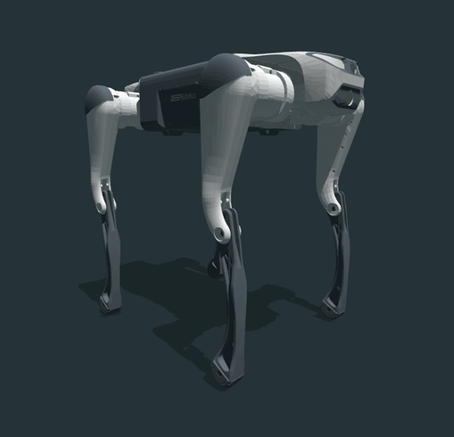
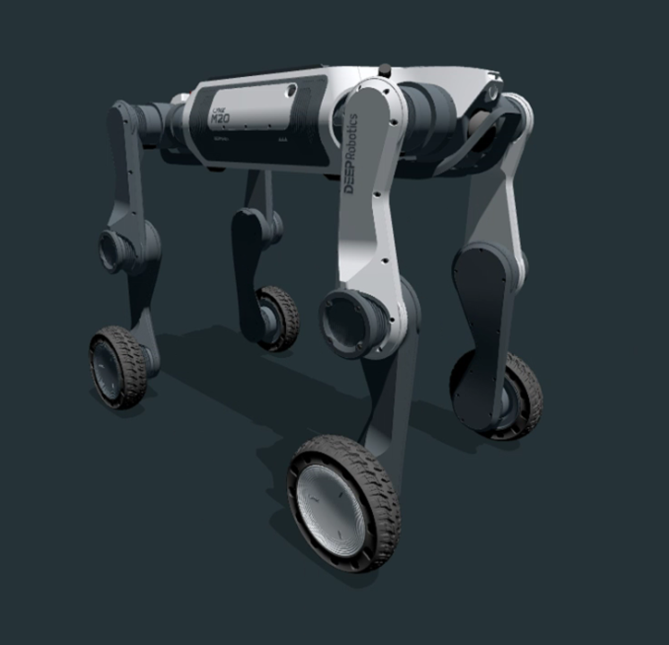

# rl_training

[](https://docs.omniverse.nvidia.com/isaacsim/latest/overview.html)
[](https://isaac-sim.github.io/IsaacLab)
[](https://github.com/leggedrobotics/rsl_rl)
[](https://discord.gg/gdM9mQutC8)
[](https://docs.python.org/3/whatsnew/3.11.html)
[](https://releases.ubuntu.com/22.04/)
[](https://opensource.org/license/bsd-3-clause)

## Tutorial Videos
We've released the following tutorials for training and deploying a reinforcement learning policy. Please check it out on [Bilibili](https://b23.tv/UoIqsFn) or [YouTube](https://youtube.com/playlist?list=PLy9YHJvMnjO0X4tx_NTWugTUMJXUrOgFH&si=pjUGF5PbFf3tGLFz)! 

## Overview

**rl_training** is a RL training library for deeprobotics robots, based on IsaacLab. The table below lists all available environments:

| Robot Model         | Environment Name (ID)                                      | Screenshot |
|---------------------|------------------------------------------------------------|------------|
| [Deeprobotics Lite3](https://www.deeprobotics.cn/robot/index/product1.html) | Rough-Deeprobotics-Lite3-v0 | 
| [Deeprobotics M20](https://www.deeprobotics.cn/robot/index/lynx.html) | Rough-Deeprobotics-M20-v0 | 

> [!NOTE]
> If you want to deploy policies in mujoco or real robots, please use the corresponding deploy repo in [Deep Robotics Github Center](https://github.com/DeepRoboticsLab).
## Contribution 

Everyone is welcome to contribute to this repo. If you discover a bug or optimize our training config, just submit a pull request and we will look into it.
## Installation

- Install Isaac Lab by following the [installation guide](https://isaac-sim.github.io/IsaacLab/main/source/setup/installation/index.html). We recommend using the conda installation as it simplifies calling Python scripts from the terminal.

- Clone this repository separately from the Isaac Lab installation (i.e. outside the `IsaacLab` directory):

  ```bash
  git clone --recurse-submodules https://github.com/DeepRoboticsLab/rl_training.git
  ```

- Using a python interpreter that has Isaac Lab installed, install the library

  ```bash
  python -m pip install -e source/rl_training
  ```

- Verify that the extension is correctly installed by running the following command to print all the available environments in the extension:

  ```bash
  python scripts/tools/list_envs.py
  ```

<details>

<summary>Setup as Omniverse Extension (Optional, click to expand)</summary>

We provide an example UI extension that will load upon enabling your extension defined in `source/rl_training/rl_training/ui_extension_example.py`.

To enable your extension, follow these steps:

1. **Add the search path of your repository** to the extension manager:
    - Navigate to the extension manager using `Window` -> `Extensions`.
    - Click on the **Hamburger Icon** (☰), then go to `Settings`.
    - In the `Extension Search Paths`, enter the absolute path to `rl_trainingb/source`
    - If not already present, in the `Extension Search Paths`, enter the path that leads to Isaac Lab's extension directory directory (`IsaacLab/source`)
    - Click on the **Hamburger Icon** (☰), then click `Refresh`.

2. **Search and enable your extension**:
    - Find your extension under the `Third Party` category.
    - Toggle it to enable your extension.

</details>

## Try examples

Deeprobotics Lite3:

```bash
# Train
python scripts/reinforcement_learning/rsl_rl/train.py --task=Rough-Deeprobotics-Lite3-v0 --headless

# Play
python scripts/reinforcement_learning/rsl_rl/play.py --task=Rough-Deeprobotics-Lite3-v0 --num_envs=10
```

Deeprobotics M20:

```bash
# Train
python scripts/reinforcement_learning/rsl_rl/train.py --task=Rough-Deeprobotics-M20-v0 --headless

# Play
python scripts/reinforcement_learning/rsl_rl/play.py --task=Rough-Deeprobotics-M20-v0 --num_envs=10
```

> [!NOTE]
> If you want to control a **SINGLE ROBOT** with the keyboard during playback, add `--keyboard` at the end of the play script.
>
> ```
> Key bindings:
> ====================== ========================= ========================
> Command                Key (+ve axis)            Key (-ve axis)
> ====================== ========================= ========================
> Move along x-axis      Numpad 8 / Arrow Up       Numpad 2 / Arrow Down
> Move along y-axis      Numpad 4 / Arrow Right    Numpad 6 / Arrow Left
> Rotate along z-axis    Numpad 7 / Z              Numpad 9 / X
> ====================== ========================= ========================
> ```
* Record video of a trained agent (requires installing `ffmpeg`), add `--video --video_length 200`
* Play/Train with 32 environments, add `--num_envs 32`
* Play on specific folder or checkpoint, add `--load_run run_folder_name --checkpoint model.pt`
* Resume training from folder or checkpoint, add `--resume --load_run run_folder_name --checkpoint model.pt`

## Lite3 online terrain adaptation (simulation only)

> [!WARNING]
> This workflow is currently for Isaac Lab simulation only. It does **not** authorize unprotected online
> exploration on a real Lite3. A real-robot deployment must add an independently validated hardware safety
> controller, emergency stop, operator supervision, timing watchdogs, and staged low-energy testing. The online
> residual policy uses proprioception only; height scans and cameras are not Actor inputs.

The demonstration keeps the PPO locomotion policy frozen and trains only a bounded residual SAC policy. Source
pretraining explicitly rejects boxes and stairs. Evaluation is one continuous pass from a 3 m flat prefix into a
held-out box-height track, with no automatic reset after a fall.

First qualify the base PPO checkpoint on source terrains:

```bash
BASE_CHECKPOINT=logs/rsl_rl/deeprobotics_lite3_rough/2026-07-24_14-42-38/model_20.pt
python scripts/reinforcement_learning/online_adaptation/qualify_base_policy.py \
  --base-checkpoint "$BASE_CHECKPOINT" --headless \
  --output logs/online_adaptation/base_qualification.json
```

Only after qualification passes, pretrain the residual on the source-only task:

```bash
python scripts/reinforcement_learning/online_adaptation/train_residual_sac.py \
  --base-checkpoint "$BASE_CHECKPOINT" \
  --task OnlineAdapt-Deeprobotics-Lite3-v0 \
  --num-envs 1024 --headless \
  --log-dir logs/online_adaptation/lite3_source
```

Run the three held-out modes with the same seed and command:

```bash
RESIDUAL_CHECKPOINT=logs/online_adaptation/lite3_source/latest.pt

python scripts/reinforcement_learning/online_adaptation/play_online_adaptation.py \
  --base-checkpoint "$BASE_CHECKPOINT" --mode base --seed 7 --headless \
  --run-dir logs/online_adaptation/demo/base

python scripts/reinforcement_learning/online_adaptation/play_online_adaptation.py \
  --base-checkpoint "$BASE_CHECKPOINT" --residual-checkpoint "$RESIDUAL_CHECKPOINT" \
  --mode residual_frozen --seed 7 --headless \
  --run-dir logs/online_adaptation/demo/residual_frozen

python scripts/reinforcement_learning/online_adaptation/play_online_adaptation.py \
  --base-checkpoint "$BASE_CHECKPOINT" --residual-checkpoint "$RESIDUAL_CHECKPOINT" \
  --mode online --seed 7 --headless --video \
  --run-dir logs/online_adaptation/demo/online
```

Run the required ten-seed comparison:

```bash
python scripts/reinforcement_learning/online_adaptation/compare_online_adaptation.py \
  --base-checkpoint "$BASE_CHECKPOINT" --residual-checkpoint "$RESIDUAL_CHECKPOINT" \
  --seeds 7 11 19 23 31 43 59 71 83 97 --max-steps 1750 --headless --video \
  --output-dir logs/online_adaptation/heldout_10_seed
```

Pretraining checkpoints and TensorBoard events are written below the selected `--log-dir`. Each demonstration
directory contains `metrics.jsonl`, `summary.json`, `config.json`, `residual_before.pt`, `residual_after.pt`,
TensorBoard events, and optional `videos/`. Comparison output contains `comparison.csv`, `comparison.json`,
`comparison.md`, and velocity, tilt, and success-rate plots. Safety projection limits residual HipX actions to
0.24, HipY/Knee actions to 0.20, limits per-step residual change, clamps physical joint targets with a 0.02 rad
margin, pauses on excessive tilt/low height/high joint speed/non-foot contact/control timeout, and requires a stable
window before resuming adaptation.

## Multi-gpu acceleration
* To train with multiple GPUs, use the following command, where --nproc_per_node represents the number of available GPUs:
    ```bash
    python -m torch.distributed.run --nnodes=1 --nproc_per_node=2 scripts/reinforcement_learning/rsl_rl/train.py --task=<ENV_NAME> --headless 
    python -m torch.distributed.run --nnodes=1 --nproc_per_node=2 scripts/reinforcement_learning/rsl_rl/train.py --task=Rough-Deeprobotics-Lite3-v0 --headless --distributed --num_envs=2048
    ```
* Note: each gpu will have the same number of envs specified in the config, to use the previous total number of envs, devide it by the number of gpus.
* To scale up training beyond multiple GPUs on a single machine, it is also possible to train across multiple nodes. To train across multiple nodes/machines, it is required to launch an individual process on each node.

    For the master node, use the following command, where --nproc_per_node represents the number of available GPUs, and --nnodes represents the number of nodes:
    ```bash
    python -m torch.distributed.run --nproc_per_node=2 --nnodes=2 --node_rank=0 --rdzv_id=123 --rdzv_backend=c10d --rdzv_endpoint=localhost:5555 scripts/reinforcement_learning/rsl_rl/train.py --task=<ENV_NAME> --headless --distributed
    ```
    Note that the port (`5555`) can be replaced with any other available port.
    For non-master nodes, use the following command, replacing `--node_rank` with the index of each machine:
    ```bash
    python -m torch.distributed.run --nproc_per_node=2 --nnodes=2 --node_rank=1 --rdzv_id=123 --rdzv_backend=c10d --rdzv_endpoint=ip_of_master_machine:5555 scripts/reinforcement_learning/rsl_rl/train.py --task=<ENV_NAME> --headless --distributed
    ```

## Tensorboard

To view tensorboard, run:

```bash
tensorboard --logdir=logs
```

## Export Policy to ONNX (without Isaac Sim)

Export a trained checkpoint to ONNX directly from the `.pt` file — no Isaac Sim or environment setup required:

```bash
# Lite3
python scripts/tools/export_onnx_fast.py \
    --checkpoint_path logs/rsl_rl/deeprobotics_lite3_rough/<run>/model_5000.pt \
    --robot lite3 \
    --output_path exported/lite3_policy.onnx

# M20
python scripts/tools/export_onnx_fast.py \
    --checkpoint_path logs/rsl_rl/deeprobotics_m20_rough/<run>/model_5000.pt \
    --robot m20 \
    --output_path exported/m20_policy.onnx
```

Robot metadata (joint names, stiffness/damping, default positions, action scales) is embedded in the ONNX file as model properties. Add `--no_metadata` to skip this.

## Compare Training Runs

Diff the `agent.yaml` and `env.yaml` configs between two runs (saved automatically to `params/` by `train.py`):

```bash
python scripts/tools/compare_runs.py \
    logs/rsl_rl/deeprobotics_lite3_rough/<run1> \
    logs/rsl_rl/deeprobotics_lite3_rough/<run2>
```

## Troubleshooting

### Pylance Missing Indexing of Extensions

In some VsCode versions, the indexing of part of the extensions is missing. In this case, add the path to your extension in `.vscode/settings.json` under the key `"python.analysis.extraPaths"`.

**Note: Replace `<path-to-isaac-lab>` with your own IsaacLab path.**

```json
{
    "python.languageServer": "Pylance",
    "python.analysis.extraPaths": [
        "${workspaceFolder}/source/rl_training",
        "/<path-to-isaac-lab>/source/isaaclab",
        "/<path-to-isaac-lab>/source/isaaclab_assets",
        "/<path-to-isaac-lab>/source/isaaclab_mimic",
        "/<path-to-isaac-lab>/source/isaaclab_rl",
        "/<path-to-isaac-lab>/source/isaaclab_tasks",
    ]
}
```

### Clean USD Caches

Temporary USD files are generated in `/tmp/IsaacLab/usd_{date}_{time}_{random}` during simulation runs. These files can consume significant disk space and can be cleaned by:

```bash
rm -rf /tmp/IsaacLab/usd_*
```

## Acknowledgements

The project uses some code from the following open-source code repositories:

- [fan-ziqi/robot_lab](https://github.com/fan-ziqi/robot_lab)
