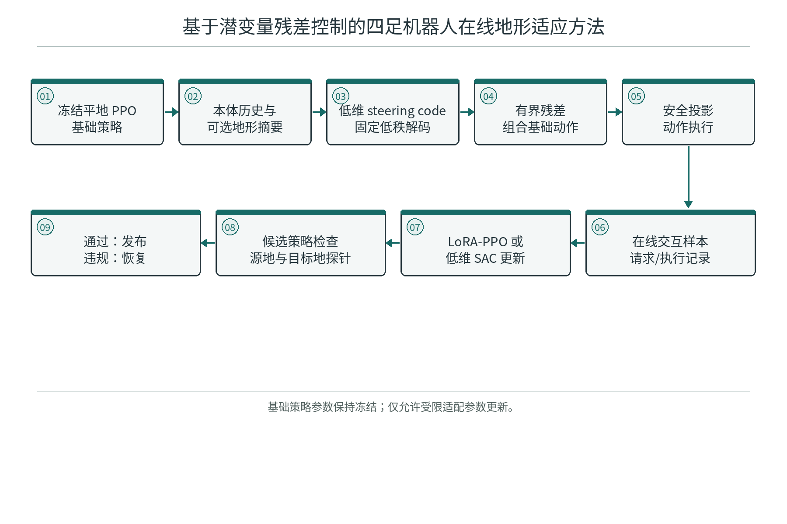
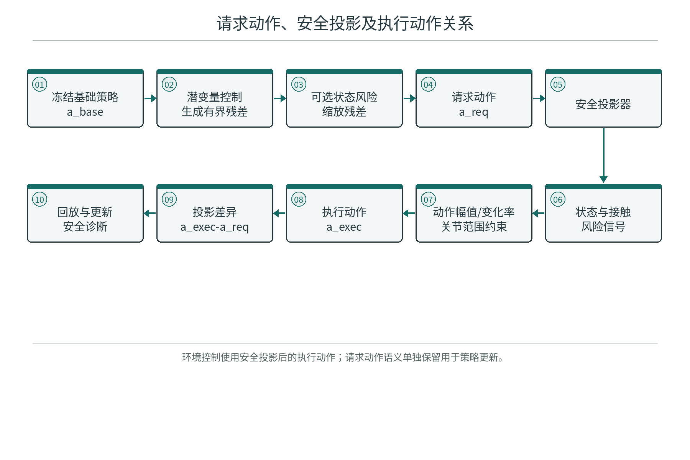
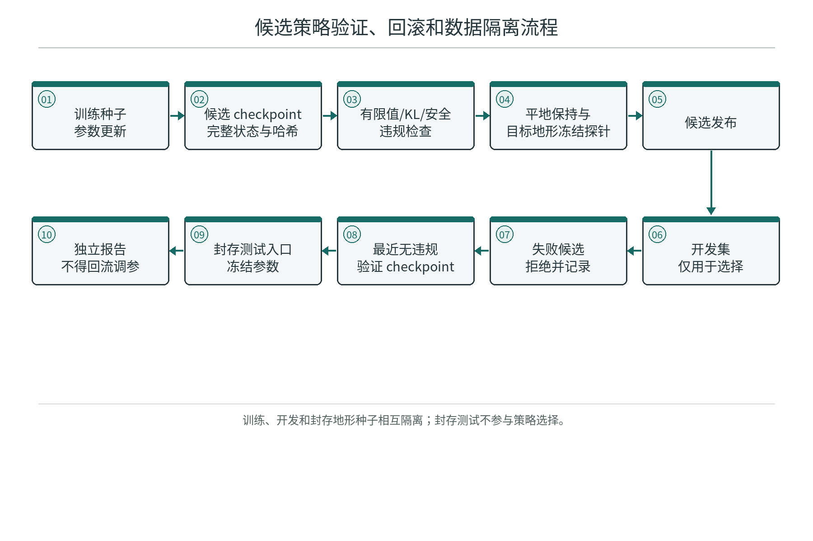

# 说 明 书 摘 要

本发明公开一种基于潜变量残差控制的四足机器人在线地形适应方法、系统、设备及存储介质。该方法冻结源平地基础策略，通过本体感知历史、积分上下文及可选地形摘要生成低维控制码，经低秩解码得到受幅值和变化率约束的关节残差，并与基础策略动作组合。系统将请求动作经安全投影后执行，分别记录请求动作、执行动作及其差异，并利用交互数据更新受限适配模块；候选策略经源平地保持、目标地形冻结验证和安全违规检查后发布，发生违规时恢复最近一次通过验证的检查点。可选地，系统根据姿态、机身高度、关节速度和非足接触状态形成有界状态风险值，线性缩小残差包络，并在硬安全暂停时将残差置零。本方法通过受限潜变量残差和候选策略验证回滚，实现四足机器人在线地形适应并提高过程可追溯性。

# 摘 要 附 图

{width=90%}

# 权 利 要 求 书

**1、**一种面向四足机器人的在线地形适应方法，其特征在于，包括：

加载在源平地上训练得到的基础运动策略，并冻结所述基础运动策略的原始网络权重；

采集四足机器人在目标地形中的本体感知信息，并构造包含机身姿态、关节状态、速度指令、上一时刻执行动作和接触状态的时序观测；

基于所述时序观测计算本体积分上下文和地形潜变量；

在所述基础运动策略的至少一个线性层中注入低秩参数增量，由所述低秩参数增量和所述地形潜变量生成候选动作；

将候选动作输入安全投影器，得到受残差幅值、变化率、关节范围和接触保护约束的执行动作；

分别记录候选请求动作和执行动作，并利用在线交互奖励及所述请求动作与执行动作之间的差异更新低秩参数和价值估计模块；以及

对更新形成的候选策略执行源平地保持验证、目标地形冻结验证和安全违规检查，仅发布通过验证的候选策略；候选策略发生安全违规时，恢复最近一次无安全违规且通过冻结验证的策略检查点。

**2、**根据权利要求 1 所述的方法，其特征在于，所述低秩参数增量满足：

$$
\Delta W_i=\frac{\alpha_i}{r}B_iA_i,
$$

其中基础权重保持冻结，且矩阵 $B_i$ 在适配初始化时为零，使适配策略的初始确定性输出与源平地策略一致。

**3、**根据权利要求 1 所述的方法，其特征在于，所述在线更新采用 clipped PPO，使用同一策略版本采集的连续 rollout，区分真实终止和时间截断，并使用终止前的末帧状态计算价值引导。

**4、**根据权利要求 1 所述的方法，其特征在于，所述本体积分上下文由机身坐标系平面速度和偏航角速度进行中点积分得到，并包括估计航向正弦量、航向余弦偏差和归一化累计横移量；环境终止时先保存终止前上下文，再清零积分器。

**5、**根据权利要求 1 所述的方法，其特征在于，所述地形潜变量由本体历史和高度扫描摘要共同生成，所述高度扫描摘要至少包括扫描有效率、最小高度、最大高度、平均高度、标准差、前后区域差和左右区域差中的一种或多种。

**6、**根据权利要求 1 所述的方法，其特征在于，在启用状态风险缩放时，分别根据机身姿态偏差、机身高度、关节速度和非足接触状态计算归一化风险分量，取所述风险分量的最大值作为状态风险值，并根据所述状态风险值按照有界线性函数缩小残差包络；在硬安全暂停或控制超时时将适应残差置零，所述状态风险值不依赖价值网络不确定性。

**7、**根据权利要求 1 所述的方法，其特征在于，所述请求动作和执行动作之间的差异被写入交互样本，并用于计算安全投影惩罚、过滤无效样本或拒绝超过投影差异阈值的候选更新；策略概率和请求动作价值保持以请求动作作为动作语义。

**8、**根据权利要求 1 所述的方法，其特征在于，所述候选策略的验收还包括与冻结源策略或固定地形教师的动作均方误差约束，以及近似 KL 散度、参数有限值和参数幅值约束。

**9、**根据权利要求 1 所述的方法，其特征在于，训练期发生安全违规的候选策略不得因后续冻结探针通过而成为恢复检查点，恢复操作同时恢复 Actor、Critic、Actor 优化器和 Critic 优化器状态，并更新恢复检查点校验哈希。

**10、**根据权利要求 1 所述的方法，其特征在于，所述地形潜变量被映射到低维 tanh steering code，所述 steering code 经固定解码矩阵映射为多关节残差，且所述多关节残差的每一维不超过基础动作限幅的预设比例。

**11、**根据权利要求 10 所述的方法，其特征在于，所述固定解码矩阵由按各关节动作限幅归一化的教师残差样本通过截断奇异值分解拟合得到，并与有界 code target、重构误差、解释方差、动作限幅和数据来源元数据绑定保存；或者利用具有特权地形信息的教师动作求解潜变量反演目标：

$$
u^*=\arg\min_u\|a_{teacher}-a(u,o)\|_2^2+\beta\|u\|_2^2,
$$

并用得到的潜变量作为本体历史和高度扫描编码器的监督目标。

**12、**根据权利要求 1 所述的方法，其特征在于，训练地形、开发验证地形和封存测试地形使用不相交的地形种子，封存测试关闭参数更新且不修改训练状态、不参与候选策略选择。

**13、**一种四足机器人在线地形适应系统，其特征在于，包括：基础策略模块、观测与积分上下文模块、地形编码模块、低秩适配模块、残差控制模块、安全投影模块、在线更新模块、候选验证模块以及检查点发布和回滚模块；其中各模块被配置为执行权利要求 1 至 12 任一项所述的方法，所述系统还可包括用于执行可选状态风险缩放的安全状态评估模块。

**14、**一种计算机可读存储介质，其上存储有计算机程序，所述计算机程序在处理器上运行时，使所述处理器执行权利要求 1 至 12 任一项所述的方法。

**15、**一种四足机器人控制设备，包括处理器、存储器、传感器接口和执行器接口，其特征在于，所述存储器中存储有程序，所述程序被处理器执行时使所述设备执行权利要求 1 至 12 任一项所述的方法。

# 说 明 书

## 一种基于潜变量残差控制的四足机器人在线地形适应方法

### 技术领域

本发明涉及四足机器人运动控制、强化学习和机器人在线适应技术领域，具体涉及一种以平地运动策略为基础，在机器人进入未见地形后利用本体感知历史和可选地形特征生成低维适应变量，通过低维残差控制、请求动作与执行动作一致性处理以及候选策略验证和回滚实现在线地形适应的方法。

### 背景技术

四足机器人通常先在平地或大规模仿真地形上训练运动策略，再将策略用于崎岖地形。固定策略在未见地形上可能出现横向偏移、足端接触异常、速度跟踪误差增大和跌倒等问题。直接更新完整策略网络会破坏已经获得的站立、支撑转换和速度跟踪能力；直接学习全维关节残差又容易产生动作突变，并且策略请求动作经过限幅、变化率限制、关节投影和安全保护后，实际执行动作可能与策略训练所使用的动作不同。

现有在线强化学习方法还存在以下问题：一是没有同时约束目标地形适应能力和源平地能力；二是缺少对请求动作与执行动作差异的显式建模；三是候选策略发生安全违规后，仍可能因后续冻结探针暂时通过而被错误晋升；四是多回合续训、开发场景选择和正式测试容易发生数据泄漏，难以判断是否获得了可重复的新技能。

因此，需要一种在不大范围修改基础策略的前提下，利用有限权限进行地形适应，并在风险升高或候选验证失败时自动减小适应幅度、暂停更新或恢复已验证策略的技术方案。

### 发明内容

#### 发明目的

本发明的目的在于提供一种基于潜变量残差控制的四足机器人在线地形适应方法，以解决四足机器人从平地策略进入未见地形后，适应过程易造成源技能退化、请求动作与执行动作不一致、候选策略安全性难以管理以及测试结果难以复核的问题。

本发明至少实现以下技术效果：

1. 冻结平地基础策略，仅允许低秩适配参数和地形适应模块更新，降低策略漂移范围；
2. 利用本体速度、机身角速度、接触状态及可选高度扫描构造地形上下文，不依赖世界位置、世界偏航角或预先知道的地形标签；
3. 在低维潜变量空间中产生残差控制量，限制残差的幅值、相邻控制周期变化率和关节目标范围；
4. 通过残差幅值、变化率和关节目标范围限制适应动作；在启用状态风险缩放时，根据姿态、机身高度、关节速度和非足接触形成有界残差包络，并在硬安全暂停时将残差置零；
5. 将请求动作经安全投影后的执行动作、投影差异和安全状态写入交互样本，用于惩罚或拒绝与实际执行不一致的候选更新；
6. 只有通过源平地保持、目标地形冻结探针和安全约束的候选策略才能成为恢复检查点或正式测试策略；
7. 对开发验证、续训验证、恢复验证和封存测试进行隔离，避免利用测试结果反向选择策略。

#### 技术方案

### 5.1 总体流程

本发明方法包括以下步骤：

S1、加载平地基础策略。获取已经在平地训练的四足机器人策略 $\pi_0$，冻结所述基础策略的原始权重，并初始化低秩适配参数、地形编码器、低维 steering code 模块和独立价值估计模块。

S2、采集本体感知和地形信息。在每个控制周期采集机身角速度、机身坐标系投影重力、关节相对位置、关节速度、上一时刻执行动作、速度指令、足端接触状态和可选地形高度扫描。对连续控制周期的本体观测进行缓存。

S3、计算积分上下文和地形潜变量。根据机身坐标系平面速度和偏航角速度进行中点积分，得到估计航向和累计横移上下文；将本体历史、积分上下文和高度扫描摘要输入地形编码器，得到潜变量 $z_t$，再由 steering 模块得到低维控制码 $u_t$。

S4、生成低秩适配动作。对基础策略的一个或多个线性层注入低秩增量：

$$
W_i=W_{i,0}+\frac{\alpha_i}{r}B_iA_i,
$$

其中 $W_{i,0}$ 为冻结的基础权重，$A_i$ 和 $B_i$ 为可训练矩阵，$r$ 为低秩维度。通过 $z_t$ 或 $u_t$ 调节低秩残差，得到候选动作：

$$
a_t^{req}=\pi_{W_0+\Delta W(u_t)}(o_t).
$$

当使用直接 LoRA-PPO 实施方式时，$u_t$ 可省略，低秩参数直接由在线 PPO 更新；当使用潜变量残差实施方式时，低秩模块或固定解码器根据 $u_t$ 产生有界残差：

$$
a_t^{cand}=a_t^0+\lambda_tD\tanh(u_tD_d),
$$

其中 $a_t^0=\pi_0(o_t)$，$D$ 为逐关节残差尺度，$D_d$ 为解码矩阵；$\lambda_t$ 为可选的状态风险缩放系数，未启用该功能时取 1。

S5、可选的状态风险缩放和硬安全暂停。启用状态风险缩放时，根据机身姿态、机身高度、关节速度和非足接触状态分别计算归一化分量 $q_{tilt},q_{height},q_{vel},q_{contact}\in[0,1]$，并取其最大值作为状态风险值：

$$
q_t=\max(q_{tilt},q_{height},q_{vel},q_{contact}).
$$

残差包络系数按有界线性关系计算：

$$
\lambda_t=1-(1-\lambda_{min})q_t,\qquad \lambda_{min}\leq\lambda_t\leq1.
$$

其中 $\lambda_{min}$ 为预设的最小缩放系数。当姿态、机身高度、关节速度或持续非足接触达到硬安全暂停条件，或者发生控制超时时，将适应残差置零；达到连续稳定步数后解除暂停。该状态风险缩放为可选安全机制，风险值不由价值网络不确定性或高度扫描有效率计算。独立于该可选缩放，安全投影仍对动作幅值、变化率、关节范围及异常接触进行约束。

S6、安全投影和动作执行。将候选动作输入安全投影算子：

$$
a_t^{exec}=\mathcal P_{safe}(a_t^{cand}),
$$

所述安全投影至少包括动作幅值限制、相邻控制周期变化率限制、关节目标范围限制和异常接触保护。控制器向执行器发送 $a_t^{exec}$，而不是未经保护的候选动作。

S7、构造请求/执行一致性样本。分别记录 $a_t^{req}$、$a_t^{exec}$、$a_t^{exec}-a_t^{req}$、风险值、投影原因、终止标记、截断标记和策略版本。将实际执行动作用于环境转移和安全诊断；策略概率或请求动作价值定义仍对应请求动作，避免将投影后的动作错误代回请求分布。

S8、在线更新。对于 LoRA-PPO 实施方式，仅使用同一策略版本的连续 rollout，依据奖励、末帧价值和 GAE 计算优势，采用 clipped PPO 目标更新低秩参数和独立 Critic；对于 latent-SAC 实施方式，在低维控制码或其低秩解码空间中更新 Actor 和双 Critic。更新目标包括策略目标、价值目标、源平地行为锚定、潜变量范数/变化率约束和请求/执行投影差异惩罚。

S9、候选验收、发布和回滚。更新后形成候选策略，并依次执行有限值检查、参数范围检查、近似 KL 检查、源平地动作均方误差检查、目标地形冻结探针和安全违规检查。候选只有在所有预设条件满足时才发布。若候选在训练期间产生安全违规，则即使其后续冻结探针通过，也不得将其晋升为恢复检查点；系统恢复最近一次冻结验证通过且无安全违规的检查点，并同步策略、Critic、优化器状态和校验哈希。

S10、隔离开发和封存测试。训练场景、开发场景和封存测试场景使用不相交的地形种子和初始条件。封存测试入口只接收预先选定的 checkpoint，关闭更新，不修改训练状态，不参与模型选择，并输出独立测试清单、协议哈希、checkpoint 哈希和逐场景结果。

### 5.2 本体上下文实施方式

在一种实施方式中，基础 Actor 接收 45 维观测，适配 Actor 额外接收 3 维积分上下文，Critic 接收基础观测、机身平面速度、时间进度和积分上下文。积分上下文包括估计航向的正弦量、航向余弦偏差和归一化累计横移量。积分器在环境终止时先保存终止前状态，再清零，防止复位后的新初态污染终止样本。

### 5.3 高度扫描和低维解码实施方式

在另一种实施方式中，高度扫描器采集固定网格的地形射线结果，并压缩为有效率、最小值、最大值、均值、标准差、前后区域差和左右区域差等统计量。高度扫描无效时将其置零并禁止该步进入适应回放。低维 steering code 通过固定解码矩阵映射到 12 维归一化关节残差，残差上限为基础动作限幅的一定比例。

### 5.4 离线教师低秩解码器实施方式

在一种已实现的离线初始化实施方式中，收集带有动作限幅、基础策略标识、协议标识、地形划分和安全掩码的教师残差样本，将残差按各关节动作限幅归一化，并通过截断奇异值分解拟合固定的低秩解码矩阵。由该解码矩阵生成有界的低维 code target，同时保存重构误差、解释方差、动作限幅和数据来源元数据。解码器文件写入后保持不可变，加载时校验解码器维度、动作限幅、code target 及来源信息；封存测试种子不得写入该教师数据集。

在另一种可选实施方式中，使用具有特权地形信息的教师动作作为监督目标，在不更新基础策略权重的情况下求解：

$$
u^*=\arg\min_u\|a_{teacher}-a(u,o)\|_2^2+\beta\|u\|_2^2.
$$

将 $(o,u^*)$ 写入教师监督缓冲区，训练本体历史/高度扫描编码器预测 steering code。监督训练仅更新编码器和 steering actor 的观测路径，固定解码器不参与梯度更新。该实施方式借鉴潜变量动作反演思想，但不要求将本发明限定为特定 flow 或 diffusion policy；教师数据、人工纠正数据和自主交互数据分别登记来源及成本。

#### 有益效果

与直接在线更新完整策略或直接学习无约束全维残差相比，本发明具有以下效果：

1. 通过冻结基础权重和低秩更新降低策略漂移；
2. 通过本体历史、积分上下文和高度扫描提供对横向偏移、接触变化和地形几何的补充感知；
3. 通过低维残差约束、安全投影和可选状态风险缩放，限制适应动作的幅值及变化；
4. 通过请求/执行动作分离，避免动作投影造成的训练对象不一致；
5. 通过候选拒绝、冻结探针和无违规恢复检查点，防止不安全策略被错误发布；
6. 通过开发/封存隔离提高在线学习结果的可复核性。

本项目现有代码已实现直接 LoRA-PPO、source-flat/terrain anchor、请求/执行动作记录、候选拒绝、策略回滚、终止前状态捕获、3 维本体积分上下文、第一版低维 latent-SAC 接口以及离线教师残差的固定低秩解码器和编码器监督接口。特权教师轨迹采集、完整动作反演数据集、真实高度扫描编码器训练和 RGLS 端到端性能仍属于后续实施方式，不能将其尚未完成的性能写成既有实验结果。

### 附图说明

图 1 为本发明在线地形适应系统的总体流程图，包括基础策略、本体上下文、低秩适配、残差控制、安全投影、在线更新和候选发布模块。

图 2 为本发明请求动作、执行动作和安全投影差异的控制流程图。

图 3 为本发明候选策略验证、恢复检查点和封存测试的数据隔离流程图。

### 具体实施方式

以下结合附图和实施例对本发明作进一步说明。以下实施例用于解释本发明，不构成对保护范围的限定。

实施例 1：直接 LoRA-PPO。加载平地 PPO Actor，在四个线性层中注入 rank=2 的 LoRA，原始权重冻结，LoRA 矩阵采用 $B=0$ 初始化。机器人在 rough terrain 上以 50 Hz 控制，rollout 达到设定长度后执行两轮 clipped PPO 更新；当发生严重非足接触或候选超过 KL/行为锚定阈值时，恢复上一稳定 checkpoint。

实施例 2：本体积分上下文 LoRA-PPO。基础 Actor 使用 45 维输入，适配 Actor 输入增加 3 维本体积分上下文。上下文由机身平面速度和偏航角速度中点积分得到，不读取世界位置和地形标签。候选策略在源平地和目标地形分别进行冻结检查。

实施例 3：固定地形教师约束。加载实验初始时登记的固定教师 checkpoint，对当前有效 rollout 观测计算教师动作均值，加入动作均方误差约束并设置候选上限。教师 checkpoint 不随续训 checkpoint 改写；当候选超过上限时，原子恢复 Actor、Critic 和两个优化器状态。

实施例 4：潜变量残差控制及可选状态风险缩放。本体历史和可用的地形摘要经编码器生成低维潜变量，steering 模块生成低维控制码，再经固定低秩解码映射为多关节残差，残差各维限制在基础动作限幅的预设比例内。启用状态风险缩放时，根据机身姿态偏差、机身高度、关节速度和非足接触状态分别计算归一化风险分量，取最大值形成状态风险值，并按预设的有界线性函数缩小残差包络；触发硬安全暂停时将残差置零。未启用状态风险缩放时，缩放系数取 1。低秩解码器可由经登记的教师残差数据拟合，也可采用固定解码矩阵。

实施例 5：安全候选发布。每个候选策略记录代码版本、基础 checkpoint 哈希、协议哈希、适配器哈希、策略版本、训练回合、探针结果、flat-retention 结果和安全违规记录。发生训练期安全违规时，候选不得晋升为 recovery checkpoint，系统恢复最近的无违规冻结验证 checkpoint；封存测试只读取预先选定 checkpoint。

### 实现状态及实施边界

本项目当前实现包括直接 LoRA-PPO、source-flat/terrain anchor、请求动作与执行动作记录、候选拒绝和策略回滚、终止前状态捕获、3 维本体积分上下文、第一版低维 latent-SAC 接口，以及离线教师残差固定低秩解码器和编码器监督接口。真实特权教师轨迹采集、完整动作反演数据集、以高度扫描作为策略 Actor 输入的编码器训练，以及 RGLS 端到端性能验证尚未完成。本说明书将这些内容作为可选实施方式描述，不将其表述为已经取得的项目实验结果。

FlowDAgger 的潜空间动作反演思想可用于设计教师动作到低维 steering code 的监督过程；本项目基础控制策略为 PPO，不是 flow 或 diffusion policy，因此本方案不称为 FlowDAgger，也不主张复现 FlowDAgger。

# 说 明 书 附 图

{width=92%}

# 说 明 书 附 图（续）

{width=92%}

{width=92%}
