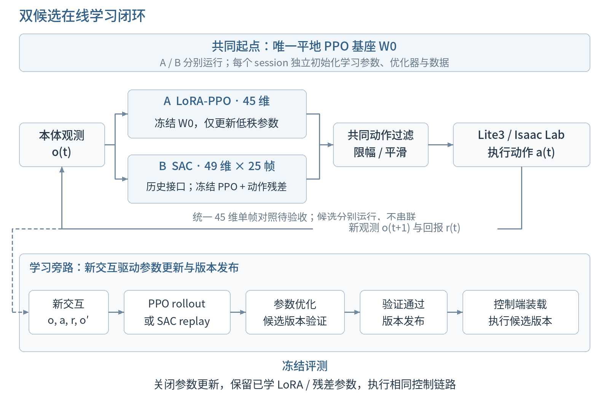
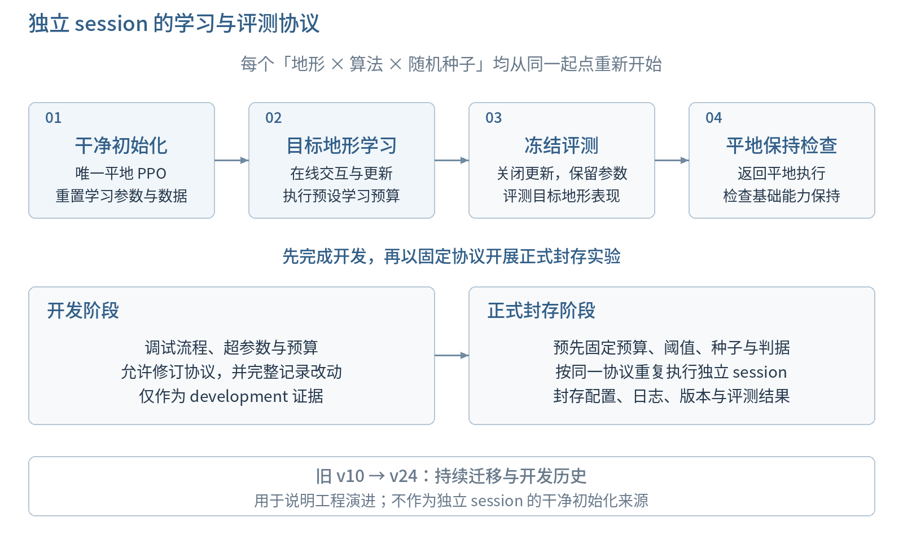
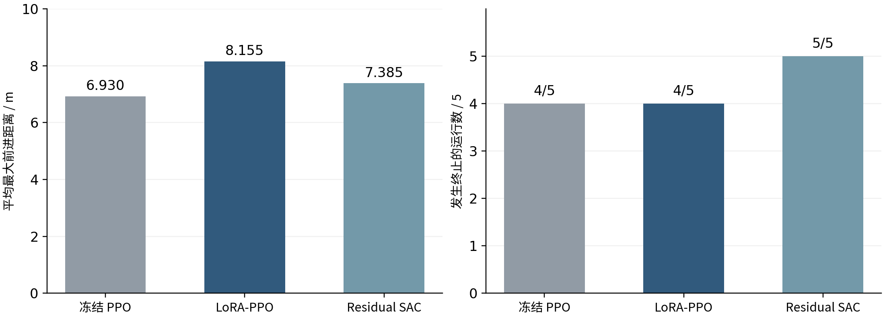

# 1　项目概述

## 1.1　项目摘要

### 1.1.1　研究目标

本研究面向四足机器人在陌生地形中的运动控制，关注一个具体问题：**仅以一个在平地训练得到的运动策略为初始技能，机器人能否通过运行期间的交互，逐步获得新的地形通过能力，并保留原有平地行走能力？** 研究平台为云深处 Lite3 四足机器人，当前实验在 Isaac Lab 仿真环境中开展。

这一问题包含两个相互关联的要求。首先，初始策略只提供平地运动技能，不能在进入目标地形之前加载复杂地形专家、目标地形成功轨迹或已经适应过该地形的控制器。其次，控制器需要把目标环境中的新交互转化为有效的参数更新，使能力变化能够在停止学习后继续保留。运行时改变动作、梯度发生变化和偶尔跨过障碍，分别对应不同层次的现象，仍需通过统一评测判断是否真正获得了新能力。

本项目采用“保留基础技能、限制在线修改”的技术路线。基础策略来自现有平地 PPO 模型；在线学习分别通过低秩参数适配和动作残差两种方式改变控制行为。前者在原 Actor 的线性层中加入 LoRA 参数并执行在线 PPO 更新，后者冻结原策略，使用 SAC 学习附加动作修正。两条路线共享基础模型和机器人平台，各自形成完整的交互、更新、发布与执行闭环。

研究目标不仅是提高陌生地形上的前进距离，还包括安全完成、更新后的能力保持、回到平地后的性能保留，以及学习所需的控制步和墙钟成本。本文按照项目概述、研究定位、方法与实现、当前证据与后续验证组织，材料截点为 **2026 年 9 月 18 日**。

### 1.1.2　核心思路

我们把系统中的职责分为三部分：平地基础策略提供已有运动技能；可训练适配模块利用新交互调整行为；动作过滤、参数验证和版本回滚约束更新如何进入实际控制。两种候选分别运行，不在同一次控制中叠加。图 1 给出总体信息流。

这里的“在线学习”指运行期间更新适配参数。对历史观测做前向推断也能产生适应行为，但它与参数更新是不同机制。当前残差路线同时包含历史编码与梯度学习，后续实验需要进一步区分这两部分的作用。

```{=openxml}
<w:p><w:r><w:br w:type="page"/></w:r></w:p>
```

{width=16cm}

用统一符号表示，基础策略为 $\pi_0$，本体观测为 $o_t$，可训练适配参数为 $\theta$。低秩路线直接修改策略映射；残差路线生成相对基础动作的修正：

$$
a_t^{\mathrm{req}}=\pi_{W_0+\Delta W_\theta}(o_t)
\quad\text{或}\quad
a_t^{\mathrm{req}}=a_t^0+\delta_t^{\mathrm{req}},\qquad a_t^0=\pi_0(o_t).\qquad(1)
$$

式（1）概括两类请求动作。随机探索时，动作从对应分布采样；关闭探索时使用确定性输出。请求动作经过状态相关的过滤器 $\mathcal F$ 后，才成为执行动作：

$$
a_t^{\mathrm{exec}}=\mathcal F(s_t,a_t^{\mathrm{req}}),\qquad
s_{t+1}\sim P(\cdot\mid s_t,a_t^{\mathrm{exec}}).\qquad(2)
$$

环境返回新观测与奖励，学习器由此产生候选参数。候选通过检查并发布后，控制端才会使用新版本。因此，“优化器更新过”与“机器人执行过更新后的策略”需要分别记录。冻结评测时关闭优化与探索，保留已学参数，用于判断训练期间出现的行为是否成为可重复的控制能力。

```{=openxml}
<w:p><w:r><w:br w:type="page"/></w:r></w:p>
```

## 1.2　结果与展望

### 1.2.1　初步仿真结果

目前已完成平地 PPO 资产来源核查，以及残差 SAC 和 LoRA-PPO 两条在线学习路线的实现。系统能够采集交互、计算更新、发布策略版本，并在控制过程中执行新参数；同时具有末帧记录、终止与截断区分、动作过滤、参数回滚和检查点恢复等组件。

在相同基础模型、rough\_4cm 地形、速度命令和接触终止协议下，五个开发地形种子的系统对照显示：LoRA-PPO 与残差 SAC 的平均最大前进距离均高于冻结 PPO，后半程速度误差也较低。不过，三组分别有 4/5、4/5、5/5 条运行发生终止，尚未形成稳定安全完成的证据。两条在线路线的输入、奖励细节和运行方式仍存在差异，这些结果用于选择开发方向，不构成纯算法优势结论。

后续多回合实验出现了部分成功案例。最新核查的 LoRA 续训实验完成 100 回合，记录 12 次成功；其开发阶段所选检查点在四个冻结验证场景中通过 2 个。该实验从已有目标地形检查点续训，不能据此声称从干净平地初始化独立学会地形。历史残差实验同样需要保留模型来源、协议变化与评测集使用方式的说明。

表 1：当前进展与能够支持的认识。

| 研究问题 | 已有证据 | 当前认识 |
|:--|:--|:--|
| 初始技能是否来自平地？ | model\_300 → 1499 → 1998 的保存配置为平地训练链 | 可将 model\_1998 作为共同技能起点 |
| 在线更新能否进入控制？ | 两条路线均有更新、版本发布及实际执行记录 | 在线学习工程闭环已建立 |
| 是否改善陌生地形行为？ | 开发对照中距离、速度误差出现正向变化 | 存在值得继续检验的行为改善信号 |
| 是否稳定安全完成？ | 多条运行终止；长程实验和冻结复测仍有失败 | 现有证据不足以确认稳定学会 |
| 是否保留原有技能？ | 已有平地保持测试，也出现过失败 | 需要统一复测与源技能约束 |

### 1.2.2　未来展望

下一阶段将围绕有效探索、参数更新与执行之间的关系，以及能力保持展开。首先补齐相同观测权限和动作规则下的对照，再从同一干净初始化开展独立学习；以固定预算后的冻结表现作为主要终点，配合平地复测与完整失败统计。研究重点由“更新链路可以运行”推进到“哪些更新能够形成可重复、可保留的新技能”。

```{=openxml}
<w:p><w:r><w:br w:type="page"/></w:r></w:p>
```

# 2　研究问题与工作定位

## 2.1　研究问题与联合挑战

平地策略已经包含站立、支撑转换和速度跟踪等基础能力，但地形起伏会改变落足高度、接触时序和可实现的动作范围。机器人可能保持直立却无法前进，也可能通过更激进的动作前进更远，却增加碰撞和跌倒。仅优化回报或位移，不能完整描述控制质量。

本项目同时面对三个挑战。第一，目标地形数据只能在运行中获得，样本规模远小于大规模并行预训练，且许多失败会缩短有效轨迹。第二，动作经过限幅、变化率限制与关节投影后，实际执行可能偏离策略请求；如果价值函数与回放中的动作定义不一致，学习信号就可能对应错误对象。第三，新技能的学习可能破坏基础技能，需要同时观察目标地形收益与平地性能变化。

因此，本文将问题拆为三个递进层次：能否从同一个平地技能起点获得可复核的在线更新；这些更新能否在固定预算内改善目标地形的冻结表现；改善能否跨独立学习重复保持，并且不以严重损失平地能力为代价。

## 2.2　相关技术路线

PPO [1] 和 SAC [2] 分别提供同策略和异策略更新工具；残差强化学习 [3] 为保留基础控制器并学习修正量提供结构依据。RMA [4] 则说明，本体感知历史可以用于估计运行条件；其部署时的前向适应与本项目的部署期梯度更新需要明确区分。离线数据辅助在线学习 [5] 和低秩适配 [6] 分别启发了源数据利用与限制参数修改的设计。

表 2：相关路线与本项目的关系。该表说明机制和问题覆盖，不作性能排名。

| 技术路线 | 主要机制 | 本项目采用或需要区分的部分 |
|:--|:--|:--|
| 大规模并行运动学习 [7] | 在丰富仿真交互中训练运动策略 | 用作平地技能预训练基础 |
| RMA 式历史适应 [4] | 用近期交互估计适应表示 | 启发历史输入；不是当前完整复现 |
| Residual RL [3] | 基础控制器加学习残差 | 对应冻结 PPO 与 SAC 残差结构 |
| 数据辅助在线 RL [5] | 结合源数据和新交互 | 启发双回放与初始化；需检查数据语义 |
| LoRA [6] | 用低秩增量限制可训练权重 | 用于原 PPO Actor 的在线适配 |
| 本项目当前工作 | 平地技能起点、受约束更新、版本执行与复测 | 面向 Lite3 陌生地形学习的系统研究 |

```{=openxml}
<w:p><w:r><w:br w:type="page"/></w:r></w:p>
```

## 2.3　当前定位与贡献边界

本项目当前的工作定位是：建立从唯一平地技能出发的在线地形学习系统，并通过可追溯的交互与评测记录，研究有限修改如何转化为新的运动能力。LoRA、PPO、SAC、历史编码和动作过滤均有已有方法基础，将这些组件组合起来本身不等同于已经形成新的算法贡献。

已有工作的价值主要体现在三个方面：明确初始技能和目标地形经验的来源；让采样、更新、发布、执行与回滚形成可检查的闭环；把目标地形表现和源技能保持放到同一评测流程中。后续若要提出方法贡献，需要围绕探索在动作约束下是否有效、价值估计是否对应请求动作、候选更新如何保持基础技能，提出具体机制并用消融验证。

### 2.3.1　区分三种实验任务

**独立在线学习**要求每个学习过程从相同平地模型、干净适配参数及空目标经验开始。**持续迁移**允许保留前一地形中的参数和经验，再进入新地形。**单回合快速适应**要求首次进入新条件后，在不复位的同一条轨迹内更新并改善表现。三者所需证据不同，不能把多回合续训成功写成首次接触即可适应。

历史 v10 → v24 台阶实验，以及最新从旧检查点开始的 LoRA 续训，属于含目标经验的学习过程。它们能用于分析工程机制和失败原因，但不能替代干净初始化的独立学习主实验。

### 2.3.2　当前比较仍存在的信息差异

表 3：现有系统与拟定统一接口的区别。

| 项目 | LoRA-PPO 当前路线 | Residual SAC 历史路线 |
|:--|:--|:--|
| 策略输入 | 原 PPO 的 45 维单帧 | 49 维本体帧，25 帧历史 |
| 额外信息 | 无新增足端接触历史 | 包含四足接触与时序信息 |
| 修改位置 | 原 Actor 线性层的低秩增量 | 基础动作之外的学习残差 |
| 学习数据 | 当前版本连续 rollout | 平地与在线经验回放 |
| 源策略参数 | 原始权重冻结 | 整个基础 PPO 冻结 |

两类输入的顺序和缩放也不同，不能通过从 49 维向量删去四列来假定与 PPO 输入等价。统一 45 维单帧的 SAC 对照仍需完成接口验收；现有对照应称为“共同地形与终止协议下的系统候选比较”。

```{=openxml}
<w:p><w:r><w:br w:type="page"/></w:r></w:p>
```

# 3　方法与系统实现

## 3.1　机器人平台与平地技能来源

项目使用 Lite3 的 12 个驱动关节，在 Isaac Lab 中构建速度跟踪环境，以 RSL-RL PPO 获得平地技能。物理步长为 0.005 s，控制降采样为 4，对应 0.02 s 控制周期，即 50 Hz 仿真控制频率。这个频率描述仿真时间，不代表包含更新、锁等待和录像的完整程序已经满足真机墙钟实时性。

当前共同起点为 model\_1998。训练链审计核对了 model\_300、model\_1499 和 model\_1998 三轮保存配置，均为平地；最早一轮未从其他策略恢复。该结论支持继续复用基础策略。它不意味着所有后续 residual 或 LoRA 检查点也只包含平地经验，适配器的来源必须单独登记。

原 Actor 是 $45\rightarrow512\rightarrow256\rightarrow128\rightarrow12$ 的 MLP，隐藏层使用 ELU。策略观测可概括为：

$$
o_t=[\omega_t^b,\ g_t^b,\ c_t,\ q_t-q_0,\ \dot q_t,\ a_{t-1}]
\in\mathbb R^{45}.\qquad(3)
$$

前三项分别为机身角速度、机身系投影重力和三维速度命令，共 9 维；关节位置、速度及上一动作各 12 维。原 Actor 不直接读取机身线速度或高度扫描。仿真奖励和评测中可以使用额外状态量，但需要与策略可见信息分开说明。

## 3.2　动作与控制接口

归一化关节动作通过尺度矩阵 $S$ 转换为关节目标，再由 PD 执行器驱动：

$$
q_t^{\mathrm{des}}=q_0+Sa_t^{\mathrm{exec}},\qquad
\tau_t=K_p(q_t^{\mathrm{des}}-q_t)-K_d\dot q_t.\qquad(4)
$$

Lite3 的 HipX 动作尺度为 0.125，其余腿关节为 0.25；名义 PD 参数为 $K_p=30$、$K_d=1$，最终行为还受执行器和关节限制影响。残差幅度在归一化动作空间中定义时，必须经过相应尺度才能换算为弧度。

请求动作与执行动作分别记录。对于残差 SAC，Critic 学习的是 gain 之后、保护过滤之前的请求残差；对于 PPO，旧动作对数概率也对应采样的请求动作。过滤器造成的实际动作变化属于环境交互过程的一部分，不能把过滤后的动作直接代回请求动作的概率或价值定义。

```{=openxml}
<w:p><w:r><w:br w:type="page"/></w:r></w:p>
```

## 3.3　候选 A：低秩 Actor 在线 PPO

### 3.3.1　低秩参数化与初始等价

对原 Actor 的线性层，将权重写为冻结权重和低秩增量之和：

$$
W_i=W_{i,0}+\frac{\alpha_i}{r}B_iA_i,\qquad
A_i\in\mathbb R^{r\times d_{\mathrm{in}}},\quad
B_i\in\mathbb R^{d_{\mathrm{out}}\times r}.\qquad(5)
$$

原权重与偏置不参与梯度更新；$A_i$ 小随机初始化，$B_i=0$。因此，注入时确定性动作均值与基础 Actor 一致。该等价性不包含探索分布：在线入口可重新设置标准差，随机采样行为需要另行核对。

对四个线性层取 $r=2$，适配权重总量为 $\sum_i r(d_{{\mathrm{in}},i}+d_{{\mathrm{out}},i})=3698$。原 MLP 权重及偏置共 189324 个参数，不计分布参数；适配量约为其 1.95%。较少的可训练参数限制了修改范围，但不能单凭参数量推断更稳定或更省样本。

### 3.3.2　PPO 更新与行为约束

当前策略版本采集连续 rollout，保存观测、请求动作、旧概率、奖励、价值和终止信息。Actor 使用 clipped PPO 目标，可选加入对基础策略动作均值的行为锚定：

$$
\mathcal L_{\pi}=-\mathbb E\left[\min\left(\rho_t\hat A_t,
\operatorname{clip}(\rho_t,1-\epsilon,1+\epsilon)\hat A_t\right)\right]
-\beta\mathcal H+\lambda_a\mathcal L_a,\qquad(6)
$$

$$
\rho_t=\frac{\pi_\theta(a_t^{\mathrm{req}}\mid o_t)}{\pi_{\mathrm{old}}(a_t^{\mathrm{req}}\mid o_t)},\qquad
\mathcal L_a=\mathbb E_{o\sim D_{\mathrm{ref}}}\|\mu_\theta(o)-\mu_0(o)\|_2^2.\qquad(7)
$$

其中 $D_{\mathrm{ref}}$ 为参考观测集，$\lambda_a$ 由具体配置决定。当前运行入口使用在线 rollout 观测，并以冻结 PPO 对这些观测的输出构造参考；独立平地数据锚定仍需在统一协议中验收。旧平地数据即使参与行为约束，也不能冒充当前策略的同策略采样。在线 Critic 独立构建，原检查点的 48 维 Critic 也不能直接当作 45 维新奖励价值函数复用。

更新还包含梯度裁剪、有限值检查与近似 KL 拒绝。拒绝时同时恢复 Actor、Critic 和优化器状态，以免被拒绝的候选通过优化器动量影响下一次更新。

```{=openxml}
<w:p><w:r><w:br w:type="page"/></w:r></w:p>
```

## 3.4　候选 B：冻结 PPO 与残差 SAC

### 3.4.1　历史编码与有界残差

残差路线保留基础 PPO，使用近期本体感知历史估计修正动作。当前常用输入为 49 维帧和 25 帧窗口，由历史编码器生成潜在表示，再结合当前帧与基础动作得到 12 维残差分布。49 维包括四足接触信息，与原 PPO 的 45 维接口独立维护。

将 Actor 的有界输出和运行时增益写为：

$$
z_t=E_\theta(h_t),\qquad
\xi_t=\tanh u_\theta(o_t,z_t,a_t^0),\quad \delta_t^{\mathrm{req}}=g_tD_\ell\xi_t,\qquad
a_t^{\mathrm{req}}=a_t^0+\delta_t^{\mathrm{req}}.\qquad(8)
$$

式（8）中 $D_\ell$ 为逐关节输出尺度对角矩阵，残差相对于基础动作产生。具体实现还具有残差权限、动作变化率和关节边界约束。确定性均值为零只表示初始均值动作不修正基础策略；带方差的随机采样仍可能产生非零动作。严格检查基础行为等价时，应关闭探索并明确增益及共同过滤规则。

### 3.4.2　双 Critic 与经验复用

SAC 通过双 Critic 和熵正则学习残差。用 $x_t$ 表示当前帧、历史和基础动作等学习条件，以 $m_t$ 表示允许价值引导的掩码，目标为：

$$
y_t=R_t^{(n)}+m_t\gamma^n\left[
\min_{i=1,2}\bar Q_i(x_{t+n},\delta_{t+n}^{\mathrm{req}})
-\alpha\log\pi_\theta(\xi_{t+n}\mid x_{t+n})\right].\qquad(9)
$$

Actor 的基本损失为：

$$
\mathcal L_{\mathrm{SAC}}=\mathbb E\left[
\alpha\log\pi_\theta(\xi\mid x)
-\min_i Q_i(x,\delta^{\mathrm{req}})\right].\qquad(10)
$$

实现的熵项按单位 tanh 动作 $\xi$ 计算，Q 输入为尺度和增益之后的请求残差；两者不使用同一坐标下的概率密度。实现还支持多步返回、Huber 损失、温度限制和可选行为约束，启用项以配置为准。平地源回放与新在线回放分别管理，以支持初始化和基础技能保持。已有约 100000 条平地源数据，但数据条数本身不保证可直接复用，仍需核对模型绑定、奖励、终止和动作定义。

当前实现已将 Critic 的动作语义统一为保护前的请求残差，并另存执行动作。这个修复解决了学习对象不一致的问题；其是否提高任务成功率，仍须在固定协议下作独立验证。

```{=openxml}
<w:p><w:r><w:br w:type="page"/></w:r></w:p>
```

## 3.5　终止、保护与参数发布

### 3.5.1　正确处理回合边界

真实失败终止与时间上限截断有不同价值含义。令 $d_t$ 表示真实终止，$u_t$ 表示时间截断，GAE 写为：

$$
\delta_t=r_t+\gamma(1-d_t)V(o_{t+1}^{\mathrm{pre}})-V(o_t),\qquad(11)
$$

$$
\hat A_t=\delta_t+\gamma\lambda\bigl(1-\max(d_t,u_t)\bigr)\hat A_{t+1}.\qquad(12)
$$

$o_{t+1}^{\mathrm{pre}}$ 是环境重置之前的末帧。真实终止不从下一状态引导价值；时间截断可以使用末帧价值，但优势递推必须在回合边界切断。不能把 reset 后的新初态当作失败动作的后继状态，也不能把重置造成的位置跳变累计为前进距离。

### 3.5.2　从候选更新到实际执行

LoRA 路线只允许同一策略版本的连续样本进入一次 PPO 更新，更新后清空旧数据，候选通过检查才递增版本并发布。9 月 15 日默认保护路径在终止或严重接触时恢复稳定快照与优化器，并丢弃失效样本；预算结束时丢弃不完整 rollout、处理未验证候选。最新 v3b 续训开启 retain_terminal_learning，允许边界强制更新并保留失败学习，收尾规则也随之改变。不同版本不能视为同一回滚协议，均须按配置解读。

残差路线具有策略发布、回滚和更新门控。控制步调度模式按已提交 transition 累积更新预算，使更新顺序较少受到主机负载影响；它可能引入等待，因而可复现性改善不等于实时性已经达标。两条路线均需要记录采样版本、发布版本、每个版本的执行步数及被拒绝更新的原因。

### 3.5.3　保护规则的含义

共同接触终止协议标识为 sustained\_nonfoot\_contact\_5n\_3steps\_v1，按环境中非足端接触超过 5 N 且持续三次计数的条件触发终止。LoRA 还可在更强接触下立即回滚，因此回滚事件和环境终止可能属于同一次事故，不应重复算作两次跌倒。

动作限幅、变化率限制、关节投影与参数回滚用于限制已知风险，但不提供陌生地形上的安全保证。若机器人走到终点后发生碰撞，或通过放宽终止条件才增加路程，也需要完整计入外部风险与完成判定。系统目前处于仿真验证阶段。

```{=openxml}
<w:p><w:r><w:br w:type="page"/></w:r></w:p>
```

## 3.6　独立学习、冻结评测与能力保持

{width=16cm}

完整评估应包含冻结基础 PPO、初始冻结适配器、在线学习器和学习后冻结策略。前两者用于识别基础能力与初始适配结构的影响；学习后冻结策略用于检验新行为是否依赖持续探索或瞬时更新。必要时增加相同探索但关闭参数更新的对照，判断收益究竟来自探索动作还是学习。

每个独立学习过程分别登记学习器种子、训练地形种子、评测地形种子与初态随机性。一个学习器的 100 个回合不是 100 次独立训练；在同一批开发场景上重复挑选最佳检查点，也不能得到独立测试结论。旧目标地形经验可以用于持续迁移研究，但必须与干净初始化主实验分开。

工程验证与物理能力验证也需要分开。实现状态文档记录过 1117 passed、7 skipped 的回归结果，说明当时的组件测试情况；本文未重新运行训练或回归测试，也不把该历史数字当作当前物理能力的证明。

```{=openxml}
<w:p><w:r><w:br w:type="page"/></w:r></w:p>
```

# 4　当前证据与下一阶段验证

## 4.1　评价指标与单场景观察

现有共同条件对照使用 RockyRoad 的 rough\_4cm 场景，前向命令 0.3 m/s，每条运行最多 2000 控制步。主要记录前进距离、速度误差、机身倾斜代理、接触和终止，以及更新与执行事件。场景名称中的 4 cm 是配置等级名称，不能据此将其等同于单个 4 cm 台阶任务。

最大前向位移取首次 reset 前相对起点的最大世界 x 变化。速度误差按实际 worker 计算，是逐步平面速度误差 $\|v_{xy}-v_{xy}^{\mathrm{cmd}}\|_2$ 的平均。部分旧汇总将其简称为前向误差，本文保留原数值并校正含义。倾斜指标由机身系投影重力水平分量构成：

$$
e_v=\frac1N\sum_t\|v_{xy,t}-v_{xy,t}^{\mathrm{cmd}}\|_2,\qquad
e_g=\sqrt{\frac1N\sum_t\left\|g_{t,xy}^{b}\right\|_2^2}.\qquad(13)
$$

$e_g$ 是无量纲姿态代理，不能直接标成弧度或横滚/俯仰角 RMS。现有汇总按各自轨迹前后半段统计；当终止时间不同或发生 reset 时，这些窗口并非严格相同的物理区间，适合作为描述性诊断。

表 4：terrain seed 101、algorithm seed 7 的单场景结果 [E1]。

| 路线 | 最大前进/m | 后半平面速度误差/(m/s) | 后半倾斜代理 | 运行结果 |
|:--|--:|--:|--:|:--|
| 冻结 PPO | 4.152 | 0.2998 | 0.2103 | 2000 步，未终止但停滞 |
| LoRA-PPO | 8.322 | 0.1190 | 0.1091 | 第 1934 步终止，reset 后续跑 |
| Residual SAC | 6.719 | 0.1704 | 0.1284 | 第 1460 步终止并结束 |

LoRA 在该例中完成 7 次完整 rollout 更新；第 1932 步严重接触触发回滚，第 1934 步触发环境终止，两者属于同一事故。SAC 记录 732 次 Critic 更新和 2 次 Actor 更新，Actor 发布发生于第 856、1056 步。更新数量不同，也说明相同控制步上限不代表相同优化工作量。

两条在线路线前进更远，但都发生非法接触。这一例可以说明在线控制行为发生了变化，不能仅据距离改善声称已经学会安全通过陌生地形。

```{=openxml}
<w:p><w:r><w:br w:type="page"/></w:r></w:p>
```

## 4.2　五个开发地形种子的系统对照

在地形种子 101、103、107、109、113 上扩展比较，算法种子保持为 7。表 5 取自保存的汇总 JSON [E2]。这些是五个开发场景重复，不是五个独立学习器种子，也未提供跨独立训练重复的统计区间。

表 5：rough\_4cm 开发对照。无终止满预算不等于到达终点。

| 路线 | 平均最大前进/m | 后半平面速度误差/(m/s) | 后半倾斜代理 | 发生终止 | 无终止满 2000 步 |
|:--|--:|--:|--:|:--:|:--:|
| 冻结 PPO | 6.930 | 0.1761 | 0.1330 | 4/5 | 1/5 |
| LoRA-PPO | 8.155 | 0.1419 | 0.1161 | 4/5 | 1/5 |
| Residual SAC | 7.385 | 0.1465 | 0.1143 | 5/5 | 0/5 |

{width=16cm}

LoRA 的平均控制步为 2000，是因为 worker 可以在终止后 reset 并继续消耗预算；其 4/5 终止次数仍必须保留。SAC 和冻结 PPO 在终止后的处理不同，进一步限制了累计预算指标的直接比较。后续应统一复位政策，或同时报告首次终止前表现及完整 session 成本。

现有开发证据支持将 LoRA-PPO 作为继续诊断的候选，同时保留 SAC 对照。它不支持最终算法排名，也不能单凭平均误差较低推断已满足安全完成要求。当前最需要补充的是统一信息、奖励和复位规则后的独立学习结果。

```{=openxml}
<w:p><w:r><w:br w:type="page"/></w:r></w:p>
```

## 4.3　多回合学习与历史迁移证据

多回合记录可以观察能力形成与退化过程，但与上一节短程对照的任务、初始化和评测使用方式不同，不能将其成功次数合并计算。

表 6：代表性长程与历史记录。各行协议不同，不作横向排名。

| 实验记录 | 可核查结果 | 解释边界 |
|:--|:--|:--|
| SAC：seed101\_v13\_statefix | 100 回合，47 次成功、25 次跌倒；平地保持累计失败 7 次 | 开发过程；最终四场景冻结验证通过 2/4 |
| SAC：transition\_budget\_v1 | 28 回合，10 次成功、10 次跌倒 | 第 20 回合开发最佳模型验证通过 3/4；综合判定未通过 |
| LoRA：corrected\_v3b | 100 回合，188307 控制步；12 次成功、38 次跌倒、26 次安全违规 | 从旧目标地形第 25 回合检查点续训，不是干净独立初始化 |
| LoRA：v3b 开发所选模型 | 第 80 回合检查点，冻结验证通过 2/4 | 由开发探针选择，不是第 100 回合最终策略；不作封存成绩 |
| 历史 v10 → v24 台阶迁移 | v24 第 23 回合记录 4 cm 完成 | 初始化已有 2 cm 经验，且接触协议中途调整 |

最新 LoRA 验证在关闭更新的模式下运行：地形种子 103 和 113 分别在 1748、1595 步成功完成；107 和 109 分别在 1073、1848 步失败。四条验证均记录零次更新，因此成功案例可以作为所选参数在这两个开发场景下产生完成行为的证据。不过，样本规模小、模型经过开发选择且已有目标经验，尚不足以证明从唯一平地技能出发的稳定独立学习。

v3b 的记录还显示 stable\_success\_episode 为空，recent\_success\_rate 为 0。训练过程中累计出现成功与实验结束时稳定保有该能力，是不同的问题；应结合完整学习曲线与冻结复测判断是否出现能力退化。

SAC v13 的 20 场景记录明确标记为重复使用的开发基准。开发所选第 50 回合模型冻结后通过 10/20，基础 PPO 为 9/20；配对上有 4 个场景改善、3 个退化，只净增加 1 个成功样本。第 100 回合平地速度误差由基础策略的 0.028799 m/s 增至 0.032078 m/s，约恶化 11.4%，未通过当次保持门槛。这些结果进一步说明需要同时报告目标能力和源技能变化。

历史 v24 首次完成回合没有发生 Actor 更新，其能力来自此前回合累积；该回合的地形种子也不同于顶层基础对照。因此不能把这一案例解释为同场景下当回合梯度更新直接带来胜出。v10 的低台阶实验中，基础和初始冻结残差也可以完成，主要支持工程链路可运行。

```{=openxml}
<w:p><w:r><w:br w:type="page"/></w:r></w:p>
```

## 4.4　结果分析与下一阶段验证重点

当前结果提示三个需要区分的现象。首先，前进与风险可以同时增加，距离改善不一定转化为安全完成。其次，训练中的成功可能依赖探索、旧经验或被挑选的检查点，必须用关闭更新后的复测判断保持性。再次，控制程序有保护与回滚并不意味着能力不会退化，平地保持失败和末段成功率下降都需要纳入解释。

因此，后续工作的核心问题是：在可执行动作约束下，哪些探索和更新能形成持续有效的技能改变？对于 SAC，应重点检查请求动作的价值估计、实际过滤比例与有效残差权限；对于 LoRA，应检查采样范围、候选拒绝、回滚与基础行为锚定。判断两种路线的取舍，需要将这些机制与完成率、失败类型和样本成本对应起来。

表 7：下一阶段问题与验证方式。以下均为待完成工作。

| 科学问题 | 当前线索 | 下一阶段验证 |
|:--|:--|:--|
| 收益是否来自参数学习？ | 在线行为改变、部分冻结完成 | 匹配探索但关闭更新；比较初始化与学习后冻结策略 |
| 两候选差异来自何处？ | 观测、历史和复位规则不同 | 统一 45 维信息协议、动作权限、奖励和复位规则 |
| 能否从干净初态获得新能力？ | 长程结果含续训与迁移 | 独立平地初始化、空目标经验、固定新交互预算 |
| 新能力是否稳定保留？ | 成功与失败交替、末段退化 | 固定预算检查点冻结复测，记录终点模型与开发最佳模型 |
| 是否损害原有平地技能？ | 已有保持失败 | 相同速度/初态的平地配对复测与行为约束消融 |
| 更新是否满足执行要求？ | 已有版本日志与控制步调度 | 完整循环延迟、更新等待和实际版本执行统计 |

正式方案应在开发完成后冻结模型选择规则、训练与评测场景划分、控制步预算及成功定义。主要终点采用预算结束时实际部署模型的冻结安全完成率，报告分子/分母、独立学习器重复及配对差值的不确定性。开发最佳模型可以用于诊断，但不能在正式测试后重新挑选。

现有计划提出每个正式学习过程最多 200000 个新控制步，独立学习器及新地形实例另行登记；这些数字是协议草案，不是已经完成的实验规模。若触及失败、回合或墙钟上限，应保留实际预算与中止原因。研究结论应随证据推进：目前能够确认系统闭环与条件性的行为改善，稳定新技能仍是下一阶段需要回答的问题。

```{=openxml}
<w:p><w:r><w:br w:type="page"/></w:r></w:p>
```

# 参考文献

[1] John Schulman, Filip Wolski, Prafulla Dhariwal, Alec Radford, and Oleg Klimov. *Proximal Policy Optimization Algorithms*. arXiv:1707.06347, 2017. https://arxiv.org/abs/1707.06347.

[2] Tuomas Haarnoja et al. *Soft Actor-Critic Algorithms and Applications*. arXiv:1812.05905, 2018. https://arxiv.org/abs/1812.05905.

[3] Tobias Johannink et al. *Residual Reinforcement Learning for Robot Control*. IEEE International Conference on Robotics and Automation, 2019, pp. 6023–6029. DOI: 10.1109/ICRA.2019.8794127. https://arxiv.org/abs/1812.03201.

[4] Ashish Kumar, Zipeng Fu, Deepak Pathak, and Jitendra Malik. *RMA: Rapid Motor Adaptation for Legged Robots*. Robotics: Science and Systems, 2021. DOI: 10.15607/RSS.2021.XVII.011. https://arxiv.org/abs/2107.04034.

[5] Philip J. Ball, Laura Smith, Ilya Kostrikov, and Sergey Levine. *Efficient Online Reinforcement Learning with Offline Data*. International Conference on Machine Learning, 2023. https://arxiv.org/abs/2302.02948.

[6] Edward J. Hu et al. *LoRA: Low-Rank Adaptation of Large Language Models*. International Conference on Learning Representations, 2022. https://arxiv.org/abs/2106.09685.

[7] Nikita Rudin, David Hoeller, Philipp Reist, and Marco Hutter. *Learning to Walk in Minutes Using Massively Parallel Deep Reinforcement Learning*. Proceedings of the 5th Conference on Robot Learning, PMLR 164, 2022（会议于 2021 年举办）. https://proceedings.mlr.press/v164/rudin22a.html.

## 软件与项目资料

机器人与训练软件包括 DeepRobotics 的 Lite3 资产及 rl\_training 工程、Isaac Lab 与 RSL-RL。本文所述在线学习模块位于项目的 lite3-online-adaptation 工作目录；主目录旧数学索引仅描述了较早状态，不能据其中“尚未实现”判断当前在线模块。

方法依据优先使用上述基础文献。项目中涉及的生成式策略、VLA、世界模型、动作先验及真机在线学习调研没有被写成当前已实现主方法，也未将仅有预印本线索的方向当作本项目实验结果。

本文模仿所给 MorphAdapt 报告的章节组织和研究进展写法，研究对象、方法、数据和结论均对应 Lite3 项目。未沿用参考报告中的跨形态任务、教师蒸馏或 OOD98 数字。

```{=openxml}
<w:p><w:r><w:br w:type="page"/></w:r></w:p>
```

# 附录　结果来源与复核索引

以下路径相对于项目在线适应工作目录。完整路径、文件哈希及小型 JSON 快照见随文 evidence/evidence\_index.json。正文取自截止日可见资料，未在本次写作中重新运行物理实验。

| 编号 | 对应内容 | 原始记录 |
|:--|:--|:--|
| E1 | 表 4 单场景对照 | artifacts/semester\_2026/09/paired\_seed101\_2000/comparison\_contact3\_sync\_v4.json |
| E2 | 表 5、图 3 五场景对照 | artifacts/semester\_2026/09/paired\_rough4cm\_development\_v1/comparison\_development\_v1.json |
| E3 | SAC v13 多回合 | artifacts/semester\_2026/09/rocky\_road\_multiepisode/seed101\_v13\_statefix/ |
| E4 | SAC 控制步预算实验 | artifacts/semester\_2026/09/rocky\_road\_transition\_budget\_v1/ |
| E5 | 最新 LoRA 续训与冻结验证 | artifacts/semester\_2026/09/lora\_ppo\_multiepisode/seed101\_edge\_slip\_v2\_100ep\_corrected\_v3b/ |
| E6 | 历史台阶迁移 | artifacts/online\_validation\_20260812/step4cm\_fixed06\_v24\_fall\_softreset\_gpu2/ |

共同平地模型的 SHA-256：

`87ec1cd3ab44079045d8da627c70b61e4918c22a715a21d5f7204acb73fbbc3c`

方法实现主要对应 source/rl\_training/rl\_training/online\_adaptation 下的 lora.py、ppo\_rollout.py、ppo\_online.py、online\_session.py、networks.py、sac.py、safety.py、publisher.py 和 isaaclab\_adapter.py。独立运行入口为 train\_lora\_ppo.py 与 play\_online\_adaptation.py；多回合编排和评测另由相应 runner 完成。

基础来源核查见主目录 docs/lite3\_flat\_ppo\_lineage\_audit\_2026-09-06.md；最新计划、实现状态及周报位于工作目录 docs 和 artifacts/semester\_2026/09。较早计划中的待实现描述已随代码变化，本文在冲突处优先采用当前源码和实际产物。

复核时应保留三项约束：目录名含 sealed 不自动证明评测未用于开发；运行名称含 corrected 不自动证明它从干净初始化开始；汇总字段中的 success 需要与对应版本的完成和风险规则一同解释。训练成功、冻结复测成功和正式独立评测成功分别统计。
