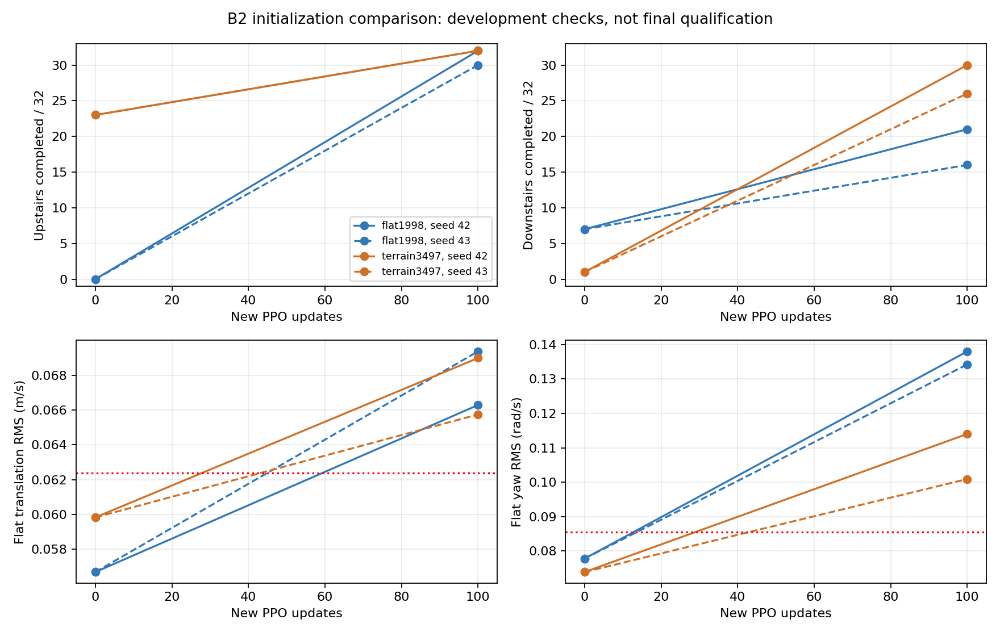

# B2 第一段：平地与地形起点对照报告

日期：2026-11-11。本阶段已完成。两个起点各用种子 42/43，共四组；四组都在第 100 次新增 PPO 更新后触发原 Flat 保持停止条件，未继续到本段上限 300 次。没有选出合格 θ1，没有启动下一阶段或从零训练。

本轮结果支持下一轮优先保留地形 `3497` 作为训练起点：两个种子的下台阶开发成绩都优于从平地 `1998` 开始，旧步态能够通过续训改变。但两个起点都出现平地能力退化，切换到平地模型没有解决这个共同问题。

## 实际执行与验证

新增独立任务 `SourceBlock-B2-Deeprobotics-Lite3-v0`，保留 B1/B1.1。六类地形、200 个 8×8 m 方形块及参考随机粗糙面维持 B1.1；本轮实现平衡台阶和专用转向采样，增加失败时具体身体接触记录。奖励权重、45/48 维观测、安全阈值和 PPO 参数未调整。

4096 环境实际分配为上台阶 819、下台阶 819、专用纯转向 410、其他全向平地 819、其他 14 列 1229。旧提案中其他 13 列为计数笔误，已按 20−2−4=14 更正；其余各列为 87/88 个环境，所有 20 列均保留。

- CPU 回归共 176 项通过：源课程与保持指标 104 项、地形导入 72 项。
- 120/4096 环境真实仿真均 22/22 通过。覆盖实际分配、200 块重置、出生高度、边界、粗糙碰撞、精确交互计数，以及专用转向在重置/重采样/连续运行后的指令。
- 两个起点及四个新模型均完成 640 个首回合开发测试，每列 32 个，共 3840 个首回合。固定种子 20261112、关闭策略观测噪声、确定性推理；六个策略逐列初始根部、关节、指令及观测哈希一致。
- 六个策略均另做原 Flat 1024 环境×3000 步，共 18432000 条评估交互。基线原 Flat 结果与历史记录一致；评估程序正常退出不等于模型通过 Q4。
- 四组实际各 100 次更新，每组 4096×24×100=9830400 条训练交互，总计 39321600 条。按列实际交互数逐一匹配分配数量×2400，不把评估交互计入训练。

## 新方形块的配对结果

这里是 B1.1 新方形地块的开发测试，不能直接替代旧直线 L1/L2 资格测试。全向平地列按原规则没有直线出口完成目标，因此其超时/边界截断不等价于失败。

| 起点/策略 | 新增更新 | 上台阶 | 下台阶 | 粗糙 A | 粗糙 B |
|---|---:|---:|---:|---:|---:|
| 平地 1998 基线 | 0 | 0/32 | 7/32 | 27/32 | 28/32 |
| 地形 3497 基线 | 0 | 23/32 | 1/32 | 32/32 | 32/32 |
| 平地起点，种子 42 | 100 | 32/32 | 21/32 | 32/32 | 32/32 |
| 平地起点，种子 43 | 100 | 30/32 | 16/32 | 32/32 | 32/32 |
| 地形起点，种子 42 | 100 | 32/32 | 30/32 | 32/32 | 32/32 |
| 地形起点，种子 43 | 100 | 32/32 | 26/32 | 32/32 | 32/32 |

四个新模型的其他 14 个非全向、非台阶列全部 32/32。平地起点种子 43 的上台阶有 2 次失败；四组下台阶剩余未完成均为失败，无超时。详细逐回合终止和身体接触见 `evaluations/*_blocks.json`。

下台阶初始失败时，平地 1998 的 25/32、地形 3497 的 31/32 均触发非法接触。地形起点续训后，种子 42 剩余 2 次失败都记录到右后小腿；种子 43 剩余 6 次为左后小腿 5 次、右后小腿 1 次。记录使用终止控制步传感器历史中的力峰值超过 5 N 的部位；多个部位允许重叠，不能把它等同于精确几何接触点，也不能仅凭部位记录推导奖励因果关系。

## 原平地保持与停止原因

Q4 原门槛保持：平移 RMS≤0.06236837 m/s、偏航 RMS≤0.08557957 rad/s、跌倒率≤3.9613%。两项 RMS 越小越好。

| 策略 | 平移 RMS | 偏航 RMS | 纯转向偏航 RMS | 跌倒/结束回合 | Q4 |
|---|---:|---:|---:|---:|---|
| 平地 1998 基线 | 0.056699 | 0.077800 | 0.155454 | 91/3073，2.961% | 通过 |
| 地形 3497 基线 | 0.059837 | 0.073889 | 0.125482 | 69/3072，2.246% | 通过 |
| 平地起点，种子 42 | 0.066286 | 0.138008 | 0.355090 | 95/3076，3.088% | 平移、偏航失败 |
| 平地起点，种子 43 | 0.069365 | 0.134226 | 0.325428 | 193/3085，6.256% | 三项失败 |
| 地形起点，种子 42 | 0.068985 | 0.114008 | 0.276993 | 98/3072，3.190% | 平移、偏航失败 |
| 地形起点，种子 43 | 0.065743 | 0.100909 | 0.220190 | 126/3072，4.102% | 三项失败 |

四组台阶都没有触发相对各自基线的保持停止条件，实际停止原因全部来自 Q4。地形起点的偏航误差在两个种子中均小于对应平地起点，但仍不合格；平移没有一致优劣，因此不能宣布地形起点在所有指标都占优。

专用转向并未缺席：每组仅专用列就提供 410×2400=984000 条交互，此外还有其他全向列中的纯转向样本。GPU 验收确认这些指令关闭航向收敛且保持带符号 0.2–0.8 rad/s。现在的证据说明这套分配没有保住原 Flat 能力，不证明增加更多样本一定无效，也不证明单一奖励就是原因。

图中只有更新前和第 100 次两个实际评估点，连线仅帮助比较端点，不代表中间时刻的实测走势。红线为原 Q4 门槛。

## 加载、训练真实性与资源

四组均完整加载各自起点的 actor、critic、已学动作标准差和 Adam，并在更新前逐张量核对一致。`model_audit.json` 进一步核验四组 actor/critic 各 8 个 MLP 张量全部变化，每个 Adam 状态的 step 均增加 2000，对应 100×5×4。没有冻结 actor，也没有仅更新探索标准差。

加载协议在两种起点间一致，但起点内的 critic、动作探索和 Adam 历史仍不同；本轮比较整体检查点初始化，无法将全部差异单独归因于步态。算法学习率共同从配置 0.0003844 初始化；载入时 Adam 组学习率分别为平地 0.00038443359375、地形 0.0002562890625，沿用已安装 RSL-RL 行为。暂停评估不重启训练进程。

训练由专用脚本显式调用 `runner.load`，`params/agent.yaml` 的通用注册配置字段 `resume: false` 不控制此脚本加载；实际加载路径、SHA256 和逐张量证明记录在每组 `training_report.json` 及汇总 `model_audit.json`，不可只看通用 YAML 判断是否续训。

| 运行 | 实际更新 | 含检查的总耗时 | 整卡显存采样峰值 |
|---|---:|---:|---:|
| 平地起点，种子 42 | 100 | 690.1 s | 10541 MiB |
| 平地起点，种子 43 | 100 | 678.7 s | 10527 MiB |
| 地形起点，种子 42 | 100 | 795.4 s | 11129 MiB |
| 地形起点，种子 43 | 100 | 789.6 s | 11129 MiB |

显存为每两秒采样的整卡用量，峰值包含暂停中的训练进程、独立评估及卡上已有进程，不是单个训练进程的占用。只使用 GPU0/1，每次启动前均满足至少 12288 MiB 空闲；未干预其他进程。四组与全部评估正常退出，无监测到的 PhysX/CUDA 致命错误。原有 USD 足部 visual 引用警告仍存在。结束后 GPU0/1 回到原来的 18/652 MiB，GPU2/3 状态保持。

## 结论、限制与下一阶段

本轮 100 次更新已经观察到台阶学习和原能力退化，停止源于预先登记的保持规则，而非耗尽 300 次预算。它不证明更长训练永远不能恢复，也不证明从零训练不可行；后两者没有在本阶段测试。只有两个种子、每条件 32 个首回合，不将结果外推为所有地形、所有训练预算下的最优起点。

建议保留 3497 为后续主要候选，先定位持续转向、停转、航向收敛及侧移的退化来源。具体 [下一阶段诊断提案](next-stage-proposal.md) 待用户确认；目前没有执行新诊断实验、修改训练目标或追加更新。四个 100 次模型均保留作诊断比较，不选为最终基础策略。原 L1/L2 隔离资格测试尚未运行，Q1–Q4 标准不变。

## 证据入口

- [登记计划](plan.md)、[汇总 JSON](summary.json)、[对照 CSV](comparison.csv)、[模型审计](model_audit.json)。
- `baseline/`：两份起点的新地块和原平地测试。
- `training/`：四组训练报告与父进程执行收据；全部训练源提交为 `af054b50b291ade24076c460aa63840401fb09a1`。
- `evaluations/`、`statistics/`：四个检查点逐回合评估和按列实际采样统计。
- `validation/`：176 项 CPU 回归及两种规模的 22 项仿真验收。
- [artifact_manifest.json](artifact_manifest.json) 记录原始日志、检查点、配置与源码的 SHA256；[SHA256SUMS](SHA256SUMS) 覆盖交付文件。原始证据保留在 `logs/stage1/block_b2`，模型与大型日志不上传 Git。
