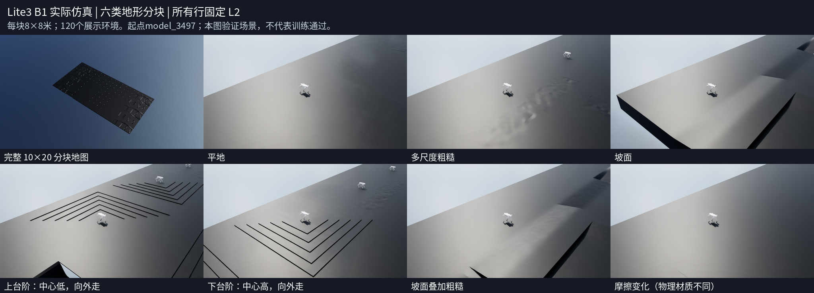

# 六类分块固定 L2：B1 实现与验证

日期：2026-11-11。用户批准的范围为 B1 实现、CPU/仿真验收、真实素材及 30 次试训。B2 正式训练须在本阶段详细汇报后另行批准。

当前状态：B1 全部完成，场景、数值和预算验收通过；未启动 B2，未选出合格基础策略。下台阶动作问题仍存在，不能用本阶段场景验收替代策略资格评估。

新任务：`SourceBlock-L2-Deeprobotics-Lite3-v0`。保留旧课程、定向任务及原 L1/L2 资格评估器。

## 场景和任务

- 10×20 个 8×8 m 地块；20 列保留原六类及全部方向条件。10 行是固定 L2 的空间副本，每次重置轮换副本，不升降难度。
- 台阶直接调用未修改的 Isaac Lab 原生生成器：上台阶从倒金字塔中心低平台向外走，下台阶从金字塔中心高平台向外走。四个轴向出口轮换；中心高程分别为 −0.175/+0.175 m，实际中心平台 2×2 m，5 次 0.035 m 高度变化，踏面 0.5 m。
- 其他地形沿用原 Source 几何函数。以未旋转地块为例，中心为 (4,4)，平坦区到 x=5，进入过渡到 x=5.5，完整挑战段 x=5.5–6.5，退出过渡到 x=7，外侧保留 1 m 平坦区。各副本按 0/90/180/270 度旋转，出生朝向和指令同步旋转；坡度仍为 8 度，粗糙峰谷参数仍为 0.03/0.015 m。这些较短地形不等同于原 12×4 m 直线资格场景。
- 出生采用实际中心地面高度加 0.375 m，XY 抖动各 ±0.1 m。完成要求沿目标轴前进至少 3.4 m，且全部足部越过距中心 3 m 的最后边缘 0.025 m。保留每刚体 0.27 m 边界包络、1 mm 数值余量和一步预测；底部扫描半径保护为 0.1 m。地形越界算失败，全向平地越界算截断。
- actor/critic 维度为 45/48，沿用原奖励、安全阈值及 PPO；失败优先自举仍启用。每次控制步记录列/方向样本数、触地步数；重置前记录完成/失败/超时、各原始终止项和触地足位置越过的台阶边缘数量。
- B1 沿用批准的 30/20/50 环境分配，仅用于新场景核验：4096 环境中全向平地 1229、下台阶 819、其他 15 列 2048（上台阶 137）。B2 不自动沿用这一比例。

## 已完成验证

- CPU 回归 107 项通过，包括原课程、边界、地形生成/碰撞切分，以及新增四方向完成判据、固定 L2 重置、计数和失败优先检查。
- CPU 几何审核 200 块通过；使用与实际生成器相同的种子和列优先随机序列。上下台阶全部四方向剖面、中心出生区域、40 个纯坡面实际 8 度坡向、粗糙副本差异均通过。
- 120 环境仿真 15/15；4096 环境仿真 15/15。两者均通过十次重置覆盖全部 200 块，实测出生离地 0.374996–0.375004 m；4096 场景的 956 个台阶机器人都能在边界内满足出口判据。
- 第一次 120 环境检查的出口探针恰好放在 3.4 m 阈值上，远处世界坐标舍入为 3.3999996 m，导致 8 个探针未判完成。探针改到 3.41 m 后全部通过；生产完成阈值保持 3.4 m。
- GPU0 顺序验收：120 环境整卡峰值 4322 MiB、32.91 s；4096 环境整卡峰值 5522 MiB、81.28 s。每 2 秒采样，不能解释为进程独占峰值；两次启动前均有 24107 MiB 空闲。无 PhysX/CUDA 错误；已有模型资产的足部 visual 引用警告仍存在，不能将其说成日志完全无警告。

## 复现

使用 `/home/tjx/anaconda3/envs/env_isaaclab/bin/python`，在本工作树运行并设置 `PYTHONPATH=$PWD/source/rl_training`：

```bash
python scripts/tools/source_block_geometry_audit.py --output logs/stage1/block_l2/new_geometry.json
python scripts/tools/source_block_check.py --num-envs 120 --gpu 0 --output logs/stage1/block_l2/new_check120
python scripts/tools/source_block_check.py --num-envs 4096 --gpu 0 --output logs/stage1/block_l2/new_check4096
python scripts/tools/source_block_visualize.py --output logs/stage1/block_l2/new_visuals
python scripts/tools/source_block_runtime.py --pilot --gpu 0 --output logs/stage1/block_l2/new_pilot
```

输出路径须不存在，保留历史尝试。试训入口固定 4096 环境、种子 42、30 次更新，检查起点 `model_3497.pt` 的 SHA256；正式 B2 不由该入口启动。

## 30 次试训结果

从初次 seed42 `model_3497.pt` 恢复完整 actor、critic、Adam，执行迭代 3497–3526，共 30 次更新，每次 4096×24 条交互，总计 2,949,120 条。所有指标及最终网络/优化器张量有限，所有 Adam 参数的 step 均比起点增加 600，actor/critic 均实际更新。模型仅保留作证据，不作为后续起点或资格候选。

训练更新合计 89.56 s，平均 2.985 s/次，约 32930 条交互/训练秒；进程总耗时 162.52 s，包含场景初始化和退出。GPU0 整卡显存每 2 秒采样峰值 6305 MiB，启动前空闲 24107 MiB。无原生物理错误、非有限值或预算超支。训练代码为 `c4d86e2c9cc77031e99c89e6bbc76bfd2d64c880`。

| 六类地形 | 环境数 | 交互数 | 完成 | 失败 | 超时/边界截断 |
|---|---:|---:|---:|---:|---:|
| 平地，含全向 | 1365 | 982800 | 130 | 1 | 1029 |
| 多尺度粗糙 | 273 | 196560 | 243 | 1 | 70 |
| 坡面 | 548 | 394560 | 508 | 3 | 131 |
| 台阶 | 956 | 688320 | 152 | 2502 | 121 |
| 坡面叠加粗糙 | 544 | 391680 | 508 | 3 | 124 |
| 摩擦变化 | 410 | 295200 | 374 | 2 | 96 |

上下台阶分别为：

| 条件 | 交互数 | 完成/已结束 | 失败 | 超时 |
|---|---:|---:|---:|---:|
| 上台阶 | 98640 | 99/141，70.21% | 3 | 39 |
| 下台阶 | 589680 | 53/2634，2.01% | 2499 | 82 |

下台阶 2499 次失败均触发非法接触；当前只确认非足接触，没有细化到身体部位。下台阶 2634 个结束回合中，1587 个尚未记录到四足均在触地时越过第一条边缘。因此虽然所属地块全部是 L2，有效跨阶经验仍不足，L2 地块交互数不能解释为每一步都已踩上台阶。

训练统计包括随机动作探索、观测噪声、变化中的策略，以及 RSL-RL 初始随机回合时长，不是最终冻结模型成功率。全向平地没有直行完成条件，completion=0 不能解释为没有学会走路；其 884880 条交互中有 45393 条有效纯转向指令，占全部样本约 1.54%，需单独改善保持措施。指令分类按当前命令统计，后退、侧移等类别可重叠。

详细数据见 [pilot30.json](pilot30.json)、[exposure.csv](exposure.csv)、[逐列/副本/方向统计](column_statistics.json)。计数满足每列交互数=该列环境数×720，全部开始回合数=已结束回合数+4096，无漏计终止步骤。

## 实景素材



- [完整地图](visuals/terrain_overview.png)。首次总览有一角超出画面，已重新拍摄完整总览并替换拼图中的总览面板，近景保持原实拍。
- [上台阶视频](visuals/stairs_up_L2.mp4)：起点 `model_3497`，向北，仿真 8.58 s 完成；编码长度 8.64 s 来自 12.5 fps 采样取整。
- [下台阶视频](visuals/stairs_down_L2.mp4)：同一起点，向南，3.36 s 因非法接触终止；终止前主体进度约 0.854 m。

这两段是 120 环境下的起点策略演示，不是试训后模型，也不是资格评估。视频在首次结束时停止，排除自动重置后的画面。首个渲染进程继承远程 DISPLAY=:3 导致 GLXBadFBConfig；移除子进程的 DISPLAY/WAYLAND_DISPLAY 后成功，无系统显示配置变更。真实截图与视频不经过生成式图像处理。

## 下一阶段

待批准的 [B2 具体提案](b2-proposal.md)：上下台阶各 20%；总环境中 10% 专用纯转向、20% 其余全向；其他 13 列合计 30%。两个种子各最多 300 次更新，每 100 次检查上台阶和原 Flat 保持指标，发现退化停止对应种子。开发集与最终资格评估分开，原 Q1–Q4 保持不变。

本次只提交提案，没有实施该新采样比例或启动正式 B2。所有 B1 进程已结束。原始运行保留在 `logs/stage1/block_l2`，交付文件由 `SHA256SUMS` 覆盖；`artifact_manifest.json` 记录原始检查、训练、模型、渲染证据及源码哈希。
