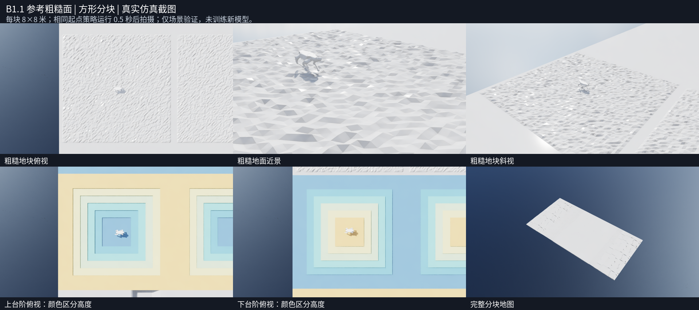
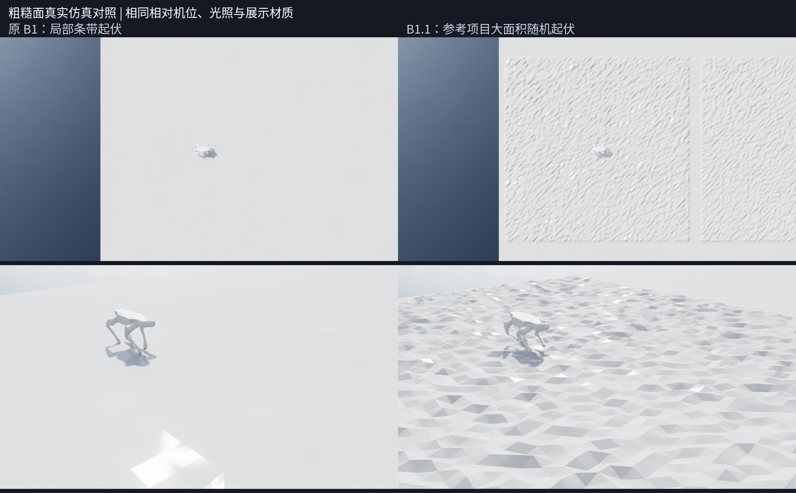

# B1.1 方形分块与参考粗糙面

日期：2026-11-11。用户批准的本轮范围是独立粗糙地形替换、出生高度适配、碰撞/边界/重置验证和真实仿真截图。没有进行策略更新，没有启动 B2。

## 完成的调整

新增任务 `SourceBlock-ReferenceRough-Deeprobotics-Lite3-v0`，通过独立配置使用参考项目 `/home/tjx/rl_training` 的 `HfRandomUniformTerrainCfg` 及同一套已安装的 Isaac Lab 原生生成函数。

- 保留六类、20 列、10 行和每块 8×8 m 的布局。更换独立粗糙面的第 6、15 列（零起始编号），合计 20 块。坡面叠加粗糙的四列沿用原 B1 参数。
- 内部随机高度为 0.01–0.06 m，采样档位间隔 0.01 m，水平采样间距 0.1 m，垂直离散精度 0.005 m。内部峰谷差 0.05 m；与外侧零高度边框比较时，全块高度差为 0.06 m，不能混为一个指标。
- 使用参考边框参数 0.25 m；原生函数按网格离散后，内部随机顶点范围为 x/y=0.3–7.7 m，共 75×75 个点。原先完整起伏只有 1 m 长的条带，现在覆盖地块大部分区域。未加入人工平坦出生平台。
- 每块使用从地图种子与实例参数导出的独立随机种子；调用原生 NumPy 随机函数后恢复全局随机状态。20 块各不相同，同一配置重复生成完全一致，不改变其他地形的随机结果。
- 出生原点采用原生生成器中央 2×2 m 区域的最高点，本地图全部为 +0.06 m；机器人根部在此基础上再加默认 0.375 m，实际初始根部高度为 0.435 m。XY 抖动仍为各 ±0.1 m。
- 两列粗糙面的统计标签改为 `reference_uniform_rough_a/b` 和 `reference_rough_transitions`，不再记作原 L2 粗糙交互。新任务整体记录为 `L2_except_reference_uniform_rough`。其余地形继续使用 L2 参数；奖励、策略观测、控制频率及 PPO 没有调整。

原任务 `SourceBlock-L2-Deeprobotics-Lite3-v0` 保留。逐块实际顶点哈希核验：原 B1 的 200 块全部复现一致；新任务中未更换的 180 块全部与 B1 一致。原 L1/L2 资格评估标准没有改变。

## 方形与真实截图

单块地形和台阶环均为方形。整张地图仍是 10×20 块组成的矩形。原斜视截图把两侧台阶边缘突出成 V 形；本轮补充了俯视图。坡面原有的楔形侧面保留，未将坡面改造成台阶。



这些图来自 120 环境的真实仿真，原起点 `model_3497` 冻结推理 25 个控制步（0.5 s）后拍摄。没有训练新模型。为看清结构，展示脚本使用网格显示颜色，并按实际高度给台阶分色；不改变网格顶点、三角面、碰撞或物理材质，20 块台阶在着色前后的几何哈希一致。独立 PNG 为渲染原图，拼图只缩放和加文字。



左侧为原 B1，右侧为参考粗糙面。二者使用相同相对机位、光照和展示材质。粗糙面仍由原生三角网格组成，小三角面用于表达连续起伏；完整地块的边界是方形。

原图：[粗糙俯视](visuals/rough_top.png)、[粗糙近景](visuals/rough_close.png)、[粗糙斜视](visuals/rough_oblique.png)、[上台阶俯视](visuals/stairs_up_top.png)、[下台阶俯视](visuals/stairs_down_top.png)、[完整地图](visuals/overview.png)。

## 验证内容与限制

几何核验不仅检查配置，还检查实际顶点/三角面、边缘和中央区域的垂直相交结果。原生粗糙面是连续的开放高度场表面，没有实体背板；每块有 6561 个顶点、12800 个非退化三角面。仿真验证包含实际脚部碰撞接触，未仅以射线命中代替物理接触。

CPU 回归、120/4096 环境验收的最终数值见 [validation.json](validation.json)，完整检查见 [check120.json](check120.json)、[check4096.json](check4096.json)。

| 检查 | 结果 | 耗时 | 整卡显存采样峰值 |
|---|---|---:|---:|
| CPU 回归 | 166 项通过 | 7.99 s | 不使用 GPU |
| 120 环境 | 20/20 | 28.84 s | 4167 MiB |
| 4096 环境 | 20/20 | 73.02 s | 5403 MiB |

两次最终仿真验收均使用 GPU0，启动前空闲 24107 MiB。每次运行原策略 100 个控制步，只检查数值、接触和计数，不执行优化器更新。

- 10 次重置覆盖全部 200 块；中央最高点与根部高度关系正确。
- 从实际 USD 碰撞体读取四只脚的球半径，均为 0.022 m。初始脚部球底最低仍高于粗糙地面最高点约 0.02651 m，XY 足部范围也落在安全中央区域内。
- 4096 环境中两列粗糙面共有 273 个机器人。100 步冻结策略运行中全部 1092 只脚均检测到超过 1 N 的地面接触，接触张量和观测/奖励保持有限。
- 上下台阶及粗糙面的 1229 个环境都能在边界内满足出口探针；越界在地形环境记作失败，在全向平地记作截断。
- 原 B1 验证分配仍为 30/20/50；这不是下一轮 B2 的训练份额。本轮检查不能证明策略已经学会新粗糙面或解决下台阶失败。

首轮 120/4096 检查均为 19/19，但统计快照沿用了旧 L2 标签。发现后修正标签并增加专项检查，重新运行最终验收。首轮原始记录保留在日志目录，不覆盖历史。

现有资产的足部 visual 引用警告仍存在；渲染还报告了已有的 Fabric 路径和输出性能警告。本轮未发现 PhysX/CUDA 致命错误。显存记录是每两秒采样的整卡占用，包含其他进程，不是当前进程独占峰值。

## 复现

在该工作树中使用 `/home/tjx/anaconda3/envs/env_isaaclab/bin/python`。脚本固定工作树导入路径；GPU 启动器只允许 GPU0/1，启动前至少 12288 MiB 空闲，并清除子进程继承的远程显示变量。

```bash
python scripts/tools/source_block_reference_rough_audit.py --output logs/stage1/block_reference_rough/new_geometry.json
python scripts/tools/source_block_check.py --reference-rough --num-envs 120 --gpu 0 --output logs/stage1/block_reference_rough/new_check120
python scripts/tools/source_block_check.py --reference-rough --num-envs 4096 --gpu 0 --output logs/stage1/block_reference_rough/new_check4096
python scripts/tools/source_block_reference_rough_visualize.py --gpu 0 --output logs/stage1/block_reference_rough/new_visuals
python scripts/tools/source_block_reference_rough_visualize.py --baseline --gpu 0 --output logs/stage1/block_reference_rough/new_baseline_visuals
```

输出路径须不存在。原始日志保留在 `logs/stage1/block_reference_rough`；交付物及源码由 `artifact_manifest.json` 与 `SHA256SUMS` 记录。

## 下一阶段

下一阶段方案见 [B2 更新提案](b2-proposal.md)。该提案使用本轮新粗糙地形，仍需用户批准；没有启动正式训练。
