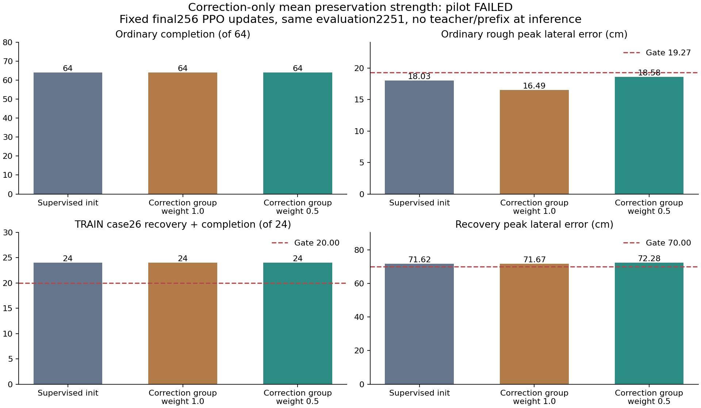
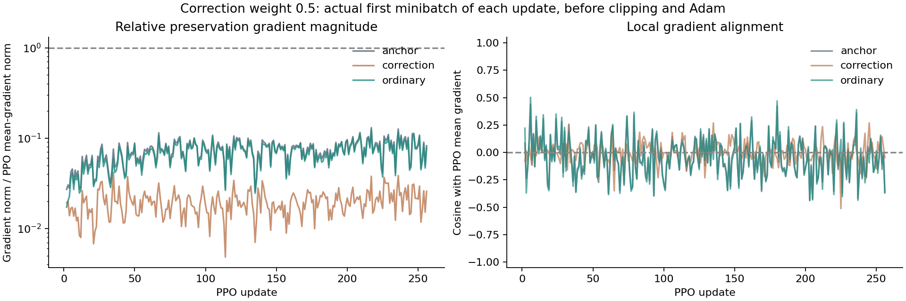
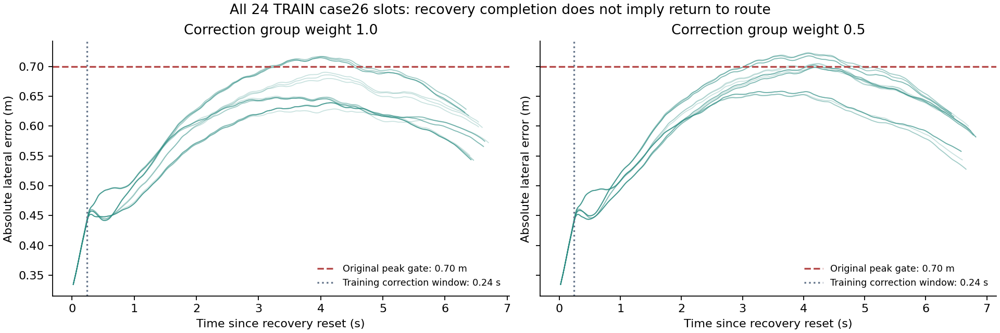

# 恢复纠正组保持权重减半：诊断与单变量实验（2026-10-10）

**普通平均横偏改善，恢复精度继续退化，完整验收未通过。** 本轮只把correction回放组的均值保持贡献减半。普通64/64、RMS6.36cm/峰值18.58cm；单TRAIN来源恢复24/24、峰值72.28cm。原六门槛仍仅过5/6，候选不晋升、原7来源验证和新FlowDAgger集成未启动。

## 先做了什么诊断

旧运行只保存首轮和最终模型，没有每轮更新前参数、实际小批次顺序及逐轮梯度。因此没有伪称还原全部历史梯度。本轮在已审计TRAIN记录上做了两项不消耗物理控制的诊断。

**局部梯度。** `model_0.pt` 是完成首轮20次Adam后保存的模型，后一个32步TRAIN rollout由该策略采集。在CPU重算其完整rollout的标准化GAE、ratio=1局部PPO目标梯度，再比较实际update2首个回放抽样中的四组保持梯度。Actor均值参数上，保持/PPO余弦约−0.143、范数比8.5%；correction/PPO余弦约−0.077。存在轻度局部反向，但不是强烈冲突的证据。这是完整rollout局部诊断，不是旧程序真实小批次更新的复原，也不是Adam预条件后的方向。最终模型只能比较同一TRAIN抽样上的保持梯度，未捏造最终PPO梯度。

**速度预测诊断。** 只读旧运行全部case26 TRAIN轨迹，排除重置age0，得到97939条记录。按完整环境流分73455条拟合、24484条诊断；原7来源/pilot数据不参与。固定ridge系数0.001，标准化仅拟合于拟合组，不搜索超参数，也不把诊断回归器装入策略。

| 诊断输入 | 根连杆质心世界横速度预测RMSE |
|---|---:|
| 拟合组均值常数 | 12.34cm/s |
| 当前48D观测 | 2.91cm/s |
| 当前48D＋一帧过去变化量48D | 0.32cm/s |
| 仅路线原点横偏的一帧有限差分 | 0.92cm/s |

当前48D具有相关信息，历史信息进一步降低此诊断误差。该结果来自同一个TRAIN来源、变化中的策略以及低容量线性预测器，不能证明Actor无法推断速度，也不能代表未知失稳泛化。有限差分对应原点速度，标签是根连杆质心速度，两者不严格相同。

以上诊断不足以确定因果，因此先选择较窄的纠正保持强度消融，同时补齐实时更新证据。历史观测尚未加入Actor。

## 单独修改哪一项

每次仍从correction/flat/rough101/rough107各取128条，冻结初始化Actor均值作为目标。设各组12D动作MSE为M：

- 对照：`L_aux = 25 × (M_correction + M_flat + M_101 + M_107)`
- 本轮：`L_aux = 25 × (0.5 M_correction + M_flat + M_101 + M_107)`

全局系数100保留；correction有效系数25→12.5，普通三组各25不变。分母仍为512×12，没有按权重和重新归一化，也没有改抽样流。这个离线回放保持项与在线动作奖励保持是两件事，在线普通/恢复前12步保持100没有变。

仍从6a470cec…监督Actor重新初始化，fresh critic/Adam，learner2281、std0.05、lr3e-6、64×32×256，5epoch×4小批，只评最终模型。无尾段保持、机身/足端横偏−8、航向−1/1m/20°及上轮世界速度奖励−8/0.5s⁻¹/0.15m·s⁻¹全部不变。48D Actor、51D Critic、12D关节动作，推理仍无case/时间/教师/固定动作前缀。

另加每轮首小批次的只读梯度记录。单元测试逐元素验证启用记录前后参数、完整Adam状态、损失及RNG相同；不是增加优化步或标签。47项测试通过。与Git中旧版本的回放和更新函数做四组全1权重对照，参数/Adam/损失/RNG/抽样均逐元素相同。运行源码176个，仅更新器和训练入口2个文件变化，环境与奖励源码不变，复用已有奖励工程证据，新增工程控制0。

## 训练及真实梯度记录

训练524288控制、5120次Adam更新、2621440次主回放查询、尾段0、存储示范动作标签用于更新0。训练恢复287成功、63失败、0截止全部保留。首32步全部31字段包括奖励与旧对照逐元素相同，chunk文件SHA也相同；主回放抽样流独立重建一致。完整数据隔离、动作保持、航向、世界速度和优化更新审计通过。

256次真实首小批次记录中，首次保持梯度为0，所以有255个有效余弦。减半后的correction/PPO均值梯度范数比中位数约1.95%，平均余弦−0.00048，负余弦占50.2%；普通三组合计范数比中位数7.01%，全部保持合计7.44%。普通组合范数在254/256次记录中高于correction。

这不支持“减半后的correction保持持续强烈压制PPO”这一解释。记录只覆盖每轮首个小批次，PPO梯度混合普通与恢复状态，且仅包括均值MLP参数、位于裁剪和Adam之前；不能据此断言其他19个小批次、旧权重1.0组或实际Adam步不存在权衡。也不能因为某项范数小就认为它没有闭环影响。

最终模型：`/home/tjx/rl_training_main/.worktrees/lite3-policy-learning/artifacts/correction_half_20261010/train/final.pt`，SHA256 `e5d5b6b493a2c0e03e9442ec53a78ba98b53e39e38352b99e39c52c1bd367362`。

## 原标准冻结评测

普通与恢复在预登记的独立进程中各运行一次，模型、GPU1、eval2251和物理配置不变。两个进程均正常结束，无场景停滞、中止或重试；组合产物保留每段原始协议、轨迹、哈希与控制账本，不伪装为单进程运行。

| 指标 | correction权重1.0 | correction权重0.5 |
|---|---:|---:|
| 普通完成 | 64/64 | 64/64 |
| 普通rough平均每回合RMS | 7.67cm | 6.36cm |
| 普通rough最大横偏 | 16.49cm | 18.58cm |
| TRAIN case26恢复并完成 | 24/24 | 24/24 |
| 恢复平均每回合RMS | 60.24cm | 61.88cm |
| 恢复最大横偏 | 71.67cm | 72.28cm |
| 恢复结束平均绝对横偏 | 58.21cm | 58.46cm |

普通flat/rough101/rough107分别16/16、24/24、24/24；四Hip/Knee延迟组恢复7/7、7/7、7/7、3/3。原普通峰值门槛0.1927442551m及RMS≤原基线×1.05通过。恢复峰值精确0.7227697372m，比0.70m高2.277cm，六门槛仍过5/6。全部初态/延迟联合哈希与旧对照和原PPO基线一致；完整轨迹及176条抽样CPU动作回放审计通过。

48个普通rough槽中40个RMS、25个峰值改善；24个恢复槽中仅2个RMS改善，**没有任何恢复槽的峰值改善**。不能只看普通均值而忽略恢复退化。

最坏恢复仍为env48，4.08秒达到72.277cm；初始偏32.652cm，额外最大偏移39.625cm。0.24–1秒平均向外速度6.48→8.40cm/s，1–2秒10.73→11.03cm/s，2–4秒3.30→3.58cm/s；4秒后向内速度3.48→4.07cm/s，后段更快回移没有抵消此前峰值。活动步按回合结束时间截断，分段仍有时长选择效应。

## 结论及下一步

本固定种子/配方下，纠正保持减半没有改善恢复峰值，候选不采用。实时梯度与闭环结果共同限制了“恢复纠正组保持过强是主要障碍”的解释，但不能否定所有保持强度配置。原单来源开发评测经过多次消融，不是独立泛化证明。

下一步优先梳理一帧路线历史输入的时序与回放配对：验证重置时清零、禁止跨回合差分、只用过去帧、冻结初始化扩展保持原映射，以及每个回放样本能否取得真实配对历史。完成后再登记仅改变观测信息的单变量实验；不凭预测诊断预告恢复必然改善。当前尚未实现新的历史输入或启动下一轮训练。原70cm门槛、原7来源资格和独立学习复现条件不变。

## 成本和复算入口

训练524288＋普通89920＋恢复89472＝**703680控制转移**，工程/条件验证/重试/新uncertain均0。恢复与FlowDAgger开发累计charged34718016、confirmed34717952、历史uncertain64；旧完整PPO11900884另列，两账合计46618900。诊断梯度、岭回归和额外autograd调用不计物理控制，也不增加策略优化步。

工作目录为本工作树；Python为`/home/tjx/anaconda3/envs/env_isaaclab/bin/python`，`PYTHONPATH=.:source/rl_training`。测试关闭无关pytest插件自动加载。物理入口使用`--device cuda:1 --headless`并取消DISPLAY，已有产物目录不可覆盖。

1. `diagnose_lite3_anchor_gradients.py`及`probe_lite3_velocity_observations.py`读取旧lateral_velocity TRAIN运行及其审计，只输出诊断。
2. `train_lite3_policy.py`执行[训练协议](lite3_correction_half_train_protocol_20261010.json)。训练后运行recovery_teacher训练审计、recovery_anchor/route_heading/lateral_velocity奖励审计及mean_anchor更新审计，最后`summarize_lite3_live_gradients.py`。
3. `evaluate_lite3_recovery_teacher.py`分别执行[普通协议](lite3_correction_half_course_protocol_20261010.json)和[恢复协议](lite3_correction_half_recovery_protocol_20261010.json)。`assemble_lite3_condition_evaluations.py`按[组合协议](lite3_correction_half_pilot_protocol_20261010.json)连接两段完整轨迹为`artifacts/correction_half_20261010/pilot-combined`。
4. `audit_lite3_recovery_teacher.py`核验组合轨迹；`audit_lite3_prefix_imitation_pilot.py`使用原prefix_imitation_plan门槛及已付费基线，随后`summarize_lite3_mean_anchor.py`和横偏/速度诊断脚本出图。新计划的pilot标准/种子与原计划逐项一致。

分析脚本位于`docs/analysis`，物理入口位于`scripts/reinforcement_learning`。旧self_target更新审计及lateral_velocity结果汇总已复算，JSON完全一致。

- [本轮计划](lite3_correction_half_plan_20261010.json)、[局部梯度诊断](lite3_anchor_gradient_diagnostic_20261010.json)、[TRAIN观测预测诊断](lite3_velocity_observation_probe_20261010.json)
- [训练审计](lite3_correction_half_training_audit_20261010.json)、[优化/回放审计](lite3_correction_half_update_audit_20261010.json)、[实时梯度汇总](lite3_correction_half_live_gradient_summary_20261010.json)
- [评测组合审计](lite3_correction_half_pilot_assembly_audit_20261010.json)、[完整轨迹审计](lite3_correction_half_pilot_trajectory_audit_20261010.json)、[原门槛判定](lite3_correction_half_pilot_result_20261010.json)、[结果与账本](lite3_correction_half_result_20261010.json)
- [全部配对回合及速度](lite3_correction_half_frozen_velocity_diagnostic_20261010.json)、[全部恢复横偏](lite3_correction_half_lateral_diagnostic_20261010.json)、[项目总结](lite3-project-summary-2026-10-08.md)、[完整PPO原理](lite3-full-ppo-finetuning-principles-2026-10-08.md)
