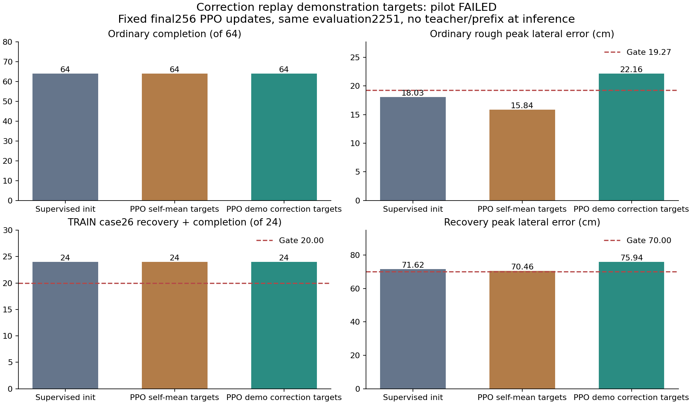
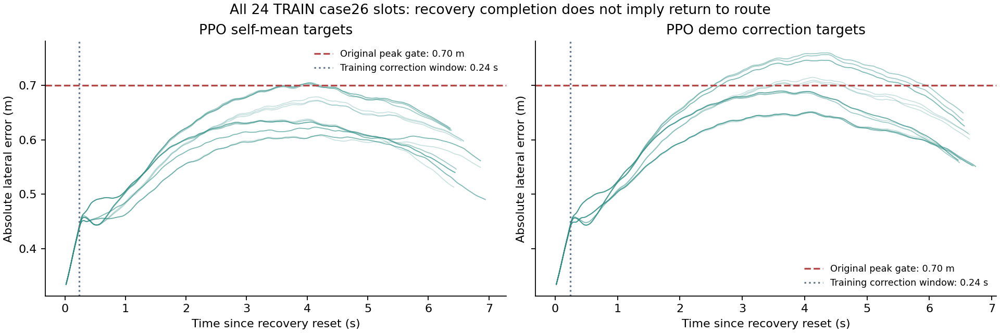

# PPO纠正回放示范目标消融：完整结果（2026-10-09）

**本轮改动未取得完整收益，原六项门槛通过四项，不采用新候选。** 普通行走仍64/64，平均横偏RMS7.04→6.32cm，但最坏横偏15.84→22.16cm；TRAIN case26恢复仍24/24，横偏RMS59.22→62.44cm、峰值70.46→75.94cm。原普通峰值上限19.27cm、恢复峰值上限70cm均未过。未触发原7来源验证，也未晋升恢复教师或开始新FlowDAgger集成。

## 改了什么，以及为什么做

[上一轮256更新对照](lite3-mean-anchor-long-result-2026-10-09.md)保住了普通行走，却未满足恢复横偏门槛。本轮只将correction回放组的目标从冻结初始化Actor均值换成既有成功TRAIN采集的实际执行动作，以检验更直接的示范约束是否能减少恢复偏移。普通flat/rough101/rough107三组继续使用初始化Actor的原始均值。

每次PPO小批额外回放四组各128行，每行12个动作维度取均方误差。因此辅助项为：

`L_total = L_PPO + 100 × (MSE_correction_demo + MSE_flat_init + MSE_rough101_init + MSE_rough107_init) / 4`

PPO仍使用横偏奖励−8、在线动作奖励保持100（覆盖全部普通控制及恢复前12控制）。后者仍参考冻结初始化Actor，与新示范目标可能竞争；本轮没有同时修改这个奖励。损失目标已经变化，不能把两轮的辅助损失标量直接比较成学习收益。

保持原监督初始化6a470cec…、learner2281、std0.05、lr3e-6、64环境×32控制×256轮、5epoch×4小批、私有回放seed2293。Actor/critic/optimizer从头初始化，不接续旧PPO或中止checkpoint；只评测最终256轮。训练布局为16flat、24普通rough101、12 TRAIN case26、12普通rough107。

仍为48D状态相关Actor，推理没有case编号、时间、脚本前缀或教师接管。地形/路线沿用10m×4m跑道、rough101/107最终高度±4cm、前进指令0.3m/s、50Hz，未增加视觉或地形扫描。这是PPO加示范辅助损失，不是新的flow噪声策略学习。

## 数据与实现核验

correction来自先前独立的新TRAIN示范采集，216条观测配216条执行动作；72条离线验证行只在训练后诊断中读取。普通保持TRAIN行数为31114/46866/46631。不使用post_recovery回放、pilot轨迹或原7个验证来源更新参数。

新增配对标签的维数、有限值、组名、dtype/device校验，状态/标签按相同索引抽样，标签detach/clone。普通目标仍由冻结参考网络生成。实际5120次Adam步、2621440条回放查询，其中655360条为重复纠正示范查询；不代表655360条独立示范。

- 数据集SHA：`b3bf2c637e2938d4fa27bda7dc17f6c7d3696d15fa30bdf3d1aca3f9b3cc6963`
- 纠正目标数组SHA：`1849d787dea93dfa615017e2c7a74ddabc2258a73b1f562faa4eb9b3a7951139`
- 抽样索引流SHA：`f23e011a25c5f5632ba43a646011b8989df4bed8512bc5af129fe0279b45605e`，与旧256轮对照相同。
- 抽样示范动作流SHA：`da4899520b0012e7d95add87fc4dbaa4644b2985b44723f1029d5644b6395edc`，独立重建通过。
- 最终模型SHA：`b256c42eea3192b484750b36ccd863cf7cf1782ba0c5e7837bcca1054a341a98`。

首32步rollout的policy/critic观测、根状态、请求/执行动作与旧对照逐元素相同；后续更新目标不同，不要求后续训练轨迹相同。训练恢复回合288成功/57失败、0截止全部保留，不能当作冻结资格评测。参考Actor未变化、原奖励掩码/目标/实际贡献审计通过。

## 工程错误及重试费用

首轮测试实际39通过、1失败；代理未先检查返回结果就提前启动了训练。这是执行错误。失败用例发现：若参考网络返回输入的view，直接覆盖纠正目标会同时改动输入。现已在替换前clone；实际FrozenPPOExpert输出独立张量，但通用契约也必须正确。修复后的40项测试实际全部通过，随后才重跑。

提前启动的运行在51次PPO更新后中止，产生104576个控制步（包括末段2个向量步），无最终checkpoint；目录、报告和轨迹全部保留，账本无pending、uncertain0。重试使用相同不可变协议、参数和种子，从原初始化重新训练至新目录，并未用中途结果选择重试配置。中止成本计入本阶段，绝不算免费重试。

40项相关测试覆盖均值保持、Actor初始化、恢复/平地保持、恢复序列、跑道和物理账本。新增只读审计在旧128轮与256轮记录上复核，旧审计和汇总JSON完全一致；新轨迹诊断也在旧控制上核对了全部24槽。测试通过代表实现符合契约，不代表策略达标。

## 冻结评测与未过门槛

固定eval2251，候选普通/恢复两条件各64槽，完整轨迹及抽样CPU动作回放审计通过。原PPO2063基线、旧256轮对照与本轮的初态/执行器延迟联合哈希一致；付费基线只读复用，门槛仍来自原登记。

| 指标 | 原PPO2063门槛参考 | 旧256轮均值目标 | 本轮示范纠正目标 |
|---|---:|---:|---:|
|普通完成|64/64|64/64|64/64|
|普通rough平均每回合RMS|8.07cm|7.04cm|6.32cm|
|普通rough最坏横偏|19.27cm|15.84cm|22.16cm|
|TRAIN case26恢复并完成|0/24|24/24|24/24|
|恢复平均每回合RMS|早期失败，不与完整回合直接比较|59.22cm|62.44cm|
|恢复最坏横偏|工程上限70cm|70.46cm|75.94cm|

本轮普通flat/rough101/rough107分别16/16、24/24、24/24。恢复四组Hip/Knee延迟0/0、0/1、1/0、1/1分别7/7、7/7、7/7、3/3。通过普通完成、普通RMS、恢复数量和分组成功率四项；普通峰值和恢复峰值两项失败。

普通最坏为rough107/env46，虽完成路段，但峰值0.221603870m超过原0.192744255m。因此平均RMS降低不能代表所有回合精度改善。恢复最坏仍为env57，峰值0.759361267m在恢复后4.36秒出现；旧对照为4.04秒、0.704632759m。

case26起点已经偏离路线32.65cm；本轮相对起点最大额外位移43.28cm，旧对照为37.81cm。走完时24槽平均绝对横偏58.59cm，旧对照56.65cm。能够回正并完成剩余路段，仍然不等于已经回到路线。图中的0.24秒表示训练纠正样本的时间范围，评测没有脚本前缀。

24个槽重复的是同一个TRAIN来源；持续使用的eval2251属于开发评测，不是24个独立来源，也不是独立学习种子。此次没有增加未知恢复来源或新地形泛化证据。项目早期完整PPO283/307的六地形验收证据仍然保留，不受本轮负结果覆盖。

## 为什么拟合改善而运动退化

| 对同一示范动作的MSE | 旧256轮对照 | 本轮 | 下降 |
|---|---:|---:|---:|
|216条TRAIN纠正状态|0.010452|0.005390|约48.4%|
|72条离线验证纠正状态|0.009175|0.005490|约40.2%|

这说明目标修改确实进入了网络更新，但只证明固定状态上的一步动作拟合。闭环状态会随动作改变，后续轨迹仍可能变差。离线post_recovery状态上，相对初始化Actor的均值变化MSE从0.000183升至0.000572，约3.12倍；普通三组也约为对照的1.37–1.41倍。该诊断支持检查恢复后行为保持不足，但尚不能证明唯一原因；在线奖励与示范目标的竞争也尚未单独消融。

下一轮先对既有TRAIN恢复后状态覆盖及辅助梯度关系作离线检查；再评估只增加恢复后保持项的单因素试验。若实施，应保留当前四组损失的原有效权重，避免新增组改变分母而同时稀释纠正/普通约束；独立采样新增组，维持原四组索引流。原初始化、种子和最终256轮规则保持，启动前另行登记实际预算。该后续试验本轮尚未实现或启动，不因这次失败就增加示范权重、延长训练或放宽70cm门槛。

## 成本与交付

本阶段：中止104576＋正式重试524288＋pilot179200＝**808064个新控制转移**，新uncertain0。2621440回放查询及离线诊断新增物理0；原7来源条件验证未触发，成本0。补充登记后的阶段上限1140864，未触发的预算不自动运行。

FlowDAgger及恢复开发累计charged29712576/confirmed29712512/历史uncertain64；旧完整PPO系列11900884另列，两账合计41613460，仍不含最早预训练及SAC/C0等费用。物理控制转移不是GPU小时。

新模型、成功/失败轨迹、原中止运行均保存在本地artifacts；本轮没有新拍录像，也没有替换此前可用模型。先前成功视频及全项目背景见[项目总结](lite3-project-summary-2026-10-08.md)，完整PPO机制见[PPO微调原理](lite3-full-ppo-finetuning-principles-2026-10-08.md)。

- [目标消融计划](lite3_demo_target_plan_20261009.json)、[原训练协议](lite3_demo_target_train_protocol_20261009.json)、[重试预算登记](lite3_demo_target_retry_addendum_20261009.json)
- [中止运行核账](lite3_demo_target_interruption_audit_20261009.json)、[40项测试日志](lite3_demo_target_tests_20261009.txt)、[分析脚本兼容核验](lite3_demo_target_analysis_regression_20261009.json)
- [训练轨迹审计](lite3_demo_target_training_audit_20261009.json)、[奖励保持审计](lite3_demo_target_reward_audit_20261009.json)、[回放配对/直接更新审计](lite3_demo_target_update_audit_20261009.json)
- [实际冻结协议](lite3_demo_target_retry_pilot_protocol_20261009.json)、[冻结轨迹审计](lite3_demo_target_pilot_trajectory_audit_20261009.json)、[原门槛判定](lite3_demo_target_pilot_result_20261009.json)
- [结果/成本JSON](lite3_demo_target_result_20261009.json)、[逐槽横偏诊断](lite3_demo_target_lateral_diagnostic_20261009.json)
