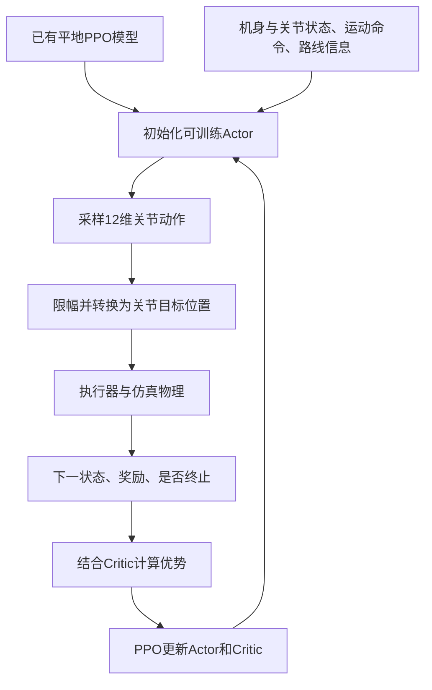

# Lite3 完整PPO微调：原理、实现与实验解释

本文解释本项目中完整PPO微调的工作方式。项目总体进展、其他算法和后续恢复实验见[项目工作总结](lite3-project-summary-2026-10-08.md)。

完整PPO微调以一个已经会在平地行走的策略为起点，通过仿真中的动作、结果和奖励继续调整整个动作网络，使它适应崎岖地形。“完整”指整个Actor都参与更新；“微调”指继承已有权重和行走能力，而非随机初始化后从零训练。

## 1. 从观测到运动，再从结果到学习

训练有两条相互配合的过程：控制过程负责让机器人运动；学习过程根据批量轨迹调整网络。冻结评测和部署时只保留控制过程，不进行优化。

## 2. Actor和Critic分别负责什么

| 网络 | 含义 | 本项目的输入/输出 | 部署是否需要 |
|---|---|---|---|
| Actor | 策略网络，决定动作 | 48维观测，输出12维关节动作分布 | 需要 |
| Critic | 价值网络，预测未来累计奖励 | 51维训练观测，输出状态价值 | 不需要 |

Actor的48维观测包含：机身角速度3、投影重力3、运动命令3、路线特征3、关节位置12、关节速度12、上一实际执行动作12。Critic额外获得3维线速度，属于训练信息，Actor推理不读取它。

路线特征为横向偏移、航向sin和cos，目前直接由仿真位姿获得。它能告诉策略偏离中线多少、朝向是否正确；实机要提供经过验证的等价定位。策略没有地形高度扫描或视觉，也没有手工指定的未来落脚点。

网络输出经过限幅，按下式转换成关节目标位置：

$$
q_{\mathrm{target}}=q_{\mathrm{default}}+k\odot a_{\mathrm{emitted}}.
$$

其中默认关节姿态与缩放系数按关节确定。执行器驱动关节靠近目标，身体和地面发生物理交互。控制周期为0.02秒，即50Hz；连续反馈形成行走行为，不是一次前向计算直接生成整段步态。

## 3. 为什么从已有平地模型开始

已有模型已经掌握基本支撑、摆腿、平衡和关节协调。从它开始，可以把探索集中在怎样调整已有动作以应对起伏地面。

正式完整PPO方案从原45维平地Actor加载权重。扩展到48维路线观测时，在第一层插入三个初始为零的输入权重列：最开始额外路线输入不改变原均值动作，随后这些新权重和其他Actor参数一起学习。Critic与优化器重新建立，探索标准差按新协议初始化。

微调期间所有Actor层都可更新，因此模型能够重新调整不同状态与多个关节之间的映射。它不是只增加一个固定抬腿量，也不是只训练最后一层。

例如，原动作在平地上足够稳定，遇到起伏后却造成碰撞或侧倾。如果探索到的另一组动作能维持接触、保持速度并避免后续失败，训练就有机会把这种动作偏好写入网络。行为变化来自参数学习；由于继承了原策略，不能描述成从零发现一种全新步态。

## 4. 探索：训练时为什么使用动作分布

如果每次严格执行原策略的同一个动作，模型很难发现更好的行为。训练时，Actor通常给出高斯动作分布：

$$
a_t\sim\pi_\theta(\cdot\mid o_t)
=\mathcal{N}\bigl(\mu_\theta(o_t),\operatorname{diag}(\sigma_\theta^2)\bigr).
$$

这里的$o_t$是观测，$\mu_\theta$是动作均值，$\sigma_\theta$控制探索幅度。探索会尝试均值附近的动作，环境结果决定哪些尝试更值得保留。冻结评测使用均值动作，关闭随机探索和梯度更新。

探索程度存在权衡：太小可能难以发现恢复动作，太大又可能破坏已有行走。完整更新网络并不保证能找到困难状态的有效动作。

## 5. 奖励、价值与优势：怎样判断动作值得保留

环境奖励与速度跟踪、路线偏移、姿态、终点/失败以及平地锚定等因素有关。动作的影响可能延迟出现，不能只看当前一帧奖励。

Critic预测从当前状态继续执行策略能获得的未来累计奖励：

$$
V_\phi(s_t)\approx\mathbb{E}\left[\sum_{k=0}^{T-t}\gamma^k r_{t+k}\right].
$$

这里$s_t$表示Critic使用的训练观测，$\gamma$是折扣因子。优势$A_t$可以直观理解为“实际后续结果减去原来预期”：

- 优势为正：本次动作及后续结果比预期更好，提高该动作概率。
- 优势为负：比预期更差，降低该动作概率。
- 优势接近零：结果接近预期，调整动力较小。

实现中用GAE综合多个时间步的预测误差。单步误差和优势估计可写为：

$$
\delta_t=r_t+\gamma m_tV_\phi(s_{t+1})-V_\phi(s_t),
\qquad
\hat A_t=\delta_t+\gamma\lambda m_t\hat A_{t+1}.
$$

$m_t$控制是否能沿当前回合继续递推；真实终止后不把重置后的状态接到旧回合上。当前有限任务将40秒任务截止作为终止失败处理，不把它当作可以继续行走的时间截断来bootstrap。一般PPO实现中，真实终止、时间截断和采样批边界需要分别处理。

举例：某次支撑调整当下奖励变化很小，但避免了几步后的跌倒，后续收益会通过优势估计影响该动作的学习。优势是批量轨迹中的统计估计，不代表对每个动作都做了精确因果实验。

## 6. PPO的关键：鼓励好动作，同时限制单次改变

PPO比较新旧策略对同一个已采样动作的概率比：

$$
\rho_t(\theta)=
\frac{\pi_\theta(a_t\mid o_t)}{\pi_{\mathrm{old}}(a_t\mid o_t)}.
$$

优势为正时，希望新策略更愿意执行这个动作。但如果仅凭少量好样本就大幅改变策略，可能破坏已有能力。PPO使用裁剪目标：

$$
L_{\mathrm{clip}}(\theta)=
\mathbb{E}_t\left[\min\left(
\rho_t\hat A_t,
\operatorname{clip}(\rho_t,1-\epsilon,1+\epsilon)\hat A_t
\right)\right].
$$

它抑制某些方向上过大的更新收益，使模型逐步调整。此处裁剪的是训练目标中的概率比，并不保证所有动作概率或物理轨迹都严格受限，更不是硬安全证明。

训练还包含Critic价值误差、熵项和本项目的镜像损失。示意的最小化目标为：

$$
L=-L_{\mathrm{clip}}+c_VL_V-c_HH(\pi_\theta)+c_ML_{\mathrm{mirror}}.
$$

Critic学习更准确地预测回报；熵项保留一定探索；镜像项约束左右映射。实际实现还使用价值裁剪和梯度裁剪等设置。

PPO概率比裁剪与执行前关节动作限幅是两件事。本项目记录裁剪前请求动作及其log-prob用于PPO；物理执行裁剪后的动作，下一观测的动作历史也必须是这个实际执行动作。否则训练和部署看到的反馈不一致。

## 7. 项目中三个重要补充

**路线观测。** 策略知道横偏和航向之后，可以学习纠偏。原45维本体观测没有显式横向位置，因此站得稳并不等于知道自己走偏了。这里增加了信息输入，不能把收益全部归因于优化器。

**镜像损失。** 将状态左右镜像后，策略输出应与原动作的左右对应镜像相近。它约束不必要的左右偏置，但不指定腿间相位或某个步态类别。当前正式方案启用镜像损失，未启用PPO数据增强。

**平地动作锚定。** 完整微调可能改善崎岖能力，却破坏已有平地行为。在平地训练样本上，用冻结原模型的执行动作作参考，加入动作差的均方惩罚：

$$
c_{\mathrm{anchor}}=
\mathbf{1}_{\mathrm{flat}}\frac{1}{12}
\sum_{j=1}^{12}
\left(a_{\mathrm{emitted},j}-a_{\mathrm{base},j}\right)^2.
$$

该项在环境奖励中使用负权重，影响随后计算的回报与优势；不是部署时的额外控制器。参考动作来自当前动作前的观测，粗糙地形不施加此项。实际逐步奖励还遵循环境RewardManager的时间缩放。

推理时只运行学习后的Actor，没有平地教师混合或回退。锚定是软约束，因此是否真正保住平地能力仍要单独评测。

## 8. 一次正式训练怎样运行

本节参数对应已经通过六地形验收的PPO283/307完整微调方案，不与后来的恢复教师超参数混淆。

| 参数 | 设置 |
|---|---:|
| 并行环境 |128：32flat、48rough101、48rough107|
| 每环境每轮采样 |32控制步|
| 每轮采样总量 |4096控制转移|
| 采样/更新轮数 |512|
| 总训练控制转移 |2097152|
| 学习率 |固定0.0001|
| 每批优化epochs |5|
| 每epoch mini-batches |4|
| 初始探索标准差 |0.2|
| 折扣因子gamma / GAE lambda |0.99 / 0.95|
| PPO clip参数 |0.2|
| 熵系数 |0.001|
| 镜像损失系数 |1|
| 平地锚定权重幅值 |2（奖励中为负）|

每轮先采集128×32条当前策略数据，计算价值目标和优势，再进行批量优化。随后用新策略采集下一轮数据。这里“512轮”指采样/更新大循环，不等于只有512次mini-batch梯度计算。

PPO属于on-policy学习，主要使用当前策略刚采集的轨迹；与持续从长期回放池抽样的SAC不同。冻结评测关闭探索、优化和回放写入，只使用预先固定的最终检查点。

控制转移数是所有并行环境行数之和，不是相同数量的秒、步态周期或GPU小时。

## 9. 与残差学习、LoRA的区别

| 方法 | 哪些部分可以学习 | 特点 |
|---|---|---|
| 残差学习 | 基础策略之外的动作修正 | 保留基础行为较多，能力受修正结构和幅度约束 |
| LoRA微调 | 注入网络的低秩适配参数 | 更新参数较少，基础权重冻结 |
| 完整PPO微调 | 整个Actor参数 | 调整空间更大，也更容易遗忘或破坏已有行为 |

完整微调允许一起改变多关节协调和不同状态下的响应，因此适合较大的行为调整。但本项目不同路线还存在观测、预算和辅助损失差异，不能据此断言PPO普遍优于SAC，也不能把最终收益全部归因于“参数更新得更多”。

## 10. 当前证据与局限

完整PPO283/307分别从相同原模型独立初始化训练。其冻结验收为：

| 范围 | 学习模型合计 | 同起点原模型 |
|---|---:|---:|
|原开发地形101/107|20/20|3/20|
|四个未参与本方法训练的新几何|39/40|18/40|
|六地形合计|59/60|21/60|

平地保持比较全部通过。唯一候选跌倒完整保留，没有换起点或补试。结果支持该仿真地形、速度、观测与初态分布下的有效学习，不支持任意地形、实机可靠性或新步态家族的声明。

后来的恢复教师也用完整PPO，但改了初态分布及部分训练参数。普通走得稳不代表失稳后一定能恢复；模型能否发现有效恢复动作，还取决于探索、奖励、接触动力学和数据覆盖。原恢复教师的冻结普通复测320/320，不能替代恢复资格或训练方法独立复现。

完整PPO微调提供的是一种学习机制：继承已有能力，用物理结果调整整个动作网络，并通过软约束限制遗忘。其性能最终仍要由冻结评测、独立学习复现和目标场景验证来确定。

## 相关文档与代码

- [项目工作总结及路线/结果图](lite3-project-summary-2026-10-08.md)
- [六地形验收报告](lite3-stable-rough-walking-result-2026-10-03.md)
- [输入与动作执行契约](lite3-rough-policy-execution-contract-2026-10-02.md)
- [完整PPO283训练协议](lite3_full_policy_flat_anchor_protocol_20261002.json)
- [完整PPO307独立复现协议](lite3_full_policy_flat_anchor_replication_protocol_20261002.json)
- [训练入口](../scripts/reinforcement_learning/train_lite3_policy.py)
- [路线观测](../source/rl_training/rl_training/policy_route.py)
- [平地动作锚定](../source/rl_training/rl_training/policy_flat_anchor.py)
- [镜像约束](../source/rl_training/rl_training/policy_symmetry.py)

本文仅整理已有实现与结果，未新增训练或仿真。
