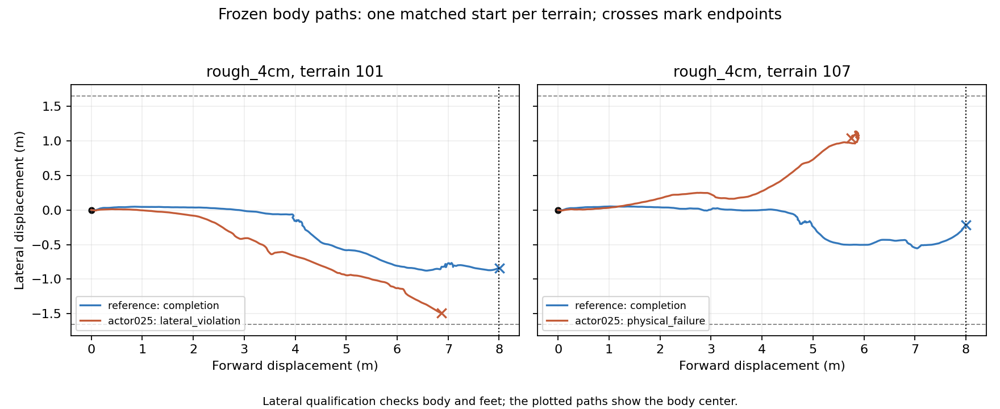

# G1.9 SAC actor 更新额度单因素对照（2026-09-30）

**本次对照不支持采用0.25的actor额度。**两地形的actor更新由3/2次增至176/182次，但reference均完成冻结任务，actor025分别横向越界和物理失败。保留负结果及原默认额度，不追加第三配置或挑选更早的checkpoint。单适应seed、单起点不能证明一般性优劣，也不能用于G1路线晋级。

## 问题与固定条件

G1.8的只读核对表明，原actor额度每有效样本0.005，G1.7实际actor更新0/2次恰好等于分回合额度上界。为检查更充分的actor更新是否有用，本轮只将该额度从0.005提高到0.25，critic额度保持0.5。若两者有效样本相同，名义actor/critic更新额度比从1:100变为1:2；真实更新仍受有效样本、安全门控、回合清除和拒绝更新影响，不能将此比例当作实际更新次数。

[预登记协议](lite3_g1_sac_schedule_protocol_20260930.json)固定development `rough_4cm` 地形101/107、learner seed53、perturbed-v1。两臂分别为`reference`和`actor025`。Huber1、初始alpha=.01、n=1、网络结构、学习率、安全阈值及修复后的预热目标gain=.5相同。本轮不同时切换critic UTD=1、增加LN或修改n-step。

每臂/地形独立从共同base开始：B5000，其中4000步冻结base采样及1000次critic-only预热，再有最多1000步后续学习。预热数据不共享或免费导入。各session固定一次最多2000步任务冻结评估和一次最多1000步真实平面保持，总上限32000控制步。没有另采base对照；reference是低actor额度的学习配置，不能称为冻结base。

执行顺序预先固定：101先reference，107先actor025，每地形固定一张GPU，最多两个worker。仅选择最后提交checkpoint，失败和aborted全部保留，不替换评估起点，不追加第三配置或救援。本轮作为保留Huber配置与第二个SAC配置的对照，单适应seed、单评估起点不满足G1路线晋级条件。

## 重启恢复与证据

重启后首先核对HEAD=e3dc2f6、工作区干净且没有遗留物理worker，因此没有重复G1.8。协议与驱动在本组物理启动前提交推送`250a7ad`。

`docs/analysis/run_sac_schedule_pair.py`保存阶段命令、状态和退出码，并持有每地形独占锁。显式`--resume`跳过已完成阶段和已经失败的配置，只将未完成阶段交回已有supervisor/账本恢复；底层仍核验源版本、配置、固定起点和已计费步骤。恢复测试覆盖完成跳过、失败配置不重试，以及从中断阶段继续。

原始数据位于`artifacts/g1_sac_actor_schedule_20260930/`。审计复用既有学习/冻结检查，额外核对manifest除actor额度外的参数一致、warmup目标gain、配对评估初态、预热轨迹是否逐位一致及回退/更新拒绝。只有实际评估窗口完整且平地比较资格有效，才报告可比较的指标。

## 实际结果

四session均完成，实际 **30509 / 32000 控制步**：适应20000、任务评估6509、平地4000；uncertain=0，无替换起点。每session均完成4000步warmup采样、1000次critic-only预热和500次常规critic更新；合计6000次critic更新。两臂所有预热目标gain均为0.5，没有重新出现等待态gain改变预热目标的问题。

同一地形两臂的预热root state、执行动作、奖励和learning terminal四组字段逐位一致（max_abs=0），评估/保持reset seed和初态匹配；manifest除actor额度外的worker参数一致。

| 地形 | reference actor更新 | actor025 actor更新 | 各臂预热后critic更新 | reference / actor025 冻结actor版本 |
|---|---:|---:|---:|---|
| 101 | 3 | 176 | 500 / 500 | 2 / 53 |
| 107 | 2 | 182 | 500 / 500 | 1 / 82 |

两臂都没有被拒绝的更新。累计接受的actor更新数与最终版本不同，因为执行过既有回退逻辑；reference各1次回退，actor025各2次。未在观察评估结果后手工更换模型，始终执行最后提交的候选。

| 地形 / 配置 | 冻结任务结果 | 前进距离(m) | 请求残差RMS | 平地稳态XY MAE(m/s) |
|---|---|---:|---:|---:|
| 101 / reference | completion，1850步 | 8.00099 | 0.000864 | 0.022656 |
| 101 / actor025 | lateral_violation，1333步 | 6.87035 | 0.014317 | 0.020521 |
| 107 / reference | completion，1755步 | 8.00088 | 0.000576 | 0.022924 |
| 107 / actor025 | physical_failure，1571步 | 5.89782 | 0.049319 | 0.020313 |

图中为机体中心路径；横向资格同时检查机体和四个足端，所以机体中心尚未到达虚线时，也可能因足端越界终止。101的actor025报告最大横向偏移1.66786 m，超过1.65 m限制。该图不表示地形高度分布。

四个平地窗口均完成1000步，排除前5秒后各有750个稳态样本，比较资格有效。actor025平均XY误差较小，但107的前向X误差从0.018161增至0.024905 m/s，Y误差降低后才使平均值变小。因此不能把平均XY误差降低描述为所有运动指标都改善，更不能抵消粗糙地形任务失败。

本轮0控制超时，最大控制计算耗时11.718 ms，原20 ms阈值保持不变。所有冻结阶段actor前后及输入actor张量一致，更新attempt和replay写入为0，replay大小不变；冻结阶段按设计不写完整learner checkpoint，没有声称获取了不存在的critic/replay后快照。8次冻结phase重复调用及两次已完成驱动的`--resume`均新增0步/0试验。

## 判断与下一步

提高额度确实增加了实际actor更新，并未受“只有两次更新”的问题限制，但这两个已观察起点的任务表现更差。这个结果不足以唯一归因于critic误差、过度更新或策略约束中的某一项；应先复盘现有Q与回退证据，不根据这两个失败继续调出第三个额度。

reference是低额度学习配置，本轮没有fresh frozen-base对照，不能把reference完成任务宣称为对base的适应收益。维持原默认actor额度，本组不推进actor025或宣称G1通过；后续数值/回退诊断应复用已付费数据并明确局限，再决定研究路线。

## 验证

[精简验证JSON](lite3_g1_sac_schedule_validation_20260930.json)保存完整报告SHA256、逐trial结果、更新/回退计数、预热字段一致性及重复调用证据。完整输入哈希位于`artifacts/g1_sac_actor_schedule_20260930/audit/report.json`。

全量回归 **1639 passed, 7 skipped**，新增恢复测试验证完成阶段不重复、失败配置不重试及中断阶段续接。首次真实审计通过；绘图时明确机体与足端的横向资格区别，未改动原始数据或控制规则。
