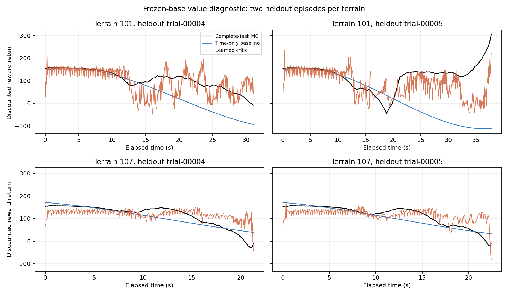
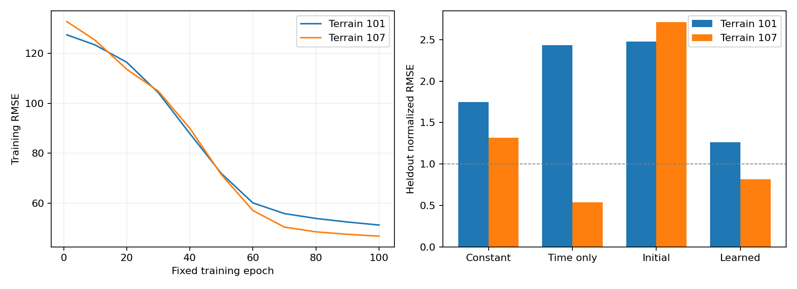

# G1.3 完整回合价值诊断（2026-09-29）

完整回合采集和预登记的 4/2 留出诊断已完成，当前 critic 的泛化不足，尚不能认定 G1 学习信号合格。101 留出 EV 为 −0.392；107 为 0.342，但 RMSE 高于仅时间基线。训练 EV 均约 0.82，不能替代留出证据。

## 协议与成本

[预登记协议](lite3_g1_value_protocol_20260929.json)固定 development rough_4cm 101/107、learner seed7、perturbed-v1、每地形六个起点；trial00000–00003 训练，00004–00005 验证。冻结确定性 base，无动作噪声、无学习采集；每回合 deadline 与 collector 上限均 2000。全部失败保留，无替换起点。

实际 **19,215 / 24,000 控制步**：101 为 10,285，107 为 8,930；12 个完整 task 回合，uncertain=0。两 session 重复 evaluation phase 调用均新增 0 步。训练样本分别 6,837 / 6,740，验证样本 3,448 / 2,190。未用额度不转为追加调参采样。

| 地形 | 四个训练回合（终止原因 / 步数） | 两个验证回合 |
|---|---|---|
| 101 | completion/1416；task_timeout/2000；lateral_violation/1421；task_timeout/2000 | lateral_violation/1558；completion/1890 |
| 107 | physical_failure/1146；completion/1752；completion/1842；task_timeout/2000 | physical_failure/1067；physical_failure/1123 |

目标是 gamma=.99 的完整 task reward-only MC，包括 task timeout 与失败的终止奖励；拒绝 collector 或 learning truncation，没有价值 bootstrap。这不是 SAC soft-Q 真值。

每地形从冻结采集的初始 critic 开始，48-128-128-1 ELU，输入为 policy45 + body XY velocity + elapsed/2000；100 epochs、batch128、Adam lr5e-5、shuffle seed11、loss=.25*MSE、grad cap1，不归一化。每地形只拟合一次，最终 epoch 后评估留出；没有用留出选择 checkpoint。CPU 拟合约 10.2 / 9.1 秒，分别 5,400 / 5,300 次 minibatch 更新。离线 checkpoint 明确标记 diagnostic-only，不可作为 online session checkpoint。

## 结果

以下为按 transition 汇总的留出指标；[验证 JSON](lite3_g1_value_validation_20260929.json)还保留各回合、回合等权 RMSE、R²、进度及接触分层。

| 地形 | 模型 | RMSE | NRMSE | EV | 偏置 |
|---|---|---:|---:|---:|---:|
| 101 | 常数 | 88.144 | 1.749 | 0.000 | −72.317 |
| 101 | 三次时间基线 | 122.805 | 2.437 | −2.863 | −72.602 |
| 101 | 初始 critic | 124.871 | 2.478 | −0.00029 | −114.248 |
| 101 | 拟合 critic | 63.581 | 1.262 | −0.392 | −22.517 |
| 107 | 常数 | 60.316 | 1.317 | 0.000 | −39.268 |
| 107 | 三次时间基线 | 24.583 | 0.537 | 0.748 | −8.748 |
| 107 | 初始 critic | 124.202 | 2.713 | 0.00013 | −115.457 |
| 107 | 拟合 critic | 37.341 | 0.816 | 0.342 | 3.784 |

101 训练/验证目标均值为 42.073 / 114.391，方差为 14563.963 / 2539.521；107 为 76.327 / 115.595，方差为 11948.503 / 2096.028。小样本的终止原因和轨迹分布明显不同，不能把拟合与留出差异全归因于某个输入字段。

训练 RMSE 持续下降，最终 EV 为 0.819864 / 0.817076，未发现数值发散。101 的最后三分之一进度 learned RMSE 约 91.12；107 验证没有最后三分之一进度样本。两个验证集都没有正的非足接触标签，该层仅记录 samples=0，不能报告为误差为零。失败终止与非足接触标签并非同一个定义。

图中 learned 输出有明显短周期波动，MC 目标较平滑；101 时间基线在后段严重低估，而 107 时间基线更好地跟随回报趋势。这些是观察，不是步态或历史缺失的因果证明。

## 工程改进与复核

新增完整回合 MC、指标和固定预算拟合工具；在线 PPO 与诊断共用相同 critic 网络工厂，未改变在线架构。数据入口核对 session/task/base 身份、账本/轨迹计数、奖励分解、时间语义、动作与 base 等价及冻结 actor 状态。

复核时补上 critic 优化器必须为空、critic 输入必须有限及接触标签必须为二值的检查。标签显式转 bool，避免整数 0/1 被 NumPy 当作行号而非掩码。已用增强入口重新审核原 12 个回合；全部通过，原拟合/留出报告保持不变，没有新增拟合或控制步。测试覆盖整数接触标签正确分层，以及非有限观测、非空 critic 优化器、非法标签和伪完整回合的拒绝。

全量回归为 **1611 passed, 7 skipped**；`git diff --check` 通过。

原始数据位于 `artifacts/g1_complete_value_20260929/terrain-{101,107}/`；完整报告、输入文件哈希及离线 checkpoint 位于其 `analysis/`。提交的精简 JSON 保留完整报告 SHA256、源版本、指标和成本，原始大型轨迹留在本地。源码检查增强后不跨版本续接旧采集 session。

## 后续边界

本轮完成 G1-A 首轮完整回合诊断，但未完成路线晋级、在线适应收益或平地保持验收。继续沿用已注册的预热行为，不将离线拟合权重导入 actor 学习。

一个待检验假设是加入仅由过去 body XY velocity 积分得到的行程代理，帮助区分相同 elapsed 下的不同运动历史。它不是世界坐标里程，当前证据不足以确认收益；本轮未实现、未拟合该候选。若后续采用，应先注册单一特征改动、固定训练预算和全新确认回合，使用原四个训练回合拟合，仅一次确认；旧验证集已看过，不再用于调参或宣称独立验证。不得加入 simulator 位置真值作为 critic 输入。
