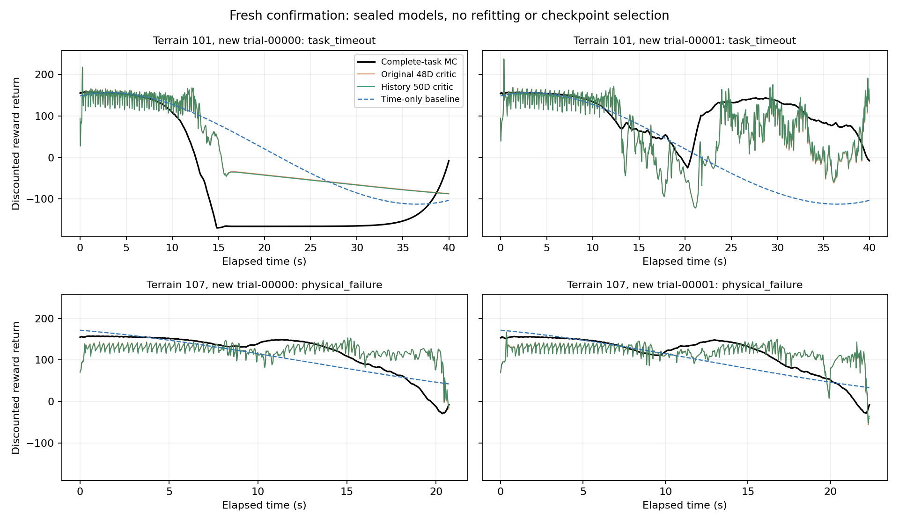

# G1.4 因果速度历史独立确认（2026-09-29）

**本次独立确认不支持速度历史候选。**101 的RMSE小幅降低（80.386→79.709），107 却升高（38.789→39.248），且仍高于时间基线（27.535）。预登记要求两地形均满足，故整体判定为不支持。保留负结果，不部署该候选，不根据这些确认回合再调参。

## 单一改动与锁定

上轮 [G1.3](lite3-g1-complete-value-2026-09-29.md) 暴露 critic 留出泛化不足。本轮只检验一个假设：在瞬时观测和绝对时间相同的情况下，过去的运动历史可能有助于区分不同回报轨迹。

[预登记协议](lite3_g1_value_history_protocol_20260929.json)规定，在原48维输入后增加两个特征：`history[t] = sum(body_velocity_xy[j], j<t) * 0.02 / 12`。每回合从零开始，排除当前时刻及未来样本。12 m 是0.3 m/s×2000步×0.02秒的固定名义行程，不从数据估计。积分没有旋转到固定坐标系，只是机体系速度的行程代理，不是世界坐标里程。没有加入位置/朝向真值、奖励或终止标签作为输入。

隐藏层仍为128/128 ELU。初始第一层由48列追加两列零，其他权重一致；原训练样本上的初始输出差异为0。新增256个参数。原在线 actor、critic入口及部署行为未改动；50维模型仅在离线诊断使用。

训练仅使用上轮101/107各四个训练回合，分别6837/6740步，未读取旧验证轨迹进行拟合或选择。仍为100 epochs、batch128、Adam lr5e-5、loss=.25*MSE、grad cap1、shuffle seed11，无输入/目标归一化。每地形只拟合一次，分别5400/5300 minibatch更新，CPU约10.51/8.97秒（与回归测试同时运行）。训练EV为0.821683/0.818298，相比原0.819864/0.817076只有小幅变化，不能据此证明泛化收益。

在两个确认采集目录都不存在时，保存了[模型锁定记录](lite3_g1_value_history_fit_lock_20260929.json)，随后提交并推送源码及协议 `b2f0048`，再启动采集。固定拟合manifest SHA256为`9a45cf46ebd3f89bd3048e4df8bcf4f47eaf82e6f0f4ece7281be5642fb08a56`。确认工具校验协议、源码、模型bundle及原数据哈希；不会重拟合比较对象或挑选epoch。

## 新确认规则

development rough_4cm101/107，各两个新的perturbed-v1起点，learner seed19；reset seeds固定为1064007299、1604434861，与上轮六个起点无重叠。同一地形的四个模型在完全相同的新轨迹上比较。采集仍执行冻结确定性base，无动作噪声、无学习；新增总预算≤8000控制步，GPU0/1各一个worker。所有失败保留，不补起点；没有封存种子、teacher重启或在线候选晋升。

比较对象固定为原保存48维critic、原训练均值常数和原训练三次时间基线。候选必须在两个地形上均满足pooled EV>0，并且相对全部三个比较对象的pooled RMSE和回合等权RMSE都降低，才记为“本次诊断支持”。这是预登记的有限资源诊断规则，不是统计显著性检验，也不等于G1在线学习收益验收。任何不完整/aborted回合使完整确认不充分，不能把截断重标为MC。

## 验证

4个新回合全部完成，实际新增 **6156 / 8000 控制步**（101为4000、107为2156），uncertain=0。101两个回合均task_timeout/2000；107两个回合分别physical_failure/1037和physical_failure/1119。没有替换起点；两session重复evaluation均新增0试验、0步。连同G1.3，完整回合价值诊断累计 **25371控制步**；新增拟合计算另列，不混入物理步预算。没有采集额外平地或适应回合。

| 地形 | 模型 | pooled RMSE | 回合等权RMSE | NRMSE | EV | 偏置 |
|---|---|---:|---:|---:|---:|---:|
| 101 | 原48维critic | 80.386 | 79.072 | 0.619 | 0.636 | 17.861 |
| 101 | 历史50维critic | 79.709 | 78.386 | 0.614 | 0.642 | 17.929 |
| 101 | 常数 | 131.384 | 123.265 | 1.012 | 0.000 | 19.800 |
| 101 | 时间基线 | 121.911 | 121.740 | 0.939 | 0.119 | −1.095 |
| 107 | 原48维critic | 38.789 | 38.812 | 0.838 | 0.305 | 3.761 |
| 107 | 历史50维critic | 39.248 | 39.273 | 0.847 | 0.288 | 3.557 |
| 107 | 常数 | 61.758 | 61.802 | 1.333 | 0.000 | −40.855 |
| 107 | 时间基线 | 27.535 | 27.517 | 0.595 | 0.687 | −9.276 |

101两个回合的候选RMSE均小幅低于原模型，107两个回合均更高。候选新增权重确实得到更新；不能把结果归因于未启用特征。101单地形满足预登记方向条件，107不满足，整体不支持。没有把小幅差异解释为统计显著性。

新101目标均值22.273、方差16869.647；107均值117.182、方差2144.847。原48维模型权重完全未变，但101在新起点的EV为0.636，上轮两个起点为−0.392，说明不同回合分布下指标差别很大；不能将这个跨数据集变化解释为训练改进。新101两回合都是超时，新107两回合都是物理失败，四回合仍不足以覆盖所有运行情况。

101非足接触层为0样本；107只有1个正标签，方差为0，EV/NRMSE/R²为null。107依然没有最后三分之一进度样本。进度分层的模拟器位置仅用于报告，不进入两个critic输入。[验证JSON](lite3_g1_value_history_validation_20260929.json)保存全部指标、逐回合结果、训练曲线、来源哈希及重复调用检查。

两critic输出在图中大幅重叠，新增历史没有解决本组回合的主要误差。101长时间停滞对应的大幅回报下降及107终止前回报变化仍有明显预测偏差；图形本身不能确定是输入不足、拟合方式还是训练覆盖不足所致。

全量测试：1623 passed, 7 skipped。新增测试检查排除当前/未来的因果前缀、逐回合清零、原48维及时间列不变、零扩展初始化等价、非法形状/尺度拒绝、固定输入哈希校验，以及所有比较对象和两种误差权重必须同时满足的判定规则。

原始拟合、模型及新回合位于`artifacts/g1_value_history_20260929/`。大型轨迹和离线模型保留在本地，不作为正式适应session的免费数据或在线checkpoint。

## 后续决定

关闭本轮历史候选，不改在线48维critic，不再围绕这些确认回合修改尺度、容量或训练轮数。保留已实现的因果特征及锁定确认工具以便审计，但没有导入在线worker或宣布G1-A合格。后续优先推进G1-B独立的固定策略soft-Q数值诊断；reward-only MC不作为SAC soft-Q真值，也不要求SAC等待PPO EV通过某个阈值。在线适应收益、冻结表现和平地保持验收仍待完成。
