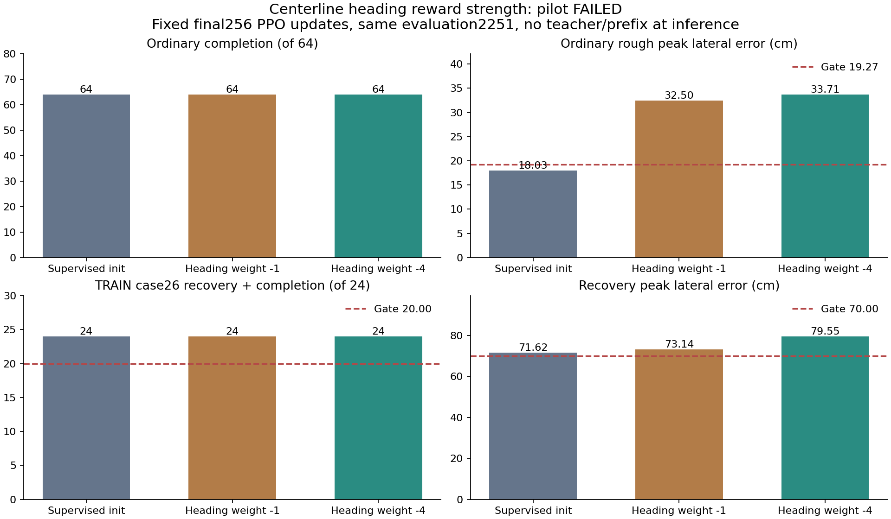
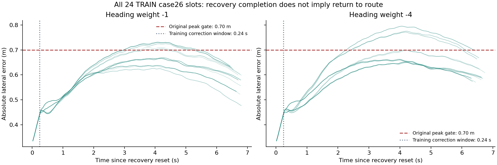

# 回线航向奖励权重−1→−4：完整实验结果（2026-10-09）

**本轮改动退化，候选不采用，原六项门槛仅通过三项。** 普通完成仍64/64，但RMS7.15→8.72cm、最坏横偏32.50→33.71cm；TRAIN case26恢复仍24/24，峰值73.14→79.55cm，走完后的平均残余横偏57.72→61.64cm。普通RMS、普通峰值和恢复峰值三项失败，原7来源验证未触发。

## 唯一变化和固定条件

承接[回线航向目标实验](lite3-route-heading-result-2026-10-09.md)。目标保持：

`ψ_ref = clip(atan2(-y, 1 m), -20°, +20°)`

只把实际航向奖励从`-[1-cos(ψ-ψ_ref)]×0.02`改为`-4[1-cos(ψ-ψ_ref)]×0.02`。前视距离、转角界限、机身/足端最大横偏惩罚−8、在线动作保持100、四组均值回放100和尾段回放25均不变。

仍从监督Actor6a470cec…重新初始化，fresh critic/optimizer；learner2281、std0.05、lr3e-6、64环境×32步×256轮、每轮5epoch×4小批、最终checkpoint规则全部不变。没有从上一候选c7c1d64d…续训，没有按评测更换种子或中途模型。

训练仍16flat+24普通rough101+12 TRAIN case26+12普通rough107；固定前进命令0.3m/s、50Hz，跑道10m×4m、rough101/107最终高度±4cm。Actor仍48D输入、12D关节动作；推理没有几何转向器、教师接管、时间或case输入。此次是PPO奖励权重消融，没有FlowDAgger噪声策略更新或新增步态量化验收。

## 工程配对和实现核验

本轮运行时代码没有修改。逐文件确认它与上一轮完成训练的源快照一致，沿用前轮实际通过的53项测试记录；没有把这描述为本轮重新跑了53项测试。只读审计增加了权重消融支持，并对旧审计/汇总JSON进行了完全一致的兼容核验。

先在相同GPU1、相同seed2311上重新执行64×400控制的冻结工程smoke，Actor和±0.01动作探针保持原样。全部冻结物理字段、动作、状态、航向目标及保持目标逐元素相同；实际航向奖励为旧值4倍，总奖励变化仅来自这一项，最大残差3.21e−7。航向/原动作保持/全轨迹配对三项审计通过。新25600个控制步全部计费，不能因轨迹复现而扣掉。

正式训练完成524288控制、5120次Adam更新。3276800次重复回放查询保持原配方：四组2621440条、尾段655360条。原四组索引流、纠正示范标签流和尾段索引流均独立重建并与对照一致；参考Actor未改变，验证行和原7来源零用于更新。

训练中的恢复回合287成功、57失败、0截止全部保留。第一32步物理和航向几何与权重−1对照逐元素相同；总奖励最大变化0.02401758，仅用权重缩放即可解释，最大残差1.49e−8。训练、原保持、航向实际奖励、双回放四项审计均通过。

固定最终模型SHA：`b0432834856e25bde22191483f635f5a260c69a3a37ef0e4eda0c702abbe8e25`。

## 冻结评测结果

固定eval2251、GPU1，候选普通/恢复两条件。与已付费原PPO2063基线及权重−1对照的初态/执行器延迟联合哈希一致。评测轨迹、动作历史、完成与恢复判据和抽样CPU动作回放均审计通过。

| 指标 | 权重−1对照 | 权重−4候选 |
|---|---:|---:|
|普通完成|64/64|64/64|
|普通rough平均每回合RMS|7.15cm|8.72cm|
|普通rough最坏横偏|32.50cm|33.71cm|
|TRAIN case26恢复并完成|24/24|24/24|
|恢复平均每回合RMS|61.26cm|62.54cm|
|恢复最坏横偏|73.14cm|79.55cm|
|恢复结束平均绝对横偏|57.72cm|61.64cm|

本轮flat/rough101/rough107完成16/16、24/24、24/24；四个Hip/Knee延迟组恢复分别7/7、7/7、7/7、3/3。通过普通完成、恢复数量、分组恢复三项；普通RMS超过原基线8.065cm的1.05倍，普通峰值超过19.274cm，恢复峰值超过70cm。原门槛保持，不因完成数好看而放宽。

24个恢复槽重复同一个TRAIN来源。开发种子2251被持续用于改进，因此这仍是开发评测，不是未知来源恢复资格、独立学习种子复现或通用稳定新步态证据。项目早期PPO283/307限定六地形验收记录继续保留；当前候选均未因“最新”而替换已验证模型。

## 逐回合诊断

48个普通rough槽中，只有13个RMS、16个峰值改善。之前最坏的env29峰值略降，但出现了新的更坏回合：

| 配对环境 | 地形 | 旧峰值 | 新峰值 |
|---|---|---:|---:|
|env62，本轮最坏|rough107|12.29cm|33.71cm|
|env29，上轮最坏|rough101|32.50cm|30.87cm|
|env51|rough107|13.70cm|28.83cm|

这些都是评测后诊断，不用于挑选种子、模型或训练标签。新最坏env62在26.4秒达到−33.71cm，此前平均世界横向速度约−1.33cm/s、航向约−4.95°；速度积分−35.24cm与位置变化−35.27cm相符。加强奖励并未消除该回合的持续漂移。

在各模型实际访问的普通活动状态上，相对初始化Actor的动作均值MSE0.000121→0.000130；不同访问分布上的平均动作误差仍不能直接解释全部闭环变化。不能据此指定唯一失败机制。

恢复最坏为env40，约4.06秒达到79.547cm。初态本已偏32.65cm，相对初态最大额外位移46.89cm，旧对照40.49cm；结束残差也增加。恢复并走完与稳定回线仍有明显差距。

## 下一项调整方向

不再沿着增大航向权重继续加码。本轮明确保留权重−4的失败结论，下一项以已登记的权重−1配方作为对照，隔离检验纠正示范目标与回线奖励的组合：仅将correction回放目标从示范执行动作改回冻结初始化Actor均值，保留权重−1回线奖励、尾段保持及其余设置，从原6a初始化重新训练。

该方向依据是更早自均值目标版本的普通/恢复峰值15.84/70.46cm，而增加纠正示范约束后的多个版本虽保持24/24恢复，峰值持续较大。这只是有待检验的交互假说，不能直接比较不同配方就归因，也不等于将旧自均值候选宣称为合格教师。新消融需另登记协议和预算，本轮尚未实现或启动。

原7来源和本轮pilot不成为训练标签；不改70cm/普通精度门槛，不挑中间checkpoint，不启动尚未具备资格的新FlowDAgger集成。

## 成本和证据

本阶段工程25600＋训练524288＋冻结评测180224＝**730112个新控制转移**，新增uncertain0。重复工程运行照常收费；回放查询、兼容检查和离线诊断新增物理0。原7来源条件验证未触发，费用0；登记上限1061888不是必须耗尽的额度。

FlowDAgger及恢复开发累计charged31884736/confirmed31884672/历史uncertain64；旧完整PPO系列11900884另列，两账合计43785620，仍不包含最早预训练及SAC/C0费用。控制转移不是GPU小时。本轮无物理中止重试，所有最终模型、训练失败和评测记录保存在本地artifacts，没有新拍视频。

- [预登记计划](lite3_heading_weight4_plan_20261009.json)、[工程协议](lite3_heading_weight4_smoke_protocol_20261009.json)
- [工程航向审计](lite3_heading_weight4_smoke_audit_20261009.json)、[工程保持审计](lite3_heading_weight4_smoke_anchor_audit_20261009.json)、[全部冻结物理配对及4倍奖励审计](lite3_heading_weight4_smoke_pair_audit_20261009.json)
- [训练协议](lite3_heading_weight4_train_protocol_20261009.json)、[训练审计](lite3_heading_weight4_training_audit_20261009.json)、[保持审计](lite3_heading_weight4_reward_audit_20261009.json)、[航向审计](lite3_heading_weight4_geometry_audit_20261009.json)、[回放及首段奖励差审计](lite3_heading_weight4_update_audit_20261009.json)
- [旧结果兼容检查](lite3_heading_weight4_analysis_regression_20261009.json)、[沿用的53项测试日志](lite3_route_heading_tests_20261009.txt)
- [冻结协议](lite3_heading_weight4_pilot_protocol_20261009.json)、[冻结轨迹审计](lite3_heading_weight4_pilot_trajectory_audit_20261009.json)、[原门槛判定](lite3_heading_weight4_pilot_result_20261009.json)
- [完整结果和成本](lite3_heading_weight4_result_20261009.json)、[48槽对比](lite3_heading_weight4_episode_comparison_20261009.json)、[普通方向诊断](lite3_heading_weight4_ordinary_diagnostic_20261009.json)、[恢复曲线数据](lite3_heading_weight4_lateral_diagnostic_20261009.json)
- [项目总结](lite3-project-summary-2026-10-08.md)、[PPO微调原理](lite3-full-ppo-finetuning-principles-2026-10-08.md)
