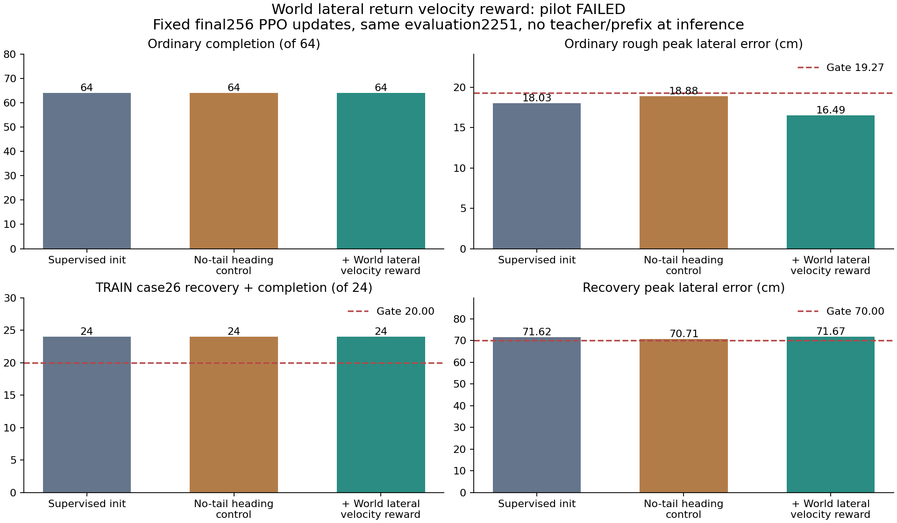
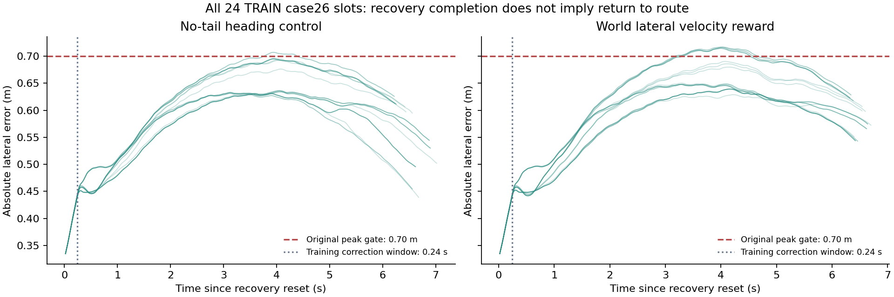

# 世界横向回移速度奖励消融（2026-10-10）

**普通峰值改善，恢复精度退化，完整验收仍未通过。** 新增速度奖励后，普通64/64、峰值16.49cm；TRAIN case26恢复24/24，但恢复峰值71.67cm，仍超过原70cm门槛。六项门槛通过五项，不晋升本轮模型、不触发原7来源验证或新FlowDAgger集成。

## 这次具体改了什么

继承上一轮无尾段保持＋回线航向配方，只新增训练奖励：

`v_y_target = clip(-0.5 × y, -0.15, +0.15) m/s`

`r_velocity = -8 × (v_y - v_y_target)² × 0.02`

y是相对跑道中心线的根连杆原点横偏；v_y是根连杆质心线速度在世界Y方向的分量。这是IsaacLab `root_state_w` 的既有约定，不是全机器人质心，也不假设速度严格等于原点位移导数。目标是区分朝内/朝外平移，并非仅奖励机身朝向。

参数在训练前只用上一轮已审计TRAIN轨迹固定：2秒局部回移时间尺度，速度限幅为0.3m/s前进命令的一半。系数匹配全部恢复age≥12控制中10%的 `8y²` 机身横偏代理与速度误差代价，再取最接近的2次幂、限于[0.5,8]，得到−8。TRAIN尾段平均新增代价约0.274/s，是机身代理2.981/s的9.2%；普通新增约0.0194/s。恢复前12步约3.403/s，比尾段更强；没有根据pilot结果反调参数。机身代理不等于原机身/足端最大横偏惩罚。

初始化仍为6a470cec…监督Actor，fresh critic/Adam；learner2281、std0.05、lr3e-6、64环境×32步×256轮、每轮5epoch×4小批，只取最终模型。四组自均值保持100、主抽样seed2293、无尾段保持、普通/恢复前12步实际动作奖励保持100、机身/足端横偏−8、航向−1/1m/20°不变。48D Actor、51D Critic、12D关节动作不变，推理无教师、时间/case输入、固定前缀或额外速度控制器。

仍是10m×4m跑道、rough101/107最终高度±4cm、50Hz、前进命令0.3m/s。本轮未新增地形、实机测试或录像；24恢复槽来自同一个TRAIN来源，不能当成24个独立失稳来源。

## 实现与训练证据

40项相关测试通过，覆盖左右反射、零偏移、限幅、世界坐标、重置前快照、重复dt错误、原航向/保持/回放/账本路径。首次pytest被环境的无关typeguard插件依赖冲突拦住，未执行测试；关闭插件自动加载后通过，没有改依赖来绕过失败测试。

工程仿真25600控制完成。全部400步公共字段除总奖励外与旧同seed工程运行逐元素相同，奖励差由新增速度项解释，最大残差2.07e−7。训练首32步的公共字段也逐元素相同，奖励差残差1.49e−8。176个运行源文件仅3个变化，其余173个与对照相同，工程/训练/评测使用相同运行源码。

训练524288控制、5120次Adam更新、2621440次主回放查询、尾段查询0。主抽样流独立重建且与对照相同；冻结参考未改变，存储示范动作标签和验证数据均未用于本轮更新。训练恢复288成功、65失败、0截止全部保留。完整数据隔离、动作保持、航向、速度分项及优化更新审计均通过。

最终模型：`/home/tjx/rl_training_main/.worktrees/lite3-policy-learning/artifacts/lateral_velocity_20261010/train/final.pt`，SHA256 `0b0001537da29fe8a5e119ab8bb591363b426dd99f12d74396d5509efe1e2d97`。

## 冻结评测与原门槛

| 指标 | 无尾段航向对照 | 新增世界速度奖励 |
|---|---:|---:|
| 普通完成 | 64/64 | 64/64 |
| 普通rough平均回合RMS | 7.15cm | 7.67cm |
| 普通rough最大横偏 | 18.88cm | 16.49cm |
| TRAIN case26恢复并完成 | 24/24 | 24/24 |
| 恢复平均回合RMS | 59.35cm | 60.24cm |
| 恢复最大横偏 | 70.71cm | 71.67cm |
| 恢复结束平均绝对横偏 | 54.85cm | 58.21cm |

普通flat/rough101/rough107分别16/16、24/24、24/24。四Hip/Knee延迟组恢复7/7、7/7、7/7、3/3。原普通最大横偏门槛0.1927442551m、RMS门槛原基线×1.05及其他标准全部保留；恢复峰值精确为0.7166910172m，超过0.70m约1.669cm，失败判定不变。

所有初态/执行器延迟联合哈希与旧对照和原PPO基线匹配。完整轨迹重算及176条抽样CPU动作回放通过。48个普通rough槽中13个RMS、28个峰值改善；24个恢复槽只有2个RMS、3个峰值改善，不能由普通最大值下降推成全面改善。

新最坏恢复槽为env48，4.00秒达到71.669cm；初始已偏32.652cm，相对起点最大额外偏移39.017cm。结束平均横偏58.21cm，也比对照54.85cm更大。“恢复并走完”仍不等于回到路线。

## 评测停滞及处理

原评测进程完成普通条件87232控制后，在第二场景创建阶段停滞，超过5分钟日志/账本无变化，账本pending为空、恢复目录尚未创建。根线程处于futex等待；原生堆栈检查被主机ptrace策略拒绝，因此没有确定内部根因。TERM未使进程退出后终止该进程，原始report/ledger保持原样，另存中断审计。

预登记续跑只执行尚未开始的恢复条件，使用相同最终模型、GPU1、eval2251、初态库及门槛。新进程正常完成87232控制。普通条件没有重跑，也没有挑选或删除回合。总评测174464控制低于原256000上限，无额外预算、无新增不确定控制。

`pilot-combined` 是明确标记的两进程组合产物，保留各条件原始路径/哈希及中断证据；不冒充原进程完整结束。独立审计验证条件互不重复、所有条件轨迹完整、原始记录不变，并重新核验全部物理轨迹及相同初态。后续类似评测优先在预登记时按条件分别启动进程，减少同进程重建场景的停滞机会。

## 负结果说明与下一步

冻结模型的全部恢复轨迹显示：0.24–1秒平均向外世界速度从7.24降至6.48cm/s；但1–2秒从9.85升至10.73cm/s，2–4秒从2.96升至3.30cm/s；4秒后平均向内速度从4.26降至3.48cm/s。因此前段局部改善没有转化为更小恢复峰值。所有终止步和完整回合都保留，后段按活动步统计仍有回合时长选择影响。

本轮证明的是这组固定参数/学习种子下的结果，不能证明世界速度奖励一般无效。当前Actor不直接观察线速度，且四组自均值保持仍约束更新；二者可能影响回移学习，但尚未通过消融确立因果。

下一步先用TRAIN更新数据核对PPO目标与四组均值保持的梯度量级/方向，并检查现有48D状态对回移速度的可辨识性；再登记一个单因素实验，优先检验恢复纠正组的保持强度。当前只提出诊断与后续消融方向，未宣称保持项就是原因，也未启动下一轮训练。保留全部既有失败和原70cm门槛；原7来源资格、独立学习复现和新FlowDAgger集成仍未通过。

## 成本与文件

新增工程25600＋训练524288＋评测174464＝**724352个控制转移**。评测中的87232普通控制被保留使用，未重复或额外加计。新增uncertain0，条件验证0。恢复/FlowDAgger累计charged34014336、confirmed34014272、历史uncertain64；旧完整PPO11900884另列，两账合计45915220。不等于GPU小时，也未包含最早预训练和SAC/C0费用。

- [计划](lite3_lateral_velocity_plan_20261010.json)、[TRAIN校准](lite3_lateral_velocity_calibration_20261010.json)、[坐标约定](lite3_lateral_velocity_coordinate_contract_20261010.json)、[完整运行与复算步骤](lite3-lateral-velocity-runbook-2026-10-10.md)
- [训练审计](lite3_lateral_velocity_training_audit_20261010.json)、[动作保持](lite3_lateral_velocity_anchor_audit_20261010.json)、[航向](lite3_lateral_velocity_heading_audit_20261010.json)、[速度奖励](lite3_lateral_velocity_reward_audit_20261010.json)、[优化更新](lite3_lateral_velocity_update_audit_20261010.json)
- [中断记录](lite3_lateral_velocity_pilot_interruption_audit_20261010.json)、[续跑登记](lite3_lateral_velocity_pilot_continuation_addendum_20261010.json)、[组合审计](lite3_lateral_velocity_pilot_assembly_audit_20261010.json)、[冻结轨迹审计](lite3_lateral_velocity_pilot_trajectory_audit_20261010.json)
- [原门槛判定](lite3_lateral_velocity_pilot_result_20261010.json)、[结果/账本](lite3_lateral_velocity_result_20261010.json)、[全部恢复横偏](lite3_lateral_velocity_lateral_diagnostic_20261010.json)、[冻结速度及全部配对回合](lite3_lateral_velocity_frozen_velocity_diagnostic_20261010.json)
- [项目总结](lite3-project-summary-2026-10-08.md)、[完整PPO原理](lite3-full-ppo-finetuning-principles-2026-10-08.md)
