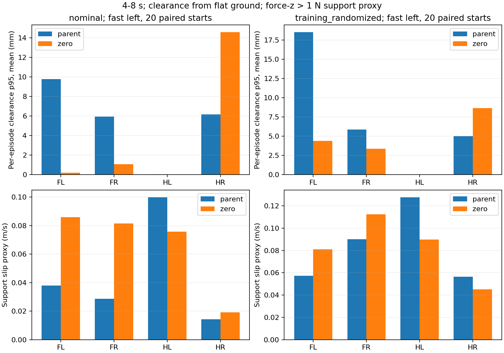
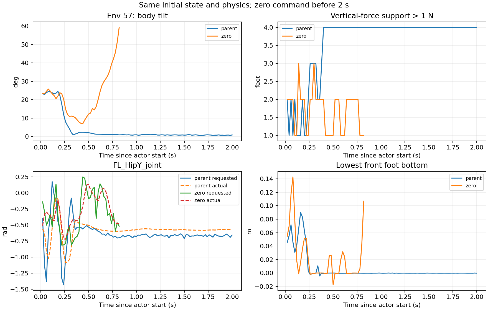
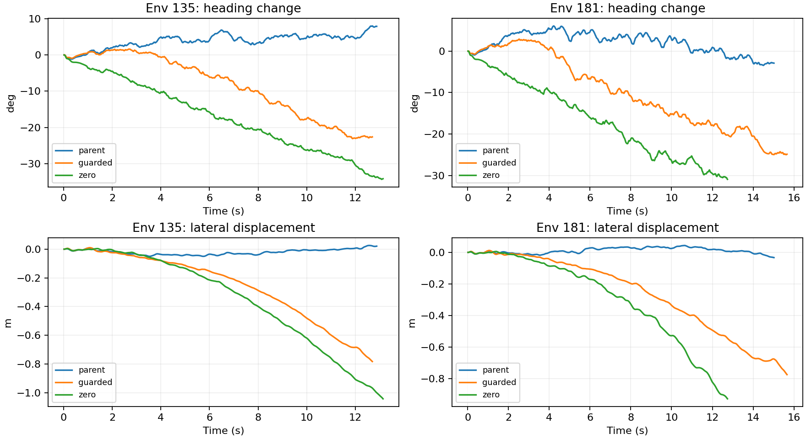

# 冻结模型运动诊断结果

本阶段已完成。新增 1280 个诊断回合，优化器更新为 0，四组原始轨迹与对应历史运行逐项一致。高速左转退化、随机化起步失败和下阶走偏都有可复核的动作证据，但尚不能归结为同一个奖励项造成。当前模型仍保留为上阶候选，不替换父模型、不部署。

下文 parent 指父模型 10000；zero 指动作保持系数为 0、训练 100 次更新后的 10100；guarded 指上一轮动作保持系数为 0.5 的 10100。本阶段没有重新训练这些模型。

## 1. 高速左转：前脚抬起减少，支撑期间滑动增多

下表为 4–8 秒，同一起点、双方均完整存活的配对结果。左右高速指令分别为 +0.8、−0.8 rad/s。

| 条件 / 指令 | 配对数 | 父模型实际角速度 | zero 实际角速度 | 父模型 MAE | zero MAE |
|---|---:|---:|---:|---:|---:|
| 名义高速左转 | 20 | 0.6060 | 0.5759 | 0.1998 | 0.2339 |
| 随机化高速左转 | 20 | 0.6536 | 0.5650 | 0.1743 | 0.2506 |
| 名义高速右转 | 20 | −0.5424 | −0.5940 | 0.2734 | 0.2186 |
| 随机化高速右转 | 19 | −0.5412 | −0.6355 | 0.2780 | 0.1939 |

名义高速左转时，四足同时接触的时间占比由 56.45% 增至 68.45%；随机化由 50.38% 增至 65.30%。接触次数不能直接代表迈步质量：名义每回合落脚次数由 16.70 增至 26.35，但落脚对应的平均腾空时间由 93.25 ms 缩至 44.83 ms。

以下净空为足底相对平地高度，先对每个回合取 95 分位，再对 20 个配对起点平均；它不是最高抬脚高度。

| 高速左转条件 / 足 | 父模型净空 p95 | zero 净空 p95 | 父模型支撑滑移代理 | zero 支撑滑移代理 |
|---|---:|---:|---:|---:|
| 名义左前 | 9.77 mm | 0.19 mm | 0.0380 m/s | 0.0860 m/s |
| 名义右前 | 5.95 mm | 1.08 mm | 0.0288 m/s | 0.0815 m/s |
| 随机化左前 | 18.52 mm | 4.40 mm | 0.0572 m/s | 0.0810 m/s |
| 随机化右前 | 5.85 mm | 3.38 mm | 0.0900 m/s | 0.1123 m/s |

左后足在高速左转中几乎持续支撑，两种策略都有这一特征。zero 的右后足抬起反而增加，因此不能说四条腿都不抬，也不能把退化解释为抬脚总高度统一降低。名义右转仍保留左前、左后足的较明显离地。

关节记录同样出现策略变化。例如名义高速左转时，右前 HipX 请求目标的回合内变化范围由 0.2169 降至 0.1104 rad，左后 HipY 由 0.2485 降至 0.1567 rad。随机化对应数值也下降。所分析的 1434 个完整转向窗口中，20 ms 采样的力矩均未达到显式执行器限值的 95%；父/新策略的质量、惯量、质心、PD 增益、延迟和初始输入完全相同。证据更符合策略输出及支撑方式改变，未见持续力矩饱和造成转不动的证据。请求目标在执行器延迟之前读取，不能当作延迟后的电机目标。



## 2. 奖励代码：取消短步惩罚后，短步仍然没有正向得分

`reference_low_stairs_repair.py: yaw_airtime_without_short_step_penalty` 在纯转向时使用的公式等价于：

```text
5 × sum(max(最近腾空时间 − 0.5 s, 0) × 本步首次落脚)
```

门控为平移指令模长 < 0.1 m/s 且偏航指令绝对值 > 0.1 rad/s。该修正已经正确接入实际训练，作用是取消短步的负分。它不奖励 40–100 ms 的短步。对本次父/新模型、两种物理条件、六类持续纯转向、三个完整时间窗共 1434 个回合窗口重算，这项修正后的得分全部为 0；站着不动同样为 0。不能把这项修正称为已提供有效的抬脚正奖励。

纯转向还保留参考项目的 `phase_foot_trajectory_exp`。当前实际配置为：权重 2、std=0.12 m、周期 0.425 s、gait_span=0、stance_span=0、velocity_weight=0、gait_psi=0.05、gait_delta=0.02。源码将 stance_span 钳制到 1e−6，因此模板几乎没有支撑段；水平参考位置固定，只随相位改变竖直参考。命令仅用于开关，左右方向和角速度大小没有进入参考轨迹，接触是否交替也不直接参与该项评分。

这是实际存在的奖励区分不足：不转、不形成有效交替迈步，也可能获得较高相位分数。名义 ±0.2 指令下，zero 四脚接触占比均为 100%，落脚事件为 0，实际角速度约 0.0028/0.0000 rad/s，但相位项仍得约 1.499/1.557，权重上限为 2。

名义高速左转退化时，相位项由 1.357 增至 1.598，偏航跟踪项却由 1.354 降至 1.316。随机化高速左转相位项也由 1.355 增至 1.418，而偏航跟踪由 1.382 降至 1.289。静止或较小动作还能减少部分动作变化、力矩等代价。这支持相位项可能参与了目标之间的取舍，但没有逐项训练干预，不能证明它是左转退化的唯一原因，也不能保证关闭它就恢复全部能力。

以上相位数值是在本次冻结状态及保存的相位参考上，换算为训练使用的 gait_level=1 后重算的分数；不是实际训练轨迹的奖励日志。统一冻结评估使用 gait_level=0.9761198315531384，原始公共分数仍完整保留。原参考计分中把纯转向当站立的 stand_still，以及参考机身高度 0.55 m，也不能冒充当前训练缺陷：实际训练早已修正站立门控与高度到 0.32 m。本次重新核实了纯转向的实际训练站立惩罚为 0。

相关代码：`reference_low_stairs_guarded_cfg.py: configure`、`reference_low_stairs_cfg.py: apply_rewards`、`reference_low_stairs_rewards.py: phase_outside_stair_translation`，以及只读参考项目 `mdp/rewards.py: phase_foot_trajectory_exp`。本阶段未修改这些历史文件。

## 3. 环境 57：相同倾斜起点上的恢复动作发生变化

该回合发生在前 2 秒零命令阶段。虽然分配的后续测试类别为低速左转，失败时尚未下达左转指令。

两个模型经历完全相同的 50 步默认 PD 准备。准备第一帧机身倾角约 0.87°，策略接手时已变为 23.76°。这说明协议本身包含一个困难的恢复起点，不能把它称为从水平站稳状态开始。该起点的物理参数和完整初始 actor 输入逐项相同。

同一输入下，zero 的第一步左前 HipY 目标比父模型多 0.2573 rad，右后 HipY 少 0.2444 rad。CPU 离线网络输出与补录中的 GPU 动作最大差为 2.39e−6 以内，请求关节目标计算也吻合，未见关节顺序或动作缩放接错。

| 时间 | 父模型倾角 | zero 倾角 | 支撑情况 |
|---|---:|---:|---|
| 策略接手前 | 23.76° | 23.76° | 相同初始状态 |
| 0.30 s | 4.26° | 10.91° | 双方都曾出现三足支撑 |
| 0.40 s | 2.21° | 7.84° | 父模型四足支撑；zero 两足支撑 |
| 0.82 s | 0.84° | 59.31° | 父模型稳定；zero 触发姿态终止 |

zero 曾更早出现前足接触，随后又失去稳定支撑，不能简单描述为前足一直没有落地。前 0.5 秒右前/右后支撑比例分别由父模型的 28%/92% 变为 4%/52%。失败前右后足成为主要支撑。

这确认了该起点上的恢复能力退化，并不能证明单独改某一个关节就能修复连续行为。也不能推广为所有恢复起点都变差：zero 的随机化起步总失败为 1，父模型为 3，且 zero 恢复了父模型原有的失败起点。相位转向门控在零命令时关闭，本例不能直接归因于转向相位奖励当时给错分；共享策略训练后的间接影响仍需后续试验。



## 4. 下阶走偏：主要由航向积累造成，平地也出现了右偏

完全复用已有的六组下阶数据，包含父模型、guarded、zero 的两种物理条件；没有新增下阶仿真。zero 名义 3/5 厘米各出现一次横向越界，都在 0.32 m/s 组，没有姿态终止。

| 起点 / 高度 | 越界时间 | 最终航向 | 相对初始横移 | 机身前进速度贡献的横移 | 机身侧向速度贡献 |
|---|---:|---:|---:|---:|---:|
| 135 / 3 cm | 13.14 s | −35.65° | −1.043 m | −1.116 m | +0.070 m |
| 181 / 5 cm | 12.74 s | −31.51° | −0.927 m | −0.935 m | +0.005 m |

分解使用完整四元数旋转，包含滚转、俯仰和竖直速度项。这两个例子的积分残差约 3.6/4.1 mm。机身侧向分量没有主导负向横移；主要是机身已经右偏，再持续向前走。足端滑移与这个机身运动分解是不同指标，不能互相替代。

两个例子首次航向相对初始变化超过 10° 分别为 3.82/3.62 s，前足第一次越过首阶边缘为 3.70/3.48 s。偏转在接近首阶前已开始累积，超过 10° 恰在前足开始下首阶附近。不能仅按机身尚未过边缘就说当时没有脚接触台阶。

为了避免只挑失败个例，另按三种策略共同完整存活的起点统计 0–2、2–4、4–6 秒窗口。名义 2–4 秒各高度都是 60 个共同起点；平地平均绝对航向变化由父模型 1.89° 增至 zero 6.15°，3/5 厘米由约 1.79°/1.77° 增至 5.88°/5.80°。平地也出现同方向右偏，支持这是更新后直行航向保持发生变化，不能全归为某一级台阶碰撞。

随机化条件仍需分开看：zero 下阶完整通过总数 184/240，高于父模型 173/240，低于 guarded 205/240。zero 的 56 个未通过全是横向越界。不能用名义两例推断随机化所有组都比父模型差，也不能将成功回合和失败回合的不同存活时长直接混合比较。



## 5. 核验、边界与交付

- GPU 1 顺序补录四次，每次 320 环境、50 步 PD 准备、1000 控制步；没有重复补录。进程耗时合计约 12.7 分钟，卡总占用峰值约 5906 MiB。所有本阶段仿真已结束。
- 全部原始报告、有效配置、初始数组及原轨迹字段与历史逐项一致。四组补录的 actor 输入命令和回合计数对齐，记录为重置前第一回合数据。父/zero 的对应初始物理数组、准备轨迹与第一步输入相同。
- 首组仿真完整结束后，旧核验器因来源清单多了一个已固定哈希的只读状态检查模块而退出 1。已限定允许该额外来源，重新核验完成数据；保留原 execution/error/log，不伪装成四个进程都以 0 退出，也没有重跑该组。其余三组退出 0。未发现物理错误或软件回退。
- 原腾空计分重建最大误差 9.54e−7，相位计分最大误差 1.26e−5。11 项 CPU 检查通过。66 个复用历史文件与上一阶段归档哈希相同；raw_manifest.json 保存 119 个原始、派生或检查点文件的哈希。
- 接触时长/足端力/关节力矩按 20 ms 采样。竖直力 > 1 N 作为支撑代理；current_contact_time > 0 作为接触状态，两者分别统计。滑移为支撑采样点上的水平足速，不能替代高频接触流形；未观察到持续力矩饱和不排除未采到的瞬时峰值。
- 所有补录仍是同一训练种子和已反复观察的开发起点。证据足以描述本组行为与代码评分，但不构成新场景泛化、10 厘米台阶或实机能力证明。

`summary.json` 是完整性核验，不表示能力验收通过。CSV 保留回合与共同起点分组，`detail_summary.json` 保存起步和下阶细节，`runs/` 保存本次小型原始 JSON。约 929 MiB 的补录与派生数组保存在本工作树的 `logs/reference_six/low_stairs_motion_diagnosis_20261115`，按哈希记录；模型和大数组没有打包进 Git。

下一阶段建议只对纯转向时的相位位置奖励做一次关闭对照，检验该项是否限制有效转向；从同一父模型、相同预算开始比较，保留上阶改进，并同时检查恢复与下阶。完整范围、预算和停止标准见 [NEXT_STAGE_PROPOSAL.md](NEXT_STAGE_PROPOSAL.md)。本阶段至此结束，等待用户确认。
