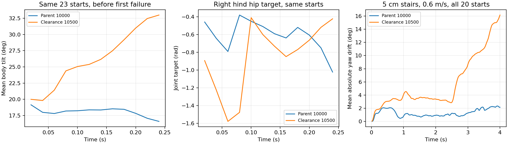

# 站立恢复、上阶方向与右转退化诊断及修正准备

本阶段完成用户批准的诊断与修正准备，执行 8 次冻结仿真、85 项 CPU 检查，PPO 更新为 0。最重要的新结果是：原净空 10500 模型在加入训练同款航向反馈后，固定参数 5 cm 上阶达到 56/60；原协议为 24/60。跨阶能力与方向保持需要分开评估。随机化起点的姿态恢复及右转退化仍然成立，原正式验收保持失败。

没有继续训练 10500，没有替换合格基础模型，也没有进入在线学习。新增组件是候选准备件，尚未接入 PPO 或现有训练入口；下一阶段须再次得到用户批准。

## 1. 站立失败定位到姿态恢复能力下降

补录器复用历史协议，父模型的固定参数和随机化前 8 秒、候选模型随机化前 2 秒，以及额外父模型前 2 秒，都与历史初始数组和轨迹逐元素一致。补录检查了质量、惯量、质心、实际 PD 增益、延迟、关节顺序、关节目标和四足接触。

23 个候选失败回合全部发生在前 2 秒零命令阶段。其中，在默认 PD 准备刚开始时，倾角范围为 0–0.87°；经过 1 秒准备，正式策略接管时已达 14.92–24.76°，中位数 19.41°。因此，之前的初始站立测试包含了较明显的姿态恢复任务，不能描述成全部从完全水平姿态接管。

但两模型的实际接管状态及随机物理参数相同，父模型在这 23 个起点中有 20 个通过前 2 秒、19 个通过前 8 秒。因此，这个准备过程不能解释掉模型间的退化。不同随机参数共同影响准备姿态；本阶段没有把质心、摩擦、质量等各自独立消融，不指定其中某项为唯一原因。

同一首帧观测下直接比较两模型输出，23 个起点的最大关节目标差为 0.290–0.570 rad；20 个起点差异最大的关节为右后腿 HipY，中位目标差约 −0.454 rad，即 −26.0°。动作缩放与关节映射已核对。接管后 0.24 秒、还没有任何候选回合终止时：

| 同一组 23 个起点 | 父模型 10000 | 净空模型 10500 |
|---|---:|---:|
| 平均倾角 | 16.59° | 33.00° |
| 左前 / 右前足支撑占比 | 8.7% / 17.4% | 0% / 0% |
| 左后 / 右后足支撑占比 | 47.8% / 52.2% | 0% / 87.0% |

支撑以足端竖直净力超过 1 N 判断，属于代理指标。结果显示动作已经在接管首帧明显改变，随后前腿及左后腿失去支撑，主要剩右后腿支撑。这是实际策略响应退化的证据；尚不能把全部退化唯一归因于净空奖励，因为上一轮同时修复了课程恢复，也没有同预算旧奖励训练对照。

进一步进行了两个冻结控制：

| 相同随机化起点，前 2 秒 | 姿态失败 / 320 |
|---|---:|
| 父模型原协议 | 3 |
| 净空模型原协议 | 23 |
| 净空模型，仅将接管后的执行器延迟设为零 | 23 |
| 净空模型，增加 0.5 秒动作渐入 | 39 |

原执行器延迟为 0 或 1 个物理步，即 0 或 5 ms。现有结果不支持用取消延迟或动作渐入来解决本次退化。两项控制的接管初始数组、物理参数与父协议一致；改变终止时机后，其他环境的后续随机噪声可能随重置分叉，所以它们不是全程逐噪声样本配对的严格消融。

实际 PD 刚度约 25.51–34.50、阻尼约 0.850–1.150，符合参考随机化范围。显式 PD 执行器的实际增益从 actuator 读取，不能把 PhysX 中为避免重复驱动而置零的刚度当作电机失效。

零命令时，台阶净空项和纯转向落地项均不启用。补录按当前训练参数重算了站姿和 0.32 m 身高项；首 0.24 秒身高奖励率为父模型约 −0.113、候选约 −0.083，没有出现旧 0.55 m 目标重新进入训练的证据。这只重算了指定项，不冒充完整训练奖励历史。

明细：[standing_episodes.csv](standing_episodes.csv)、[analysis.json](analysis.json)。

## 2. 上阶失败中，方向漂移占很大比重

历史台阶协议固定身体坐标前进速度、角速度为零，并以世界坐标横向超过 1 m 判越界。偏航一旦积累，零角速度并不会把机身转回台阶方向。训练中的普通航向样本使用 `wz = clip(0.5 × 航向误差, −0.8, 0.8)`；特殊纯前进样本则不使用航向反馈，不能声称训练全部有闭环。

为排除跌倒减少导致越界机会增多的统计混淆，检查了双方都完整存活的固定时间窗。5 cm、0.6 m/s 的前 4 秒全部 20 对回合都有效，平均绝对偏航由父模型 2.15°增至候选 16.15°。候选大部分明显偏航发生在足端碰阶代理信号之后，时序关联本身不能证明接触是唯一原因。

29 个候选越界回合的世界坐标横移分解表明，偏航后的身体前进速度贡献了主要横向位移，身体横向速度常在抵消这部分位移。三维姿态旋转和速度积分与实际位移的误差最大约 1.22 cm。见 [stairs_drift.csv](stairs_drift.csv) 和 [stairs_paired_windows.csv](stairs_paired_windows.csv)。

冻结两模型、保留原起点和判定阈值，仅在运动命令中加入朝世界 +x 的航向反馈，使用训练增益 0.5、限幅 0.8；不加入横向位置纠偏、不改变台阶、不更新权重。5 cm 完整通过数如下，每格分母均为 20：

| 速度 | 父模型原协议 | 父模型加航向 | 净空模型原协议 | 净空模型加航向 |
|---|---:|---:|---:|---:|
| 0.32 m/s | 0 | 0 | 1 | 16 |
| 0.4 m/s | 4 | 8 | 13 | 20 |
| 0.6 m/s | 14 | 16 | 10 | 20 |
| 合计 / 60 | 18 | 24 | 24 | 56 |

候选加入航向后，5 cm 侧向越界 29→0、姿态失败 3→0；剩余 4 个低速回合为超时。平地、2 cm 和 3 cm 共 180 个回合全部通过。本对照只覆盖固定参数上阶，未声称随机化、下阶、转向或部署通过。

结论应更新为：10500 已有更好的受控方向跨阶能力，原协议暴露了方向积累偏差。仍需保留原协议，分别报告身体速度跟踪和闭环路线通过率；不能把 56/60 写回原正式验收或用它抵消站立恢复退化。



## 3. 右转的代码问题与能力保持缺口

上一轮固定参数 ±0.5 rad/s、4–8 秒配对结果继续有效：左转误差 0.309→0.296，右转 0.245→0.289，右转 20 对回合全部变差。首 2 秒的 23 次失败与这个转向跟踪结论分别统计。

再次核对确认：

1. 纯转向依旧使用 0.5 秒腾空阈值；单脚摆动 0.2 秒落地会得到 `5 × (0.2 − 0.5) = −1.5` 的奖励率，控制步实际乘 0.02。先前修复只针对台阶平移，没有取消纯转向的短摆动扣分。已经有独立的 `yaw_airtime` 候选，本阶段复核其测试，不改历史实现。
2. 执行真实命令采样源码的 100000 个受控样本中，8443 个纯转向全部是转向目标航向，恒定角速度纯转向为 0。这不等于历史训练逐帧统计，但确认了持续左右转的覆盖缺口。
3. 站立采样约 28.3%，数量并不低。共享策略更新仍会改变未修改奖励对应的行为。8399 个父模型实际冻结观测上，候选对父模型的关节目标均方根偏移，在平稳站立为 0.028 rad，在站立恢复为 0.304 rad。仅保留站立命令份额没有约束住恢复动作。

不能把对左右都适用的落地扣分，单独解释成右转退化的唯一原因。模型响应已经变化，奖励冲突与命令覆盖是需要修正的训练条件。

## 4. 已准备的独立修正

新增 [能力保持组件](../../scripts/tools/reference_low_stairs_preservation.py)，均为显式调用的候选函数，没有接入已有训练入口：

- 能力保持辅助损失：在父模型真实观测上约束关节目标偏移，使用实际动作缩放；将平稳站立、姿态恢复、直行、左转、右转分组均衡计算。父模型停止梯度，台阶摆脚状态不在这批平地约束数据中。下一阶段需要标定各类权重，尤其不能用过强的转向模仿约束固定住父模型原有转向不足。
- 纯转向覆盖修正：只将一半原纯航向转动样本改为恒定角速度，0.2–0.8 rad/s，左右概率相同；保留另一半航向任务。受控采样得到恒定左转 2092、右转 2132、剩余航向转动 4219，站立仍为 28341；其余样本逐元素不变，恒定转动也不会被后续航向更新覆盖。
- 复用已准备的纯转向短摆动修正，保留零命令、平移及其他奖励边界。当前没有把三个候选直接叠加后续训。
- 新增冻结记录器和分析入口，显式记录准备阶段、实际 PD 参数、同观测两策略动作、原协议与航向对照，避免再次把姿态恢复失败记成运动中转向失败。

[preservation_validation.json](preservation_validation.json) 验证父模型对自身损失为零、候选梯度有限、父模型无梯度、模型参数未更新；验证集包含 207 个姿态恢复状态。`diagnostic_anchor_bank.npz` 来自诊断协议，只证明组件能识别退化。如果将其用于后续训练，该协议就不能再视为留出测试；建议下一阶段另用独立种子采集训练保持库，并保留本次固定协议及额外种子做验收。

## 5. 验证与下一阶段建议

85 项检查通过，包含新诊断/保持边界和已有净空、修正、训练入口、验收回归。8 次成功冻结仿真共 2400 个探针回合位置，含重复回放，不是 2400 个独立随机起点；864000 次正式控制步交互，另有 120000 次 PD 准备交互，仿真进程合计约 718.5 秒。GPU 1 观测总占用峰值 6153 MiB，包含其他项目。没有停止其他进程。

开发中第一次启动因记录器把环境类替成函数，导致类型注解导入失败，尚未进入仿真控制；修正为子类后完整回放通过，失败目录保留。分析阶段修正了一处 NumPy 整数的 JSON 序列化问题。CPU 校验的随机数保护已限定 `devices=[]`，避免无意义地初始化其他 CUDA 设备。最终检查见 [verification.json](verification.json)，原始输入与产物索引见 [raw_manifest.json](raw_manifest.json)。历史训练源文件、父检查点、10500 检查点和参考项目保持原样。

建议下一阶段在用户批准后执行：

1. 从原低台阶 10000 父模型建立独立训练入口，保留六类地形、2–5 cm 台阶和已修复净空；接入能力保持、纯转向短摆动修正及恒定左右转覆盖。先做配置差异、独立保持库、梯度和保存恢复检查，未通过不启动 PPO。
2. 限额最多 200 次 PPO 更新，在 100 次处检查随机化恢复和左右转；达到预设退化停止条件即停止，不自动追加预算。使用独立种子采集保持库，固定本次原协议的评估数据用途。
3. 完成后复测原上下阶及左右转协议，另列闭环航向上阶结果。分别报告恢复失败、转向误差、上阶碰撞与侧偏，不能只看总回报或闭环通过数。

这是有能力保持约束的联合修正试验，不是三个改动各自的因果实验；200 次仅用来检查修正方向，不保证收敛或实机可用。本阶段到此结束，等待用户批准，不自动启动上述下一阶段。

复核入口：

```bash
OPENBLAS_NUM_THREADS=1 OMP_NUM_THREADS=1 MKL_NUM_THREADS=1 \
/home/tjx/anaconda3/envs/env_isaaclab/bin/python scripts/tools/reference_low_stairs_regression_analyze.py

OPENBLAS_NUM_THREADS=1 OMP_NUM_THREADS=1 MKL_NUM_THREADS=1 \
/home/tjx/anaconda3/envs/env_isaaclab/bin/python scripts/tools/reference_low_stairs_preservation_validate.py

OPENBLAS_NUM_THREADS=1 OMP_NUM_THREADS=1 MKL_NUM_THREADS=1 \
/home/tjx/anaconda3/envs/env_isaaclab/bin/python scripts/tools/reference_low_stairs_regression_archive.py
```
