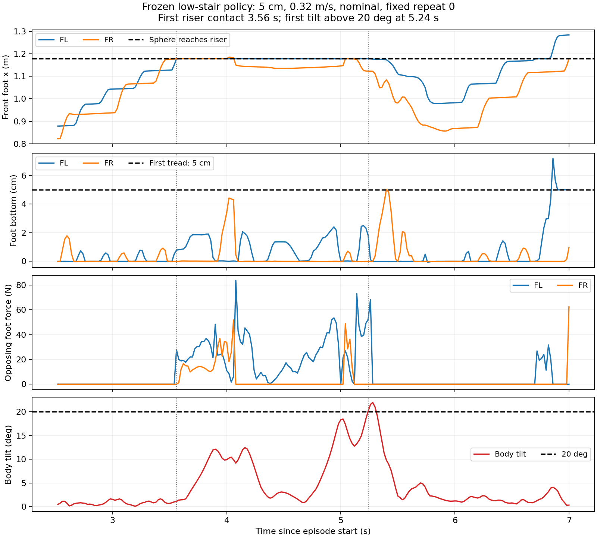

# 低台阶与转向专项修正准备

本阶段完成原因核查、两个独立奖励变体和小规模冻结验证。发现的主要问题是：上阶前的足端净空不足，接触台阶后原净空项停止约束；原地转向仍受短腾空落地惩罚，小角速度响应还受到较弱的跟踪收益和指令分布影响。

这些结果支持有针对性的短试训，但尚未证明修改后能力提高。没有执行 PPO 更新，没有改变现有模型，没有启动在线学习。下一阶段建议只先批准碰阶变体最多 500 次更新，完成后再次汇报。

## 1. 已完成的范围

- 重新分析上一阶段上行的 360 个台阶回合：2/3/5 cm × 0.32/0.4/0.6 m/s × 20 起点 × 两种物理条件；另核对已有两组转向轨迹。平地对照结果沿用上一阶段，不重复计入 360。
- 从真实训练配置及源函数核对奖励门控和指令采样。此前站立门控与 0.32 m 身高目标已经修正，不把旧评估器中的原参考惩罚误认为当前训练错误。
- 完成两个相互独立的可选修改，每个只改变一个奖励项。原训练入口、原低台阶配置和奖励源文件保持不变，两个参考项目只读。
- 49 项 CPU 检查通过。GPU 1 完成两次各 120 环境、600 控制步的冻结验证，共 144000 条控制步交互，外加每次 1 秒默认 PD 准备。两次各约 148 秒。

## 2. 上台阶为什么失败

### 足端抬起的时机和高度不足

以名义参数的第一道台阶为例，记录前脚中心第一次到达台阶前 3.2 cm 时的球底高度。球形足端半径为 2.2 cm，这个位置接近即将碰到立面的时刻。每档速度有 20 个起点、40 次前脚首次接近：

| 台阶 / 指令速度 | 接近时球底低于台面 | 球底与台面的高度差中位数 | 首次接近至有效落脚的中位时间 |
|---|---:|---:|---:|
| 3 cm / 0.32 m/s | 40/40 | −2.29 cm | 0.25 s，36 次存在后续落脚 |
| 5 cm / 0.32 m/s | 40/40 | −4.54 cm | 2.04 s，31 次存在后续落脚 |
| 5 cm / 0.40 m/s | 40/40 | −4.10 cm | 0.65 s，38 次存在后续落脚 |
| 5 cm / 0.60 m/s | 40/40 | −3.93 cm | 0.21 s，40 次存在后续落脚 |

后续落脚时间只统计有落脚的样本，不能把缺失落脚当作零秒；落脚可能发生在暂时倾斜和恢复之后。这是按几何与支撑估计的落脚记录，不是整段通过率。

3 cm 也会碰到台阶，但更容易在较短时间内完成落脚。5 cm 尤其在低速下出现长时间顶阶。固定参数的 5 cm 三档速度、各 20 个起点，在首次机身倾斜超过 20°之前均已出现足端碰阶特征。

### 原净空项存在接触后的约束缺口

当前 `clearance_cost` 同时要求脚的总接触力小于 1 N，并且足端沿指令方向向前运动。因此脚已经顶住立面、或碰阶后停止向前运动时，这只脚的净空惩罚变成零。此前这样设计是为了把摆动和支撑分开；实际失败轨迹表明它没有覆盖持续顶阶。

这并不表示整个回合没有惩罚：姿态、足端总受力、能耗等项仍然存在。问题是专门用于跨阶的净空项在这个关键状态不再给出对应约束。直接统一增加抬脚高度或放宽姿态终止条件，目前依据不足。

固定示例 `env180` 为 5 cm、0.32 m/s、第 0 个起点：3.56 s 首次出现前脚顶阶，5.24 s 首次倾斜超过 20°；随后曾恢复，最终在 18.50 s 姿态异常终止，完成 3 级。最终侧翻不能与第一次暂时倾斜混为一谈。

图中前脚长时间停留在立面前，球底大多未达到 5 cm 台面高度，反向接触力多次升高。[PDF](first_riser_failure.pdf) 可单独导出。

### 左右支撑失衡明显，未发现普遍的关节饱和

固定参数 5 cm 的 22 个姿态异常回合，结束前 0.5 秒平均有效支撑约 1.47 只脚；左侧两脚平均支撑占比 14.5%，右侧 59.0%，左后脚只有约 6.4%。这说明失败末段存在明显单侧支撑不足，但末段现象不能单独证明左右不对称最初由哪个奖励造成。

首次倾斜超过 20°之前、机身进入台阶接近区之后，按控制帧和关节统计：

| 5 cm 速度 | 达到 95% 扭矩上限 | 达到 95% 速度上限 | 超出软关节位置范围 |
|---|---:|---:|---:|
| 0.32 m/s | 0.50% | 0.12% | 0.050% |
| 0.40 m/s | 0.44% | 0.14% | 0.055% |
| 0.60 m/s | 0.12% | 0.19% | 0.047% |

髋关节使用 24 Nm、膝关节 36 Nm 的实际配置上限，关节顺序已核对。位置范围来自本阶段实际仿真资产。以上支持优先处理足端动作和接触过程；20 ms 记录无法排除每个 5 ms 物理子步中的短暂饱和，不能据此声称不存在力矩瓶颈。

离线碰阶判据使用实际台阶边缘、球底高度和反向净接触力，属于接触特征判断；台阶边缘约有 2 mm 测量误差。原轨迹没有逐接触点和小腿接触数据，因此没有把所有非足端接触排除。

## 3. 转向问题核查

当前低台阶方案只对台阶行进取消了线速度门控的短腾空落地惩罚。角速度门控的 `feet_air_time_ang_z_lite3` 沿用原函数：单脚腾空 0.2 秒后落地，在步态系数为 1 时得到 `5 × (0.2 − 0.5) = −1.5` 的瞬时奖励率，而脚不抬起时为零；实际控制步再乘 0.02 秒。

在上一阶段冻结转向轨迹的第 4–8 秒、固定参数条件下，该项平均奖励率为：左转 +0.5 约 −0.123，右转 −0.5 约 −0.167；两组 ±0.2 基本不转，该项为零。这里核对的是未改变的角速度落地函数，评估步态系数约 0.976，不能冒充训练历史逐项回报。

小角速度还存在两个限制：

1. 要求 0.2 rad/s 时，完全不转仍得到约 1.385/1.5 的角速度跟踪奖励率；精确跟踪最多增加约 0.115。结合落脚惩罚和固定轨迹项，静止可能成为不易离开的行为，但还没有总回报因果对照证明它是唯一最优解。
2. 执行真实指令采样函数的 100000 个样本中，8443 个非零纯转向全部为航向反馈生成；恒定角速度的非航向控制样本为零。训练包含转向，但恒定转速覆盖不足。固定轨迹项仍在纯转向中启用，也没有按左右转向生成不同目标足迹。

另一个未处理的范围是台阶上的行进加转向：只要角速度指令超过阈值，原角速度落脚惩罚仍可能触发。本阶段的转向变体刻意限定为原地转向，便于分别验证原因，不能声称已经清除所有台阶奖励冲突。

## 4. 实现的两个独立变体

代码位于 [reference_low_stairs_repair.py](../../scripts/tools/reference_low_stairs_repair.py)，只能显式调用，不改变旧训练的默认行为。

| 变体 | 唯一修改 | 生效条件与边界 |
|---|---|---|
| A：`riser_contact` | 新增 `stair_riser_contact`，权重 −1 | 台阶块内有平移指令、机身尚直立；从足端球心沿指令方向发射 4 cm 水平射线，检测 3 cm 内的竖直面，再要求反向接触力大于 5 N。按四脚平均，代价上限为 1。 |
| B：`yaw_airtime` | 替换角速度落地项函数，权重和 0.5 s 阈值不变 | 平面指令小于 0.1 m/s 且角速度绝对值大于 0.1 rad/s 时，每只脚的短落地负值分别截到零；保留长腾空的原正值。其他指令仍用原函数。 |

A 保留原净空、有效落脚、前进、姿态和能耗项；平地摩擦力、远处墙面、水平面、反向移动离开立面都不能单独触发。纯转向也不触发该项。B 对站立、直行和带明显平移的转弯保持原计算。

两项均为离线基础训练奖励。射线只提供给奖励计算，actor 仍为 45 维自身状态，critic 仍为 393 维。没有给部署模型增加台阶感知，也没有增加单侧补偿或修改动作、力矩限幅。

潜在风险需要在试训中检查：A 是额外负项，可能使策略更保守或停在台阶前；B 取消一种惩罚，但本身不会奖励低速转起来。二者都不能仅用总奖励变高来验收。

## 5. 验证结果

两个变体分别在相同 120 环境、六类分块、固定 5 cm 上下阶和固定转向指令下运行 600 步。使用同一低台阶 10000 次模型，完全冻结：

- 两组全部初始数组与 22 个轨迹字段逐元素相同，说明奖励验证没有改变冻结策略的物理轨迹。
- 碰阶代价在有效首回合中触发 1278 个环境控制帧，全部来自上台阶；其他地形及这次下阶均为零。峰值为 0.576，未超上限 1。
- 原地转向落脚奖励有 365 个环境控制帧被修正；其他指令改变数为零。±0.2 仍基本不迈步，冻结结果中该变体没有产生额外奖励，进一步说明改善需要学习且不能保证。
- 奖励管理器与独立计算的最大误差约 `2.38e-7`。每组仍有 2 个首回合姿态失败，不能将通过执行检查解释为通过运动能力验收。
- 两次 GPU 运行无错误、物理回退或接触丢失记录。49 项 CPU 检查通过，涵盖碰阶/平地/错向/缺失射线、按脚截断、转向门控及既有低台阶规则。
- 现有模型 SHA256、20 个训练共同源文件、三个原奖励实现文件及旧模型校验均通过；适配 actor 与原模型类在 2368 个输入上的最大输出差为零。

详细记录：[verification.json](verification.json)、[integration_analysis.json](integration_analysis.json)、[tests.xml](tests.xml)、[逐回合数据](stairs_episodes.csv)、[足端接近与落脚数据](foot_approaches.csv)、[转向核查](turn_audit.json)。`status=passed` 仅表示本阶段检查通过。

## 6. 下一阶段提案，尚未启动

建议先只执行 A，最多 500 次更新。B 已准备并通过冻结检查，但不自动接着训练，也不与 A 合并。

1. 使用 `logs/reference_six/low_stairs_training/scratch_seed42_10000/model_updates_10000.pt`，SHA256 为 `419921855e24b40af058ac6642083eca8538f639e596606c51c2150ae7549a8f`。恢复 actor、critic、Adam 状态和自适应学习率；当前学习率为 `0.0005766503906250003`，Adam 步数为 200000。下一次迭代从 10000 开始，不使用 1998 或旧高台阶模型。
2. 为这个检查点接入独立受限续训入口，在任何 PPO 更新前检查完整恢复与来源。原低台阶入口的从头训练限制保留，禁止误用旧高台阶续训路径。GPU 1、4096 环境、种子 42；六类分块、2–5 cm、原 PPO、指令范围及其他奖励全部保留，只加入 A。
3. 预算为新增 500 次更新、49152000 条交互，前 20 次也计入 500。前 20 次检查损失、观测、接触和吞吐；有异常立即结束。保存 100/250/500 次检查点，不自动延长。
4. 检查点不保存完整物理场景、地形等级和 RNG 状态；新环境按既有低台阶设置从最低等级及原生课程重建。这不是逐位连续运行。必须记录各类地形的等级与碰阶信号覆盖；若 500 次内高等级台阶覆盖不足，报告为有限预算未充分检验，不能直接归因于奖励无效。训练末尾原全局平均等级约 5.764，重建后的课程变化需要如实报告。
5. 结束后仍按原六组协议评估 1600 个首回合：0/2/3/5 cm、三档速度、两种物理条件，以及原地左右转、停止、反转、航向和行进转弯。与冻结 10000 基线配对，单列失败和完整窗口，不重训原奖励基线。

短试训的预设筛选标准如下，属于工程筛选，不是统计保证或实机资格：

- 固定参数 5 cm 上阶，0.32/0.4 m/s 从 0/20、4/20 至少提高到 8/20、10/20；0.6 m/s 不低于 14/20；姿态失败由 22/60 至少降到 11/60。
- 固定参数 2/3 cm 上阶不低于 60/60、54/60，三个高度下阶仍为 60/60；两组固定参数平地各 60/60。
- 随机化的台阶和平地分组逐项与基线比较，不能用固定参数改善掩盖明显退化。
- 左右转、低角速度、航向、停止和反向转向全部复测。共同完整窗口的跟踪误差如恶化超过 10%，或新增姿态失败，不能推荐该模型替换基础策略。

训练时间粗估 1.5–2 小时，连同初始化与评估约 2–3 小时；依据是前次 10000 次耗时约 30 小时 10 分钟，实际以本轮前 20 次吞吐校准。该阶段结束后详细汇报，再决定是否单独批准 B 的最多 500 次试训，B 仍从同一个冻结 10000 模型开始。

若试训没有改善，先分析碰阶时长、足端净空、停滞和转向回归，再考虑角速度落脚项在台阶行进中的门控、恒定角速度覆盖或固定轨迹项。不会自动放宽验收条件、追加长训或进入 6–8 cm 在线学习。

## 7. 复现与证据位置

离线分析：`scripts/tools/reference_low_stairs_failure_audit.py`。冻结验证：`scripts/tools/reference_low_stairs_repair_validate.py --variant riser_contact|yaw_airtime --gpu 1 --output <新目录>`。归档核验：`scripts/tools/reference_low_stairs_repair_verify.py`。

原始新轨迹与日志保存在 `logs/reference_six/low_stairs_repair_preparation_20261114/`，上一阶段轨迹没有重写。原始文件哈希见 [raw_manifest.json](raw_manifest.json)，交付文件哈希见 [SHA256SUMS](SHA256SUMS)。
