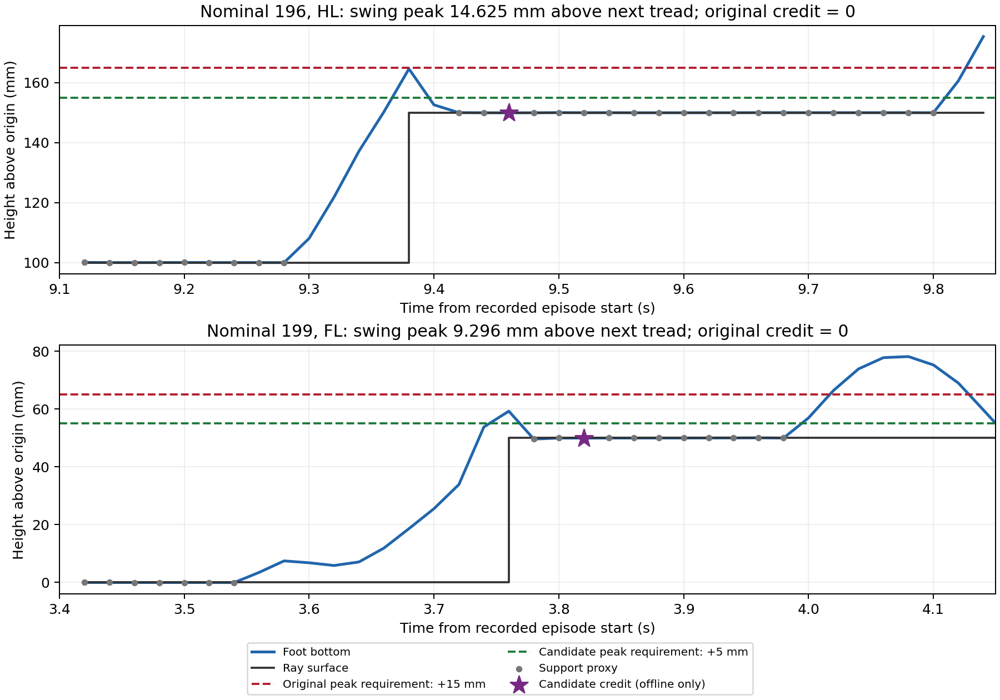

# 上阶奖励状态核验与修正准备结果

本阶段完成了批准的 480 个冻结回合补录，以及保存轨迹上的 CPU 分析。名义和训练随机化上阶仍各为 238/240，通过数没有变化；初始状态、动作、机身、足端、原奖励等全部已有轨迹字段与历史结果逐字段完全一致。训练更新为 0，没有部署或改变现有模型。

主要发现是落脚正奖励的峰值门槛会排除部分已经完成的稳定上阶，支持准备一个单项奖励取舍试验。未发现达到持续净空目标后仍扣分的情况，也没有证据把四个失败统一归为一个实现错误。低一级支撑清除净空目标、双足支撑中断取消落脚资格，均符合现有代码规则。

## 已完成的范围与核验

- 固定 zero10100：`model_updates_10100.pt`，SHA256 为 `290d94746c467b5cd21ef74c47a908011521c1f145da35ba7b94f1b92d9b7497`。历史奖励、原协议、参考项目及模型只读。
- 新增名义/训练随机化上阶各 240 回合，GPU 1 顺序完成。台阶 0/2/3/5 cm，速度 0.32/0.4/0.6 m/s，每个组合 20 起点。没有重跑下阶、起点 57 或额外起点。
- 延续 50 步、1 秒 PD 准备，正式记录静止 0.5 秒、加速 0.5 秒、最长 20 秒。前进时使用世界 +x 航向反馈，增益 0.5、限幅 ±0.8 rad/s，无横向位置反馈。
- 旁路调用实际训练的持续净空、推进、落脚规则。旁路奖励不加入公共评估奖励，不进入策略观测或动作。PD 准备状态保留，真实重置同步清除状态，四列诊断地形显式映射到平地/台阶类别。
- 两组原报告、配置、初始数组和全部 18 个已有轨迹字段一致。补录的命令、力、重置标志、坐标等与原轨迹一致。原版落脚状态另在 CPU 上按保存输入逐帧重放：480,000 个环境控制帧的更新前/后状态、得分率和每足发奖事件全部精确一致，包含原第一回合结束后的记录与真实重置。
- 独立方形环台阶几何校验排除距边缘 2.1 mm 内的射线点。两组足下地面最大误差分别约 2.21/2.26 μm，前方障碍最大误差均约 2.15 μm；这只验证被纳入的射线点，不宣称验证边缘接触流形。
- 两次仿真分别 162.1、166.4 秒，合计约 5.5 分钟；代码、离线重算和审查另计。正常退出，无仿真运行错误。GPU 总占用采样峰值 4692/4684 MiB，包含其他进程。本阶段 GPU 进程已退出。
- 32 项旁路/持续净空检查、7 项恢复门控检查、14 项候选/分析检查，共 53 项通过。检查包含秒制支撑时间、重复发奖、原地踏步、腾空不足、单足支撑、重置、门控梯度及首次支撑与整回合得分口径。

原始轨迹留在 `logs/reference_six/low_stairs_reward_state_20261116`。小型运行 JSON 归档于 [runs](runs)，来源及文件哈希在 [raw_manifest.json](raw_manifest.json) 与 [completion_audit.json](completion_audit.json)。

## 四个失败分别发生了什么

以下为整段第一回合统计。墙面列是四足累计检测时长，因此可超过回合时长；不同回合存活时间不同，不能用总量直接归因。

| 条件、起点 | 高度 / 速度 | 结果 | 净空目标建立次数 | 低一级支撑清除次数 | 墙面代理，足·秒 | 实际落脚得分事件 |
|---|---|---|---:|---:|---:|---:|
| 名义 196 | 5 cm / 0.32 m/s | 20 s 超时 | 120 | 88 | 9.10 | 21 |
| 名义 199 | 5 cm / 0.32 m/s | 20 s 超时 | 122 | 91 | 9.02 | 20 |
| 随机化 121 | 3 cm / 0.32 m/s | 20 s 超时 | 111 | 85 | 4.44 | 8 |
| 随机化 231 | 5 cm / 0.6 m/s | 8.50 s 横向越界 | 53 | 25 | 0.56 | 17 |

每足每个新高度发奖一次，单次累计回报为 0.25。四例的净空/推进/落脚三项累计回报依次为：196 的 −2.719/8.587/5.25，199 的 −2.708/8.246/5.00，121 的 −1.532/9.526/2.00，231 的 −0.624/5.333/4.25。这是旁路重算的训练奖励分量，不能与公共评估总奖励混用。

完整记录见 [episodes.csv](episodes.csv)、[cycles.csv](cycles.csv) 和 [focus_windows.csv](focus_windows.csv)。最后 20 秒内的前进不足、后足未完成跨阶等行为证据仍沿用[上一阶段报告](../lite3-low-stairs-stability-priority-20261116/README.md)，本阶段补全奖励内部状态。

## 净空项没有发现达标后误罚

当前持续净空目标是障碍顶面加 25 mm。全部有效第一回合中，足底达到该目标而仍被净空项扣分的帧数为 0。墙面接触不会清除目标，稳定合法支撑满 40 ms 才会清除；落到较低一级同样清除。

全体出现 13,595 次低一级支撑清除。历史测试明确要求这种行为，目的是支撑时不继续抬脚。它允许一次失败摆动结束后重建目标，确实可能与反复尝试同时出现，但没有证据证明把目标一直保留到上一级就能改善行为；本阶段保留该规则。

## 落脚正奖励门槛与支撑中断要分开

原规则要求离地至少 40 ms、首次触地、至少两足支撑、机身未严重倾斜、台阶平移命令有效、高于此前支撑/已奖励高度 8 mm 以上、足端前进至少 4 cm、机身同期前进至少 1 cm、摆动足底峰值超过新台阶顶面 15 mm、足底接近地面，并持续有效支撑 60 ms。

按独立的力/几何代理识别，每足每级首次至少 60 ms 的稳定更高支撑共 10,069 个。其中 2,361 个在首次支撑段结束前未计分，24 个在该回合后续获分，整回合未计分为 2,337 个。这些不能全部叫作漏计错误：规则有意排除短腾空、原地踏步、机身没有前进或摆动峰值不足等动作。62 个事件之前没有记录到同高度的原始触地；最近一次触地可能早于当前支撑段，CSV 保留了时差和是否位于本段的标记。

在首次支撑未计分事件中，最近触地只有峰值一项未通过的为 1,584 个；其中 1,365 个峰值至少 5 mm。此数仅说明资格门槛，最终发奖还取决于后续持续支撑与此前计分状态。

两个直接例子：

- 名义 196 左后足，第 3 级，9.42 s 触地，足端前进 9.70 cm、机身前进 1.284 cm，摆动峰值仅比新台阶高 14.625 mm。其余资格通过，连续支撑到 9.80 s，原规则不给奖励。
- 名义 199 左前足，第 1 级，3.78 s 触地，摆动峰值比新台阶高 9.296 mm，其余资格通过且形成稳定支撑，原规则也不给奖励。

图中红线为原 15 mm 门槛，绿线为候选 5 mm 门槛，灰点为支撑代理，紫星为离线候选到 60 ms 时的得分。线条和动作均来自同一条原轨迹。下图 4.0 s 之后是下一次摆动，不能倒算到 3.78 s 的首次落脚峰值。

另外，全部 7,880 次通过资格的触地中，7,734 次完成发奖，146 次在等待期被取消。四个失败中的取消均有对应原因：

| 起点 / 足 | 资格通过 | 取消 | 原因 |
|---|---:|---:|---|
| 名义 196 / 左前 | 5.60 s | 5.64 s | 该足失去支撑 |
| 名义 199 / 左后 | 5.78 s | 5.82 s | 总支撑足少于两足 |
| 随机化 231 / 右后 | 7.20 s | 7.24 s | 总支撑足少于两足 |
| 随机化 231 / 右后 | 7.96 s | 7.98 s | 总支撑足少于两足 |

尤其名义 199 的左后足在 5.84 s 再次进入稳定双足支撑时，原 pending 已取消，不能把后面的稳定支撑接到前面凑满 60 ms。这符合代码的连续性要求，本阶段不放松该保护。

见 [supported_levels.csv](supported_levels.csv)、[pending_events.csv](pending_events.csv)。各拒绝原因可能重叠，不能相加当作互斥事件数。

## 起点 231 的横移不能直接归为足底滑动

采用全部同高度、同速度的成功起点，统一从加速结束的 1 s 比到双方全部仍存活的最早终点。名义 196/199 各对比同一组 18 个成功起点；随机化 121/231 各对比 19 个成功起点。

| 失败起点 | 共同窗口 | 支撑足水平速度：失败 / 成功均值，m/s | 机身横向速度绝对值：失败 / 成功均值，m/s |
|---|---|---|---|
| 名义 196 | 1–13.72 s | 0.0627 / 0.0600 | 0.0894 / 0.0803 |
| 名义 199 | 1–13.72 s | 0.0853 / 0.0600 | 0.1026 / 0.0803 |
| 随机化 121 | 1–11.36 s | 0.0428 / 0.0598 | 0.0319 / 0.0389 |
| 随机化 231 | 1–6.42 s | 0.0701 / 0.0964 | 0.1295 / 0.0623 |

231 的机身横向速度高于全部 19 个成功对照，支撑足水平速度却低于其中 18 个。这不支持将其归因于更严重的支撑滑移。名义 199 的支撑足横向速度代理偏大，值得保留观察，但 20 ms 足端中心速度仍包含旋转、接触切换和滚动效应，并非真实接触点滑动速度。窗口后的运动、触地瞬间与细分到相同步态/台阶的因果关系尚未识别。

见 [common_windows.csv](common_windows.csv)、[groups.csv](groups.csv) 和 [summary.json](summary.json)，所有对照起点均有记录，没有只挑两条成功轨迹。

## 唯一上阶候选：落脚峰值裕量 15 mm → 5 mm

独立候选只放松落脚正奖励的峰值资格，持续净空仍要求障碍顶面加 25 mm；权重、足端/机身前进、腾空、双足支撑、60 ms 连续支撑、每足每高度一次等规则均保留。它区分摆动时的净空目标与完成更高支撑后的奖励资格。5 mm 是本次拟验证值，没有证明最优，也不能把它理解为把全部脚的抬脚目标降为 5 mm。

候选类在独立文件，未接入任何训练、推理或部署入口。AST 检查保证与历史 update 的唯一逻辑差异是该常量。保存的两组输入经过原版/候选 CPU 重放，结果如下：

| 范围 | 原发奖次数 | 候选发奖次数 | 新增足与高度组合 | 丢失原组合 |
|---|---:|---:|---:|---:|
| 全部 480 回合 | 7734 | 9083 | 1349 | 0 |
| 名义 196 | 21 | 22 | 1 | 0 |
| 名义 199 | 20 | 23 | 3 | 0 |
| 随机化 121 | 8 | 9 | 1 | 0 |
| 随机化 231 | 17 | 22 | 5 | 0 |

名义成功起点中有 169 个增加得分，随机化成功起点中有 174 个增加得分，调整并非只作用于四个失败。新增 1,349 是完整状态机重放的结果，不能用最近触地门槛统计的 1,365 替代。另有 9 个原已奖励的足与高度组合在候选中提前发奖；保留组合不表示所有原发奖时刻都不变，四个重点失败没有这种时刻变化。

这份结果只验证奖励覆盖变化，通关结果与动作都没有改变。更容易获得正奖励可能鼓励过低的摆动，净空惩罚是否足够约束需要对照训练检验；随机化 121 还有机身前进门槛不足，231 还有横移问题，这一项没有承诺修复它们。

还发现原落脚类未排除净空使用的墙面代理：名义成功起点 231 左前足 5.94 s、225 左前足 7.08 s 各一次发奖与墙面代理重合。足底距射线地面约 0.119/0.452 mm、竖向力约 24.13/33.55 N，属于靠近边缘的实际支撑与墙面代理同时成立，不能直接当作凭空奖励。候选仍为 2 次，四个重点失败均为 0。本阶段不把这项单独规则差异混入候选。

见 [landing_candidate_summary.json](landing_candidate_summary.json)、[逐回合重计分](landing_candidate_episodes.csv)、[逐足事件](landing_candidate_events.csv) 和 [分组](landing_candidate_groups.csv)。

## 起点 57：已准备恢复门控，尚未修复

复用历史父模型与 zero 的随机化转向轨迹，初始 57 的输入完全相同，倾角约 23.760°，两模型第一步关节目标 RMSE 相差 0.12883 rad。历史父模型存活 20 s，zero 在 0.82 s 姿态终止。

独立门控只选平移命令模长及偏航命令绝对值都不超过 1e−5、真值倾角严格在 10–30° 之间的状态。仅对此类状态计算按原动作尺度换算的关节目标偏差，教师输出截断梯度。台阶前进、主动转向、一般平稳站立均不直接计入该辅助损失。

前 2 s 中，父模型 57 有效 100 帧、命中 13 帧，zero 有效 41 帧、命中 29 帧。全 320 起点中，两者分别命中 1017/31821、1027/31941 个有效帧。离线只计算动作输出梯度，没有优化器或模型参数梯度，也没有把正式诊断数据转成训练样本。

门控只限定损失的直接样本范围，共享网络参数一旦训练，其他状态的输出仍可能改变。系数、独立训练样本和训练接入均未确定。该候选与上阶候选分开，下一阶段建议先检验上阶单项，不同时加入恢复约束。

见 [recovery_gate_audit.json](recovery_gate_audit.json) 和 [起点 57 逐帧检查](recovery_gate_frames.csv)。低速 ±0.2 rad/s 不转仍不作为修复目标；独立转向分支保持停止，全部姿态失败仍需记录。

## 下一阶段需用户确认

建议从 zero10100 分出候选与原设置对照，各做最多 100 次 PPO 更新，再用相同起点验证上/下阶和已有中高速转向是否保持。对照用于区分奖励调整与额外训练本身的影响；不加入恢复约束，不扩大训练高度，不自动延长训练或部署。

具体初始化、两分支合计 200 次更新、最多 5120 个冻结回合、验收门槛及停止条件见 [NEXT_STAGE_PROPOSAL.md](NEXT_STAGE_PROPOSAL.md)。该方案尚未批准、未启动。本阶段到此结束。
