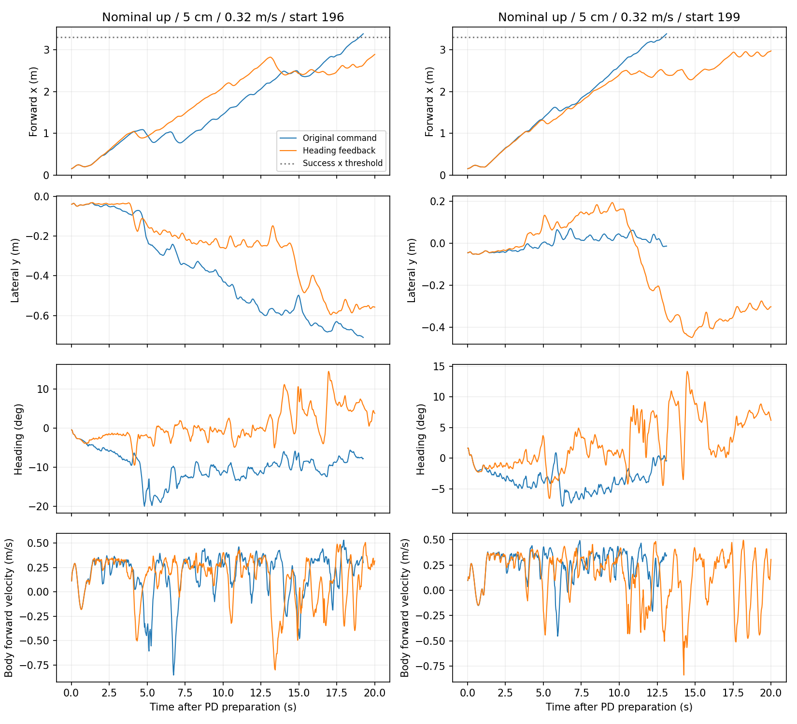

# 行进航向反馈的冻结验证结果

本阶段完成。保留 zero10100，新增三组共 720 个冻结回合，复用已有名义上阶反馈 240 回合和四组无反馈 960 回合。优化器更新为 0，没有修改奖励、网络、参考项目或部署代码。

结果支持继续把行进航向保持作为上阶和下阶的辅助验证方向。四组配对协议合计通过数从 847/960 提高到 956/960；新增成功 111 个，丢失原成功 2 个，净增 109。反馈下没有姿态终止，剩余失败为 3 个上阶超时和 1 个上阶横向越界。原有环境 57 的零命令恢复失败未在本阶段重跑或修复。

这是一项冻结策略的命令反馈干预，不表示模型经过学习而变好，也不表示原无反馈协议或部署验收已通过。四组协议使用固定且反复观察的开发起点，合计分母不代表 960 个独立随机场景。

## 执行与核验

- 模型为 `logs/reference_six/low_stairs_zero_preservation_20261115/train_001_100/model_updates_10100.pt`，SHA256：`290d94746c467b5cd21ef74c47a908011521c1f145da35ba7b94f1b92d9b7497`。运行前核验历史训练和恢复链，运行后模型哈希保持一致。
- 新入口 `reference_low_stairs_heading_probe.py` 只允许名义下阶、随机化上阶和随机化下阶。名义上阶使用已有结果，没有重跑。历史台阶协议与旧航向探针源码保持原哈希。
- 与旧探针相同，50 步、1 秒 PD 准备后开始正式记录；静止 0.5 秒，再用 0.5 秒渐增前进指令。仅在前进指令大于 0 时使用 `wz = clip(0.5 × wrap(-heading), -0.8, 0.8)`，目标世界 +x，无横向位置反馈。计划中原先写的前 2 秒零命令属于转向协议，已修正文档，未改变台阶协议。
- 0/2/3/5 cm、0.32/0.4/0.6 m/s，每组合 20 起点；确定性均值动作、第一回合、重置前记录。新旧初始数组逐字段相同，条件与重复编号一一配对。配置核验只允许来源清单中一个固定哈希的只读日志观察器有无差异。
- 逐帧反馈公式最大误差不超过 2.39e−7 rad/s；前进指令的静止和加速时序保持原样，侧向指令恒为 0。8 项 CPU 检查通过，包括反馈边界、接入时序、组合白名单、配对拒绝、相同总数掩盖退化及共同时间窗的缺失记录。
- GPU 1 顺序运行，三组分别耗时 184.6、127.2、131.3 秒，合计 443.1 秒，约 7.4 分钟。三组均正常退出，无运行错误或物理软件回退。卡总占用采样峰值 4684 MiB，包含其他进程；运行前各组空闲均为 22270 MiB。全部本阶段仿真进程已退出。
- 36 个复用历史文件与原归档哈希相同。`raw_manifest.json` 记录 65 个原始文件及模型的哈希。约 255 MiB 的新原始日志和轨迹留在 `logs/reference_six/low_stairs_heading_stability_20261116`，小型 JSON、CSV 和图表已归档。

## 按条件与高度的结果

名义条件关闭质量、惯量、质心、增益和观测噪声随机化，保留原执行器延迟；随机化条件使用原训练随机化。两种条件分开比较。

| 条件 | 无反馈成功 / 240 | 带反馈成功 / 240 | 新增成功 | 丢失原成功 | 反馈后剩余失败 |
|---|---:|---:|---:|---:|---|
| 名义上阶，复用 | 229 | 238 | 11 | 2 | 2 超时 |
| 名义下阶，新增 | 238 | 240 | 2 | 0 | 无 |
| 随机化上阶，新增 | 196 | 238 | 42 | 0 | 1 超时、1 横向越界 |
| 随机化下阶，新增 | 184 | 240 | 56 | 0 | 无 |

每个高度包含三档速度，共 60 起点。下表为无反馈 → 带反馈的完整通过数。

| 条件 | 平地 / 60 | 2 cm / 60 | 3 cm / 60 | 5 cm / 60 |
|---|---|---|---|---|
| 名义上阶 | 60 → 60 | 60 → 60 | 60 → 60 | 49 → 58 |
| 名义下阶 | 60 → 60 | 60 → 60 | 59 → 60 | 59 → 60 |
| 随机化上阶 | 50 → 60 | 48 → 60 | 48 → 59 | 50 → 59 |
| 随机化下阶 | 50 → 60 | 47 → 60 | 46 → 60 | 41 → 60 |

5 cm 上阶按速度进一步拆分：

| 条件 | 0.32 m/s / 20 | 0.4 m/s / 20 | 0.6 m/s / 20 |
|---|---|---|---|
| 名义 | 15 → 18 | 20 → 20 | 14 → 20 |
| 随机化 | 18 → 20 | 16 → 20 | 16 → 19 |

名义上阶原失败的 180、184、192、193、197、221、224、227、231、233、236 全部恢复成功，同时原成功的 196、199 变为超时。名义下阶原越界的 135、181 均恢复成功。随机化上阶恢复 42 个原越界起点，原越界的 121 变为超时、231 仍越界；随机化下阶全部 56 个原越界起点恢复成功。

原协议合计失败为 7 次姿态终止和 106 次横向越界；带反馈合计为 0 次姿态终止、1 次横向越界、3 次超时、0 次正式卡住。新增三组没有丢失原成功。改善不能完全归为航向误差单独下降：反馈改变了实际命令、动作和接触时序。

完整逐起点结果在 [pairs.csv](pairs.csv)，所有结果类型发生变化的起点在 [changed_outcomes.csv](changed_outcomes.csv)，所有剩余失败在 [remaining_failures.csv](remaining_failures.csv)。固定时间窗只统计双方共同存活的配对起点，并在 [common_window_groups.csv](common_window_groups.csv) 显式记录纳入及排除数量；全部终止仍保留在总体分母和逐起点结果中。

## 两个名义上阶超时：有前进停滞，也有后足尚未完成跨阶

两个回合都为 5 cm、0.32 m/s。无反馈分别在 19.24 秒、13.12 秒成功，带反馈在 20 秒结束时未完成。最终航向分别约 +3.79°、+6.18°，横向坐标为 −0.558 m、−0.303 m，未触及 ±1 m 横向边界。

| 起点 | 20 秒机身 x | 成功所需机身 x | 最高已跨阶数 / 7 | 最后 5 秒前进 | 末帧后足位置 |
|---|---:|---:|---:|---:|---|
| 196 | 2.889 m | >3.299 m | 5 | 0.461 m | 左后仍在第 5 级、右后在第 6 级 |
| 199 | 2.973 m | >3.299 m | 6 | 0.620 m | 两后足仍在第 6 级 |

两例的前足在末帧均已支撑到最高第 7 级。完整通过还要求足端过最后边缘并满足持续支撑条件，因此不能只看前脚是否上去。最后 5 秒仍有明显前进，按原协议应判超时，不能改称永久卡住，也不能直接假定延长时间一定成功。

196 在 12–18 秒反复回退和缓慢前进，机身 x 从约 2.52 m 到 2.59 m；199 在 10–16 秒从约 2.40 m 到 2.52 m，同时出现明显侧向运动。按同一时刻、双方都已到阶且都未首次倾斜超过 20°的共同暴露区间比较：

| 起点 | 共同暴露时间 | 无反馈碰阶代理，足·秒 | 带反馈碰阶代理，足·秒 | 无反馈严格墙面代理 | 带反馈严格墙面代理 |
|---|---:|---:|---:|---:|---:|
| 196 | 14.72 s | 6.62 | 8.28 | 5.24 | 7.42 |
| 199 | 8.24 s | 3.18 | 4.12 | 2.32 | 3.18 |

这些轨迹支持将问题继续定位到碰阶、支撑转换和有效推进，而不能仅靠提高航向反馈增益解释。20 ms 足端力与几何代理不能替代接触流形，也没有直接记录实际训练净空状态机的目标和落脚计分事件，目前不足以认定某个奖励条件就是唯一原因。

图中灰线只表示机身 x 的必要门槛，不代表全部成功条件。详细末帧足端、速度与台阶几何见 [timeout_details.json](timeout_details.json)，每 2 秒的推进、横移分解与碰阶统计见 [timeout_windows.csv](timeout_windows.csv)。199 首次倾斜超过 20°后仍有碰阶和缓慢推进，完整描述见时间窗；共同碰阶比较没有混入其后续状态。

## 随机化上阶仍有两个失败

- 起点 121：3 cm、0.32 m/s，20 秒超时，最高跨过第 5 级，机身 x=2.839 m、y=0.279 m，最终航向 −2.35°。最后 5 秒前进 0.811 m。原无反馈结果为横向越界，因此它不是丢失原成功，但任务仍未完成。
- 起点 231：5 cm、0.6 m/s，在 8.50 秒横向越界，最高跨过第 6 级，机身 x=3.179 m、y=−1.001 m，最终航向 −5.02°。相对初始位置横移 −0.937 m，其中机身前进分量经姿态旋转贡献 −0.369 m，机身侧向分量贡献 −0.566 m，竖直分量贡献 +0.003 m，积分残差约 −4.3 mm。剩余横移有明显机身侧向运动贡献。仅控制航向、侧向命令恒为零，并不能保证回到中线；这些数据也不能直接等同于足端支撑滑移。

见 [failure_lateral_components.csv](failure_lateral_components.csv)。本阶段未添加位置反馈、未调增益或提高速度。

## 当前结论与下一步

行进航向反馈值得保留为诊断辅助：本组下阶的越界全部恢复，上阶大部分失败也得到改善。不过它丢失两个名义上阶原成功，并留下另外两个随机化失败，尚不满足逐起点保持要求，也没有验证任意方向、主动转弯和指令切换，不能直接接入部署。

环境 57 在随机化转向协议前 2 秒零命令阶段，于 0.82 秒姿态失败；本轮反馈在前进指令为 0 时不生效，这个恢复问题仍然存在。低速 ±0.2 rad/s 不转继续按用户选择不作为修复目标，独立转向分支保持停止。

下一阶段建议核验上阶过程中实际训练净空与落脚状态，并据此准备最小修正；起点 57 使用既有完整动作证据单列恢复约束方案。现有冻结轨迹按公共参考奖励计分，没有这些训练奖励的内部状态，不能据公共分数直接改训练权重。具体范围、480 回合旁路补录预算及停止条件见 [NEXT_STAGE_PROPOSAL.md](NEXT_STAGE_PROPOSAL.md)。该方案尚未批准或启动，本阶段在此结束。
