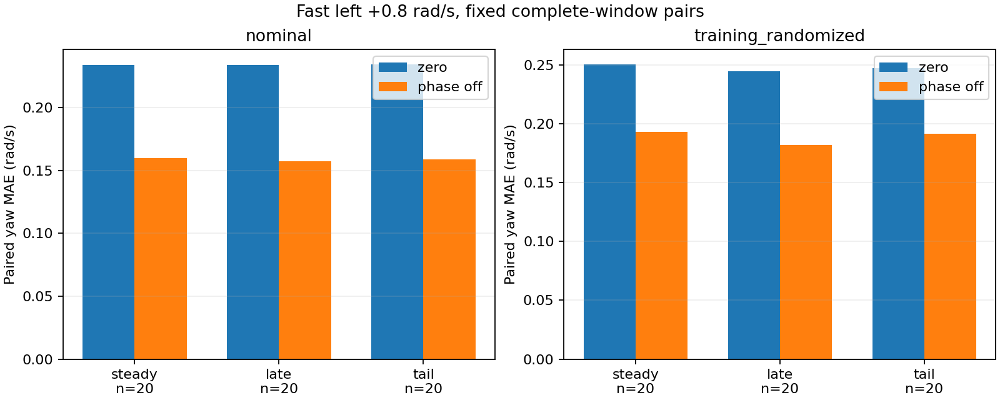
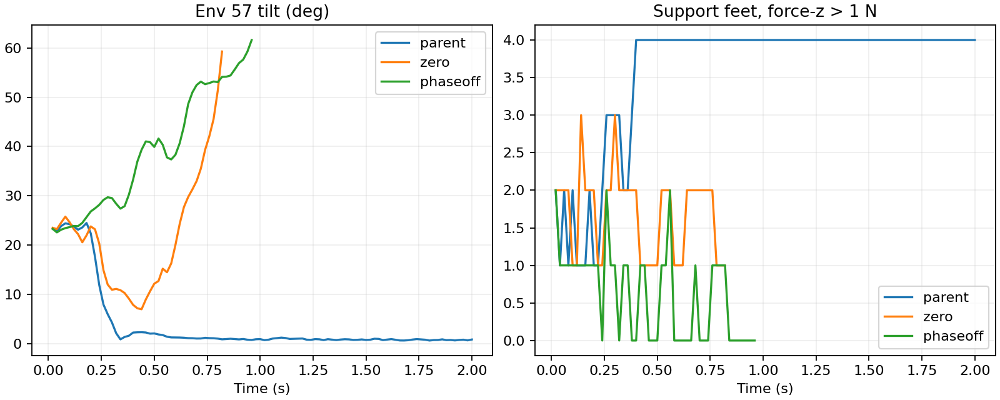

# 纯转向相位奖励关闭对照：阶段报告

本阶段于北京时间 2026-11-16 完成，目录沿用启动日期 20261115。恰好完成 100 次 PPO 更新和 1600 个冻结验证回合，能力验收未通过。中高速纯转向改善，但名义 5 cm 上阶由上一轮的 49/60 降至 20/60，随机化转向测试中的起步姿态失败由 1 个增至 7 个。训练及本阶段全部仿真均已结束；本模型保留作对照，不替换现有模型、不部署。

下文 parent 为父模型 10000，zero 为上一轮动作保持系数为 0 的 10100，guarded 为动作保持系数为 0.5 的 10100，phaseoff 为本轮关闭纯转向相位项的 10100。zero 与 phaseoff 均从同一 parent 恢复后各训练 100 次；本轮没有从 zero 再续训。

## 1. 改了什么，实际是否生效

唯一有效配置变化是 `phase_foot_trajectory_exp.func`：平移指令模长 < 0.1 m/s 且偏航指令绝对值 > 0.1 rad/s 时，将原相位位置奖励置零。原函数每次仍调用一次，以保留参考缓存初始化等副作用。其余奖励、六类地形、命令覆盖、PPO 设置及系数为 0 的辅助路径均沿用 zero。

- actor、critic、Adam 和课程恢复状态与 zero 的启动检查点逐项相同；训练种子 42、4096 环境、GPU 1。
- 先完成 64 步零更新集成，即 262144 次环境交互；actor、critic、Adam 未变，辅助项没有梯度作用。
- 随后恰好 100 次 PPO 更新，即 2400 控制步、9830400 次环境交互。保存启动、50、100 次更新检查点；新增 2000 次 Adam 步，累计 202000 次。
- 实际训练记录到 741172 个纯转向环境帧，全部移除了非零相位贡献。非纯转向返回值逐值保持，参考缓存初始化正常。
- 同一次奖励计算的反事实核对中，相位项最大误差 1.19e−7，总奖励差最大误差 2.38e−7。其他项使用本次原生计算的值，没有重复调用有状态奖励。这是同状态计分核验，不是两套环境逐帧相同的声明。

相关实现为 `scripts/tools/reference_low_stairs_yaw_phase_off_cfg.py` 和 `reference_low_stairs_yaw_phase_off_train.py`。完整配置差分和恢复证据保存在 `runs/`。没有发现本轮门控失效、恢复错模型、辅助损失暗中生效或预算超出的情况。

## 2. 转向改善了多少，还有什么没解决

以下为名义条件 4–8 秒的配对结果，每行 20 个相同起点。MAE 是实际偏航速度与命令之差的绝对值均值，越低越好，单位 rad/s。

| 指令 | zero 实际角速度 | phaseoff 实际角速度 | zero MAE | phaseoff MAE |
|---|---:|---:|---:|---:|
| 左转 +0.5 | 0.1868 | 0.4008 | 0.3135 | 0.1187 |
| 右转 −0.5 | −0.3155 | −0.4572 | 0.2024 | 0.0889 |
| 高速左转 +0.8 | 0.5759 | 0.6522 | 0.2339 | 0.1595 |
| 高速右转 −0.8 | −0.5940 | −0.6860 | 0.2186 | 0.1458 |

这四组相对 zero 和 parent 都是 20 个配对起点全部改善。名义 320 个转向回合全部存活。

高速左转不是只改善了一个时间窗。下表每行仍为 20 个配对起点；各策略在这些组的配对编号相同。

| 条件 | 时间窗 | parent MAE | zero MAE | phaseoff MAE | 相对 zero 改善/退化起点数 |
|---|---|---:|---:|---:|---:|
| 名义 | 4–8 s | 0.1998 | 0.2339 | 0.1595 | 20 / 0 |
| 名义 | 10–14 s | 0.1994 | 0.2337 | 0.1570 | 20 / 0 |
| 名义 | 16–20 s | 0.1988 | 0.2343 | 0.1587 | 20 / 0 |
| 随机化 | 4–8 s | 0.1743 | 0.2506 | 0.1933 | 17 / 3 |
| 随机化 | 10–14 s | 0.1776 | 0.2444 | 0.1819 | 19 / 1 |
| 随机化 | 16–20 s | 0.1777 | 0.2476 | 0.1914 | 18 / 2 |

随机化高速左转虽然优于 zero，仍未恢复到 parent；4–8 秒 MAE 比 parent 高约 10.9%。随机化标准右转和高速右转的共同存活 MAE 相对 zero 略差，分别为 0.1518→0.1551（20 对）和 0.1948→0.2080（17 对）。后者缺失的起点发生了起步失败，不能只用幸存者均值代替整体结果。

低速 ±0.2 rad/s 仍基本不转。名义 phaseoff 实际角速度约为 −0.00040 / −0.00012 rad/s；随机化低速左/右约为 0.00727 / 0.00007 rad/s。关闭相位项没有解决低速起转问题。

保留原严格筛查规则，相对 parent 的 96 个命令/物理条件/时间窗中，12 个 MAE 增幅超过 10%，没有缺失整组窗口，各配对数为 17–20。退化包括名义右弧线三个窗，随机化左右弧线各三个窗、直行晚窗和高速左转前窗；另一个为名义右转停止后的晚窗，绝对 MAE 仅增加 0.000143 rad/s。这个极小变化仍如实计入原规则，但不与明显能力退化等量解读。具体数值见 `summary.json` 的 `screening` 和 `turn_pairs.csv`。

## 3. 上阶没有保住，下阶也不能只看总通过数

表中每格都是完整通过数/60，每高度含 0.32、0.4、0.6 m/s 三档速度，各 20 起点。名义指固定物理参数，随机化指原协议的训练随机化物理条件。

| 条件 / 方向 | 高度 | parent | guarded | zero | phaseoff |
|---|---:|---:|---:|---:|---:|
| 名义上阶 | 平地 | 60 | 60 | 60 | 60 |
| 名义上阶 | 2 cm | 60 | 60 | 60 | 60 |
| 名义上阶 | 3 cm | 54 | 57 | 60 | 59 |
| 名义上阶 | 5 cm | 18 | 9 | 49 | 20 |
| 名义下阶 | 平地 | 60 | 60 | 60 | 60 |
| 名义下阶 | 2 cm | 60 | 60 | 60 | 60 |
| 名义下阶 | 3 cm | 60 | 60 | 59 | 60 |
| 名义下阶 | 5 cm | 60 | 60 | 59 | 60 |
| 随机化上阶 | 平地 | 45 | 51 | 50 | 55 |
| 随机化上阶 | 2 cm | 43 | 50 | 48 | 49 |
| 随机化上阶 | 3 cm | 40 | 51 | 48 | 48 |
| 随机化上阶 | 5 cm | 37 | 48 | 50 | 41 |
| 随机化下阶 | 平地 | 44 | 51 | 50 | 54 |
| 随机化下阶 | 2 cm | 45 | 51 | 47 | 53 |
| 随机化下阶 | 3 cm | 45 | 51 | 46 | 49 |
| 随机化下阶 | 5 cm | 39 | 52 | 41 | 50 |

名义 5 cm 上阶三档速度由 zero 的 15/20、20/20、14/20 降为 3/20、10/20、7/20，三档均低于批准的保持门槛。逐起点比较，新增成功 3 个，但丢失原有成功 32 个，净减 29 个。随机化 5 cm 上阶三档由 18、16、16 降为 8、17、16；新增成功 7 个、丢失 16 个，主要退化在 0.32 m/s。

名义 5 cm 的 40 个未通过分为：卡住 17、超时 12、横向越界 10、姿态终止 1。zero 原为姿态终止 7、横向越界 4，没有卡住或超时。因此仅看到姿态终止变少，会漏掉明显的前进能力下降。40 个未通过中有 24 个记录到至少第 6 级，但没有满足完整通过条件；不能笼统说它们连第一阶都上不去。名义 3 cm 另有 1 个卡住。

名义下阶恢复到各高度 60/60，zero 原来的两个越界起点均通过。5 cm 起点 181 的最终横移仍有约 0.357 m，说明通过并不等于完全直行。随机化下阶通过总数由 184/240 提高到 206/240，但姿态终止由 0 增至 3，分别在平地、3 cm、5 cm 的起点 26、143、190，发生于 0.40、0.82、0.98 秒。上阶随机化姿态终止也由 0 增至 4。上下阶的平地样本有重叠，不能把这些数简单相加当作独立失败起点总数。

## 4. 足端证据和奖励含义

名义高速左转 4–8 秒，phaseoff 的四足同时接触占比由 zero 的 68.45% 降至 41.78%，落脚对应平均腾空时间由 44.83 ms 增至 113.86 ms。前脚出现更明确的离地，名义支撑滑移下降。

| 高速左转条件 / 足 | zero 净空 p95 | phaseoff 净空 p95 | zero 支撑滑移 | phaseoff 支撑滑移 |
|---|---:|---:|---:|---:|
| 名义左前 | 0.19 mm | 15.82 mm | 0.0860 m/s | 0.0341 m/s |
| 名义右前 | 1.08 mm | 17.73 mm | 0.0815 m/s | 0.0518 m/s |
| 随机化左前 | 4.40 mm | 11.15 mm | 0.0810 m/s | 0.0883 m/s |
| 随机化右前 | 3.38 mm | 13.57 mm | 0.1123 m/s | 0.0906 m/s |

净空是每回合足底相对平地高度的 95 分位，再对相同起点平均，不能称为最大抬脚高度。随机化左前滑移没有下降；左后足仍几乎持续支撑，右后净空还减少了，因此不能宣称已恢复标准对角小跑。相同窗口内没有采到达到显式力矩限值 95% 的情况，但 20 ms 采样不能排除瞬时峰值。

这次同父模型、同预算、仅相位项改变的训练对照，支持原相位模板参与限制了这套设置中的中高速纯转向。它没有证明相位项是全部退化的唯一原因，也没有证明一般情况下都应关闭相位奖励。

上阶诊断另采用相同起点、共同存活且双方首次机身倾角超过 20° 之前、双方机身均进入阶区的共同时间，避免把成功者较短的行程与卡住者较长的碰撞时间直接比较。

| 名义 5 cm 速度 | 共同暴露时间 | zero 碰阶足时占比 | phaseoff 碰阶足时占比 |
|---|---:|---:|---:|
| 0.32 m/s | 123.32 s | 11.18% | 14.96% |
| 0.4 m/s | 168.06 s | 10.59% | 14.96% |
| 0.6 m/s | 90.02 s | 11.29% | 12.24% |

每档 20 对均有共同暴露；占比的分母是四只足乘共同暴露时长。碰阶代理要求足端靠近正面立面、净空不足且水平接触力反向超过 5 N，它是几何与力的联合代理，不是逐接触点的物理分类。名义三档都增多，支持卡阶和前进停滞更明显。随机化对应占比分别为 7.88%→8.36%、7.30%→7.32%、6.54%→5.64%，并非所有条件都增加，不能将随机化失败全部归为碰阶。记录和共同暴露起点数见 `up_diagnostics.csv`、`up_matched_contacts.csv`、`detail_summary.json`。

评估始终沿用公共参考奖励计分，便于协议一致；冻结记录里的非零原相位分数不是候选训练时的分数。离线重建的候选纯转向相位项为 0；原腾空项重建最大误差 9.54e−7，相位项为 1.06e−5。当前实际训练的站立门控和 0.32 m 高度修正早已生效，不能再将公共评估中的旧站立分数或 0.55 m 配置误报为本轮训练错误。

## 5. 起步恢复为何也变化

随机化转向测试的前 2 秒为零命令。phaseoff 的 7 个姿态失败全部发生于该阶段：57（0.96 s）、86（0.62 s）、143（0.92 s）、147（0.80 s）、153（0.66 s）、240（0.78 s）、260（0.34 s）。

zero 只有起点 57 在 0.82 s 失败，因此本轮新增 6 个、没有恢复该旧失败。parent 有 3 个零命令起步失败和 1 个命令后失败；相对 parent，本轮新增 57、86、143、147 共 4 个失败，恢复 259 一个，另与 parent 共享 153、240、260 三个失败起点。其中 parent 的 153 原在 2.24 s 失败，本轮提前到零命令阶段，不能把它算成新增起点。

起点 57 在完全相同的 PD 准备后，策略接手时已倾斜约 23.76°，是困难恢复状态。parent 在 0.30 s 降到约 4.26°；zero 降到 10.91°；phaseoff 此时约 29.53°，到 0.96 s 达到约 61.64°并终止。三个模型的初始物理数组、准备过程和输入一致，见 `motion_recovery57.csv` 和图。

代码层面的关键限制是：纯转向条件只控制奖励返回值，实际 PPO 仍更新同一个 actor 的共享权重，动作保持辅助系数又是 0。纯转向学习带来的参数变化仍可能改变直行、上阶和恢复时的输出。改变奖励还会改变后续采样轨迹与优势估计；本轮没有逐批梯度分解，不能把每个退化都归给某一笔纯转向梯度。

在重复使用的开发诊断输入上，本轮相对 parent 的恢复关节目标 RMSE 约 0.1321 rad，直行约 0.0256 rad，确认非纯转向输入上的动作也改变了；这些输入未参与本轮系数为 0 的保持训练，但已被反复观察，不能当全新泛化集。奖励门控正确不等于其他行为受到隔离保护。

## 6. 验收、资源与归档

- 六组冻结验证为两种条件各转向 320、上阶 240、下阶 240，合计 1600 回合；0 次验证更新，无额外航向反馈仿真。第一回合、重置前记录，父/zero/guarded 历史数据复用。
- 八个 GPU 子进程（集成、训练、六组验证）全部退出 0，运行完整性核验通过。集成约 1.15 分钟，训练约 18.28 分钟，六组验证合计约 20.09 分钟。实现、代码检查、CPU 统计和归档时间另计。
- 训练期间 GPU 1 卡总显存占用峰值 10703 MiB，冻结验证峰值 5897 MiB；这些是卡总占用采样值，不冒充单进程精确峰值。
- 77 项检查通过。120 个复用历史运行文件逐一哈希核验；`raw_manifest.json` 记录 224 个原始/来源文件。`closeout.json` 重新核验原始文件、参考源码、实现来源、四个模型哈希及进程退出状态。
- `summary.json` 的顶层 passed 仅表示来源与完整性通过，`screening.status=failed` 才是本轮能力结果；`verification.json` 不代表可部署。
- 最后 20 次训练日志均值为 reward 60.5539、回合长度 996.47、姿态终止指标 0.01065、偏航误差 0.3871。这些不是独立成功率；移除相位分数后总奖励也不能直接与 zero 比较高低。
- 大模型和数组约 1.4 GiB 留在本工作树 `logs/reference_six/low_stairs_yaw_phase_off_20261115`，不上传 Git。小型 JSON、CSV、图表及报告归档到本目录，`artifact_manifest.json` 保存交付文件哈希。
- 本轮仍是单训练种子和已观察过的开发起点，只能证明本组条件下的结果，不代表新场景、多种子、10 cm 台阶、MuJoCo 或实机验收通过。

最终候选为 `train_001_100/model_updates_10100.pt`，SHA256 为 `2353502964ed2cdb3c9b95692e0b3af8b4daacaa37e643ce3a65f88d1adce8eb`。原模型和参考项目均保留。

下一阶段建议先验证冻结上阶较好的 zero 主策略、独立纯转向增量分支的可行性，详见 [NEXT_STAGE_PROPOSAL.md](NEXT_STAGE_PROPOSAL.md)。该方案尚未实现，需要用户确认；本阶段没有继续训练、改结构或部署。
