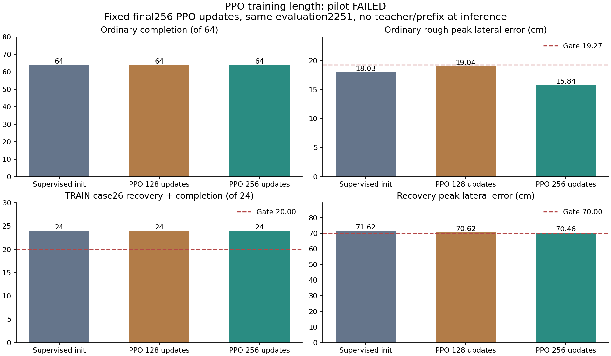

# 直接均值保持PPO：128→256轮固定长度消融

本轮承接[128轮直接均值保持实验](lite3-mean-anchor-result-2026-10-09.md)。该候选普通64/64、横偏RMS8.43cm/峰值19.04cm，TRAIN case26恢复24/24、峰值70.62cm；原六门槛通过五项，恢复峰值仍高于70cm。

**结果：普通通关保持64/64，RMS8.43→7.04cm、峰值19.04→15.84cm；case26恢复保持24/24，但峰值仅70.62→70.46cm，仍高于70cm。原六门槛通过五项，完整pilot未过，原7来源验证未触发。**

## 唯一主要变量

最终训练预算从128轮增加到256轮，仍从监督Actor `6a470cec8c1f1b1ad6f237c1ecc6401367528715ccca0f44b4f02b4860fa2ead` 重新初始化，不从128轮PPO候选续训。Critic与优化器仍全新；learner2281、初始std0.05、lr3e-6、横偏惩罚−8、普通/恢复前段奖励保持100、直接均值回放损失100、私有回放seed2293及TRAIN数据均不变。

每轮64环境×32控制，共524288训练控制，最终5120次Adam步。每次小批另回放128correction/128flat/128rough101/128rough107，总2621440条重复监督查询；不读取离线验证行、post_recovery组或pilot轨迹进行更新。输入仍48D，推理没有case、时间、前缀或教师接管。

重新执行的前128轮物理也计费，不能因为此前已运行过相同配置而扣掉。独立审计将比较原128轮完整轨迹前缀，检查相同初始化和采样流是否复现；不以该检查选择中途checkpoint。只评测预先登记的最终256轮模型。

## 评测与预算

固定eval2251的普通与TRAIN case26两条件，使用原六门槛：普通逐地形完成不下降、RMS≤原PPO2063的1.05倍、峰值不增加；case26至少20/24且优于原模型、各延迟组≥80%、恢复峰值≤70cm。70.62cm与70cm接近不构成放宽门槛的理由。

训练524288、候选pilot上限256000；只有全部pilot门槛通过才触发原7来源验证上限256000，阶段总上限1036288。原控制与基线只读复用，须初态/执行器延迟联合哈希一致；保留所有失败，不按中途损失或评测择优。

## 证据

- [预登记长度计划](lite3_mean_anchor_long_plan_20261009.json)
- [固定训练协议](lite3_mean_anchor_long_train_protocol_20261009.json)、[冻结评测协议](lite3_mean_anchor_long_pilot_protocol_20261009.json)

## 训练审计已完成

实际完成256轮、524288训练控制，其中98304为case26恢复控制；只暴露TRAIN case26，原验证来源零使用。训练恢复回合288成功、54失败，全部保留，不把带探索的训练回合当作资格验证。最终checkpoint SHA256为`3893dddf314e14c47639a14f3ccb06538f51ecce348299f9239e342ecbda4c27`。

5120次Adam更新及2621440条回放抽样已核对；索引流SHA256为`f23e011a25c5f5632ba43a646011b8989df4bed8512bc5af129fe0279b45605e`，冻结参考Actor未变化。原奖励保持的目标/掩码/实际奖励分量也逐步核验。

完整前128轮在policy/critic观测、根状态、请求和执行动作上与原128轮实验逐元素一致，各字段最大绝对差均为0。它证明本次执行的前半段复现，不等于独立学习种子复现或新增来源泛化。

离线普通动作均值偏差MSE约0.000139–0.000140，略高于128轮约0.000126–0.000127；恢复前段约0.0000601，低于128轮0.0000692。不同状态组的变化方向不同，仍须以闭环结果判定。

- [训练轨迹审计](lite3_mean_anchor_long_training_audit_20261009.json)
- [奖励保持审计](lite3_mean_anchor_long_reward_audit_20261009.json)
- [回放索引、直接更新与完整前缀审计](lite3_mean_anchor_long_update_audit_20261009.json)

## 冻结评测结果

| eval2251指标 | 监督初始化 | 128轮PPO | 256轮PPO |
|---|---:|---:|---:|
|普通通关|64/64|64/64|64/64|
|普通rough RMS|7.91cm|8.43cm|7.04cm|
|普通rough峰值|18.03cm|19.04cm|15.84cm|
|case26恢复并完成|24/24|24/24|24/24|
|case26 RMS|59.73cm|59.49cm|59.22cm|
|case26峰值|71.62cm|70.62cm|70.46cm|

本轮普通flat/rough101/rough107分别16/16、24/24、24/24；case26四Hip/Knee延迟组分别7/7、7/7、7/7、3/3。普通完成、RMS、峰值和两项恢复成功门槛都通过；恢复峰值实际0.704632759m，仍超过0.70m，不能按“接近”或显示精度改判。

延长训练在这组配置上改善了普通行走，恢复峰值却只下降约0.16cm、恢复RMS只下降约0.27cm。普通指标已优于监督初始化，但恢复RMS仍约59cm，不能把“会回正并走完”称为“已经精密回线”。24槽来自同一个TRAIN来源，评测种子2251是持续使用的开发种子；仍无原7来源资格、独立学习种子或未知来源恢复的新增证据。

原7来源有条件评测未触发，费用0；不晋升新恢复教师或启动新FlowDAgger集成。该阶段复用前轮已经通过的36项运行时代码测试；运行时代码未改，新扩展的只读审计对旧128轮结果向后兼容核验通过。所有训练、奖励保持、直接更新、完整前缀和评测轨迹/CPU动作回放审计通过。

## 成本和下一步

实际训练524288＋冻结评测179200＝**703488新控制转移**，新增uncertain0；2621440次回放查询本身新增物理0。累计charged28904512/confirmed28904448/历史uncertain64；旧完整PPO系列11900884另列，两账合计40805396，仍不包括原预训练及更早SAC/C0。

延长训练对恢复峰值的收益已经很小，下一项优先检验恢复前段的监督目标：目前直接保持损失把它锚定到初始化神经Actor，而原成功示范具有更小的恢复峰值。可另行登记仅将correction组目标改为已有新TRAIN采集的真实示范动作，普通组继续保持初始化Actor，其余PPO参数固定。不同种子的示范与本结果不能直接作因果比较，该假说须通过新固定预算对照验证；不能回流本轮pilot作标签、放宽70cm门槛或继续无限增加更新。此目标消融本轮尚未实现或启动。

- [冻结轨迹审计](lite3_mean_anchor_long_pilot_trajectory_audit_20261009.json)、[原六门槛判定](lite3_mean_anchor_long_pilot_result_20261009.json)
- [完整对比、成本和失败清单](lite3_mean_anchor_long_result_20261009.json)、[SVG图](figures/lite3-mean-anchor-long-20261009.svg)
