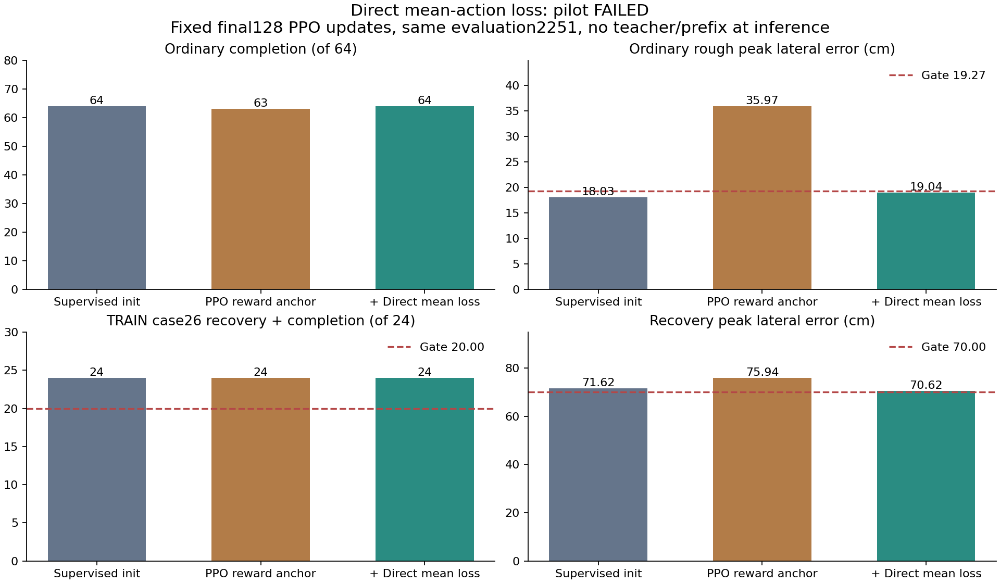

# PPO直接均值动作保持：固定训练回放消融

上一轮[回线PPO配对](lite3-recovery-return-ppo-result-2026-10-08.md)保住了TRAIN case26的恢复成功数，但主组普通行走降到63/64、横偏精度退化。保持项已执行且目标/掩码正确，说明该配置的软奖励惩罚没有充分保持原行为。

本轮保留上一主组的全部PPO配置、训练期动作奖励保持100与横偏惩罚−8，只新增直接作用于Actor均值输出的回放MSE损失。仍从原监督候选6a470cec…重新初始化，没有从失败PPO模型续训；learner2281、std0.05、lr3e-6、64×32×128=262144训练控制、最终128轮检查点不变。

**结果：相比上一PPO主组，普通通关63→64/64、RMS13.39→8.43cm、峰值35.97→19.04cm；case26自主恢复保持24/24，峰值75.94→70.62cm。六项原门槛通过五项，恢复峰值仍超过70cm，未触发原7来源验证。**

## 损失与数据

每个PPO小批执行一次合并反向传播和一次Adam更新：`L = L_PPO + 100 × L_mean_replay`。保留原价值损失、熵系数0、裁剪比率0.2及Actor/Critic各自的梯度范数上限1。均值保持项直接比较原始动作均值与冻结初始化Actor在相同48D观测上的输出，不包括采样噪声，也不直接惩罚探索方差。

每次另取128条correction、128flat、128rough101、128rough107训练观测。数据来自已审计的监督迁移/普通状态覆盖TRAIN数组；不取post_recovery组，不取离线验证行或任何pilot轨迹。标签重新由冻结初始化Actor计算，不直接采用文件中旧示范动作。总2560次Adam更新对应1310720条重复回放查询，不能把它们算成独立样本或新增物理转移。

回放使用独立CPU随机数流seed2293，记录抽样索引流SHA256，以便不启动仿真即可重建。实例化冻结参考网络时恢复主随机数状态，避免仅新增模块就改变PPO采样流。输入仍48D，推理时没有回合年龄、case编号、固定前缀或教师接管。

实现明确只支持本次使用的前馈、固定学习率、单GPU、无RND/镜像损失配置，其他配置直接拒绝。在CPU测试夹具中，零系数与已安装原PPO.update在参数、损失和RNG上完全一致，包含开启/关闭逐小批优势归一化的测试；非零项具有Actor均值梯度，冻结参考网络及探索方差不接收该项梯度。相关36项测试通过。

## 评测规则

固定eval2251、普通/恢复两条件，复用原付费基线须匹配初态及执行器延迟联合哈希。原六门槛不变；case26恢复峰值仍需≤70cm。未全部通过时，不启动原7来源资格验证，不补种子或择优选中途检查点。

本次为真实PPO加监督保持辅助项，没有flow反演或噪声策略更新，不计作FlowDAgger收益；同一个TRAIN恢复来源上的重复成功不代表其他来源或实机恢复。

## 证据

- [预登记计划](lite3_mean_anchor_plan_20261009.json)
- [训练协议](lite3_mean_anchor_train_protocol_20261009.json)、[冻结评测协议](lite3_mean_anchor_pilot_protocol_20261009.json)

## 完整结果与含义

| eval2251指标 | 监督初始化 | 上一PPO主组 | 直接均值保持 | 原门槛 |
|---|---:|---:|---:|---|
|普通通关|64/64|63/64|64/64|逐地形不低于原PPO2063|
|普通rough RMS|7.91cm|13.39cm|8.43cm|≤8.47cm|
|普通rough峰值|18.03cm|35.97cm|19.04cm|≤19.27cm|
|case26恢复并完成|24/24|24/24|24/24|≥20且优于原PPO2063的0/24|
|case26 RMS|59.73cm|64.22cm|59.49cm|如实报告|
|case26峰值|71.62cm|75.94cm|70.62cm|≤70cm，未通过|

本轮普通flat/rough101/rough107分别16/16、24/24、24/24；case26四Hip/Knee延迟组依次7/7、7/7、7/7、3/3。实际峰值0.706205368m，不能因四舍五入或接近上限而判通过。原基线普通RMS0.080651613m、峰值0.192744255m，门槛按未舍入值计算。

本轮明显修复了上一PPO更新造成的普通行走退化，但普通RMS/峰值仍稍高于监督初始化，并不是所有维度都超过初始化模型。恢复峰值相比初始化减少约1.00cm，而平均横偏仍约59.49cm；70cm只是TRAIN迁移工程上限，达到附近不等于精密回线。

模型仍只在同一个TRAIN恢复来源、同一开发评测种子上验证，24槽并非24个独立来源。没有启动原7来源资格验证、新FlowDAgger集成或实机测试，也没有独立学习复现，不替换已验收的既有策略。

## 更新与数据审计

实际完成128轮PPO、2560次Adam更新、1310720条训练回放查询。独立重建CPU采样索引流SHA256为`3cfb6f1a43ac2f45e27559c205fc583701a47b80ed36a70439bb2274fe1af4b8`；回放只读取correction216、flat31114、rough10146866、rough10746631条TRAIN观测，验证行没有进入优化。

首个32步rollout的策略/critic观测、根状态、请求/执行动作与上一PPO主组逐元素一致，排除了新增参考网络初始化导致首段采样改变的问题。冻结参考模型结束时逐参数未变。最终checkpoint：`88e8b29218a1c8762d0741c545735971e1bf37f719f048e171d725ad05e6cd86`。

离线验证流上的普通动作均值偏差MSE降至上一PPO主组的约13.0%–13.3%，恢复前段降至4.44%。例如rough101为0.000127，对照0.000956；95%动作绝对偏差约0.0217，对照0.0618。该结果说明保持项确实约束了均值漂移，但闭环性能仍以完整轨迹为准。

带探索的训练恢复回合为144成功、29失败；上一主组为144成功、22失败。本轮训练失败更多，并未据此挑选回合或检查点。训练回合数、离线动作误差与关闭探索后的成功率是不同证据，分别保留。

实际执行的均值更新模块已按训练报告SHA归档在本地`artifacts/mean_anchor_20261009/train/source_snapshot/`；训练结束后仅补齐RSL-RL版权注释与许可证，源码语法树一致。更新逻辑、数据、奖励约束和最终动作回放均审计通过；36项相关测试通过。

## 成本与下一项

训练262144＋冻结评测178176＝**440320新物理控制**；监督回放查询不增加物理转移，原7来源有条件验证未触发、费用0，新增uncertain0。此前PPO配对阶段920000另保留；两阶段合计1360320。

累计后续恢复开发为**charged28201024/confirmed28200960/历史uncertain64**。旧完整PPO系列11900884另列，两账合计40101908，仍不包括原始预训练与更早SAC/C0。

下一项优先做固定训练长度消融：保留本轮初始化、均值保持系数、奖励、学习率与种子，将最终更新预算128→256，启动前单独登记，只评测最终256轮模型，不根据中间结果选择。普通精度余量很小，必须和恢复成功/横偏一起复核，不能只追逐0.62cm的差距或放宽70cm门槛。该更长训练本轮尚未启动。

- [训练轨迹审计](lite3_mean_anchor_training_audit_20261009.json)、[原奖励保持审计](lite3_mean_anchor_reward_audit_20261009.json)
- [直接损失、采样流、配对首段与离线诊断](lite3_mean_anchor_update_audit_20261009.json)
- [评测轨迹审计](lite3_mean_anchor_pilot_trajectory_audit_20261009.json)、[固定门槛结果](lite3_mean_anchor_pilot_result_20261009.json)
- [汇总、成本与失败清单](lite3_mean_anchor_result_20261009.json)、[SVG图](figures/lite3-mean-anchor-20261009.svg)
