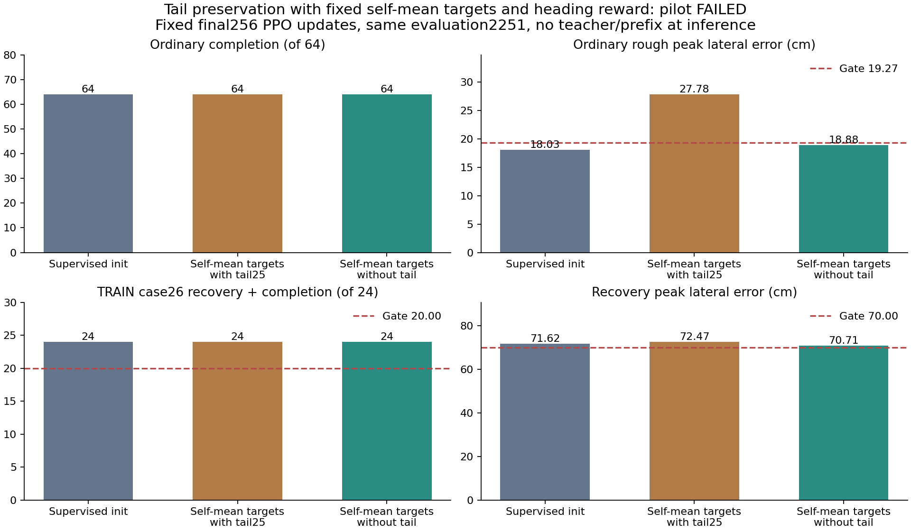
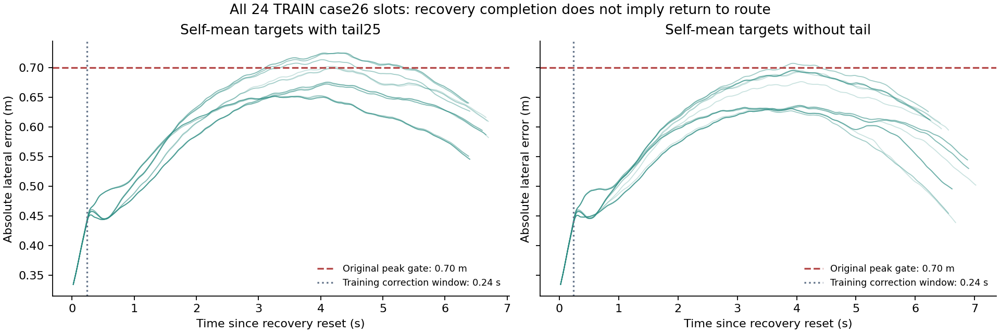

# 去掉尾段保持：固定自均值目标与回线航向奖励（2026-10-10）

**本轮改善普通行走和恢复横偏，但完整验收仍未通过。** 相对上一轮，普通峰值27.78→18.88cm、恢复峰值72.47→70.71cm，普通精度三门槛全部通过。六项门槛通过五项，恢复峰值仍超过70cm；候选未晋升，原7来源验证未触发。24个恢复槽仍重复同一个TRAIN case26，不是24个独立来源。

## 改了什么，为什么这样改

上一轮自均值组合保留了单独的尾段保持项，它要求策略在5681条既有TRAIN尾段状态上接近冻结初始化Actor。初始化本身恢复后横偏较大，额外保持可能限制纠偏，必须通过闭环实验检验，不能仅靠辅助损失下降判断。

本轮只移除这项，原四组correction/flat/rough101/rough107各128条、整体均值保持系数100和CPU抽样seed2293均不变。目标仍是冻结初始化Actor的原始动作均值，不读取存储示范动作作为优化标签。

初始化Actor此前经过示范监督，本轮没有抹去已有示范知识；改变的是当前PPO更新中的辅助项。

- 对照：`L_PPO + 100 × MSE_四组自均值 + 25 × MSE_尾段自均值`
- 本轮：`L_PPO + 100 × MSE_四组自均值`

协议直接省略`tail_anchor`，使用既有无尾段路径。若保留该字段而只填系数0，现有训练器最终的尾段调用次数断言不适用；无需因此更改已验证的运行代码。

从原监督初始化6a470cec…重新开始，fresh critic/Adam；learner2281、初始std0.05、lr3e-6、64环境×32步×256轮、每轮5epoch×4小批、最终checkpoint规则全部不变。没有接续上一轮失败模型。普通/恢复前12步在线动作奖励保持100、机身/足端最大横偏平方惩罚−8也不变；航向目标仍为`clip(atan2(-y,1m),±20°)`，权重−1。

48D策略观测、12D关节动作保持。推理没有teacher、case/时间输入、固定动作前缀或额外转向器。仍是10m×4m跑道、rough101/107最终高度±4cm、固定前进命令0.3m/s、50Hz，未新增未知地形、步态量化验收或实机测试。

## 训练与实现核验

176个运行源文件与对照的哈希全部相同；沿用已通过的53项测试、无尾段实际训练路径和相同奖励工程证据，没有声称本轮重新执行53项测试。新增工程物理0。只读审计/汇总扩展了本轮schema，并重新生成上一轮JSON，两个原结果逐项一致。

本轮524288个训练控制、5120次Adam更新、2621440次主回放查询；尾段查询0、优化使用存储动作标签0。主抽样流独立重建并与对照相同，冻结参考未改变，验证行零用于更新。训练恢复288成功、72失败、0截止均保留。

首32控制的全部26个记录字段（含奖励、状态、动作和保持掩码）与对照逐元素相同；后续参数更新才因尾段项移除而不同。训练、实际动作保持、航向几何及更新四审计全部通过。

固定最终模型：`artifacts/no_tail_heading_20261010/train/final.pt`，SHA `f9cb2e415fae056af538201b3fb77efe650d5054d1b1351d591e646b2c7111a9`。

## 冻结评测和原门槛

同GPU1、eval2251、普通/恢复两条件，仅评测最终256轮模型。两条件初态/执行器延迟联合哈希与对照和原PPO2063基线一致，完整轨迹及抽样CPU动作回放审计通过。

| 指标 | 带尾段25对照 | 本轮无尾段 |
|---|---:|---:|
| 普通完成 | 64/64 | 64/64 |
| 普通rough平均每回合RMS | 7.67cm | 7.15cm |
| 普通rough最坏横偏 | 27.78cm | 18.88cm |
| TRAIN case26恢复并完成 | 24/24 | 24/24 |
| 恢复平均每回合RMS | 61.31cm | 59.35cm |
| 恢复最坏横偏 | 72.47cm | 70.71cm |
| 恢复结束平均绝对横偏 | 59.37cm | 54.85cm |

flat/rough101/rough107各16/16、24/24、24/24；四Hip/Knee延迟组恢复7/7、7/7、7/7、3/3。普通完成、RMS、峰值及恢复数量/延迟分组门槛通过。恢复峰值精确为0.7070779800m，仍超过0.70m约0.708cm，不能四舍五入补过。普通峰值门槛仍为原基线0.1927442551m；没有换阈值、seed或中间checkpoint。

48个普通rough槽中28个RMS、37个峰值改善；24个恢复槽的RMS和峰值全部改善。旧普通最坏env39从27.78→10.74cm，新最坏为rough101/env19，峰值18.88cm、发生在24.54秒。其此前平均世界横向速度−0.735cm/s、平均航向−3.21°，持续的小速度仍可积累偏移。所有槽都保留，没有因图表展示而筛选评测结果。

恢复最坏为env57，3.94秒时达70.708cm；初始已偏32.652cm，相对起点额外最大位移38.055cm。结束平均横偏仍54.85cm，不能把恢复并走完称为精密回线。

## 从负结果中得到什么

去掉尾段保持后，离线验证尾段均值动作变化MSE由0.000111→0.000233，实际普通访问状态的均值变化MSE由0.000105→0.000160，二者都增大；路线精度却改善。这说明在本固定组合/学习种子下，更接近初始化动作不是更好路线的充分条件，尾段25没有带来所需闭环收益。不能推广成所有动作保持都有害。

更早的无尾段、零航向目标256轮模型仍有普通峰值15.84cm、恢复峰值70.46cm，完整门槛同样失败。因此本轮不是历史最优恢复峰值，也没有证实当前回线航向目标优于旧目标。所有候选和失败判定继续保留，没有按新旧排序替换已验证策略。

新增只读TRAIN速度诊断使用本轮全部98304个case26训练控制，包含失败、终止步及整个学习过程，没有使用pilot或原7来源。0–0.24秒平均向外世界速度约50.12cm/s；0.24–1秒9.65cm/s，1–2秒10.18cm/s，2–4秒2.34cm/s，4秒后平均转为向内4.11cm/s。1–2秒的水平航向坐标横速度平均已向内约0.69cm/s，但世界坐标仍明显向外，说明朝向与平移必须联合考察。

这些分段来自变化中的策略，后段还存在存活选择效应，不能作为最终模型的动力学因果证明，也不能把水平航向坐标称为完整机身坐标。诊断只输出汇总，不产生优化标签。

## 下一步方案

下一项先用TRAIN轨迹校准“向路线回移的世界横向速度”奖励，再登记单项奖励消融，保持本轮无尾段配置及原四组保持。候选形式为`v_y_target = clip(-k*y, ±v_max)`、惩罚`(v_y-v_y_target)^2`；它直接区分朝内/朝外平移，不能仅用朝向替代速度。

正式训练前应先固定k、速度限幅与系数（依据TRAIN量纲和代价，不按pilot挑选），验证左右反射、零偏移、限幅、终止前快照和dt计费，再冻结训练/预算。必须保留普通精度与原70cm门槛、同初始化/学习种子和最终256轮规则。当前仅完成诊断与方案，未实现新运行奖励、未登记或启动下一轮物理预算；不能据此预告一定通过。原7来源及pilot不进入训练标签，原资格和独立学习复现仍是新FlowDAgger集成前提。

## 成本和交付

新增训练524288＋冻结pilot176896＝**701184个控制转移**，工程0、条件验证0、新uncertain0，低于登记上限1036288。回放查询和只读诊断不产生物理控制。没有中止重试或新录像。

恢复/FlowDAgger开发累计charged33289984、confirmed33289920、历史uncertain64；旧完整PPO系列11900884另列，两账合计45190868，仍不包含最早预训练及SAC/C0费用。物理控制转移不等于GPU小时。本轮是PPO辅助损失消融，没有新flow反演或噪声策略训练。

- [预登记计划](lite3_no_tail_heading_plan_20261010.json)、[训练协议](lite3_no_tail_heading_train_protocol_20261010.json)、[运行版本核验](lite3_no_tail_heading_preflight_20261010.json)、[旧分析兼容核验](lite3_no_tail_heading_analysis_regression_20261010.json)
- [训练审计](lite3_no_tail_heading_training_audit_20261010.json)、[实际动作保持](lite3_no_tail_heading_reward_audit_20261010.json)、[航向几何](lite3_no_tail_heading_geometry_audit_20261010.json)、[回放更新审计](lite3_no_tail_heading_update_audit_20261010.json)
- [冻结协议](lite3_no_tail_heading_pilot_protocol_20261010.json)、[冻结轨迹审计](lite3_no_tail_heading_pilot_trajectory_audit_20261010.json)、[原门槛](lite3_no_tail_heading_pilot_result_20261010.json)、[结果和账本](lite3_no_tail_heading_result_20261010.json)
- [全部配对回合](lite3_no_tail_heading_episode_comparison_20261010.json)、[恢复横偏曲线](lite3_no_tail_heading_lateral_diagnostic_20261010.json)、[普通动作/侧移诊断](lite3_no_tail_heading_ordinary_diagnostic_20261010.json)、[TRAIN速度分段诊断](lite3_no_tail_heading_train_velocity_diagnostic_20261010.json)
- [项目总结](lite3-project-summary-2026-10-08.md)、[完整PPO原理](lite3-full-ppo-finetuning-principles-2026-10-08.md)
