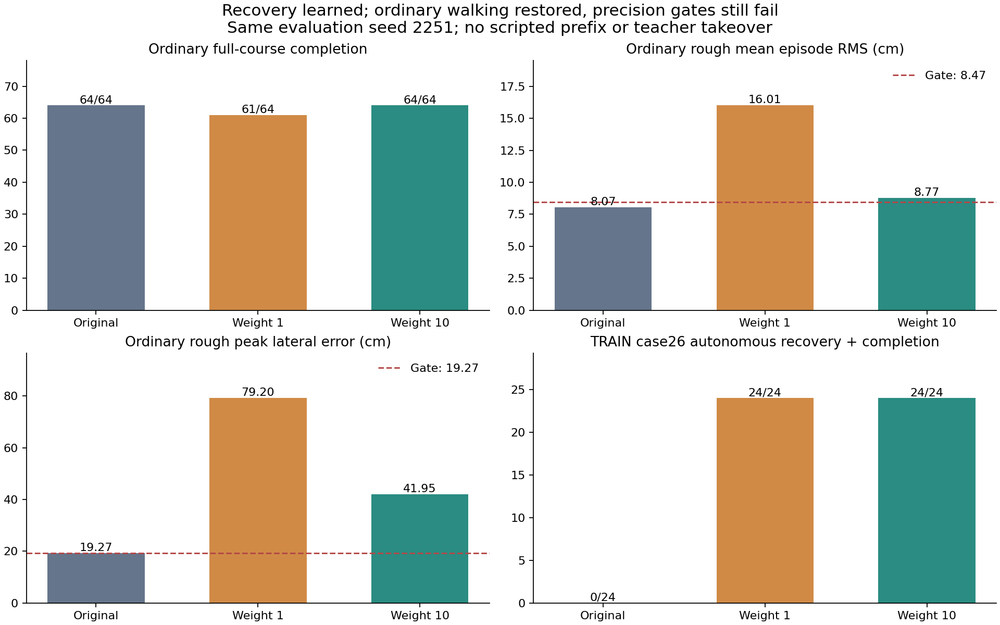

# 从固定恢复示范到状态相关Actor：监督微调与保持权重消融

**已完成两次监督训练和闭环评测：网络在同一TRAIN case26上自主恢复并走完剩余路段24/24，不再需要固定前缀或教师接管；提高普通行为保持损失后，正常行走由61/64恢复到64/64。但普通横向精度和恢复横偏仍未通过预登记门槛，两模型都不晋升为合格教师。**

图中均为eval2251；Original是固定槽PPO2063，Weight 1/10是两次从它重新初始化的监督拟合。24次恢复是同一TRAIN来源在不同环境槽/执行器延迟上的重复，不是24个独立来源。可下载[SVG](figures/lite3-prefix-imitation-20261008.svg)。

本轮承接受约束搜索找到的TRAIN case26成功动作，测试同一48维观测的网络能否自行执行恢复。它不使用前缀时间、case编号或教师接管作为推理输入；这是完整Actor均值网络的监督微调，不是PPO、SAC或FlowDAgger更新。

## 新训练采集与隔离

固定原32恢复槽PPO2063为初始化和普通保持参考，固定搜索候选15为case26示范器。另行登记seed2243普通行走、seed2237恢复示范，未把此前搜索、稳健筛选或完整路段复核轨迹回流作训练标签。两个新采集各88448控制步，总176896，无不确定步；普通64/64、恢复示范64/64（含case26的24/24）完成。

仅从完成的首次回合提取动作前观测与实际执行动作。按整个环境流分区：env_id能被4整除的流只用于离线验证，不参与拟合。它们仍来自相同TRAIN来源/地形，不能冒充原7个留出来源或未知地形验证。

| 样本组 | 用途 | 拟合行数 | 离线验证行数 | 每批抽样 |
|---|---|---:|---:|---:|
|correction|case26最初12控制步的纠正动作|216|72|128|
|post_recovery|交还原PPO后的恢复行走保持|5681|1885|128|
|flat|普通平地保持|15474|5312|128|
|rough101|普通101行走保持|23390|7900|64|
|rough107|普通107行走保持|23539|7900|64|

纠正样本很少且被重复抽样，因此必须检查闭环迁移，不能把大量梯度更新视为增加了独立数据。数据集逐行重建审计通过，标签来自新采集的执行动作，验证流未参与优化。

## 固定训练方法

learner2247从原冻结PPO2063的48→512→256→128→12 ELU均值网络初始化，全部层可训练。使用Adam、学习率1e-5、批量512、梯度范数上限1，固定2000次更新，只保留最终checkpoint作为评测对象。每批组成按上表固定，优化各组按样本占比加权的原始网络输出对执行动作目标的MSE。

Critic和高斯探索方差没有训练，物理执行仍使用共同动作限幅。平地和普通崎岖样本提供行为保持约束；没有把“会复制示范”假定为“会改善示范本身约58cm的横漂”。

最终模型SHA256：`29194d513a458b3e2b72b826f6c17ad9f49a8354844af7ccdf27b94d9d449e58`。

## 离线结果

| 离线验证组 | 初始MSE | 微调后MSE |
|---|---:|---:|
|纠正动作|0.72367|0.00544|
|恢复后保持|0.000169|0.002695|
|平地|约0|0.000160|
|rough101|约0|0.000334|
|rough107|约0|0.000320|

以上单位是归一化动作分量的平方，不是角度或横偏距离。恢复示范拟合明显改善，但普通/恢复后保持不再与原策略完全相同。小动作误差也可能在动力学闭环中累积，所以这些数不能作为恢复成功率。

## 首轮闭环pilot（完成，未通过）

使用新seed2251，原Actor与微调Actor各运行普通起步和TRAIN case26恢复起步，共4臂、每臂64环境×最多2000步，上限512000。两模型在同条件必须有相同初态和执行器延迟；微调Actor全程自己输出动作，没有固定前缀或教师接管。

预登记门槛：case26至少20/24恢复并完成，各Hip/Knee延迟组至少80%，最坏横偏≤0.70m；普通逐地形完成不低于原Actor、rough RMS≤原Actor1.05倍、最坏横偏不增加。0.70m只是从已知示范迁移到自主网络的TRAIN案例工程上限，不是精密循迹标准，也不替代原教师资格。

首轮普通61/64，失败均为rough107的env60/61/63姿态终止；case26自主恢复24/24。普通横偏和恢复峰值均不合格，实际352512控制步，无不确定步。完整结果保留，未挑选中途checkpoint或更换种子。

## 保持损失权重1→10（完成，部分改善）

第一版离线拟合成功却影响正常行走，因此另行预登记一次单因素消融：所有非correction组的MSE权重乘10，包含post_recovery、flat、rough101/107；其余数据、整流划分、原PPO初始化、learner2247、2000更新、学习率和批组成不变。没有从第一版失败模型续训。

目标为`L = 0.25 L_correction + w × (0.25 L_post + 0.25 L_flat + 0.125 L_101 + 0.125 L_107)`，w分别为1和10。权重改变了纠正与保持的相对梯度，也改变总梯度尺度；梯度仍受范数1裁剪。它不是物理硬约束，不保证每次执行与原策略完全一致。

| 离线验证组 | 权重1 | 权重10 |
|---|---:|---:|
|纠正动作MSE|0.005444|0.009073|
|恢复后保持MSE|0.002695|0.000673|
|平地MSE|0.000160|0.0000312|
|rough101 MSE|0.000334|0.0000832|
|rough107 MSE|0.000320|0.0000810|

最终模型SHA256：`80c8fbe3eee67b9c689374f51dc99c25ac8e871d828b227baa4db630d07621fd`。完整2000次Adam更新、数据重建、验证误差及最终模型审计通过。

第二版只运行候选的普通/恢复两臂，复用第一版已经付费的原PPO对照。审计确认两条件的初态与执行器延迟联合哈希完全一致，基线报告哈希锁定；未把复用对照重复计费。新增173696控制步，无不确定步。

| 闭环指标（eval2251） | 原PPO2063 | 监督权重1 | 监督权重10 | 原pilot要求 |
|---|---:|---:|---:|---|
|普通平地完成|16/16|16/16|16/16|不低于原模型|
|普通rough101完成|24/24|24/24|24/24|不低于原模型|
|普通rough107完成|24/24|21/24|24/24|不低于原模型|
|普通总完成|64/64|61/64|64/64|逐地形保持|
|普通rough平均回合横偏RMS|8.07cm|16.01cm|8.77cm|≤8.47cm，即原模型1.05倍|
|普通rough最坏横偏|19.27cm|79.20cm|41.95cm|≤19.27cm|
|TRAIN case26恢复并完成|0/24|24/24|24/24|≥20/24且优于原模型|
|case26四延迟组成功数|0/7、0/7、0/7、0/3|7/7、7/7、7/7、3/3|7/7、7/7、7/7、3/3|每组≥80%|
|case26平均回合横偏RMS|失败早停，不作完整路线对比|63.71cm|60.69cm|如实报告|
|case26最坏横偏|失败早停|78.57cm|71.30cm|≤70cm|

四延迟组依次为Hip/Knee控制步延迟0/0、0/1、1/0、1/1。第二版成功数、延迟分组和普通完成三个门槛通过，普通RMS、普通峰值和恢复峰值三个门槛失败。8.77cm比原模型高约8.74%，而允许增幅只有5%；71.30cm虽接近70cm，也不放宽门槛。

只有全部pilot门槛通过，才启动原7来源、seed2081的候选完整跑道/恢复验证。本轮条件未满足，**该验证未运行、费用0**；新教师资格与独立学习复现尚未通过，未启动新FlowDAgger集成或硬件验证。这里完成的是监督学习的自主恢复迁移，不是新一轮PPO梯度更新，也没有证明新步态族或通用恢复。

## 已有轨迹定位与下一步

只读诊断定位第二版普通最坏回合为rough101/env22：7.04秒时，距地形原点纵向3.66m处偏移41.95cm，该回合最终成功。rough101/107的平均RMS分别9.12/8.42cm，峰值41.95/23.07cm；说明完成率恢复后仍存在较大的局部偏移。

恢复最坏回合为env57：3.98秒、纵向7.21m处偏移71.30cm。初始位置已经偏32.65cm，整个case26组相对自身起点的最大额外偏移38.65cm，最终平均绝对横偏仍56.88cm。峰值发生在原示范前缀0.24秒之后很久，表明回正与回到路线是两个需分别解决的目标；这不能唯一证明某个动作或接触是原因。

下一步优先补足普通保持的闭环状态覆盖：用另行预登记的新TRAIN采集，让原PPO在候选访问的普通状态上给保持标签，测试能否缩小分布偏移。原pilot轨迹只做诊断，不直接转为训练标签；保留相同48D输入和固定评测门槛。恢复后横偏的改善需要另行研究带行为保持约束的PPO更新或更低横偏示范，不能假定复制已有约58cm横偏的示范会自动学会精密回线。两项分阶段登记、分别比较，不继续盲目增加保持权重。本轮尚未启动这些新采集/训练。

## 证据与预算

- [阶段计划与预算](lite3_prefix_imitation_plan_20261008.json)
- [新采集普通行走审计](lite3_prefix_imitation_collect_course_audit_20261008.json)
- [新采集恢复示范审计](lite3_prefix_imitation_collect_prefix_audit_20261008.json)
- [数据集审计](lite3_prefix_imitation_dataset_audit_20261008.json)
- [监督训练协议](lite3_prefix_imitation_train_protocol_20261008.json)
- [闭环pilot协议](lite3_prefix_imitation_pilot_protocol_20261008.json)
- [第一版闭环判定](lite3_prefix_imitation_pilot_result_20261008.json)
- [权重10消融登记](lite3_prefix_imitation_preserve10_plan_20261008.json)、[训练审计](lite3_prefix_imitation_preserve10_training_audit_20261008.json)
- [权重10轨迹/动作回放审计](lite3_prefix_imitation_preserve10_pilot_trajectory_audit_20261008.json)、[固定门槛判定](lite3_prefix_imitation_preserve10_pilot_result_20261008.json)
- [两版对比、偏移定位与费用](lite3_prefix_imitation_comparison_20261008.json)、[复现汇总图脚本](analysis/summarize_lite3_prefix_imitation.py)
- [前置动作搜索与完整路段验证](lite3-recovery-sequence-search-result-2026-10-08.md)

第一组登记上限1024000（采集256000、pilot512000、有条件原来源验证256000）；权重10另登记pilot上限256000及有条件验证上限256000，未触发预算不自动花完。实际新采集176896＋第一版pilot352512＋第二版pilot173696＝**703104控制步**，两次共4000监督更新新增物理0，留出验证0，新增uncertain0。36项相关模型/恢复/动作前缀/账本/跑道回归测试通过；两次闭环轨迹和CPU动作回放审计通过。审计通过不等于上述性能门槛通过。

一次过早发起的采集审计被running状态检查拒绝，错误日志保留，采集结束后重新审计，未重复物理运行。此前累计charged25876352/confirmed25876288/uncertain64；本阶段后累计**charged26579456/confirmed26579392/历史uncertain64**。完整PPO旧系列11900884另列，二者相加为38480340个已计费控制转移，仍不包含原预训练及更早SAC/C0费用。失败模型、两个最终checkpoint、完整轨迹均留在本地artifacts，代码、协议和审计纳入私有仓库。
