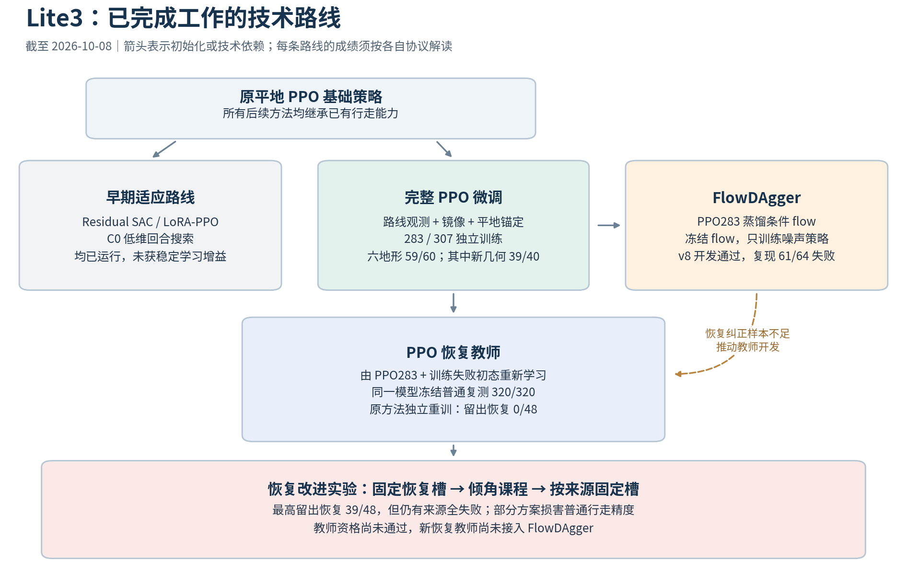
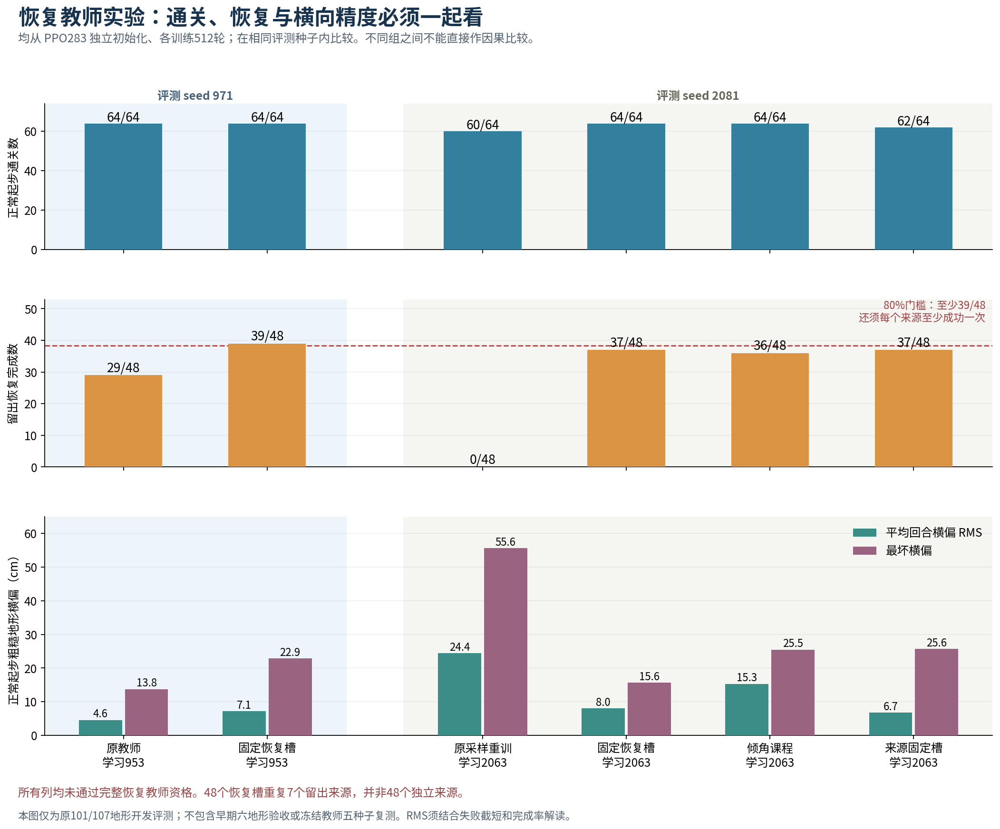

# Lite3 项目工作总结与证据说明（截至2026-10-08）

项目已经完成从平地策略、在线适应、完整PPO微调，到FlowDAgger和恢复教师开发的一整套实现、仿真实验与审计。已经取得限定条件下可复现的崎岖行走成绩；尚未完成稳定失稳恢复、可复现的FlowDAgger增量收益或实机验证。以下依据已保存的协议和结果汇总，不新增物理实验。

## 1. 任务、地形和实际控制方式

机器人为DeepRobotics Lite3，使用IsaacLab/Isaac Sim仿真、12个关节。近期主要测试固定rough101/rough107，它们是地形生成种子，不是两类算法。跑道长10m、宽4m，前3m平地、0.5m过渡，后续岩石/凹陷连续起伏；网格0.1m，84个生成形状，最终高度限制±0.04m。生成配置的5–10cm高度参数还会缩放/截断，不能把它当成实际跨越10cm台阶。

控制周期0.02s（50Hz），指令为前进0.3m/s、横向速度和转速为0；近期完整评测最多2000步/40s。训练通常128环境：32flat、48rough101、48rough107；冻结评测通常64环境：16flat、每种rough24。完成数包括平地，崎岖横偏指标则只统计rough。

当前PPO/flow策略使用48维观测：机身角速度3、投影重力3、速度/转向命令3、路线特征3、关节位置12、关节速度12、上一实际执行动作12。路线特征为横向偏移和航向sin/cos，来自仿真真实位姿；它不是已经实现的实机SLAM或GPS定位。训练critic额外有线速度，共51维。策略没有地形高度扫描、视觉或未来落脚点输入。

网络输出12维关节动作，经过统一限幅后换算成关节目标位置，由仿真执行器驱动。不是直接输出落脚点或机身导航轨迹。推理使用已训练策略，平地锚定教师等只在训练时使用，不靠部署时教师接管维持成绩。

## 2. 实际实现和运行过哪些算法

| 路线 | 学习对象及用途 | 已有证据 |
|---|---|---|
| Residual SAC | 保留基础PPO，学习动作残差；回放、双Q、目标网络和更新调度 | 多轮真实训练、工程修复及独立复现；未获得稳定增益 |
| LoRA-PPO | 冻结基础权重，训练低秩适配参数与critic | 完成GAE、PPO、版本隔离、KL/失败回滚与仿真入口；未证明稳定通关 |
| C0低维回合搜索 | 搜索前/后腿两维修正参数，以完整回合成绩更新分布 | 有限工况出现进度收益，独立回合学习未达标 |
| 完整PPO微调 | 更新整个actor，加入路线信息、镜像损失和平地动作锚定 | 两次独立训练通过限定六地形验收，是目前最明确的学习成果 |
| FlowDAgger | 冻结条件flow，学习把状态映射到flow输入噪声的网络 | 已实现完整反演/纠正/聚合/训练/冻结评测；开发收益未稳定复现 |
| PPO恢复教师 | 从PPO283出发，在失稳初态上学习恢复动作 | 普通行走显著改善，恢复仍有来源全失败，未通过教师资格 |

早期SAC修复包括critic预热目标增益、actor更新额度、回放/冻结隔离、控制步确定性调度和回退审计。提高actor更新频率确实增加了学习更新，却导致冻结任务退化。随后双学习种子正式复现中，SAC在101/107各仅1/10完成，同起点原模型分别2/10和0/10，未达到稳定门槛。不能说没有实现SAC，也不能因更新次数增加就说学得更好。

C0固定代码有局部进度收益，但独立回合级学习中，101候选/原模型都是1/5，107都是0/5。LoRA早期单seed能比原模型走得更远，但仍发生真实非法接触；它与SAC均没有完成稳定目标。这些负结果和费用均保留。

## 3. 已经真正通过的完整PPO崎岖行走验收

最后成功的方法是完整actor微调：路线观测帮助控制横漂和航向，镜像损失约束左右动作一致性，平地动作锚定约束微调过程不要破坏原平地行为。两次训练分别使用学习种子283/307，从同一个原始模型独立初始化，fresh critic/optimizer，各512更新、2097152控制转移。

| 冻结评测范围 | 两个学习模型合计 | 同起点原模型 |
|---|---:|---:|
|原开发地形101/107|20/20|3/20|
|四个未参与本方法训练的新几何种子|39/40|18/40|
|六地形合计|59/60|21/60|

四个新种子是834818272、1490653948、1132853762、874689437，均在观察成绩之前登记。唯一候选跌倒是模型283在最后一个种子的第5次试验，前进约6.12m后跌倒，未替换或补试；仍满足每地形合计≥9/10、每模型≥4/5的既定标准。配对平地保持全部通过。

因此可以说已经通过该仿真分布内的学习验收，包括同类生成器的未见几何；不能推成任意新场景或硬件可靠性。原先的“59/60”和后来的向量环境“64回合”使用不同执行/初态协议，不能直接合并计数。

已有足端接触、摆动统计与图。新地形40个候选任务窗口四足均有摆动样本，触地起始间隔描述性中位数约0.41s，原模型约0.51s。轨迹时长和位置不同，尚不足以分类为新步态家族或证明单因素因果；目前证据支持学习到更有效的控制行为。

## 4. FlowDAgger做到了哪一步

实现不是只写了接口：用PPO283训练观测蒸馏条件flow，进行了6000次flow-matching更新；flow接收状态、时间和12维动作/噪声，用8步Euler解码产生一次关节动作。它继承Gaussian PPO的单峰先验，不是大型多模态步态生成器。

随后冻结flow，仅训练噪声策略。教师在学生访问状态给出纠正动作，动作先通过离散解码器反演为噪声标签，再检查前向重建误差和噪声边界。成功纠正与自主保持样本进入独立缓冲区，训练批按50/50采样。失败、无效反演和物理费用均保留。部署只运行噪声策略与flow，不加载教师接管。

v2最终63/64，未适配零噪声flow64/64，没有净收益。后续围绕标签质量、网络容量、纠正/保持监督冲突、路线教师、恢复样本和扰动做了v3–v12系列实验。v8开发达到64/64、rough RMS约9.32cm，但同方法独立学习复现仅61/64，而三个对照均64/64，因此没有证明稳定增量收益。v12没有收集到合格的大倾角恢复正例，按规则跳过更新。

这促使工作转向恢复教师：模仿学习不能从缺失或不可靠的纠正中凭空获得恢复能力。后来的PPO教师成绩与FlowDAgger成绩分开记账，新恢复教师尚未接入FlowDAgger。

## 5. 恢复教师、冻结复测和独立学习复现

恢复库来自v11/v12的训练失败轨迹：27个完整来源回合，每个提取首个20–30°状态，20个训练、7个验证，完整来源不跨分区。恢复的是root姿态/速度和关节状态；求解器接触记忆、执行器缓冲和动作历史重新初始化，因此是运动学恢复测试，不是精确还原原事故现场。

“恢复成功”要求连续25控制步（0.5s）倾角≤10°，并最终走完剩余路段。48个rough恢复槽重复7个来源，不能称48个独立来源。资格还要求恢复≥80%（至少39/48）、每来源至少一次成功，以及普通通关、RMS、峰值等对照门槛全部通过。

第一版PPO恢复教师在seed971普通64/64，rough平均回合RMS4.56cm、最大13.77cm，留出恢复29/48。相同评测的PPO283和旧FlowDAgger v2恢复均0/48。教师确实学到了部分恢复，但case0/19仍零成功。

把同一教师冻结后，用五组新初态种子复测：教师320/320，旧v2为314/320；教师rough RMS4.56cm、最坏17.87cm。冻结普通行走门槛通过，但这只是一个模型对不同初态的验证。

另用学习种子2063、相同方法从PPO283重新训练，普通60/64、恢复0/48、RMS24.44cm，未复现原教师的收益。两者不矛盾：已得到的一个模型可以稳定，训练方法本身仍可能对学习随机性敏感。

## 6. 最近几轮具体改进及结果

| 学习种子 / 评测种子 | 方法 | 普通通关 | 恢复 | rough RMS | 最坏横偏 |
|---|---|---:|---:|---:|---:|
|953 / 971|原恢复教师|64/64|29/48|4.56cm|13.77cm|
|953 / 971|固定32恢复槽|64/64|39/48|7.15cm|22.87cm|
|2063 / 2081|原方法独立重训|60/64|0/48|24.44cm|55.64cm|
|2063 / 2081|固定32恢复槽|64/64|37/48|8.02cm|15.61cm|
|2063 / 2081|倾角分层课程|64/64|36/48|15.31cm|25.49cm|
|2063 / 2081|按来源固定槽|62/64|37/48|6.75cm|25.65cm|

表中的漂移指标来自正常起步rough评测，不是恢复起步的漂移。不同评测种子分组不直接用于因果比较；RMS还应结合失败截短轨迹和完成率解释。

**固定恢复槽。** 原来“50%的rough回合恢复起步”只产生约2.42%–5.25%的恢复控制步，因为恢复回合很快失败。改成32个环境固定执行恢复任务后，恢复控制比例严格达到25%。两组恢复分别0→37/48和29→39/48，说明该变化有收益；但第二组横向精度保持失败，两组仍有来源全失败，教师资格未过。

**倾角课程。** 只从原20个训练来源提取更早的10–15°、15–20°状态，前128轮轻、中间128轮中等、最后256轮原难度。原验证来源不动。恢复37→36/48、RMS8.02→15.31cm，未采用。这只否定本次具体课程配置，不能否定所有课程学习。

**角速度与接触诊断。** 固定旧模型，在原训练初态和仅初始角速度减半的初态上各执行128步。短时失败14/48→9/48，但训练case11/22/26仍全失败，多在0.18–0.32s终止。记录了重置前末步足端位置、接触净力及基座质心，早期经常只有一足检测到接触；这不是静态稳定性证明，也未确定唯一因果。前10个活动控制步的动作裁剪比例较低，不能简单推成动作范围太窄。

**按来源固定槽。** 困难来源原来各仅约3000训练控制，容易来源有5–6万。永久分配来源后，case11/22/26得到32768/16384/16384控制，但训练完成仍全0；冻结恢复保持37/48，普通降至62/64。平均横偏更低但峰值更大，完整收益失败，未替换原模型。

**搜索正例与自主网络迁移。** 受约束动作搜索为TRAIN case26找到0.24秒修正，筛选执行器延迟稳健性后，固定修正＋冻结PPO在两个新种子均24/24恢复并完成剩余路段；case11/22仍无正例。随后用新的训练采集做完整48D Actor均值网络监督拟合，两版在eval2251均自主恢复24/24，推理时没有case编号、时间输入、固定前缀或教师接管。第一版影响普通行走；仅将保持损失权重1→10后，普通完成61→64/64、rough RMS16.01→8.77cm、峰值79.20→41.95cm。相同初态/延迟的原模型普通64/64、RMS8.07cm、峰值19.27cm，因此精度保持仍失败。恢复起步峰值71.30cm，也超过70cm工程上限，未触发原7来源验证。这是单个TRAIN来源的监督迁移证据，尚不是PPO更新、通用恢复资格或FlowDAgger增益。详见[两次监督微调与对比图](lite3-prefix-imitation-result-2026-10-08.md)。

## 7. 工程修复、审计和录像

已建立固定协议/种子/模型哈希、训练/验证隔离、真实物理转移账本、逐步动作/状态记录、冻结评测和CPU动作回放；所有并行槽、失败、截止与工程重试保留，最终检查点不按评测择优。主要修复包括：裁剪前请求动作与实际执行动作历史不一致、固定前进指令被其他配置覆盖、自动重置导致终止状态读错、SAC预热目标/更新时序、停止信号和预算落盘、恢复采样覆盖、录像克隆可见性与离屏渲染。

按来源固定槽阶段62项、后续短动作搜索65项相关回归通过；本次监督迁移完成36项相关模型/恢复/前缀/账本/跑道测试及两版轨迹审计，测试集有所不同、不相加。测试/轨迹审计通过代表实现与记录符合契约，不等于学习目标通过。

已有可看的成功视频：[demo.mp4](../artifacts/recovery_teacher_20261006/video-delivery/course-demo/demo.mp4)。它是同一冻结恢复教师的一次新渲染运行，960×540、25fps、26.36秒；提前固定rough101/env16，该回合成功，RMS2.62cm、最大9.62cm。视频不是原64/64评测录像，也不是独立训练复现。其他物理槽仍执行并计费。

## 8. 当前可用成果、成本和未完成项

完整PPO283/307有早期六地形独立训练验收证据；原teacher-v1有当前两地形普通行走及五种子冻结复测证据；固定恢复槽953模型的恢复数最高39/48，但资格和精度保持不完整。最近失败候选均保留为实验产物，没有因“最新”而替换已验证模型。

完整PPO系列累计11900884控制转移；FlowDAgger及后续恢复开发累计charged26579456、confirmed26579392、历史uncertain64。本次新示范采集与两版监督模型闭环评测新增703104，监督拟合本身新增物理0。两个分账合计38480340个已计费控制转移，仍不包括原始基础模型预训练和更早SAC/C0成本，不能写成整个项目的总费用。物理控制转移也不是墙钟秒数或GPU小时。大模型/轨迹/视频保存在本地artifacts，代码/协议/审计推送到jenny-tian的同名私有仓库。

未完成的关键工作：补足自主恢复策略的普通状态保持覆盖、降低恢复后的横向偏移，继续为其他困难TRAIN来源寻找正例；通过原恢复资格并独立复现；新恢复教师接入FlowDAgger后的真实增量评测；另建封存的新来源恢复集；横坡、纵坡、台阶、低摩擦及组合场景矩阵；实机定位、执行和硬件验证。case26虽已迁移到自主网络，但仍有约61cm恢复横偏RMS；两版都未通过pilot全部门槛。下一步的新保持采集和恢复后回线优化尚未启动。失败的有限搜索不能证明其他来源物理不可恢复。

## 原始报告索引

- [早期SAC独立复现](lite3-learning-replication-2026-10-02.md)
- [完整PPO六地形验收](lite3-stable-rough-walking-result-2026-10-03.md)
- [输入/动作执行契约](lite3-rough-policy-execution-contract-2026-10-02.md)
- [FlowDAgger实现](lite3-flowdagger-implementation-2026-10-03.md)、[v8复现](lite3-flowdagger-v8-result-2026-10-04.md)
- [恢复教师](lite3-recovery-teacher-2026-10-05.md)、[冻结复测与重训](lite3-p1-replication-result-2026-10-06.md)
- [固定恢复槽](lite3-p2-sampling-result-2026-10-06.md)、[倾角课程](lite3-curriculum-result-2026-10-07.md)
- [动态诊断与按来源分配](lite3-source-stratified-result-2026-10-08.md)
- [短动作搜索与完整跟进](lite3-recovery-sequence-search-result-2026-10-08.md)
- [监督恢复迁移与保持权重消融](lite3-prefix-imitation-result-2026-10-08.md)
- [全部实验登记](lite3_experiment_registry.md)、[后续场景计划](lite3-next-experiments-plan-2026-10-06.md)
