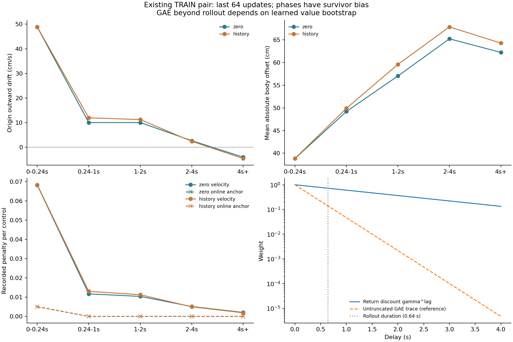

# 恢复阶段的奖励与保持诊断（2026-10-12）

**已完成上次留下的 TRAIN 分阶段检查，发现需要先核对“失败终止代价与持续惩罚”的目标取舍。** 外漂阶段的速度奖励正常生效，在线动作保持已在0.24秒后关闭；现有梯度证据不足以将外漂归因于纠正保持过强。两个训练运行中，成功结束路段的平均折扣回报均低于早期失败回合，按槽位和训练阶段拆分后仍可见此现象。它是奖励目标一致性的警示，尚不是策略主动跌倒或某个奖励修改有效的因果证明。

本轮只读取2026-10-10的49D零历史/真实历史 TRAIN 配对，两组各524288控制，共1048576条已有控制；没有新增仿真、优化、冻结评测或模型晋升。上轮普通/恢复峰值、原六门槛、原7来源资格和累计物理账本均保持原结果。



## 数据和核验范围

输入是`artifacts/route_history_20261010/{zero,history}/train`的512个完整轨迹chunk、两组原训练协议、训练/航向/速度/保持/更新审计，以及每组256条真实首小批次梯度。脚本核对所有chunk名称、哈希、长度、524288控制账本、TRAIN case26隔离、奖励时刻状态和保存的配置。使用每一步的`heading_root_state`，包括自动重置前终止状态；不把返回的新回合状态当作终止状态。

每组98304个恢复控制和425984个普通控制全部纳入。恢复回合跨chunk拼接：零历史287成功、64失败、12个右截断；真实历史288成功、63失败、12个右截断；两组截止均0。失败末步、训练结束尚未完成的12个回合分别保留。这里的成功是训练路段终止标记，不能直接代替冻结评测的连续直立恢复资格。

统计同时提供全部256轮和末64轮。相同阶段内按控制步求均值；较晚阶段只包含活到该阶段的回合，存在存活选择效应。末64轮也仍是变化中的策略，同一回合可能跨PPO更新，不是最终模型的冻结试验。

## 1. 外漂阶段没有在线保持，速度惩罚确实存在

下表为末64轮。路线原点有限差分来自相邻控制位置；它与记录的根连杆质心速度不同，脚本分别保存两者。

| 恢复控制前年龄 | 零历史原点向外速度 | 真实历史原点向外速度 | 零历史平均绝对横偏 | 真实历史平均绝对横偏 |
|---|---:|---:|---:|---:|
| 0–0.24秒 | 48.85cm/s | 48.90cm/s | 38.83cm | 38.84cm |
| 0.24–1秒 | 10.03cm/s | 11.95cm/s | 49.20cm | 49.90cm |
| 1–2秒 | 10.03cm/s | 11.25cm/s | 57.03cm | 59.58cm |
| 2–4秒 | 2.66cm/s | 2.41cm/s | 65.21cm | 67.85cm |
| 4秒后 | −4.02cm/s | −4.59cm/s | 62.23cm | 64.27cm |

实际记录的根连杆质心向外速度在1–2秒为10.00/11.20cm/s。该阶段的速度惩罚分别为−0.01040/−0.01129每控制，航向惩罚为−0.00500/−0.00489，在线动作保持为严格0。0–0.24秒的在线保持约−0.00502/−0.00509每控制。原实现没有把前12步保持错误延长到外漂阶段。

两个运行中，恢复控制的横向目标速度均处于±0.15m/s限幅；这是因为该case起点和后续横偏都超过0.30m。目标限幅不意味着速度损失没有梯度：`(vy−target)^2`仍随实际速度变化。不能把100%目标饱和写成奖励失效。

## 2. 回放保持与环境奖励分开解释

原TRAIN回放的correction组216行全部来自0–11控制步；普通三组分别31114、46866、46631行。恢复后5681行虽保存在数据中，本配对未采样，尾段回放为0。只读取训练分区的行来源，不读取pilot、原7来源或离线验证分区。

每组256条实际首小批次记录中，纠正保持梯度范数/PPO均值网络梯度范数的中位数为1.88%/1.98%，平均余弦为0.0028/−0.0083；全保持梯度比中位数为6.92%/7.19%。这些混合普通/恢复状态的梯度只覆盖每轮第一个小批次、裁剪和Adam之前，既不是逐阶段梯度，也不是实际优化器步方向。

因此，本证据不足以支持再次减小纠正保持作为首选操作。没有直接尾段回放也不表示普通保持对尾段行为毫无影响，网络参数仍共享。回放均值MSE、其梯度与环境每步奖励单位不同，报告没有将它们相加或用原始数值大小判定支配关系。

## 3. 成功与失败的已实现折扣回报存在次序问题

按`G = Σ gamma^t r_t`、gamma0.99，从各自回合第一个控制开始，直接累积保存的总环境奖励，不使用最终Critic代替历史Critic，也不将回放损失混入环境奖励。

| TRAIN运行 | 成功回合数 | 成功平均G | 失败回合数 | 失败平均G | 同槽成功均值低于失败的槽数 |
|---|---:|---:|---:|---:|---:|
| 零历史 | 287 | −4.7766 | 64 | −4.3993 | 12/12 |
| 真实历史 | 288 | −4.8854 | 63 | −4.4036 | 12/12 |

失败通常约0.32秒终止；成功回合约6.6秒结束，横偏峰值中位时刻约3.86/3.88秒。零/真实组成功回合中55/67个峰值超过70cm，失败回合全部未到70cm就终止；这也说明不能脱离成功率仅比较最大横偏。

按回合开始所在64轮区间分层后，末64轮成功/失败均值为−4.8010/−4.3765和−5.3099/−4.3965。该区间有成功也有失败的8个槽中，分别6/8、8/8仍呈现上述均值次序。完整逐槽、逐区间值保存在JSON，未将稀少失败组隐藏。

终止失败项当前为一次性−2，完成项为+5；成功路径在此之前还会累积数秒负奖励。仅在相同失败轨迹上将末步失败项代数替换为−5，`G_new = G_old − 3 × gamma^(T−1)`，两组失败平均G变成−6.9807/−6.9842，成功轨迹G不变。这只是固定轨迹敏感性计算，未生成新的物理结果、监督标签或修改奖励。

不同结果的初态随机性、探索动作和策略参数并不相同；同槽和同阶段分层也不能将其变成同状态下的可实现反事实。上述均值次序不能证明Actor主动偏好跌倒。它足以提出“失败代价相对于持续惩罚是否过轻”的单因素检验，尤其应先排除增加横偏惩罚反而加重早终止激励的问题。

## 4. 时间尺度是另一个待核对项，尚未证明Critic失效

rollout32步即0.64秒；gamma0.99的折扣衰减至1/e约需1.99秒，gamma×lambda=0.9405的GAE迹权重衰减至1/e约需0.326秒。1秒后的普通回报折扣仍为0.605，2秒为0.366，4秒为0.134，不能误称这些奖励都被忽略。

将价值预测固定时，同一rollout内某个未来奖励对先前GAE的直接系数是`(gamma×lambda)^lag`，并在done处切断；跨rollout边界没有直接奖励项连接，较远影响需要价值bootstrap传递。图中的未截断GAE曲线只是参考，不是实际跨rollout权重。短rollout不等于短的真实任务视野，也不足以直接推出应增大gamma、lambda或rollout。

旧轨迹没有保存各时刻真实Critic值、TD误差和全部小批次的归一化优势。仅靠末模型不能重建变化中Critic的历史估计，因此本轮不声称已经定位信用分配故障。

## 5. 无法精确恢复的奖励分项

旧日志直接保存并可重算的是在线保持、航向和世界横向速度三项；终止项由经核对的事件和固定源码恢复。其他项统记为`unallocated_reward`，没有将剩余值冒充某一个奖励。

实际横偏成本使用`max(|body_y|, max|foot_y|)^2`，原轨迹缺少奖励时刻足端坐标，因此只能得到正惩罚幅度下界`8 × 0.02 × body_y^2`，不能重算实际足端参与的奖励。末64轮1–2秒这一下界为0.05243/0.05719每控制。它不是新奖励、不是完整奖励分解，也不是与原验收根连杆横偏完全相同的目标。

## 后续单因素验证与边界

当前优先候选是以49D零历史配方为对照，仅检验终止失败项−2→−5，其余初始化、输入、回放、航向/速度/横偏奖励、学习种子2281、256轮和最终模型选择不动。−5目前只是待检验候选，未登记物理运行、未修改运行时代码、未训练。它针对成功/失败目标次序，不能预先宣称能解决70cm恢复峰值。

正式运行前应同时准备只读记录：每控制实际奖励向量及名称、奖励时刻根连杆/足端几何、每rollout实际价值/下一价值/TD/原始及归一化优势。对照工程检查应证明只读记录不改变动作、物理状态、RNG、参数或更新；终止项变化只在失败/截止末步出现。任何新增工程、训练和冻结评测需先单列协议与预算，不占用已完成运行的记录，不据中途成绩选模型。

普通完成率与精度、恢复完成率与延迟分组、原70cm峰值均沿用原六门槛；全过才触发原7来源验证，教师资格、独立学习复现和新FlowDAgger集成仍分别受限。暂不同时改gamma、lambda、rollout或保持权重。

## 复算与交付

在本工作目录执行：

```bash
env PYTHONPATH=.:source/rl_training \
  /home/tjx/anaconda3/envs/env_isaaclab/bin/python \
  docs/analysis/diagnose_lite3_recovery_objective.py \
  --output docs/lite3_recovery_objective_diagnostic_20261012.json \
  --figure docs/figures/lite3-recovery-objective-20261012
```

新增8项针对终止状态、奖励错账、重置回合、截断保留和折扣边界的测试，连同14项已有保持/速度回归，共22项通过。初次pytest被环境自动加载的typeguard/typing_extensions不兼容阻止收集；关闭第三方插件自动加载后测试正常执行，未修改环境依赖。图已实际查看。

新增物理控制0、优化步0；累计FlowDAgger与恢复开发charged36179648、confirmed36179584、历史uncertain64，旧完整PPO11900884另列。模型、评测资格和上轮候选结论不变。

- [诊断源码](analysis/diagnose_lite3_recovery_objective.py)、[完整数值与输入哈希](lite3_recovery_objective_diagnostic_20261012.json)
- [测试与交付核验](lite3_recovery_objective_delivery_audit_20261012.json)、[上轮配对结果](lite3-route-history-result-2026-10-10.md)
