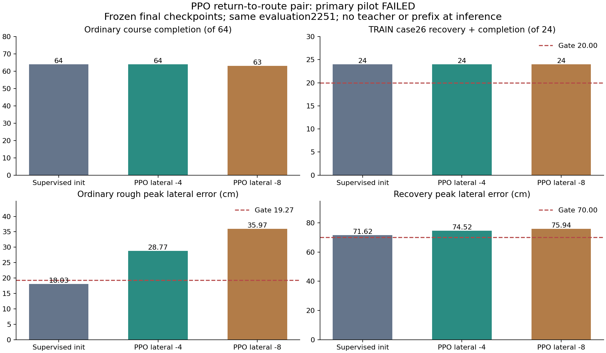

# 从监督恢复策略开始的回线PPO：动作保持与横偏惩罚对照

本轮以[普通状态覆盖后的Actor](lite3-retention-coverage-result-2026-10-08.md)为初始化。它在eval2251普通64/64、横偏RMS7.91cm/峰值18.03cm，TRAIN case26自主恢复24/24，但恢复峰值71.62cm超过原70cm门槛。目标是在保留已有动作行为的同时，直接利用物理回报优化恢复后的路线。

**两组均未通过性能验收。** 主组普通通关63/64、横偏RMS13.39cm/峰值35.97cm；case26仍恢复24/24，但峰值75.94cm，比监督初始化更差。对照也有精度退化。保留原监督候选，不因PPO更新较新而替换。

## 工程实现

新增训练期动作保持项：冻结初始化Actor，在当前真实48D动作前观测上计算并限幅参考动作。普通环境全程、恢复环境每回合最初12个控制步纳入保持掩码；恢复尾段不加此项。PPO仍自主采样动作并执行，无教师接管。每次自动重置后，恢复前段保护重新开始。

奖励新增项为`-100 × mean((实际限幅动作 - 冻结参考动作)^2) × 0.02`。这是软奖励惩罚，不是硬动作限制，也不保证最终策略一定保持原精度。目标与掩码在动作前计算，实际惩罚在本步物理执行后、自动重置前由RewardManager计算；逐步日志同时记录目标、掩码、回合年龄、执行动作、成本和实际奖励分量。过期目标会报错。

为兼顾同地形的普通行走，64个训练环境固定为16flat、24普通rough101、12恢复rough107（TRAIN case26）、12普通rough107。新增可选固定来源槽数参数，默认不改变原来的全地形分配行为。评测仍使用case26全部24个rough107槽。

监督checkpoint只包含均值网络。新初始化接口显式允许均值checkpoint，并新建高斯log_std使初始标准差为0.05；均值权重逐项复制，Critic和Adam状态全新，来源checkpoint和随机数状态不被初始化函数修改。旧接口默认仍拒绝不完整Actor。

工程smoke使用seed2273、64×400=25600步、冻结Actor加逐步交替±0.01的动作探针。只检查时序、非零实际奖励贡献、掩码和自动重置，不作为通关成绩。全部物理步计费；独立CPU回放审计通过。32项相关单元/契约测试通过。

## 预登记配对设计

| 设置 | 两组共同值 |
|---|---|
|初始化Actor|6a470cec8c1f1b1ad6f237c1ecc6401367528715ccca0f44b4f02b4860fa2ead|
|学习种子|2281|
|训练量|64环境×32步×128轮＝262144控制/组|
|网络|完整48→512→256→128→12 ELU Actor；Critic51D仅用于训练|
|PPO|lr3e-6固定，5epochs×4minibatches，clip0.2，gamma0.99，lambda0.95|
|探索与约束|初始std0.05、entropy系数0、梯度范数1、保持惩罚系数100|
|其他|无镜像损失；只用最终128轮checkpoint；终止与动作限幅不变|

唯一两组间训练变量是原`course_lateral`奖励系数：对照−4，预定主组−8。该成本是机体及四足最大绝对横偏的平方，不只是机体横偏；评测单列机体横偏RMS和峰值。增大惩罚能否改善最终行为必须通过冻结评测验证，不能依据奖励数值或训练回合平均成绩认定。

两组各用eval2251做普通与TRAIN case26两条件评测，原PPO2063基线只在初态/执行器延迟联合哈希完全相同时复用。原六门槛不变：普通逐地形完成不退步、RMS≤基线1.05倍、峰值不增加；case26恢复≥20/24且优于原模型、四延迟组各≥80%、恢复峰值≤70cm。主组在启动前确定，不能因对照结果较好而把对照替换成主组。只有主组全部通过才另登记原7来源验证，原教师资格与独立训练复现仍需分别满足。

这是基于监督初始化的真实PPO更新，和此前监督MSE拟合不同；训练期可用来源/回合年龄计算保持掩码，推理仍只输入原48D观测，无case编号、时间输入、固定前缀或教师。

## 证据入口

- [配对计划与预算](lite3_recovery_return_plan_20261008.json)
- [工程协议](lite3_recovery_return_smoke_protocol_20261008.json)、[工程独立审计](lite3_recovery_return_smoke_audit_20261008.json)
- [对照训练协议](lite3_recovery_return_control_train_protocol_20261008.json)、[主组训练协议](lite3_recovery_return_trial_train_protocol_20261008.json)
- [对照评测协议](lite3_recovery_return_control_pilot_protocol_20261008.json)、[主组评测协议](lite3_recovery_return_trial_pilot_protocol_20261008.json)

## 已完成结果

| eval2251指标 | 监督初始化 | PPO对照−4 | PPO主组−8 |
|---|---:|---:|---:|
|普通完成|64/64|64/64|63/64|
|普通rough RMS|7.91cm|12.96cm|13.39cm|
|普通rough峰值|18.03cm|28.77cm|35.97cm|
|case26恢复并完成|24/24|24/24|24/24|
|case26 RMS|59.73cm|62.62cm|64.22cm|
|case26峰值|71.62cm|74.52cm|75.94cm|

主组env30在rough101、1061步姿态终止；普通和恢复条件中的这个普通槽均发生同一失败。对照通过成功数/延迟组/普通完成三门槛，主组只通过恢复成功数和延迟组两门槛，两组横偏门槛都失败。未启动有条件原7来源验证，也没有换种子或挑中途模型。24恢复槽仍来自同一个TRAIN来源，不证明其他来源恢复或独立学习复现。

两组每组262144训练步，其中49152为恢复控制；对照训练恢复成功142、失败25，主组成功144、失败22。这些是带探索的重复训练回合，不替代冻结评测。每组128轮、2560次Adam步，均值网络确实更新，Critic/优化器未加载旧状态。两组首个32步rollout在策略/critic观测、根状态和请求/执行动作上逐元素完全相等，源代码快照也相同；变化从不同回报驱动的更新开始。

最终checkpoint SHA256：

- 对照：`99b556425a978550833d77cf8cf1204fcf11256f3a2e2fee6ae70dc43feb5b74`
- 主组：`16388461b4668d180d9d910c12259c6ef17aeaf5e5d599795c97c96974ed8d09`

## 诊断与接续改进

在原训练数据的离线验证流上，主组相对初始化Actor的普通状态原始动作均值MSE约0.00095–0.00097，95%动作绝对偏差约0.062，最大约0.11；对照普通MSE约0.00130。两组最终探索std仍约0.05。实际约束目标、掩码与RewardManager惩罚均已逐步核验，因此不能归因于保持项未执行。

这说明本配置的软奖励保持不足以维持原闭环精度；但未证明唯一退化原因。对于未限幅的高斯动作，期望平方偏差含均值偏差和方差两部分，奖励惩罚经回报/优势间接作用于均值。下一项采用现有TRAIN普通/恢复前段状态，增加可直接反向传播的均值动作保持损失，保留其余PPO配置以与本主组比较；不使用本次pilot轨迹作标签。该新实验另行登记、保留本负结果。

## 账本与审计

smoke25600＋两组训练524288＋对照评测183168＋主组评测186944＝**920000新控制转移**，uncertain0；有条件原7来源验证未启动、成本0。累计charged27760704/confirmed27760640/历史uncertain64；旧完整PPO系列11900884另列，两账合计39661588，仍不含原始预训练及更早SAC/C0。

32项相关回归通过；工程、两组训练、冻结参考动作/掩码/真实奖励贡献以及两组评测轨迹/CPU动作回放均通过审计。工程通过不等于策略验收通过。

- [完整配对结果、动作漂移诊断和成本](lite3_recovery_return_result_20261008.json)
- [对照门槛判定](lite3_recovery_return_control_pilot_result_20261008.json)、[主组门槛判定](lite3_recovery_return_trial_pilot_result_20261008.json)
- [对照动作保持审计](lite3_recovery_return_control_anchor_audit_20261008.json)、[主组动作保持审计](lite3_recovery_return_trial_anchor_audit_20261008.json)
