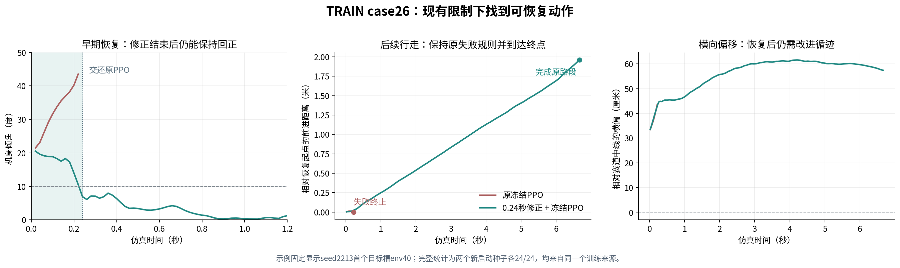

# Lite3：受约束短动作搜索、延迟稳健性及完整路段跟进

本轮目标是寻找困难TRAIN状态下可执行的恢复正例，帮助区分“没有足够采样”和“当前策略没有发现合适动作”。它不是新的PPO训练，不修改已训练权重，也不计入原7个留出来源的恢复资格。

## 实验设置

固定原32恢复槽learner2063的最终PPO（SHA065c1c3b…），使用原训练来源case11/22/26，保持原root姿态/速度、关节状态、动作绝对限幅和失败终止。它们此前在多轮PPO训练中一直没有任务完成。

每次64环境，其中24个rough107槽重复一个目标来源，另外40个普通槽及结束后的padding都继续计入物理账本。最初12个控制步（0.24秒）执行 `clip(PPO(actual_observation) + transient_offset)`，之后修正严格归零，只运行冻结PPO。前缀有3段，每段4步、12个关节，总36个参数，单个修正参数限制在±2个归一化动作单位。它是临时的分段修正，不是预先写好的步态相位控制器，也不扩大关节目标限幅。

工程阶段比较无前缀、零前缀、非零前缀，各4096控制步。无/零前缀的全部公共轨迹数组精确相等；非零请求、动作历史、交还时刻、关节computed/applied力矩和接触记录均通过审计。新增物理12288，uncertain0。审计脚本一次缩进错误导致离线启动失败，日志保留并修复，仅重跑审计，没有重跑物理。65项相关测试通过。

## 第一阶段：CEM搜索与第一次复核

每个来源先运行付费baseline，再进行6代、每代24候选的交叉熵法（CEM）搜索。每代保留零前缀和当前最佳前缀，其余22个从高斯参数分布采样；精英6个用于更新参数均值/标准差，初始std1、下限0.25。模型权重不更新，所有提案和失败都保留。

搜索分数为 `1000×短恢复正例 + 2×活动控制步 - 平均倾角(度) + 0.5×交还后最长直立步数`。短正例要求：交回PPO后有连续25步倾角≤10°，该窗口至少5步有两足世界向上接触力>5N，同时存活至128步/2.56秒，或者已完成原路段。只计首次回合，不使用自动重置后的帧。该标准用于短恢复诊断，不等于原完整教师资格。

| TRAIN来源 | 搜索结果 | 选中候选的表现 |
|---|---|---|
|case11|无短正例|最多23步/0.46秒，交还后连续直立0步|
|case22|无短正例|最多39步/0.78秒，交还后连续直立0步|
|case26|找到短正例|128步存活，交还后连续直立116步|

case26在第4/5代分别出现6/15个短正例候选。最初按单次最高分选择的前缀，在两个新启动种子2161/2179上仅4/24、3/24成功，baseline均0/24，未通过每组至少20/24的复核。第一阶段共204800控制步、uncertain0；独立审计重建了候选、CEM更新、选择、初态配对和计费。

## 第二阶段：修正选择方式，保留执行器延迟差异

第一次复核中，成功全部集中在Hip/Knee延迟为1/0的组合；其他三组全失败。这表明单次最佳分数不足以选出稳健前缀，不能把偶然适合某个执行器延迟的动作直接作为训练教师。

另行预登记：取原搜索中全部20个不同的短正例参数序列，每个原样重放到seed2153的全部24个目标槽。不修改延迟、不按新结果删候选、不重新调参数；按四种原有Hip/Knee延迟组合0/0、0/1、1/0、1/1中的最差成功率排序，再比较总成功数和平均搜索分数。筛选须每个组合≥80%、总体≥20/24；通过后才冻结该前缀，在新种子2203/2207对原PPO复核。

最终选择固定候选15，独立审计通过：

| 启动种子 | 原PPO短恢复 | 固定候选15短恢复 | 四延迟组 |
|---|---:|---:|---|
|2153，开发筛选|0/24|24/24|全部通过|
|2203，新启动复核|0/24|24/24|全部通过|
|2207，新启动复核|0/24|24/24|全部通过|

第二阶段新增196608控制步、uncertain0。它是额外付费的TRAIN来源稳健性筛选，不替换第一阶段失败的复核结果，不是独立神经策略训练复现。始终只有一个来源case26，24槽不是24个独立来源，新的启动种子也没有生成新的地形或恢复状态库。

## 第三阶段：完整路段跟进（完成，通过）

第二阶段通过后才登记完整路段跟进：固定同一候选15和同一PPO，用新的启动种子2213/2221，对原PPO与前缀方案分别运行64槽、最多2000控制步。每个种子的24目标槽需要至少20个真正到达原终点，并满足交还后持续回正和接触支撑条件；四延迟组各≥80%，且优于配对原PPO。初态及执行器延迟必须完全配对。

完整阶段上限512000控制步。它检验短时回正能否接续到完整行走，而非用2.56秒存活代替通关。前缀不会因为结果而更换，case0/19等留出来源不进入本实验。

四个运行及独立审计均完成，固定前缀通过了两个新种子全部门槛：

| 新启动种子 | 原PPO恢复并完成 | 固定候选15＋PPO | 四延迟组 | 前缀方案横偏RMS / 最坏 |
|---|---:|---:|---|---|
|2213|0/24|24/24|全部通过|58.15 / 68.43cm|
|2221|0/24|24/24|全部通过|58.73 / 68.43cm|

初态本身偏离中线约32.65cm；相对该起点额外横移的最坏值约35.78cm。因此这证明了恢复并完成路段的可行性，不能描述成精密循迹，不能用它替代普通行走的低漂移指标。原PPO在很短时间内终止，其截短横偏与完成者的整段RMS不作直接优劣归因。

图固定显示seed2213的首个目标槽env40，完整统计使用两个种子各24槽，不用单条示例替代统计。前缀结束后约2秒内姿态回到接近直立，随后原PPO继续完成剩余约2m路段。模型权重全程冻结；修正只有最初12个控制步。

固定前缀文件：`artifacts/recovery_search_20261008/positive-prefix-pool/candidate15.npy`，SHA256 `d134e1c7fbfa231304e3c32abc563233e27759b6f962fd812b16133e144df975`。它来自初次搜索的case26/generation05/env57，在完整跟进前已锁定，未根据完整路段结果更换。

## 结论范围与后续

目前已经获得“一个此前反复失败的训练来源，在既有限制下存在可恢复且能完成剩余路段的动作”的正证据，并发现了选择动作时需要考虑执行器延迟差异。case11/22仍没有正例，有限搜索失败不能证明其物理上不可恢复。

该方案需要预先知道这是指定起点，并在起步时施加固定前缀；还不是一个能根据任意实际观测自主决定何时恢复的新策略。完整路段通过后，下一步是锁定该前缀作为TRAIN来源的示范器，另行登记新的训练采集种子生成正例，再检验状态相关策略能否自主触发和执行恢复；不直接把本轮复核轨迹回流作训练标签。仍须保留case11/22等未解决来源，并做原留出来源测试和独立学习复现。本轮没有启动新的PPO训练。原教师资格、FlowDAgger新教师集成、实机验证都没有被本实验替代。

## 证据与账本

- [搜索工程结果](lite3_recovery_search_smoke_result_20261008.json)
- [第一阶段协议](lite3_recovery_sequence_search_protocol_20261008.json)
- [第一阶段独立审计](lite3_recovery_sequence_search_audit_20261008.json)
- [延迟稳健性筛选协议](lite3_recovery_robust_screen_protocol_20261008.json)
- [稳健性筛选独立审计](lite3_recovery_robust_screen_audit_20261008.json)
- [完整路段协议](lite3_recovery_prefix_fullcourse_protocol_20261008.json)
- [完整路段独立审计与结果](lite3_recovery_prefix_fullcourse_result_20261008.json)

本轮实际工程12288+搜索204800+稳健筛选196608+完整跟进353152=766848控制步，无不确定步。累计charged25876352/confirmed25876288/uncertain64；原64不确定步仍保留。更早完整PPO基础系列和原始预训练等仍按既有分账另列。
