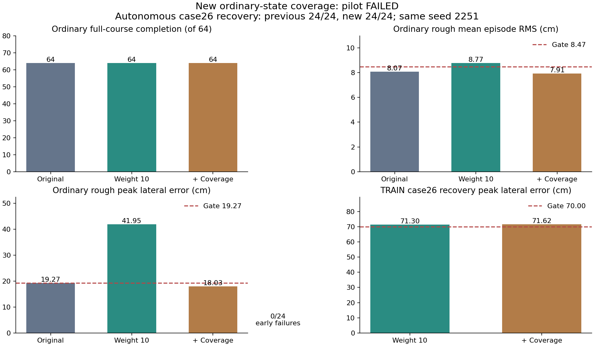

# 普通行走状态覆盖消融：新采集、监督拟合与闭环验证

本轮承接[监督恢复迁移实验](lite3-prefix-imitation-result-2026-10-08.md)。权重10候选已在TRAIN case26自主恢复24/24，并保持普通64/64，但普通横偏RMS8.77cm、最坏41.95cm，精度保持未通过。本轮只测试补充普通行走的状态覆盖能否改进这一问题，未更改PPO奖励、网络、物理参数或验收门槛。

**结果：新候选普通64/64、rough平均横偏RMS7.91cm、峰值18.03cm，三个普通保持门槛全部通过；TRAIN case26自主恢复保持24/24，但恢复峰值71.62cm仍超过70cm。本轮六个pilot门槛通过五个，完整验收仍未通过，原7来源验证未启动。**

图中为同eval2251和同初态/延迟的配对比较；恢复0/24的原模型早期失败，不用其截短轨迹峰值作完整路线比较。[SVG图](figures/lite3-retention-coverage-20261008.svg)。

## 采集与标签

预登记新seed2267，用冻结的权重10候选自行执行普通首回合，64环境×最多2000步，上限128000。实际64/64完成，87488物理控制转移；首回合有效活动82913行，其余为已结束环境继续执行的向量padding，全部计费。

原PPO2063在每个实际动作前48D观测上离线输出动作均值，并按原执行限幅裁剪为保持标签。教师无需另跑仿真，但这些标签是行为保持参考，不代表已经证明对该状态有纠正收益。采用动作前观测，上一动作历史仍是候选实际执行动作，不把它改成教师动作历史。

标签只允许来自距中心线±30cm内的普通状态。该界限在采集前登记，并与原恢复纠正/恢复后数据的横偏域互斥；新采集全部活动行均满足，因此没有实际排除行。按照预设规则，即使回合失败，失败前符合范围的活动行也可纳入，不能依成功挑轨迹；本次新采集恰好无失败。原pilot和原7个留出恢复来源不参与训练。

原数据整流划分保持不变；新增数据同样按env_id%4==0整环境流留作离线验证，不能解释为未知来源验证。只有普通三个组追加标签，correction和post_recovery的原数组逐元素不变。

| 追加样本组 | 拟合行数 | 离线验证行数 |
|---|---:|---:|
|flat|15640|5114|
|rough101|23476|7717|
|rough107|23092|7874|
|合计|62208|20705|

新增标签与旧普通标签直接按组拼接，组内均匀抽样；新旧样本比例由实际行数决定，没有根据结果挑选。独立审计重建全部82913条新标签，并核查旧数组、采集协议、模型与轨迹哈希。

## 固定训练与评测

从原PPO2063初始化完整48→512→256→128→12 ELU Actor均值网络，fresh Adam、learner2247、学习率1e-5、梯度范数1、固定2000更新。保持权重10、每批128纠正/128恢复后/128flat/64rough101/64rough107与上一版完全一致。训练不是从权重10模型续训；数据来源变化是本轮主要变量。仅评测最终checkpoint，不按中途损失选择模型。

最终模型SHA256：`6a470cec8c1f1b1ad6f237c1ecc6401367528715ccca0f44b4f02b4860fa2ead`。这是Actor监督微调，没有Critic、高斯探索方差、PPO或FlowDAgger更新。

闭环仍为eval2251、普通与TRAIN case26两条件，每条件64环境×最多2000步。全程无固定恢复前缀或教师接管；复用已付费原PPO基线前，必须匹配初态/执行器延迟联合哈希。case26≥20/24、四延迟组各≥80%、恢复峰值≤70cm，普通逐地形完成不低于原模型、RMS≤原模型1.05倍、峰值≤原模型，这些门槛都保持不变。

## 闭环结果与限制

| eval2251指标 | 原PPO2063 | 上一版权重10 | 新增状态覆盖 | 本轮判定 |
|---|---:|---:|---:|---|
|普通平地|16/16|16/16|16/16|通过|
|普通rough101|24/24|24/24|24/24|通过|
|普通rough107|24/24|24/24|24/24|通过|
|普通rough平均回合横偏RMS|8.07cm|8.77cm|7.91cm|通过≤8.47cm|
|普通rough峰值|19.27cm|41.95cm|18.03cm|通过≤19.27cm|
|case26恢复并完成剩余路段|0/24|24/24|24/24|通过≥20且优于原模型|
|四延迟组恢复|0/7、0/7、0/7、0/3|7/7、7/7、7/7、3/3|7/7、7/7、7/7、3/3|通过各≥80%|
|case26横偏RMS|早期失败|60.69cm|59.73cm|报告项|
|case26峰值|早期失败|71.30cm|71.62cm|失败，超过70cm|

延迟组依次为Hip/Knee0/0、0/1、1/0、1/1。新候选普通rough101的RMS/峰值8.01/18.03cm，rough107为7.82/15.92cm；原PPO对应7.99/19.27cm与8.14/18.18cm。因此准确说法是总体RMS与两地形峰值改善，不能写成每地形所有指标都改善。

新候选普通最坏回合为rough101/env18，最终完成；恢复最坏为case26/env40，也完成了剩余路段。恢复峰值比上一版增加约0.32cm，平均RMS下降约0.96cm，二者不能混为同一改善结论。71.62cm比工程上限多1.62cm仍然判失败，不临时放宽到72cm，也不更换种子或检查点补过。

这是一个学习种子、一个反复使用的开发评测种子和同一个TRAIN恢复来源的结果；24槽是相关的重复试验，不是24个独立来源。尚未证明新来源恢复、独立训练复现、未知地形泛化或实机可靠性。本轮普通保持成功没有替代完整pilot、原教师资格或后续FlowDAgger增益验收。

## 离线验证与结果解释

| 普通离线验证组 | 原数据部分MSE | 新采集部分MSE |
|---|---:|---:|
|flat|0.00002691|0.00003647|
|rough101|0.00008091|0.00007106|
|rough107|0.00007824|0.00008361|

纠正动作MSE0.009130、恢复后保持0.000671，接近上一版。数据集变大后不能只看混合平均MSE，本表分别重算原数据与新增数据。普通闭环精度的证据来自上面的独立轨迹审计，而不是这些离线误差。

本轮支持“补充候选访问状态有助于本配置的普通精度保持”，不能据单组结果确定唯一因果机制。新增数据依旧以原PPO为动作参考，也没有给恢复后的回线提供更好目标，因此恢复横偏没有实质解决是需要单列处理的问题。

## 下一项：保护已有动作的恢复回线优化

普通保持这一开发门槛已通过，下一步优先开展带动作保持约束的PPO工程准备，以本轮最终Actor作为初始化；原7来源仍不作训练。已有`flat_anchor`只保护平地，不能直接声称它也保护崎岖行走或恢复前段，需要先实现并审计覆盖这些状态的约束。

拟定顺序为：先以冻结当前Actor作为行为参考，验证普通槽及恢复前段的动作保持目标、掩码与执行时序；再单独预登记短预算PPO试验，fresh critic/optimizer、保留48D输入，优化真实训练轨迹的回线表现。训练期可以记录恢复来源和回合阶段来计算约束，推理端不增加case编号、计时输入或教师接管。普通保持、恢复成功、横偏三类门槛继续分开，未满足完整pilot不得触发原7来源验证。

该PPO工程与新训练本轮尚未启动；不会将当前监督拟合冒充PPO收益，也不把本次pilot轨迹回流训练。具体约束系数、探索方差、学习种子和物理预算在工程检查及正式运行前分别登记。

## 成本、验证与保存

新采集87488＋候选两臂pilot173760＝**261248控制转移**。监督拟合2000更新、离线教师查询与汇总均新增物理0；原基线只读复用，原7来源有条件验证未触发、费用0，新增uncertain0。保留全部采集、最终模型和闭环轨迹。

累计FlowDAgger及后续恢复开发为**charged26840704 / confirmed26840640 / 历史uncertain64**。完整PPO旧系列11900884另列，两账合计38741588个已计费控制转移，仍不含原始预训练与更早SAC/C0成本。

采集、全部新增标签、固定训练及闭环轨迹/CPU动作回放均审计通过；36项相关回归测试通过。工程验证通过不等于上面的完整性能门槛通过。

## 证据入口

- [预登记计划与预算](lite3_retention_coverage_plan_20261008.json)
- [新采集协议](lite3_retention_coverage_collect_protocol_20261008.json)、[轨迹审计](lite3_retention_coverage_collect_audit_20261008.json)
- [数据集审计](lite3_retention_coverage_dataset_audit_20261008.json)、[监督训练审计](lite3_retention_coverage_training_audit_20261008.json)
- [固定闭环协议](lite3_retention_coverage_pilot_protocol_20261008.json)
- [闭环轨迹审计](lite3_retention_coverage_pilot_trajectory_audit_20261008.json)、[六门槛结果](lite3_retention_coverage_pilot_result_20261008.json)
- [配对对比与成本](lite3_retention_coverage_comparison_20261008.json)、[图表生成脚本](analysis/summarize_lite3_retention_coverage.py)
