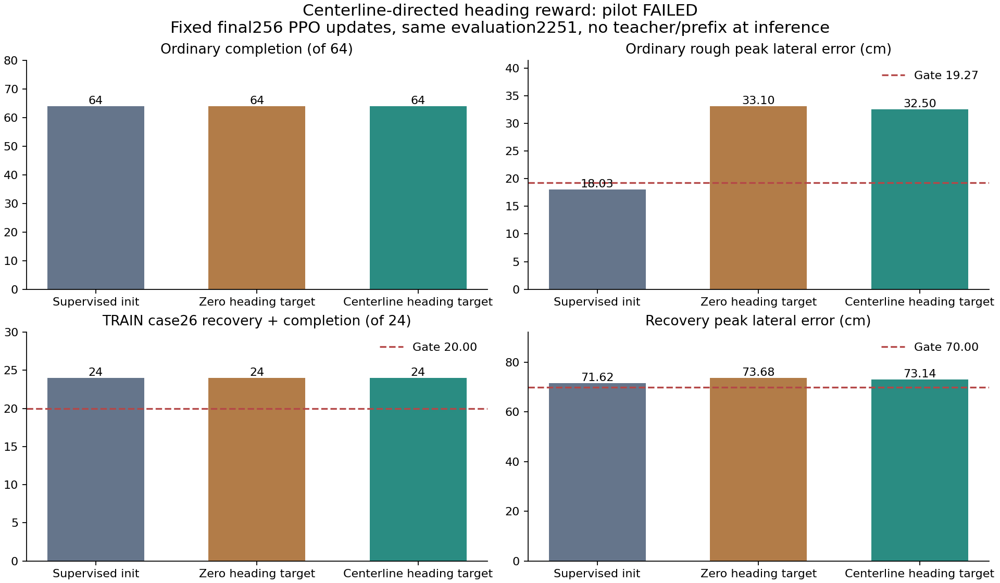
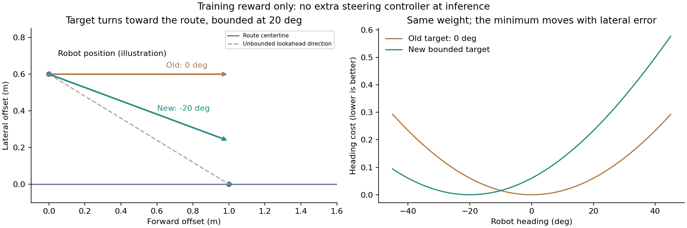
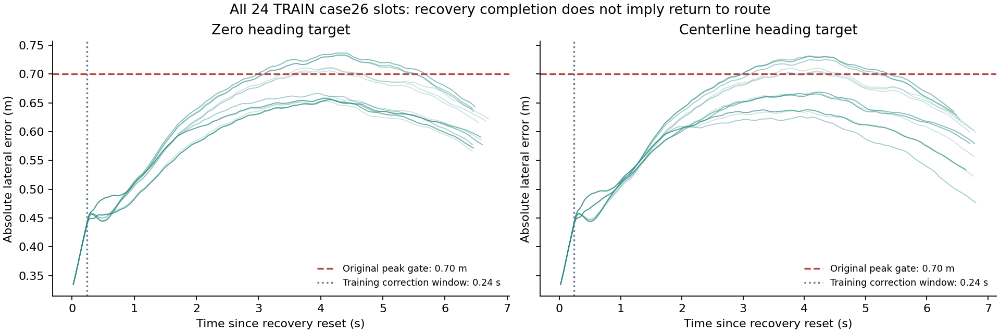

# 朝向路线中心的航向奖励：完整实验结果（2026-10-09）

**本轮有局部收益，完整验收仍未通过，候选未晋升。** 相对上一轮尾段保持PPO，普通完成仍64/64，横偏RMS9.89→7.15cm，最坏33.10→32.50cm；TRAIN case26恢复仍24/24，峰值73.68→73.14cm。原六项门槛通过四项，普通和恢复峰值仍失败，原7来源验证未触发。

## 先核对了什么

只读取已有新TRAIN采集，继续排除env_id%4==0的离线验证流。普通活动行62403条，旧横偏成本均值0.04899，而纯机身横偏平方均值0.00773；100%的这些行由足端而非机身决定最大横偏。原航向成本均值0.002664；偏离中心超过5cm的普通TRAIN行中，83.96%的航向有向外分量。这些是已有轨迹描述，不是新奖励的物理评测结果。

原横偏项有保持足端空间余量的作用，本轮没有把它当成实现错误，也没有同时替换它。问题是原航向目标始终为世界正前方；它可以配合横偏惩罚学习回线，但没有直接表达偏离时向路线回转的方向。因此只修改航向奖励目标。

## 唯一学习改动

设机身相对路线的有符号横偏为y、航向为ψ：

`旧目标：ψ_ref = 0`

`新目标：ψ_ref = clip(atan2(-y, 1 m), -20°, +20°)`

`航向奖励：r_heading = -[1 - cos(ψ - ψ_ref)] × 0.02`

仍使用原权重−1。偏在路线左侧时目标向右，偏在右侧时向左；接近中心时目标回到正前方。1m前视距离和±20°界限在实验前固定，未按结果调参。

此几何计算只用于训练奖励。推理时仍由48D状态相关Actor输出12D关节动作，没有新增外部转向器、case/时间输入、脚本前缀或教师接管。路线位姿仍来自仿真定位，尚未实现实机定位链路。

横偏成本仍为机身与足端最大绝对横偏的平方、权重−8，原在线动作保持100、四组均值回放100、尾段回放25均不变。仍从监督Actor6a470cec…重新初始化，fresh critic/optimizer，learner2281、std0.05、lr3e-6、64环境×32步×256轮、每轮5epoch×4小批。只评测最终256轮，不接续失败模型，不挑中间检查点。

地形仍为10m×4m跑道、rough101/107最终高度±4cm，指令前进0.3m/s、控制50Hz；没有新增地形感知或未知场景证据。

## 工程验证和对照可信度

53项相关测试通过，包括向内目标、左右反射、转角限幅、非法参数拒绝、旧默认奖励精确一致、奖励时刻快照跨自动重置保持，以及原PPO/回放/恢复/账本检查。

先执行固定seed2311、64×400=25600控制步工程smoke，冻结初始化Actor并交替施加±0.01动作探针。新航向目标、实际dt奖励、重置前状态和原动作保持分别独立审计通过，再锁定正式训练协议。工程检查不用于策略资格评定，也不作为新训练标签。

GPU0当时有其他用户任务，本轮使用空闲、同型号RTX3090的GPU1。实际首32步rollout的policy/critic观测、根状态、请求及执行动作，与GPU0旧尾段保持对照逐元素相同。第一段总奖励最大变化0.00475049，减去新旧航向项差后的最大残差仅1.43e−8，说明该段奖励差异由预定改动解释。它不等于独立学习种子复现。

完整训练524288控制、5120次Adam更新、3276800条重复回放查询；原四组索引、纠正标签及尾段索引流全部不变，冻结参考模型不变，验证行和原留出来源零用于更新。训练恢复288成功、53失败、0截止，全部保留。最终模型SHA：

`c7c1d64d723b9bd20097f8176321ce8c531f26ae5ff15d48c2fa7bfb4c53ec25`

完整训练中655个结束控制的奖励快照与重置后观测正确区分。新旧航向成本在同一实际轨迹上均值为0.03203/0.00923；后者是反事实计算，不是另跑一个零航向对照的成绩。训练、原保持、航向几何与双回放四项审计均通过。扩展脚本还复现了旧尾段保持审计/汇总，以及旧普通轨迹诊断字段。

## 冻结评测和原门槛

固定eval2251，在GPU1评测普通和TRAIN case26两个条件。与原PPO2063基线及旧尾段保持对照的初态/执行器延迟联合哈希相同；基线只读复用。

| 指标 | 旧256轮自均值目标 | 上轮尾段保持 | 本轮回线航向目标 |
|---|---:|---:|---:|
|普通完成|64/64|64/64|64/64|
|普通rough平均每回合RMS|7.04cm|9.89cm|7.15cm|
|普通rough最坏横偏|15.84cm|33.10cm|32.50cm|
|TRAIN case26恢复并完成|24/24|24/24|24/24|
|恢复平均每回合RMS|59.22cm|61.54cm|61.26cm|
|恢复最坏横偏|70.46cm|73.68cm|73.14cm|

本轮flat/rough101/rough107完成16/16、24/24、24/24；四个Hip/Knee延迟组恢复分别7/7、7/7、7/7、3/3。通过普通完成、普通RMS、恢复数量和分组恢复四项；普通峰值32.502cm超过原19.274cm，恢复峰值73.143cm超过70cm。

24个恢复槽重复同一个TRAIN来源，不是24个独立来源。持续使用的eval2251属于开发评测，本轮没有原7来源资格或独立学习复现；不能由本表宣称已学会通用恢复或新步态。旧256轮自均值目标本身也未过完整门槛，保留其较好成绩不等于晋升。

## 改善是否覆盖了困难回合

48个普通rough槽中42个RMS改善、41个峰值改善。收益并非仅由一个好回合造成，但也不是每个槽都改善：

| 配对环境 | 地形 | 旧峰值 | 新峰值 |
|---|---|---:|---:|
|env44，上一轮最坏|rough107|33.10cm|13.65cm|
|env29，本轮最坏|rough101|16.47cm|32.50cm|
|env36|rough101|22.87cm|28.48cm|
|env49|rough107|20.61cm|23.35cm|

这些槽是评测后诊断展示，未用来更换训练seed、模型或测试条件。全部48个槽保留。

本轮env29在27.18秒达到−32.50cm，之前平均世界横向速度约−1.21cm/s、平均航向约−5.20°。负向速度积分约−33.02cm，位置实际变化约−32.86cm；持续方向偏差仍会累积。各模型自己的普通活动状态上，相对冻结初始化Actor的动作MSE从0.000174降到0.000121，但该平均量依然不能代表最坏路线精度，也不是相同访问分布上的因果比较。

恢复最坏为env57，4.08秒达到73.14cm。起点已偏32.65cm，最大额外位移40.49cm；走完时24槽平均绝对横偏60.15→57.72cm。峰值、RMS及结束残差均略有改善，但仍离精密回线很远，不能因24/24完成就称为稳定通过。

## 下一项

本轮保留负面判定，不晋升新恢复教师，不启动新FlowDAgger集成。新的航向目标在多数普通槽及恢复结束残差上有收益，下一项优先登记航向奖励强度的单因素消融：只将本项权重−1→−4，保持1m/20°几何、原初始化、数据、保持项、learner2281和最终256轮规则。先确认实际奖励缩放及首rollout配对，再按原普通/恢复门槛评测。

这是假说检验，不能保证更强权重一定更好；不同时改变前视距离、探索或网络，不把本轮pilot/原7来源转为训练标签，不放宽70cm或19.274cm界限。该强度消融本轮尚未登记执行预算或启动。全项目早期PPO283/307限定六地形验收仍保留，不被本轮局部恢复实验替代。

## 成本与交付

本阶段工程25600＋训练524288＋冻结评测183936＝**733824个新控制转移**，新增uncertain0。回放查询和离线诊断新增物理0；原7来源条件验证未触发，费用0。阶段上限1061888，未触发的预算不自动消耗。

FlowDAgger及恢复开发累计charged31154624/confirmed31154560/历史uncertain64；旧完整PPO系列11900884另列，两账合计43055508，仍不包含最早预训练及SAC/C0费用。控制转移不是GPU小时。

本轮无物理中止重试；最终模型、训练失败、工程轨迹和完整评测均保留在本地artifacts。没有新拍视频，没有以最新候选替换已验证模型。

- [TRAIN奖励几何诊断](lite3_route_heading_diagnostic_20261009.json)、[预登记计划](lite3_route_heading_plan_20261009.json)
- [工程协议](lite3_route_heading_smoke_protocol_20261009.json)、[工程航向审计](lite3_route_heading_smoke_audit_20261009.json)、[工程动作保持审计](lite3_route_heading_smoke_anchor_audit_20261009.json)
- [训练协议](lite3_route_heading_train_protocol_20261009.json)、[53项测试日志](lite3_route_heading_tests_20261009.txt)、[旧结果兼容检查](lite3_route_heading_analysis_regression_20261009.json)
- [训练轨迹审计](lite3_route_heading_training_audit_20261009.json)、[原奖励保持审计](lite3_route_heading_reward_audit_20261009.json)、[航向实际奖励审计](lite3_route_heading_geometry_audit_20261009.json)、[双回放及首段对照审计](lite3_route_heading_update_audit_20261009.json)
- [冻结协议](lite3_route_heading_pilot_protocol_20261009.json)、[冻结轨迹审计](lite3_route_heading_pilot_trajectory_audit_20261009.json)、[原门槛判定](lite3_route_heading_pilot_result_20261009.json)
- [结果与成本](lite3_route_heading_result_20261009.json)、[48槽配对比较](lite3_route_heading_episode_comparison_20261009.json)、[恢复曲线数据](lite3_route_heading_lateral_diagnostic_20261009.json)、[普通动作/方向诊断](lite3_route_heading_ordinary_diagnostic_20261009.json)
- [项目总结](lite3-project-summary-2026-10-08.md)、[完整PPO机制](lite3-full-ppo-finetuning-principles-2026-10-08.md)
