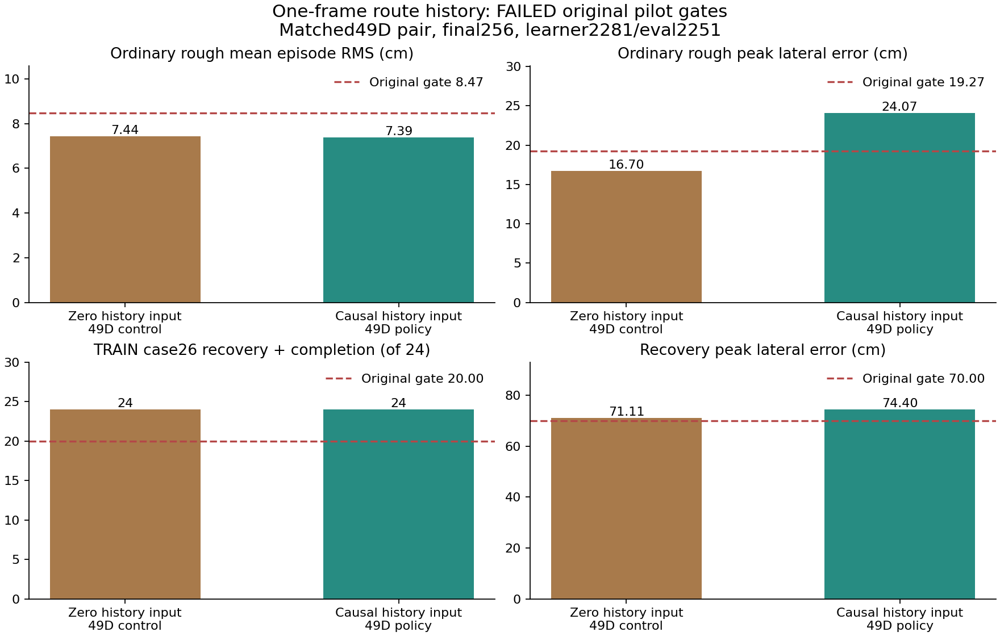
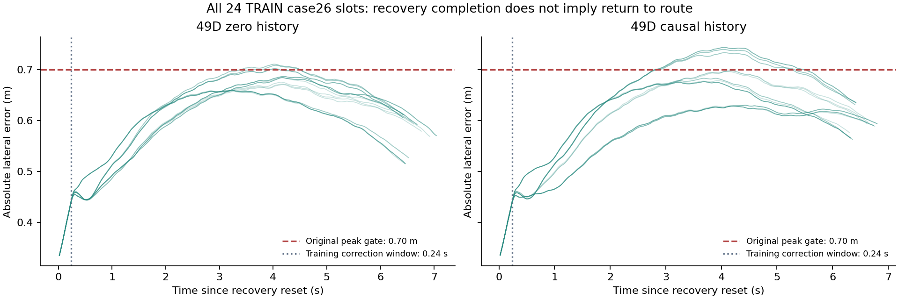

# 一帧路线历史：同维度配对结果（2026-10-10）

**历史输入实现和时序审计通过，但本固定配方的闭环精度退化，候选不采用。** 两个49D Actor分别输入恒零和真实一帧路线差分，各完成256轮训练与两条件冻结评测。两组普通均64/64、TRAIN case26恢复均24/24；真实历史组普通峰值16.70→24.07cm、恢复峰值71.11→74.40cm，原六门槛由5/6变为4/6。原7来源条件验证未触发，新FlowDAgger集成未启动。

## 为什么重做49D对照

上一轮TRAIN线性速度预测诊断中，当前48D的RMSE为2.91cm/s，增加完整48维一帧变化量后为0.32cm/s。本轮只增加一个夹紧路线差分标量；同一TRAIN诊断下，当前48D加该标量的RMSE为0.529cm/s。它提供可预测信息，但该离线结果并不保证控制收益，也不能把0.32cm/s标作本轮49D输入的结果。

在原48D索引12插入标量，保留其余观测和末12维上一实际动作：

`h[t] = clip((route_y[t] - route_y[t-1]) × 1.65 / 0.02, ±1m/s) / 0.3m/s`

首次观测或上一步done时清零，并以当前新起点重建缓存；只有真实控制步更新缓存，重复读取观测不推进历史。在线训练、工程smoke、冻结评测共用同一包装器。没有未来帧、case编号、回合时间或新增模拟器线速度输入。路线原点的有限差分也不等同于根连杆质心速度。

零组在在线观测和回放中都置零这一列；真实组在两处都使用真实历史。两组均从原6a470cec…监督Actor扩展零权重列，均用49D网络构造和51D Critic，匹配初始化随机数维度。原48D运行只能作历史参照，不能作为本轮信息消融的因果对照：改变输入宽度会影响初始化随机数消耗和矩阵计算。

冻结保持教师仍是原48D Actor，收到49D输入时显式去掉新增列；没有悄悄把保持目标换成扩展网络。Critic不增加历史。其余correction权重0.5、普通三组1、总回放系数100、固定512×12分母、普通/恢复前12步在线动作保持100、横偏−8、航向−1/1m/20°、世界回移速度−8/0.5s⁻¹/0.15m·s⁻¹全部保留，无尾段保持。

## 数据、工程及训练核验

从三个既有TRAIN采集重建174282行回放，先计算相邻控制帧差分再筛选，跨chunk连续；152行初始/重置历史为零。原48D观测、12D目标、顺序和完整环境流的训练/离线验证分区逐元素保留。四组训练回放分别为correction216、flat31114、rough10146866、rough10746631行；post_recovery仍保存但没有用于本轮优化。原7来源和pilot数据均未参与构建。

数据SHA256为`cf3d13ccf369d56ace9595142e8b9f704a4e5a981cf1ec8f7348a07dcb6ddc8a`。独立审计按来源/时间/环境回到原始帧核对；新增保留的`audit_lite3_route_history_dataset.py`已将预登记数据审计逐字节复现，原审计哈希未变化。

55项历史/既有单元测试及1项真实RSL49D rollout、PPO更新和原48D保持教师集成测试通过，共56项。两组400控制步工程运行，各25600物理控制，所有公共物理状态、当前观测、动作和奖励逐元素一致；仅历史输入有25509行不同。重置、读取时序、保持、航向及世界速度审计通过。

两组均learner2281、fresh critic/Adam、std0.05、lr3e-6、64×32×256、5epoch×4小批次，仅评最终模型。各524288控制、5120次Adam、2621440条回放查询、256条真实首小批次梯度记录。存储示范动作标签用于更新0，离线验证行用于更新0，尾段回放0。训练恢复计数为零组287成功/64失败、真实组288成功/63失败，均0截止，失败全部保留。

首32步公共观测、状态、动作和奖励逐元素一致，历史输入1982行不同；首轮更新后Critic参数也逐元素相同，整个主回放抽样流一致。零组新增权重列范数保持0，真实组为0.00560132。两组训练、更新、历史和奖励审计均通过。旧48D训练及评测审计复算后JSON完全不变。

## 固定评测和原门槛

每组course/recovery各用独立进程，固定eval2251、GPU1、最终256轮模型，四个条件各运行一次且正常结束。canonical48D初态/延迟联合哈希与原基线一致，实际49D初态另存；全轨迹重算历史，零组176条、真实组178条抽样CPU动作回放核验通过。动作推理没有固定前缀、教师接管或case/时间开关。

| 指标 | 49D零历史 | 49D真实历史 |
|---|---:|---:|
| 普通完成 | 64/64 | 64/64 |
| 普通rough平均每回合RMS | 7.44cm | 7.39cm |
| 普通rough最大横偏 | 16.70cm | 24.07cm |
| TRAIN case26恢复并完成 | 24/24 | 24/24 |
| 恢复平均每回合RMS | 61.07cm | 61.44cm |
| 恢复最大横偏 | 71.11cm | 74.40cm |
| 恢复结束平均绝对横偏 | 57.18cm | 59.76cm |

| 原门槛 | 零历史 | 真实历史 |
|---|---|---|
| 普通完成逐地形不劣于原基线 | 通过 | 通过 |
| 普通rough RMS≤原基线×1.05（8.4684cm） | 通过 | 通过 |
| 普通rough峰值≤原基线（19.2744cm） | 通过 | 未通过 |
| case26恢复并完成≥20/24 | 通过 | 通过 |
| 每个Hip/Knee延迟组恢复率≥80% | 通过 | 通过 |
| case26峰值≤70cm | 未通过 | 未通过 |

两组flat/rough101/rough107均16/16、24/24、24/24；四延迟组均7/7、7/7、7/7、3/3。真实历史普通峰值精确0.2407073975m，恢复峰值0.7440094948m；没有舍入成通过，也没有替换种子、挑中途checkpoint或放宽标准。

## 全部轨迹和输入利用诊断

普通48个rough槽中28个RMS、16个峰值改善；普通最坏由零组env27转为真实组env49。恢复24槽中只有7个RMS、7个峰值改善，结束平均绝对横偏增大2.58cm。普通RMS的微小下降没有带来整体精度收益。

零组最坏恢复env48在4.02s达71.105cm；真实组最坏env40在4.04s达74.401cm。两者起始横偏均32.652cm，额外最大偏移38.453→41.749cm。恢复0.24–1s平均向外速度8.43→7.60cm/s，但1–2s为10.54→11.17cm/s、2–4s为3.17→3.37cm/s，4s后向内速度4.13→3.39cm/s。早段局部改善未抵消后续外漂，后段回移反而变慢。统计覆盖全部活动步，各回合结束后截断，后段仍存在存活时长选择效应。

另外仅用既有TRAIN来源回放，对最终真实历史Actor做固定状态的历史列置零诊断。纠正组原始动作均值RMS变化0.002045，单动作最大变化0.007142；普通rough101/107组RMS变化约0.000113/0.000118。历史列确实被使用，但这些数值没有预定的“足够大”门槛，不能仅凭量级断言网络没学会，也不能把固定状态置零当成闭环反事实。此诊断没有使用pilot状态、没有新增优化或物理控制。

## 结论和下一项依据

当前初始化、学习率、256轮和保持/奖励配方下，单个因果路线历史标量没有解决恢复峰值，且破坏普通峰值门槛。信息可预测、输入被使用和闭环行为改善是不同的证据层次。这个单学习种子结果不能否定所有历史策略，也不足以区分历史列学习不足、其余参数的共同变化和奖励/保持约束的权衡。

下一步优先在TRAIN轨迹上按恢复阶段核对实际奖励与保持贡献，检查优化目标对1–4s外漂峰值的约束是否与验收指标一致，再据机制证据登记一个改动。不会仅凭本轮负结果扩大网络、延长训练或继续随意调多个权重。本轮没有启动后续新训练。

恢复评测仍是一个已用于训练的case26重复24次，且已多次用于开发；不是24个独立来源，也不是原7来源资格、独立学习复现、新地形泛化或实机证明。原7来源未加入训练，本次资格验证因门槛未过而未运行。

## 控制成本与复算文件

| 阶段 | 零历史 | 真实历史 | 合计 |
|---|---:|---:|---:|
| 配对工程 | 25600 | 25600 | 51200 |
| 256轮训练 | 524288 | 524288 | 1048576 |
| 普通冻结评测 | 89536 | 91392 | 180928 |
| 恢复冻结评测 | 89536 | 91392 | 180928 |
| 本轮总计 | 728960 | 732672 | **1461632** |

低于预登记总上限1867776，原7来源条件验证0、中断/重跑0、新uncertain0。FlowDAgger与恢复开发累计charged36179648、confirmed36179584、历史uncertain64；旧完整PPO11900884另列，两账已计费合计48080532。两次真实工程运行都计费，组合评测视图不重复计费；离线重建、诊断和审计没有物理控制。

最终模型保存在`artifacts/route_history_20261010/{zero,history}/train/final.pt`：零组SHA256 `6f8cce14010d7a41e85457e6c21f6bd58f2d00b52357d4b96e9dc43087538a54`；真实组 `d7263ed28ab9b35b9f4ec49992d93303d58c24ceebbfd845a08c5414ba2cdb69`。模型和轨迹保留本地，代码、协议、审计和图推送到同名私有仓库。

- [运行与复算说明](lite3-route-history-runbook-2026-10-10.md)、[预登记计划](lite3_route_history_plan_20261010.json)、[数据审计](lite3_route_history_dataset_audit_20261010.json)、[训练前56项测试及工程检查](lite3_route_history_pretrain_checks_20261010.json)
- [配对训练审计](lite3_route_history_training_pair_audit_20261010.json)、[零组更新](lite3_route_history_zero_update_audit_20261010.json)、[真实组更新](lite3_route_history_history_update_audit_20261010.json)
- [零组原门槛](lite3_route_history_zero_pilot_result_20261010.json)、[真实组原门槛](lite3_route_history_history_pilot_result_20261010.json)、[结果与账本](lite3_route_history_result_20261010.json)
- [全部配对回合及速度](lite3_route_history_frozen_velocity_diagnostic_20261010.json)、[恢复横偏](lite3_route_history_lateral_diagnostic_20261010.json)、[输入利用诊断](lite3_route_history_use_diagnostic_20261010.json)、[项目总结](lite3-project-summary-2026-10-08.md)
- [交付审计](lite3_route_history_delivery_audit_20261010.json)：递归核验证据与轨迹哈希、177个运行源码、8个实际运行账本、56项测试、数据审计复算和文档链接；两张图已实际查看。
