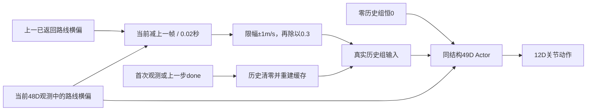

# 一帧路线历史：配对实验与复算入口

本轮比较同为49D的零历史输入与真实历史输入。两者使用同样的网络宽度、初始化方式、学习种子2281、fresh critic/Adam、256轮和回放/奖励设置。48D旧结果仅作历史参照；新输入维度会改变网络初始化的随机数消耗和矩阵计算形状，因此不能把旧48D运行冒充本轮配对对照。

完整评测已完成：真实历史普通峰值24.07cm、恢复峰值74.40cm，原门槛未过，详见[结果报告](lite3-route-history-result-2026-10-10.md)。

## 输入与时序

在原48D观测的路线三项之后、关节项之前插入一列（索引12），其余原观测次序保留，末12项仍是上一实际动作：

`h[t] = clip((route_y[t] - route_y[t-1]) × 1.65 / 0.02, ±1.0) / 0.3`

route_y是已有归一化路线横偏。首次观测或前一步done时，缓存设为当前新起点、输入为0，禁止跨回合差分。真实组输入h，零组输入恒0；两组都记录实际差分，便于配对审计。重复读取观测不推进历史，只有一次真实控制步返回后更新缓存。只需当前和过去路线信息，不读取未来帧、case编号或额外模拟器线速度。路线原点速度近似不等于根连杆质心速度，更不是全机器人质心速度。

Critic仍为51D。初始化从原6a监督Actor复制，在输入权重矩阵索引12插入零列；两组都用49D构造，确保随机数维度可比。训练保持教师始终是原48D网络，收到49D时显式去掉历史列，原目标不变。零组在在线观测和离线回放中都将历史列置零。

## 回放历史重建

`build_lite3_route_history_dataset.py`从三组原始TRAIN采集轨迹重建174282条样本，包括原训练/离线验证分区；先在完整时间序列上计算差分，再按旧成功/活动/区域/环境流规则选择样本，避免把筛选后的相邻行误作相邻控制帧。保留原48D观测、12D目标及排列次序逐元素一致，额外保存来源、时间、环境ID和重置标记。152条起始/重置行历史为0。

`audit_lite3_route_history_dataset.py --output <新文件>`独立审计用行来源回到原始轨迹，核对前一控制帧、done、分区、差分值及旧观测/标签。四组PPO回放只读取训练分区；原7来源和pilot均不参与构建。本轮没有使用完整48维历史差分，仅增加一个路线差分标量。额外TRAIN线性预测诊断的当前48D＋该标量RMSE约0.53cm/s；完整48维变化量的0.32cm/s是另一个诊断输入，不能混称为本轮输入。

## 已冻结的协议与预算

- [总计划](lite3_route_history_plan_20261010.json)：工程两组51200、训练两组1048576、pilot合计上限512000，只有真实历史组通过全部原六门槛才进入原7来源seed2081验证上限256000，总上限1867776。
- [数据审计](lite3_route_history_dataset_audit_20261010.json)、[训练前检查](lite3_route_history_pretrain_checks_20261010.json)：55项既有/历史单元测试和新增1项49D PPO集成测试通过；400步配对工程物理、动作、奖励相同。
- [零组训练](lite3_route_history_zero_train_protocol_20261010.json)、[真实组训练](lite3_route_history_history_train_protocol_20261010.json)。均为64×32×256，主回放每组2621440查询，末模型固定，不按中途成绩选择。
- [零组完整评测](lite3_route_history_zero_pilot_protocol_20261010.json)、[真实组完整评测](lite3_route_history_history_pilot_protocol_20261010.json)。各条件独立进程，不重复挑选。恢复峰值70cm、普通峰值原基线19.27cm等原标准不改。

## 运行与审计

工作目录为本工作树，Python使用`/home/tjx/anaconda3/envs/env_isaaclab/bin/python`，`PYTHONPATH=.:source/rl_training`。物理运行取消DISPLAY、`--device cuda:1 --headless`，已有目录不可覆盖；任何重试保留旧账本并另登记。

1. `smoke_lite3_recovery_anchor.py`执行零/真实历史工程协议，输出`artifacts/route_history_20261010/{zero,history}-smoke`。历史、保持、航向、速度审计核验新输入与原奖励。冻结Actor新列0，两组400步公共字段应相同。
2. `train_lite3_policy.py`执行两份训练协议，输出`artifacts/route_history_20261010/{zero,history}/train`。`audit_lite3_recovery_teacher.py --training`检查来源隔离/动作/重置，另执行历史、保持、航向、速度审计。
3. `audit_lite3_history_training.py`检查每组原超参数、49D模型、原48D目标、数据/分区、CPU回放流、优化步数、实时梯度记录和新输入列。`audit_lite3_history_pair.py`检查两协议只有信息开关等必要记录不同、首32步公共状态/动作/奖励相同、首轮后critic相同和回放流相同。
4. 每组分别运行`evaluate_lite3_recovery_teacher.py`的course和recovery子协议。`initial.npz`保留canonical48D快照供旧物理初态/延迟哈希比较，`initial_history.npz`另存实际49D首输入，后续轨迹直接保存49D输入。
5. `assemble_lite3_condition_evaluations.py`组合两段完整评测；基础轨迹审计和`audit_lite3_route_history.py`分别重算结果及每一步历史，随后`audit_lite3_prefix_imitation_pilot.py`用原门槛与已付费基线判定。`summarize_lite3_route_history.py`汇总两组与成本，横偏/速度诊断保留所有活动回合。

分析脚本位于`docs/analysis`，物理入口位于`scripts/reinforcement_learning`。旧48D训练和pilot轨迹审计已复算，原JSON完全一致。本轮若通过开发门槛仍只是单个TRAIN来源和一个学习种子，不等于原7来源资格或独立学习复现。

`diagnose_lite3_route_history_use.py --output <新文件>`仅在旧TRAIN来源回放上测量最终策略历史列置零的原始动作变化。`audit_lite3_route_history_delivery.py --output docs/lite3_route_history_delivery_audit_20261010.json --figures-reviewed`汇总递归证据/轨迹哈希、8个真实运行账本、177个运行源码、56项测试、数据审计逐字节复算及文档链接；`--figures-reviewed`仅在人工或代理实际查看两张图后提供。
