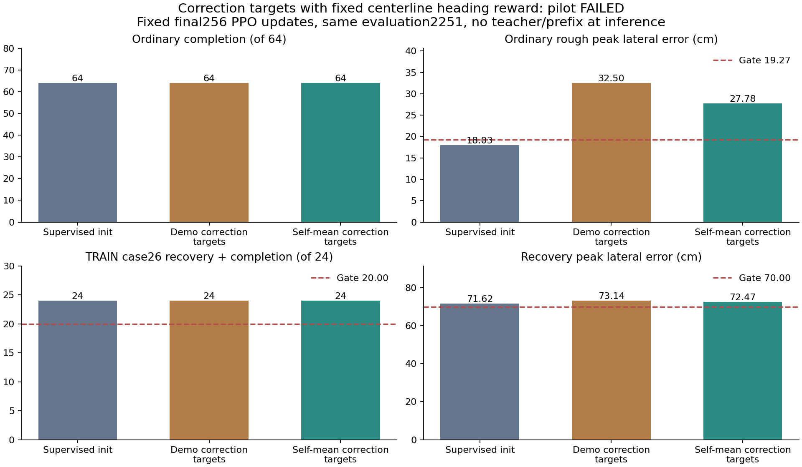
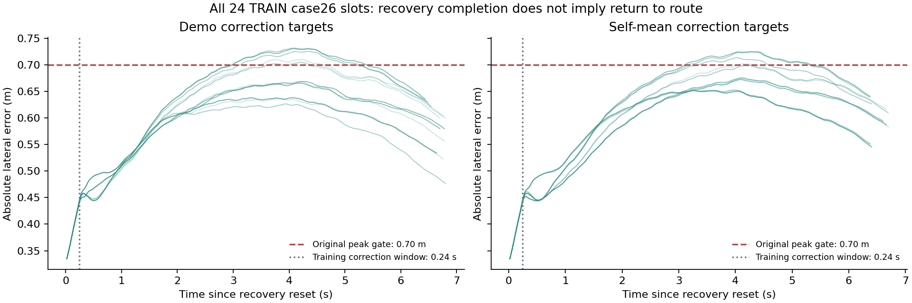

# 自均值纠正目标＋回线航向奖励：完整结果（2026-10-09）

**本轮降低了全局最坏横偏，但整体未达标，候选不晋升。** 相对航向权重−1的示范目标对照，普通峰值32.50→27.78cm、恢复峰值73.14→72.47cm；普通RMS7.15→7.67cm，恢复结束平均残差57.72→59.37cm。原六门槛仍只过四项，两个峰值均超标。没有触发原7来源验证。

## 唯一改动

本轮以[航向权重−1的回线奖励配方](lite3-route-heading-result-2026-10-09.md)为对照，未从上一轮失败的权重−4模型续训。只把correction回放组的目标，从存储的成功示范执行动作改回冻结初始化Actor在同一观测上的原始动作均值。

216条correction TRAIN观测不变，普通三组和5681条尾段TRAIN观测也不变。四组回放各128条、总系数100；尾段另128条、系数25。两条独立采样流的seed2293/2309保持不变。

`L = L_PPO + 100 × MSE_四组冻结初始化均值 + 25 × MSE_尾段冻结初始化均值`

冻结参考仍为监督Actor6a470cec…。这个初始化模型此前已经利用示范进行监督学习；本轮改变的是PPO阶段的回放目标，不能把它描述为完全不使用示范知识。

航向目标仍为`clip(atan2(-y,1m),±20°)`、权重−1；机身/足端最大横偏惩罚−8、普通/恢复前12步在线动作保持100均不变。仍learner2281、std0.05、lr3e-6、64环境×32步×256轮、每轮5epoch×4小批、fresh critic/optimizer，从原监督Actor重新开始，只取最终checkpoint。

输入仍48D、输出12D关节动作，推理没有teacher、case/时间、脚本前缀或额外转向器。地形仍10m×4m跑道、rough101/107最终高度±4cm、指令0.3m/s、50Hz；本轮没有新增未知地形或实机证据。

## 实现和数据核验

运行时代码未修改，已逐文件确认与原完成运行的源哈希一致。沿用实际通过的53项测试及相同奖励的工程证据，自均值回放路径也已有早期128/256轮实际运行记录。本轮新增工程物理0；没有把沿用测试说成本轮重新执行。

正式训练完成524288控制、5120次Adam更新、3276800条重复回放查询。训练恢复288成功、67失败、0截止全部保留。主回放及尾段索引流均独立重建并与对照完全一致；冻结参考未改变。训练协议移除了固定示范目标组及其数组配置，训练报告也没有固定目标记录，源代码核对确认训练器没有读取存储动作作本轮优化标签。原验证行和7个留出来源零用于更新。

首32控制的所有记录字段——物理状态、动作、奖励、航向目标和保持掩码等——与对照逐元素相同。目标变化发生在随后的参数更新中。训练、动作保持、航向几何和直接更新四项审计通过；只读审计/汇总对旧结果保持兼容。

固定最终模型SHA：`1d3e32fff6e553c7c28fdc7f5f59d621c6b0d3258b5d83ba9506ff2ceddf48c7`。

## 冻结评测

固定eval2251、GPU1，普通与TRAIN case26两条件。与原PPO2063基线和示范目标对照的初态/执行器延迟联合哈希一致。全部轨迹、恢复/终止判据、动作历史及抽样CPU动作回放审计通过。

| 指标 | 示范纠正目标对照 | 本轮自均值纠正目标 |
|---|---:|---:|
|普通完成|64/64|64/64|
|普通rough平均每回合RMS|7.15cm|7.67cm|
|普通rough最坏横偏|32.50cm|27.78cm|
|TRAIN case26恢复并完成|24/24|24/24|
|恢复平均每回合RMS|61.26cm|61.31cm|
|恢复最坏横偏|73.14cm|72.47cm|
|恢复结束平均绝对横偏|57.72cm|59.37cm|

本轮flat/rough101/rough107完成16/16、24/24、24/24；四Hip/Knee延迟组恢复7/7、7/7、7/7、3/3。普通完成、普通RMS、恢复数量和分组恢复通过；普通峰值超过19.274cm、恢复峰值超过70cm，完整门槛失败。

24个恢复槽重复同一TRAIN来源，开发种子2251持续用于方案改进。它不是24个独立来源，也不是原7来源教师资格或独立学习复现。没有新增FlowDAgger噪声策略训练或新步态量化验收；早期PPO283/307的限定六地形验收证据仍单独保留。

## 为什么不能只看全局峰值

48个普通rough槽中只有15个RMS、10个峰值改善。过去的最坏值降低，但更多回合的误差略增，且产生了新的较差回合：

| 配对环境 | 地形 | 旧峰值 | 新峰值 |
|---|---|---:|---:|
|env29，对照最坏|rough101|32.50cm|23.25cm|
|env39，本轮最坏|rough101|10.91cm|27.78cm|
|env40|rough107|18.24cm|25.00cm|
|env46|rough107|15.25cm|24.03cm|

这些是评测后展示的诊断槽，没有用于更换checkpoint、seed或训练标签。全48槽数据保留。本轮env39在17.36秒达到+27.78cm；此前平均世界横向速度+1.62cm/s，平均航向仅约+0.49°，航向平面内横向速度仍约+1.41cm/s。因此小航向角也不能保证没有侧移，不能把所有漂移归因于偏航。

实际普通访问状态上的均值动作MSE约0.000105，较对照0.000121略低；普通活动观测均在±30cm内。本轮仍未恢复旧自均值256轮对照的普通峰值15.84cm，说明有限数据覆盖/平均动作误差不能单独解释完整效果。

恢复最坏env40在4.28秒达到72.472cm，初态已经偏32.65cm，最大额外位移39.82cm。全局峰值略低，但平均RMS和结束残差没有改善。仍不能把“恢复并走完”称为“回到路线”。

训练后的只读示范拟合诊断为：TRAIN MSE0.005541→0.010376、离线验证MSE0.005538→0.009124，回到接近初始化的水平；这符合目标切换的方向。存储动作只在此训练后诊断中读取，没有用于优化。拟合更像示范或更像初始化，都必须经过真实闭环门槛检验。

## 下一项

不晋升本轮模型，也不改门槛。下一项拟保持当前自均值目标与权重−1回线航向奖励，单独去掉尾段保持项（有效系数25→0）。原四组均值项、数据、初始化、seed和最终256轮规则保持，先核对首rollout、奖励和主采样流一致，再评测普通/恢复表现。

这是检查尾段保持在当前组合中的必要性，不等于已经证明尾段约束有害。更早的较好自均值对照既没有尾段项，也没有当前回线航向目标，不能直接跨两项差异归因。后续消融尚未登记新执行预算或启动；原7来源和pilot仍不进入训练标签，不能换seed、选中间checkpoint或放宽70cm。

## 成本与交付

本阶段训练524288＋冻结评测179776＝**704064个新控制转移**，新增uncertain0。新增工程0，回放查询/只读诊断新增物理0；原7来源条件验证未触发，费用0。登记上限1036288，未触发预算不自动消耗。

FlowDAgger及恢复开发累计charged32588800/confirmed32588736/历史uncertain64；旧完整PPO系列11900884另列，两账合计44489684，仍不包含最早预训练及SAC/C0费用。控制转移不是GPU小时。所有失败和最终模型保留，无物理中止重试，没有新拍视频。

- [预登记计划](lite3_self_target_heading_plan_20261009.json)、[训练协议](lite3_self_target_heading_train_protocol_20261009.json)、[旧结果兼容核验](lite3_self_target_heading_analysis_regression_20261009.json)
- [训练审计](lite3_self_target_heading_training_audit_20261009.json)、[动作保持审计](lite3_self_target_heading_reward_audit_20261009.json)、[航向审计](lite3_self_target_heading_geometry_audit_20261009.json)、[目标隔离与全首段审计](lite3_self_target_heading_update_audit_20261009.json)
- [冻结协议](lite3_self_target_heading_pilot_protocol_20261009.json)、[冻结轨迹审计](lite3_self_target_heading_pilot_trajectory_audit_20261009.json)、[原门槛判定](lite3_self_target_heading_pilot_result_20261009.json)
- [完整结果和成本](lite3_self_target_heading_result_20261009.json)、[48槽配对结果](lite3_self_target_heading_episode_comparison_20261009.json)、[普通侧移诊断](lite3_self_target_heading_ordinary_diagnostic_20261009.json)、[恢复曲线数据](lite3_self_target_heading_lateral_diagnostic_20261009.json)
- [项目总结](lite3-project-summary-2026-10-08.md)、[完整PPO原理](lite3-full-ppo-finetuning-principles-2026-10-08.md)
