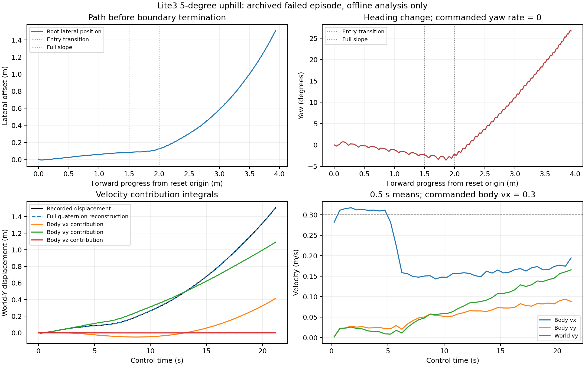

# 上坡漂移分析与边界诊断离线准备

日期：2026-10-29。范围：用户批准的离线分析、判定日志补齐和 CPU 验证。**没有启动仿真、重试上坡或初始化 PPO，历史上坡失败结论保留。**

## 已有轨迹的结论

对[上次固定上坡失败记录](../lite3-source-policy-prequalification-uphill-l1-20261029/README.md)的 1059 个控制步进行完整四元数旋转和 50 Hz 梯形积分，从第一条 0.02 s 样本至终止前 21.18 s：

| 世界 Y 位移组成 | 数值 |
| --- | ---: |
| 记录的净横向位移 | +1.506943347 m |
| 机体前向速度经完整姿态旋转的贡献 | +0.415283179 m |
| 机体侧向速度经完整姿态旋转的贡献 | +1.092095046 m |
| 机体竖向速度经完整姿态旋转的贡献 | −0.000784716 m |
| 位移减去上述积分的残差 | +0.000349838 m |

正机体侧向速度贡献占主要部分，yaw 后续转正后，前向速度也逐渐贡献正世界 Y 位移。坡段的平均机体前向速度明显低于入口平段，偏航与横漂同时增长。

| 按 root 位置划分的区域 | 相对起点前进区间 | 控制时间 | yaw 起止 | 横向位置起止 | 平均机体 vx / vy |
| --- | --- | --- | --- | --- | --- |
| 入口平段 | 0.0012–1.5 m | 0.02–4.841 s | +0.031° → −2.293° | 0.00005 → 0.08382 m | 0.30965 / 0.02213 m/s |
| 入口过渡段 | 1.5–2.0 m | 4.841–7.263 s | −2.293° → −2.172° | 0.08382 → 0.12423 m | 0.20478 / 0.02695 m/s |
| 完整坡段中已走过的部分 | 2.0–3.9349 m | 7.263–21.18 s | −2.172° → +26.710° | 0.12423 → 1.50700 m | 0.16018 / 0.06875 m/s |

分段边界来自已登记几何，时间按相邻样本插值；它表示 root 所在区间，不能等同于第一只脚踏上坡面的时刻。积分从第一条样本开始，因此净位移与相对 reset origin 的峰值 1.506996989 m 略有不同。

这是运动学核算，**没有定位策略、初始状态、接触动力学或材质的因果根因**。命令仍为机体 `(0.3, 0, 0)`，heading controller 关闭；本阶段没有改变策略观测、奖励或控制器。actor 原有观测没有绝对 yaw／横向位置，因此现有记录不能证明它能够主动返回世界坐标中的中心线。

[分析 JSON](drift_analysis.json)、[可分享的 PDF](drift_analysis.pdf) 和下图由[离线脚本](../../scripts/tools/source_uphill_drift_audit.py)生成。脚本同时检查姿态旋转与已记录世界速度的一致性，并明确描述阈值仅用于观察偏差增长，不新增安全门槛。



## 历史比较的适用范围

[historical_comparison.json](historical_comparison.json) 固定比较来源、哈希、代码版本和实际 seed。Flat、粗糙 L1 分别有单条件通过记录，但它们的地形／初始 seed 和运行版本不同，不能当作控制变量实验。旧 10 m 上坡使用 geometry/state seeds 10060/20060，在 1154 步前进 4.148248 m 后以 root 横漂 1.803304 m 结束；当前 12 m 上坡为 10001/20060，触发的是全刚体预测边界保护。旧报告记录源码哈希，未记录 Git revision，本页不补造 revision。

两次上坡都呈现明显漂移，但上述差异阻止我们把距离和步数的变化解释为策略性能改善或下降。没有合并计算通过率，也没有把 Flat／粗糙的通过视为训练已无改善空间。[基线台账](baseline_progress.json) 与上一阶段逐字节相同：保留上坡失败及 12 个未运行的准备用例。

## 边界诊断如何补齐

原边界谓词的阈值、比较符号和终止逻辑保持不变。[tile_bounds.py](../../source/rl_training/rl_training/source_scan/tile_bounds.py) 现在接受可选诊断字典，在**同一次谓词计算**中复制实际输入和中间结果；[manager 终止包装](../../source/rl_training/rl_training/tasks/manager_based/locomotion/velocity/mdp/terminations.py) 附加刚体映射、全局控制步和逐环境 episode 步号。

在单环境冻结策略入口启用观察器后，[诊断记录器](../../source/rl_training/rl_training/source_scan/tile_bounds_diagnostics.py) 将每次判定立即写入独立 `tile_bounds.jsonl`，阶段标记为 `termination_predicate_pre_reset`。记录包括：

- 全部 17 个刚体的名称、ID、世界位置和线速度，以及实际计算的下一控制步 XY 预测位置。
- 每刚体、每 XY 轴的当前位置／预测越界标志，以及聚合终止标志。
- 原始地形 row/column 分配、索引有效性、实际索引位置、origin、安全上下界、半径／余量／周期和状态 dtype。
- 位置、速度和 origin 的非有限 XY 标志。非有限数序列化为明确的 `nan`、`+inf`、`-inf` 字符串，既保留证据，也生成合法 JSON。

所有诊断 tensor 都先复制，因此 reset 或后续物理缓冲区更新不会改写快照。没有安装观察器的其他环境不产生这些快照或文件。原 guard 的非有限检查仍仅针对 XY；记录非有限 Z 不等于增加 Z 终止规则。

CPU 读回验证保留原 dtype，重算每一步的全部谓词字段，并检查连续步号、17 刚体完整映射及末步与 episode term 的一致性。缺失、重复、陈旧或被改动的记录会拒绝诊断验收。worker 和监督器分别核对；episode 结果先落盘，后续诊断验证失败也保留已有结果。终止原因汇总新增明确的 `source_terrain_tile_bounds` 名称，其他原因优先级保留。

**历史记录没有的触发刚体和当前／预测分支仍然未知。** 新代码无法追回它们。即使未来诊断记录完整，上坡再次触发保护也仍记为安全条件失败，不能因为日志完整而记为通过。

## CPU 验证与限制

定向测试 102 项通过，覆盖四边精确等号及一个浮点间隔外侧、预测独立触发、非有限输入／无效索引、多环境 origin 选择、快照不可变、真实包装函数与模拟 reset 的衔接，以及日志缺失／污染拒绝。单独的旋转例子检查了竖向速度经过 roll 后的横向贡献；分段积分的守恒也已检查。

最后一次完整相关回归 **615 项通过**；冻结原函数对照和输入哈希核验见 [post_review.json](post_review.json)。[review.py](review.py) 从上阶段提交读取原 guard，在 float32／float64、1／17 刚体的 8192 个 CPU 环境样例上对比原版、新版关闭诊断、新版启用诊断的终止标志。该对照不启动模拟器。

首次相关回归出现一次既有子进程清理测试失败：`test_supervisor_kills_signal_resistant_descendants[cooking-True]`，614 项通过、1 项失败，见 [原始日志](regression_initial.log)。失败测试的 finally 清理后，该子进程已不存在。监督器文件未在本阶段修改，随后其完整 64 项 CPU 测试通过，见 [专项复核](supervisor_recheck.log)。后续完整回归结果见 [regression.log](regression.log)。**该次失败的原因尚未定位；后续通过不等于已修复它。** 所有运行记录都保留，没有调整超时或跳过该测试。

CPU fixture 不能证明真实 PhysX tensor 采集、日志耗时和运行时 reset 时序；这些仍需单独批准的真实复验。依赖 API 的已有 invalid-escape DeprecationWarning 保留，不解释为 GPU 执行或本阶段修复成果。

可在本项目环境重现离线核验：

```bash
CUDA_VISIBLE_DEVICES='' /home/tjx/anaconda3/envs/env_isaaclab/bin/python \
  docs/lite3-source-uphill-drift-boundary-offline-20261029/review.py
```

## 冻结准备与下一阶段

[preparation.json](preparation.json) 冻结新的源码、依赖、诊断和测试输入，只包含上坡这一候选诊断用例；[input_changes.json](input_changes.json) 逐项列出改动。原准备文件 SHA-256 `a2199a7e558a0ba047adc671b941c68ac851c4d4ba3c198e609ab3e50e98f2b2` 和原始运行归档保持不变。新准备中的 `runtime_status=not_run` 指新候选诊断回合尚未执行，不改写基线失败。

[next_stage.json](next_stage.json) 准备了待确认的**一次同条件上坡诊断复验**：seeds 10001/20060、difficulty 0.3384848514104325、5°、12×4 m、同一冻结 actor 与命令，GPU0 至少 12288 MiB 可用显存，2000 控制步及 120/240 s 预算。以新输出目录保留完整刚体／预测分支记录，分别报告诊断完整性和原安全条件是否通过；发生任何失败即停止，不自动重试、换种子或切换其他地形。

该命令尚未执行。按用户逐阶段约定，真实复验需审阅本阶段结果（包括清理测试的一次未解释失败）后另行批准。G3/G4、扩容和 PPO 资格未被本阶段取得。
