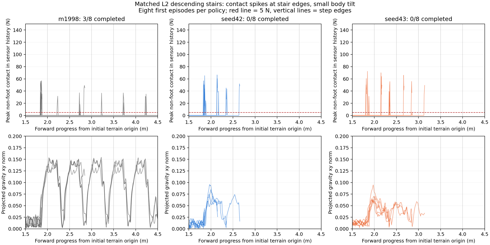

# S1-D 诊断与代码修复

日期：2026-11-11。用户授权：排查问题并解决。已完成 6 次冻结策略诊断、两处学习代码修复及验证。**尚未证明修复后的策略能通过 L2 下台阶；原有 checkpoint 没有被修改或重新训练。** 下一阶段的具体训练试验见 [训练提案](training-proposal.md)，等待用户确认。

## 已确认的失败机制

新策略已掌握大部分地形。最终资格评估中，两种子均为 L1 480/480，L2 448/480；L2 失败全是下台阶，且平地转向误差退化。诊断使用三个冻结策略、L1/L2 各一次，命名空间 4、全新起点 960–1079；起点状态逐一匹配。共 720 个首回合，其中记录 96 条上下台阶轨迹。所有运行正常结束，actor、记录和执行收据均核验。

| 模型 | L1 上/下台阶 | L2 上/下台阶 | L2 下台阶失败类型 |
|---|---|---|---|
| 原始 model_1998 | 7/8、8/8 | 0/8、3/8 | 5 次非法接触；部分瞬时接触可以恢复 |
| 延长后种子 42 | 8/8、8/8 | 8/8、0/8 | 8 次小腿接触 |
| 延长后种子 43 | 8/8、8/8 | 8/8、0/8 | 8 次小腿接触 |

两份新策略的下台阶终止时，基座相对扫描地面的高度为 0.307–0.337 m，重力投影的水平分量模长为 0.013–0.044，远未达到倾斜/低高度安全限值。接触主要发生在 `FL_SHANK`、`FR_SHANK`，之后也有后腿 `HL_SHANK`、`HR_SHANK`；三次连续控制步的接触计数达到 3，触发既定的非法接触终止。没有发现躯干先撞地的证据。

第一道下降边缘距地形起点 2.0 m。前腿通常在基座前进约 1.81–1.88 m 时先碰到小腿；此时脚已越过边缘，脚中心低于上层踏面。该轨迹与小腿在下降边缘发生接触相符，现有记录没有接触点/法向，因此不把具体几何接触点当作已直接测量的事实。

图中每条线对应一个首回合。接触力为传感器历史窗口内的非足部峰值，阈值为 5 N；终止还要求连续 3 个控制步，不能将单个峰值直接当作终止。竖线为台阶边缘，横轴为基座进度，因此前腿接触可以出现在基座到达边缘之前。原始策略通过部分下台阶时，机身随地形的倾斜幅度更大；新策略更水平，但这只是观察，尚不能据此断定降低姿态奖励就能修复。

## 排除和未证明的原因

- **台阶生成不一致：已排除。** 直接调用实际网格生成函数，训练第 4/9 行与评估 L1/L2 的上下台阶顶点、面片、起点完全相同，虽然生成种子不同。L1 为 3×2 cm，L2 为 5×3.5 cm，踏面 0.5 m。见 [几何对照](stair_geometry_comparison.json)。
- **失败位置被误判为完成：本次下台阶轨迹未出现。** 两种子 16 条 L2 下台阶失败轨迹均无同时 terminated 和 truncated 的控制步。失败距离通常约 2 m，而完成门槛是 9.25 m。
- **扫描异常导致本次 0/32：没有证据。** 6 次诊断的全部记录有限，原先资格评估也通过扫描健康检查。下面的扫描奖励缺陷确实存在，但不能归因于它解释本次下台阶失败。
- **环境数量或显存错误：未见。** 本次运行原生日志清洁；既有修复后的大规模仿真正常。

## 已修复的代码问题

### 1. 一个扫描异常会影响整批环境的身高奖励

旧 `base_height_l2` 对所有环境一起调用 `.any()` 和全局 `max()`。任一环境包含 NaN、Inf 或异常大值，所有环境都使用基座自身高度作目标，整个批次的身高惩罚趋于零。

实际函数最小复现：三个环境的身高惩罚原本均为约 0.000625；只破坏一个环境的一个扫描点，三个都变为 0。修复为逐环境校验，异常环境保持原有回退，其他环境继续使用有效地面高度。覆盖 NaN、正负 Inf、超大值，以及无扫描器的平地模式。

实现：`source/rl_training/rl_training/tasks/manager_based/locomotion/velocity/mdp/rewards.py`。复现数据：[reward_scan_reproduction.json](reward_scan_reproduction.json)。

### 2. 失败与截断同时出现时，PPO 仍给失败加价值自举

stock 包装器把原始 `truncated` 直接放入 `extras[time_outs]`。因此同一步失败与超时/完成同时出现时，RSL-RL PPO 仍加 `gamma * V`，与失败优先的学习语义不一致。此前阶段为保持既定训练连续性披露并保留，此次在用户授权修复后纠正。

增加任务显式启用的学习包装层：只给 `truncated & ~terminated` 加自举，保留原始 Gym 终止标志、回合结束、课程升降级和安全计数。添加同时出现次数的日志指标；其训练中实际频率尚未测量。其他任务默认不启用此行为。检查并修正包装层的回合长度赋值转发，保持 RSL-RL 原来的随机初始回合长度行为。

实现：`source/rl_training/rl_training/source_curriculum/learning.py`，通过课程任务配置与 `train.py` 接入。没有修改系统安装的 Isaac Lab 或 RSL-RL。

## 为什么仍需要重新训练

两处修复确保未来学习数据和价值目标的处理更正确，不能直接改变旧模型的动作。下台阶的直接问题是当前学到的步态在边缘发生小腿接触；要改变它，需要新的训练并用独立起点评估。

原训练按列等额分配：20 列中下台阶仅 1 列，约占 5%；全向平地占 20%，其中纯转向抽样约占 10%，相乘后专门纯转向样本约占整体 2%。这与下台阶暴露不足、转向遗忘的解释相容，但尚不是因果证据。课程日志还把上下台阶合为一族，族均值不能单独反映下台阶进展。actor 与 critic 都没有前方地形扫描输入，策略主要靠本体感知反应，也限制了提前调整的能力；本阶段未改变观测维度。

建议先验证一个主要干预：增加下台阶和平地全向的采样份额，同时保留所有其他地形，并单独记录上下台阶课程进展。奖励权重、actor/critic 输入、安全门槛与评价规则保持既定值，以便判断采样调整能否改善；若仍失败，再考虑姿态/摆腿奖励或 critic 地形信息，作为下一份登记试验。

## 验证、提交与边界

- 初次新回归为 7 失败、1 通过；修复后学习边界专项 10/10 通过。真实调用安装的 `PPO.process_env_step`，验证四种组合中只有非失败截断获得价值自举。
- 课程、EA-LPL、地形生成和奖励相关回归共 412 项通过；随后回合长度转发补充验证专项 10 项全部通过。
- 4096 环境实际仿真验收 15/15，通过原生错误检查；完成/失败/同时出现的课程行从 `[2,2,2]` 到 `[3,1,1]`，学习自举掩码 `[True,False,False]`，原始截断掩码仍为 `[True,False,True]`。见 [GPU 验收记录](repaired_gpu_check.json)。
- 诊断采集工具提交 `15cb251`，主要修复 `5dcd684`，包装器接口修复 `a707c5c`。原阶段一完整报告已提交 `79a4ee9`，归档格式修正为 `a77bb6f`。原始实验结论保持不变。
- [diagnostic_summary.json](diagnostic_summary.json)、[stairs.csv](stairs.csv) 保留 96 条台阶首回合的接触与结局；[SHA256SUMS](SHA256SUMS) 包含原始轨迹、运行 JSON、actor、摘要和图的哈希。原始数据在 `ea-lpl-evidence/stage1_diagnosis/`，不上传 git。

当前诊断与代码修复阶段完成；模型通关能力尚未修复验证。新的正式训练须按用户每阶段确认要求批准 [下一阶段提案](training-proposal.md) 后执行。
