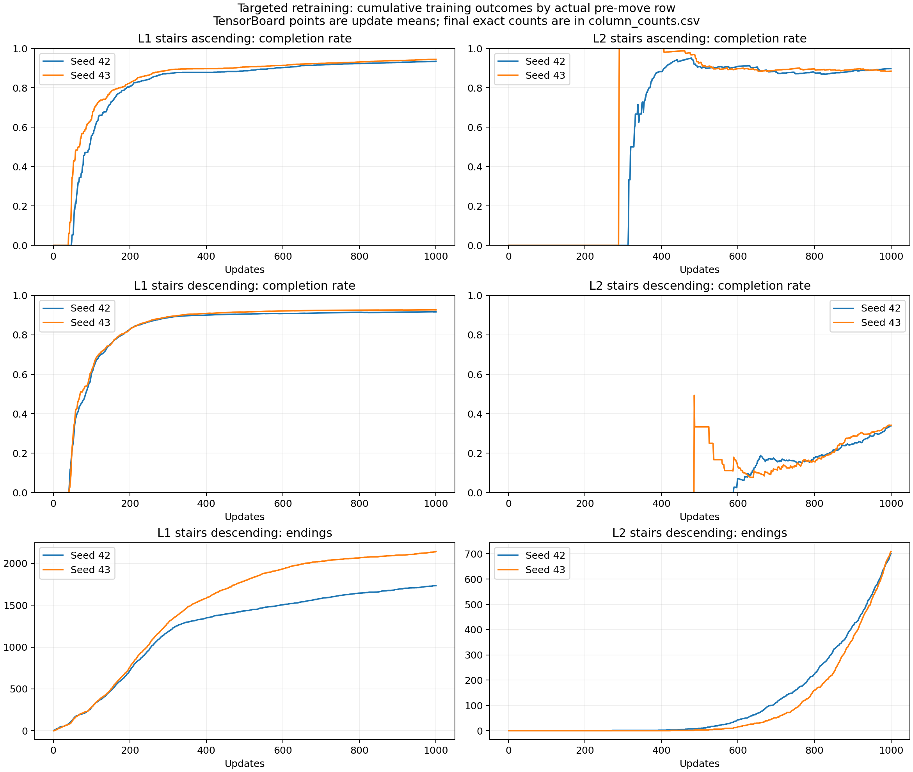

# 阶段一定向重训：最终报告

日期：2026-11-11。已完成用户批准的实现与验证、30 次试训、两个种子各 1000 次正式更新、32 次四策略配对地形评估，以及两次新模型平地保持测试。两个最终模型都没有通过全部 Q1–Q4，未选出 θ1；未追加训练，未执行 L3 预览，未进入阶段二。

下台阶已从起点模型的 0/32 提高到种子 42 的 27/32、种子 43 的 29/32。种子 42 通过全部地形门槛，但平地转向退化；种子 43 同时出现上台阶退化。因此，下台阶问题得到明显改善，完整基础策略的目标仍未达成。

用户已选择下一方案的范围：保留六类，复用参考项目的分块布局和台阶，结合固定 L2 训练。用户随后批准的 B1 已完成，见 [分块 L2 实现与验证报告](../lite3-block-l2-b1-20261111/README.md)；B2 正式训练仍待单独批准。本文件以下保留原定向试验的结果和当时提案背景。

## 四策略配对结果

每个策略在 L1/L2 各测试 480 个首回合，共 15 条件×32 起点；四策略共 3840 个首回合。使用命名空间 4、起点 1080–1559，逐组初始状态哈希完全匹配。32 个运行均正常退出，原生日志无错误，检查点身份、完整性与配对检查全部通过。

| 策略 | L1 完成 | L2 完成 | L2 上台阶 | L2 下台阶 | L2 安全终止 |
|---|---:|---:|---:|---:|---:|
| 原始 model_1998 | 286/480 | 243/480 | 0/32 | 19/32 | 25/480 |
| 起点 model_3497 | 480/480 | 448/480 | 32/32 | 0/32 | 32/480 |
| 最终种子 42 model_4496 | 480/480 | 474/480 | 31/32 | 27/32 | 5/480 |
| 最终种子 43 model_4496 | 480/480 | 463/480 | 18/32 | 29/32 | 7/480 |

两个最终策略在 L1 所有条件均为 32/32；在 L2，除上下台阶之外的另外 13 个条件均为 32/32。种子 42 的 6 次未完成是下台阶 5 次非法接触、上台阶 1 次超时。种子 43 的 17 次未完成是下台阶 3 次非法接触，以及上台阶 4 次倾斜/安全终止、10 次超时。当前资格记录没有细化到接触身体部位，不将这些新的非法接触直接断言为与旧诊断完全相同的小腿接触。

| 策略 | Q1 地形族 | Q2 每个条件 | Q3 安全 | Q4 平地保持 | 可选为 θ1 |
|---|---|---|---|---|---|
| 原始 model_1998 | 不通过 | 不通过 | 不通过 | 通过 | 比较策略，不参与选择 |
| 起点 model_3497 | 不通过 | 不通过 | 不通过 | 通过 | 比较策略，不参与选择 |
| 最终种子 42 | 通过 | 通过 | 通过 | 不通过 | 否 |
| 最终种子 43 | 不通过 | 不通过 | 通过 | 不通过 | 否 |

Q1 沿用每族 L1≥90%、L2≥85%；种子 42 的 L2 台阶族为 58/64=90.625%，种子 43 为 47/64=73.4375%。Q2 沿用每条件至少 24/32，所以种子 42 的下台阶 27/32 符合原门槛，不需要把单条件完成率另改为 85%。Q3 沿用每级安全终止最多 24/480。全部条件、置信区间和失败计数见 [qualification.md](qualification.md)、[conditions.csv](conditions.csv)。

## 平地保持：目前的共同问题

两个新模型均完成原 Flat 任务 1024 环境×3000 步；原始和起点复用此前同配置、同检查点的有效记录。评估程序通过只表示证据完整、仿真正常，模型是否合格由下列 Q4 指标决定。

| 策略 | 平移 RMS，m/s | 相对原始 | 偏航 RMS，rad/s | 相对原始 | 跌倒/结束回合 |
|---|---:|---:|---:|---:|---:|
| 原始 model_1998 | 0.056699 | 基准 | 0.077800 | 基准 | 91/3073，2.961% |
| 起点 model_3497 | 0.059837 | +5.53% | 0.073889 | −5.03% | 69/3072，2.246% |
| 最终种子 42 | 0.062356 | +9.98% | 0.138505 | +78.03% | 62/3072，2.018% |
| 最终种子 43 | 0.063253 | +11.56% | 0.103474 | +33.00% | 28/3072，0.911% |

Q4 限值为平移 RMS≤0.06236837、偏航 RMS≤0.08557957、跌倒率≤3.9613%。种子 42 的平移勉强通过，但偏航不通过；种子 43 的平移与偏航都不通过。两者跌倒率通过。

纯转向指令下，偏航 RMS 分别为原始 0.15545、起点 0.12548、种子 42 的 0.34813、种子 43 的 0.25270。说明必须单独处理全向能力保持，不能仅因台阶视频能走通就宣布成功。完整类别指标及运行收据见 [retention.json](retention.json)。

## 实际训练了什么

每个种子使用 4096 环境，全部六类环境共同更新同一个 actor、critic 和 PPO；两个种子独立。原 10×20 物理地形保持不变，每类内部保留所有方向和条件。

| 六类地形 | 环境数 |
|---|---:|
| 平地，含全向运动保持 | 1365 |
| 多尺度粗糙 | 273 |
| 坡面 | 548 |
| 台阶 | 956，上 137、下 819 |
| 坡面叠加粗糙 | 544 |
| 摩擦变化 | 410 |

分配配置 `stairs20_omni30_v1` 先按 30/20/50 最大余数法分组，再组内均分：全向平地 1229、下台阶 819、其余 15 列合计 2048。初始化时应用分配，然后构建指令与课程掩码；全部 20 列仍存在。新任务为 `SourceCurriculum-Targeted-Deeprobotics-Lite3-v0`，原均匀列分配任务保留。

环境从第 0–4 行开始，成功升级，失败降级。增加下台阶环境并不保证持续练习 L2。最终精确计数如下，分母为实际结束回合，按升降级前的行统计：

| 种子 | 条件 | L1 成功/结束 | L2 成功/结束 |
|---|---|---:|---:|
| 42 | 上台阶 | 270/289，93.43% | 316/352，89.77% |
| 42 | 下台阶 | 1590/1734，91.70% | 238/702，33.90% |
| 43 | 上台阶 | 270/286，94.41% | 322/364，88.46% |
| 43 | 下台阶 | 1985/2141，92.71% | 243/710，34.23% |

种子 42 下台阶共结束 20932 个回合，L2 仅占 3.354%；种子 43 共结束 21032 个，L2 占 3.376%。两者 L2 分别开始 828 个回合，训练结束时仍有 126/118 个尚未结束。大量回合停留在第 5–8 行；这支持后续固定 L2 增加目标难度暴露的方案，但不证明固定 L2 一定能解决所有问题。

训练累计成功率包含学习早期、随机动作探索与训练观测噪声，不能当作最终冻结策略的独立成功率。全向平地主要以超时或边界截断结束，不使用直线通行完成判据，因此其 completion=0 不代表没有学习。

曲线是 TensorBoard 在每次更新内部平均后的累计计数/比例。精确整数见 [column_counts.csv](column_counts.csv)、逐行 [column_row_counts.csv](column_row_counts.csv)；完整六族曲线见 [family_learning.png](family_learning.png)。

## 预算、恢复与验证

- CPU 回归 428 项通过；4096 环境 GPU 验收 17/17。核验 200 个地形块、精确分配、离地 0.375 m、actor 45/critic 48 维、L1/L2 计数与失败优先自举。GPU 短验收总显存峰值 5410 MiB，原生错误为 0。见 [gpu_check.json](gpu_check.json)。
- 30 次试训从 3497 到 3526，正常退出，模型和记录指标均有限；试训模型未作正式起点或选择候选。
- 两个正式种子都从同一个初次 seed42 的 `model_3497.pt` 恢复 actor、critic、完整 Adam，各完成 3497–4496 共 1000 次更新。每次 4096×24 条交互，每种子 98,304,000，两种子合计 196,608,000；未自动延长。
- 正式训练的源代码提交为 `d6f0500`。运行期间后续提交只含文档/展示素材，没有修改 `source/` 或 `scripts/`。
- 已修复的每环境身高奖励检查和失败截断自举保持启用；奖励权重、actor/critic 维度、安全阈值、几何和 Q1–Q4 都未改变。两份训练日志的 2000 个更新中，`Diagnostics/source_failure_timeouts` 仅在种子 43 的迭代 4118 出现非零均值 0.0417，其余 1999 个更新为 0；不能把下台阶改善简单归因于这一少量同时失败/截断的修正。
- 起点 Adam 组内学习率为 0.0002562890625；安装的 RSL-RL 恢复优化器状态，但自适应 `learning_rate` 仍按原续训行为从配置 0.0003844 初始化，随后写回优化器；此次没有另改超参数。

| 运行 | 更新数 | 进程总耗时 | 更新耗时合计 | 更新均值 | 所在 GPU 总显存采样峰值 |
|---|---:|---:|---:|---:|---:|
| 试训 | 30 | 192.6 s | 97.9 s | 3.264 s | 6204 MiB |
| 种子 42 | 1000 | 4084.1 s，68.1 min | 3033.2 s | 3.033 s | 12866 MiB |
| 种子 43 | 1000 | 5124.2 s，85.4 min | 3638.5 s | 3.639 s | 9646 MiB |

显存数字是每 5 秒采样的整张卡用量，包含同时运行的比较评估、展示或其他已有进程，不是单个训练进程的独占峰值。训练后段无比较评估时，卡上总用量约 6180/6810 MiB。耗时包含环境构建和共享资源等待，不能只用更新均值估计全部墙钟时间。两次正式运行、全部评估和渲染均使用 GPU0/1，并检查每次启动前至少 12288 MiB 空闲；未使用 GPU2/3。

模型 SHA256：

| 模型 | SHA256 |
|---|---|
| 起点 | `47889ee59d07416287332164a38566a812d6ebbc0be637e13752829f8891d49c` |
| 最终种子 42 | `1e28d7b6c6206fa591867943acc76485f3ab75328f1774d014b4be3e26404177` |
| 最终种子 43 | `fc45e19eaf49a4b3a3dfb2af931699f9a0dfc086be23bff9fdc3defbd877c12c` |

## 实际仿真素材与参考项目

[最终种子 42 下台阶视频，24.64 秒](visuals/final_seed42/stairs_down_L2.mp4) 展示了一次完整通过，使用最终 `model_4496`；[8 秒截图](visuals/final_seed42/stairs_down_8s.png)、[六类地形截图](visuals/final_seed42/terrain_montage.png) 可直接查看。展示单独使用 120 环境，正式训练为 4096；视频不计入资格评估。

中期 `model_4100` 的 [10 秒视频](visuals/stairs_down_L2_first_episode.mp4) 保留为历史记录，约 9.98 秒发生非法接触，不能再用它代表最终模型。最终展示在 24.64 秒达到完成条件，原生日志正常。

对 `/home/tjx/rl_training` 的检查发现：它有可复用的原生上下台阶生成器和 8×8 m 分块布局，但 Lite3 子配置把两种台阶比例设为 0，并采用初始 0–5 行与后续升降级；不是已验证的固定 L2 台阶训练。当前已经共享大多数奖励实现。具体见 [参考项目审查](reference-project-review.md)。

用户选择后形成的 [分块 L2 提案](block-training-proposal.md) 保留六类、排除箱体，直接复用原生台阶生成函数。CPU 几何核对已确认可得到四方向 5×3.5 cm 台阶、0.5 m 踏面和 2×2 m 实际中心平台；新任务尚未实施。

## 下一阶段与证据

建议先进行 B1：新增独立的 10×20、8×8 m 方形分块任务；固定本项目 L2 参数，每次重置保持 L2；各组在所属地块行走，统一训练策略。同步调整出生高度、方向、完成出口和边界判据，避免沿用不可达的 9.25 m 直线距离。完成 CPU、120/4096 环境仿真验收和真实视频，再做 30 次试训；详细汇报后，再确认 B2 正式训练的起点与预算。

这次结果还要求 B1 报告单独列出上下台阶和全向指令的暴露量，B2 不能只追求下台阶：种子 43 的上台阶与两种子的纯转向都有退化。分块或固定 L2 本身尚不能保证恢复这些能力。

本次没有额外的未调整采样重训对照，不能把改善严格归因于环境份额；修复后代码、训练随机性和继续学习都可能贡献。没有采用中间检查点挑选或修改验收门槛。

原始证据目录：`/home/tjx/rl_training_main/.worktrees/lite3-online-adaptation/.git/ea-lpl-evidence/stage1_targeted`。训练原始记录在本工作树 `logs/stage1/targeted` 和 `logs/rsl_rl/deeprobotics_lite3_source_curriculum`，不上传 git。归档 [artifact_manifest.json](artifact_manifest.json) 记录训练/模型/渲染身份；[SHA256SUMS](SHA256SUMS) 覆盖原始运行 JSON、日志、检查点、TensorBoard、参数、统计与交付图文素材。最终结论见 [qualification.json](qualification.json)。
