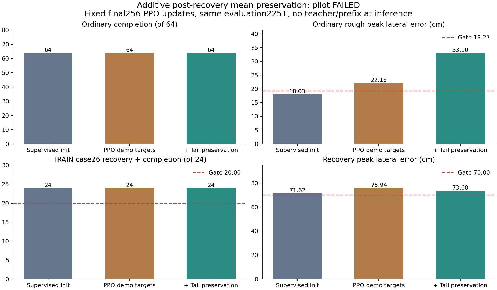
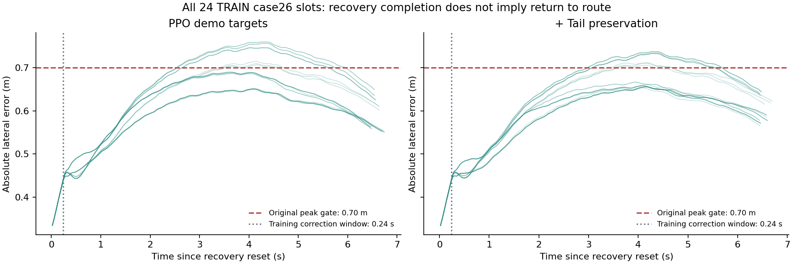

# PPO新增尾段保持：完整实验结果（2026-10-09）

**本轮未通过原验收，候选不采用。** 相对上一轮示范目标PPO，TRAIN case26恢复仍24/24，最坏横偏75.94→73.68cm，仍超过70cm；普通行走虽然64/64，但RMS6.32→9.89cm、最坏22.16→33.10cm。六项门槛只过三项，原7来源验证未触发，新FlowDAgger集成未启动。

## 从诊断到唯一改动

上一轮发现固定状态上的纠正拟合改善，却伴随恢复后行为变化增大。本轮先做了零物理、零更新的TRAIN诊断：已有5681条尾段观测覆盖横偏43.82–68.43cm，此前PPO回放没有使用。上一候选在这些TRAIN观测上相对初始化Actor的均值MSE为0.000581，旧自均值目标对照为0.000187。

尾段保持梯度与上一候选现有辅助项的余弦为0.817，与纠正项为0.055，未显示强烈局部对抗。该结果只描述固定权重处的辅助MSE梯度，既不是完整PPO梯度，也不能预先证明闭环收益。

因此本轮只新增独立尾段保持项：

`L_total = L_PPO + 100 × L_original_four_groups + 25 × MSE_tail`

原四组仍各128条：correction使用成功TRAIN示范执行动作，flat/rough101/rough107使用冻结初始化Actor均值。新增项每小批采128条尾段TRAIN观测，目标也是冻结初始化Actor的原始均值，不读取尾段存储动作。

系数25与原四组中每组的有效系数100/4一致。新增组不进入原四组平均的分母；它使用独立CPU采样seed2309，原seed2293的四组索引流不变。仍将所有损失合并后一次反传、一次梯度裁剪和一次Adam更新。因此原损失系数没有稀释，但总梯度及裁剪结果会改变，不代表原更新幅度保持不变。

数据字段名为`post_recovery`，实际定义是成功TRAIN示范回合中**前12步纠正之后**的活动观测，不保证每一行都已经满足连续直立恢复判据。本轮保持这一既有划分，不把组名当成逐状态恢复资格标签。该数据原来已经用于监督初始化，新增之处是在PPO更新中使用。

## 固定设置、实现和核验

继续从监督Actor6a470cec…重新初始化，fresh critic/optimizer；不接续上一轮失败模型。learner2281、std0.05、lr3e-6、256轮、64环境×32步、每轮5epoch×4小批、横偏奖励−8、原在线动作保持100均不变。训练仍16flat+24普通rough101+12 TRAIN case26+12普通rough107。

保持48D Actor，推理没有case、时间、前缀或教师接管。地形仍10m×4m跑道，rough101/107最终高度±4cm，指令0.3m/s、50Hz。没有新增视觉、地形扫描、实机定位或硬件测试。本轮属于PPO辅助损失消融，不是新FlowDAgger噪声策略增益。

42项相关测试实际通过。其中零尾段系数测试检查旧PPO参数、损失、RNG、回放索引和优化器步数一致；非零尾段测试在零学习率条件下核对每个小批的额外Actor梯度等于25倍尾段MSE梯度，旧损失及采样不变。首轮41过1失败是测试误将Actor首参数log_std当作MLP权重，显式选MLP后通过；测试通过前没有启动物理训练，费用0。

实际完成524288训练控制、5120次Adam更新。原四组2621440条回放查询不变，新增655360条重复尾段查询，总3276800；不是独立样本数或额外物理步。训练恢复288成功、60失败、0截止，全部保留。

- 尾段TRAIN观测数组SHA：`f950c322f1eba84b5b4309dd63a28d03e571a2735f6f013de517e0d51439e07b`。
- 新尾段索引流SHA：`c459fc87a1d7c9013bb83209c041e7dc212d8845fa68bb8b74325f9328ff96e0`。
- 原四组索引流仍为`f23e011a…`，纠正标签流仍为`da489952…`，均与上一对照完全相同。
- 最终checkpoint SHA：`b714dea5427b7eee88183d17317a562b65d08848058e89ae16509e8a6fac2fdf`。

训练、奖励保持、双回放索引及直接更新审计通过；首32控制的policy/critic观测、根状态和请求/执行动作与旧对照逐元素相同。原验证来源零使用，离线验证行不用于优化。扩展后的旧示范目标审计和汇总JSON完全复现，历史结论保持。

## 冻结评测结果

固定eval2251，普通与TRAIN case26两个条件。原PPO2063基线与付费对照只读复用，候选的初态/执行器延迟联合哈希完全一致。只评测预先指定的最终256轮模型，不换种子或中途检查点。

| 指标 | 旧256轮自均值目标 | 上轮示范目标 | 本轮＋尾段保持 |
|---|---:|---:|---:|
|普通完成|64/64|64/64|64/64|
|普通rough平均每回合RMS|7.04cm|6.32cm|9.89cm|
|普通rough最坏横偏|15.84cm|22.16cm|33.10cm|
|TRAIN case26恢复并完成|24/24|24/24|24/24|
|恢复平均每回合RMS|59.22cm|62.44cm|61.54cm|
|恢复最坏横偏|70.46cm|75.94cm|73.68cm|

本轮普通flat/rough101/rough107为16/16、24/24、24/24；恢复四个Hip/Knee延迟组分别7/7、7/7、7/7、3/3。普通完成、恢复数量、分组恢复三项通过；普通RMS、普通峰值、恢复峰值三项失败。普通RMS上限仍为原8.065cm的1.05倍，普通峰值仍不得超过19.274cm；恢复峰值仍不得超过70cm。

24槽重复的是同一个TRAIN来源。它不代表24个独立恢复来源，更不等于原7来源资格、独立学习复现或未知崎岖地形恢复。旧256轮自均值目标也只有5/6项通过，保留其较好对照成绩不等于已经晋升为完整恢复教师。项目早期PPO283/307限定六地形验收仍是独立保留的已有证据。

恢复最坏槽变为env40，4.28秒达到73.681cm。起点已偏32.65cm，最大额外位移41.03cm，低于上轮43.28cm；但走完时24槽平均绝对横偏从58.59升到60.15cm。峰值略低并不等于回线更好，图中所有24个重复槽均保留。

## 为什么动作保持改善，普通路线反而变差

离线尾段验证观测的均值变化MSE0.000572→0.000313，降低约45%；普通三组固定验证状态上的均值变化也降低约16%。纠正示范验证MSE0.005490→0.005584，略增约1.7%。

进一步对各模型实际访问的全部普通活动状态（含flat）重新查询同一冻结初始化Actor：上轮均值动作MSE为0.000213，本轮0.000174，也下降约18%。这些是不同访问分布上的描述性统计，不构成配对状态上的因果结论。但它排除了“只看固定离线状态才出现误差下降”这一过于简单的解释；平均一步动作误差仍不能保证长期路线精度。

本轮有184条普通活动观测超出旧±30cm保持域，不能单凭这些行断言覆盖缺口是唯一原因。最坏rough107/env44在26.58秒达到−33.10cm；此前平均世界横向速度约−1.18cm/s，累计位置变化−31.30cm，速度积分约−31.24cm，与轨迹相符。平均航向约−4.50°；按航向平面变换后的横向速度约+1.19cm/s。这表明小的方向偏差和速度偏差持续累积，不能只用单步MSE判定稳定循迹，也不能仅据这些相关量断言唯一因果。

## 下一项方向

本轮不继续增加尾段保持系数，不采用新候选。下一项围绕持续偏航和累计横移设计单因素对照：先核对实际奖励量，再决定路线奖励改动。当前代码中的横偏成本是机身和足端最大绝对横偏的平方，航向成本是`1-cos(yaw)`；验收RMS/峰值主要看机身横偏。要明确两者的关系，不能把现有奖励直接描述为纯机身横偏损失。

优先检查TRAIN轨迹上的方向、横移和奖励分量，然后分别评估与机身回线相关的奖励或课程调整。新候选仍从固定初始化开始，单独登记预算和门槛；普通保持与恢复必须一起评测。不得将本轮pilot轨迹或原7来源变成训练标签，也不以放宽70cm、换seed或延长训练补过。后续新奖励/课程实验尚未实现或启动。

## 成本与证据

本阶段训练524288＋冻结评测183936＝**708224个新控制转移**，新增uncertain0；梯度分析、3276800次回放查询、轨迹诊断和汇总均新增物理0。原7来源条件验证未触发，费用0；未用完的登记上限不自动花费。上一轮中止误启动成本已经计入此前累计，不在本轮重复收费或扣除。

FlowDAgger及恢复开发累计charged30420800/confirmed30420736/历史uncertain64；旧完整PPO系列11900884另列，两账合计42321684，仍不含最早预训练及SAC/C0成本。物理控制转移不是GPU小时。

全部最终模型、训练失败与冻结轨迹保留于本地artifacts。本轮没有新拍录像；当前普通/恢复稳定目标仍未全部完成。

- [TRAIN覆盖及梯度诊断](lite3_tail_anchor_gradient_diagnostic_20261009.json)、[预登记计划](lite3_tail_anchor_plan_20261009.json)
- [训练协议](lite3_tail_anchor_train_protocol_20261009.json)、[42项测试](lite3_tail_anchor_tests_20261009.txt)、[旧结果兼容核验](lite3_tail_anchor_analysis_regression_20261009.json)
- [训练审计](lite3_tail_anchor_training_audit_20261009.json)、[奖励保持审计](lite3_tail_anchor_reward_audit_20261009.json)、[双回放及直接更新审计](lite3_tail_anchor_update_audit_20261009.json)
- [冻结协议](lite3_tail_anchor_pilot_protocol_20261009.json)、[冻结轨迹审计](lite3_tail_anchor_pilot_trajectory_audit_20261009.json)、[原门槛判定](lite3_tail_anchor_pilot_result_20261009.json)
- [完整结果和成本](lite3_tail_anchor_result_20261009.json)、[逐槽恢复轨迹](lite3_tail_anchor_lateral_diagnostic_20261009.json)、[实际普通访问状态及偏航诊断](lite3_tail_anchor_ordinary_diagnostic_20261009.json)
- [项目总结](lite3-project-summary-2026-10-08.md)、[完整PPO原理](lite3-full-ppo-finetuning-principles-2026-10-08.md)
