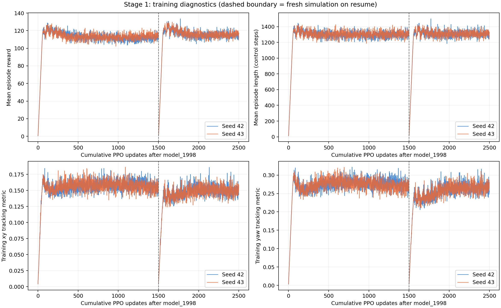
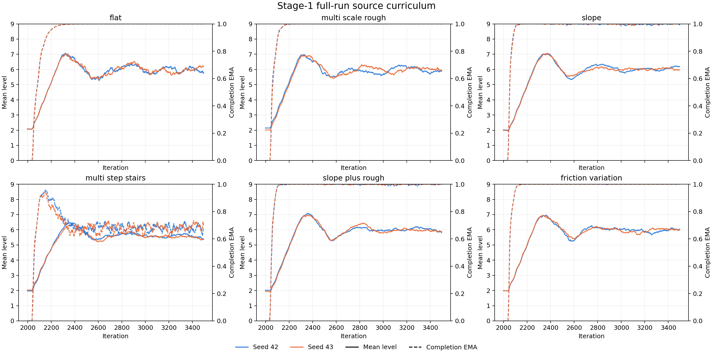
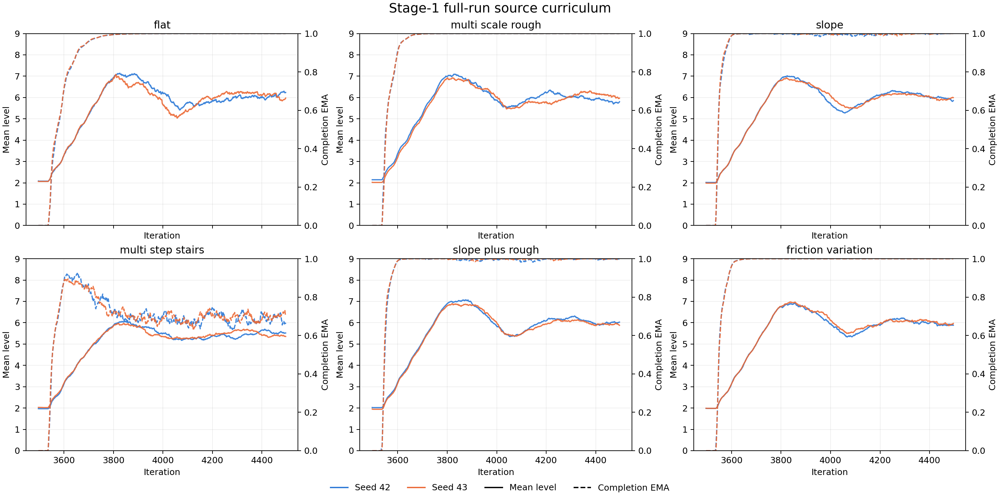

# 阶段一结果：完成既定试验，停在 S1-D

更新：2026-11-11。代码、试训、两个种子的正式训练与一次延长，以及两轮完整资格评估均已结束。**两个最终模型仍未通过 Q1–Q4，未选出合格 θ1，阶段二未启动。** 后续诊断或训练需用户批准。

后续授权：用户于 2026-11-11 要求排查问题并解决，现已进入问题诊断与代码修复阶段。本报告保留本轮训练的原始结论；修复后的验证另行记录，新的正式训练预算在诊断汇报后确定。

训练大幅改善了大部分 Source 地形，但 L2 下台阶仍是主要短板；延长后两个种子的平地偏航跟踪均超过允许误差。整体完成率不能替代逐族、逐条件、安全和保持能力的共同验收。

## 做了什么

- Claude 完成课程核心、Isaac 接口和任务配置；Codex 从 GPU 启动故障接续，修复仿真容量问题并完成训练、评估工具、审查与结果归档。
- actor 45 维、critic 48 维；4096 环境；10×20 地形；第 4 行为 L1，第 9 行为 L2；L3、boxes、rocky road 未参与训练。80% 地形块直行航向保持、20% 平地全向指令。
- 原始 model_1998 完整恢复 actor、critic、Adam 和迭代状态；种子 42/43 各训练 1500 次，初次均未通过资格，再按原定条件各延长 1000 次一次。正式与延长合计约 4.9152 亿条训练交互；另有 30 次试训。
- 两轮各 24 次有效地形运行，共 48 次、5760 个首回合；每策略每等级 480 个起点，每条件 32 个。初次用命名空间 4 的 0–479，复评用 480–959；三个策略的初始状态逐一匹配。
- 原始策略和四个训练后模型共 5 份有效平地检查，每份 1024 环境×3000 步。重复基线、关闭程序失败或中断的记录均不参与汇总。

## 训练与耗时

| 运行 | PPO 更新次数 | 日志迭代 | 平均秒/迭代 | 含启动退出时长 | 整卡显存采样峰值 |
|---|---:|---|---:|---:|---:|
| 试训，种子 42 | 30 | 1998–2027 | 2.893 | 2.70 分钟 | 6198 MiB |
| 正式，种子 42 | 1500 | 1998–3497 | 2.686 | 71.26 分钟 | 6585 MiB |
| 正式，种子 43 | 1500 | 1998–3497 | 2.544 | 67.37 分钟 | 6236 MiB |
| 延长，种子 42 | 1000 | 3497–4496 | 3.142 | 56.33 分钟 | 9065 MiB |
| 延长，种子 43 | 1000 | 3497–4496 | 2.814 | 50.35 分钟 | 9034 MiB |

所有运行均通过最终 checkpoint、完整迭代序列、actor/critic 参数有限值、Adam 状态和全部 TensorBoard 标量检查。续训 runner 从保存的迭代编号开始，故延长最终文件为 model_4496；确实执行了 1000 次更新，没有为凑文件编号额外增加训练。

显存是每 5 秒采样的整卡占用，延长时有评估并行，不能当作单个训练进程的显存峰值。两个正式种子在 GPU0 顺序运行；延长时 GPU1 已满足准入条件，两个种子分别在 GPU0/1 运行。

横轴为累计执行的 PPO 更新次数。虚线处重新创建仿真并恢复模型，课程状态和回合统计重新开始，因此曲线重启处的突变不能解释为模型瞬间遗忘。训练跟踪指标与独立平地 RMS 指标定义不同。

课程图实线为平均地形行，虚线为完成 EMA。它们是训练诊断，不作为资格判定；第 9 行占比也不等同于掌握程度。完整数值见 [training_summary.json](training_summary.json)。

## 两轮资格判定

| 评估轮次 | 模型 | L1 完成 | L2 完成 | L2 下台阶 | L1/L2 安全终止 | Q1 | Q2 | Q3 | Q4 |
|---|---|---:|---:|---:|---:|---|---|---|---|
| 初次 | seed42 | 480/480 | 448/480 | 0/32 | 0/32 | 未通过 | 未通过 | 未通过 | 通过 |
| 初次 | seed43 | 480/480 | 446/480 | 0/32 | 0/32 | 未通过 | 未通过 | 未通过 | 未通过 |
| 延长后 | seed42 | 480/480 | 448/480 | 0/32 | 0/32 | 未通过 | 未通过 | 未通过 | 未通过 |
| 延长后 | seed43 | 480/480 | 448/480 | 0/32 | 0/32 | 未通过 | 未通过 | 未通过 | 未通过 |

Q1：每族 L1≥90%、L2≥85%；Q2：30 个条件每个≥24/32；Q3：每个等级安全终止≤24/480；Q4：平地 xy/偏航 RMS≤原始策略的 1.10 倍，跌倒比例≤原始策略加 1 个百分点。门槛和安全定义全程未放宽。

延长后仍无合格种子，按预登记规则停在 **S1-D**。不能仅凭 L2 整体完成率 93.33% 而把模型直接当作 θ1。L3 预览以合格 θ1 为前提，本轮未执行；新地形在线学习也未开始。

## 延长后：六族与原始策略对照

本表只比较新起点上的配对结果；初次与延长两轮没有合并。每族给出完成数/样本数。95% 精确区间、安全计数及动作投影比例见 [完整复评报告](extended_qualification.md)。

| 等级 | 地形族 | model_1998 | 种子 42 | 种子 43 |
|---|---|---:|---:|---:|
| L1 | 平地 | 32/32 | 32/32 | 32/32 |
| L1 | 多尺度粗糙 | 32/32 | 32/32 | 32/32 |
| L1 | 坡面 | 32/128 | 128/128 | 128/128 |
| L1 | 台阶 | 64/64 | 64/64 | 64/64 |
| L1 | 坡面加粗糙 | 32/128 | 128/128 | 128/128 |
| L1 | 摩擦变化 | 96/96 | 96/96 | 96/96 |
| L2 | 平地 | 32/32 | 32/32 | 32/32 |
| L2 | 多尺度粗糙 | 32/32 | 32/32 | 32/32 |
| L2 | 坡面 | 32/128 | 128/128 | 128/128 |
| L2 | 台阶 | 9/64 | 32/64 | 32/64 |
| L2 | 坡面加粗糙 | 32/128 | 128/128 | 128/128 |
| L2 | 摩擦变化 | 96/96 | 96/96 | 96/96 |

全部 30 个条件、每条件完成数与 95% 区间、平均前进距离、横向偏移峰值和末端偏航均见 [复评明细](extended_qualification.md)；初次结果见 [初次明细](initial_qualification.md)。可直接分析的表格为 [families.csv](families.csv) 和 [conditions.csv](conditions.csv)。

延长后两种子 L2 下台阶均为 0/32（完成率的 95% 精确区间为 0%–10.89%），全部因非法非足部接触终止。平均前进分别为 2.14 m 和 2.35 m，横向偏移峰值均值分别为 0.084 m 和 0.089 m，末端绝对偏航约 2.6°；目前证据更集中于接触失败，具体接触部位仍需诊断。原始策略在同一组新起点为 9/32。两种子其他 14 个 L2 条件各 32/32，安全动作投影比例为 0。台阶族合计只有 32/64，低于 Q1 的 85%；下台阶低于 Q2 的 24/32，32 次安全终止也超过 Q3 的 24 次。

## 平地保持

| 策略 | xy RMS（m/s） | 偏航角速度 RMS（rad/s） | 跌倒回合/结束回合 | 跌倒比例 | Q4 |
|---|---:|---:|---:|---:|---|
| m1998 | 0.056699 | 0.077800 | 91/3073 | 2.96% | 基线 |
| seed42 | 0.058654 | 0.098734 | 76/3072 | 2.47% | 未通过 |
| seed43 | 0.060994 | 0.093108 | 32/3072 | 1.04% | 未通过 |

本轮允许上限：xy 0.062368 m/s，偏航 0.085580 rad/s，跌倒比例 3.96%。两个最终模型的 xy 和跌倒比例均满足要求，偏航误差分别增加 26.9% 和 19.7%。

纯转向指令的偏航 RMS：原始策略 0.1555，种子 42 为 0.2086，种子 43 为 0.1999 rad/s。该分类结果用于定位问题，不额外引入验收门槛。

初次种子 42 的 Q4 通过，延长后未通过，说明延长没有同时改善所有能力。按站立、纯横移、纯前进、纯转向、一般指令分类的结果已保留，见 [retention_by_command.csv](retention_by_command.csv)；全部检查见 [initial_retention.json](initial_retention.json)、[extended_retention.json](extended_retention.json)。

## 修复、裁定与局限

1. 原启动错误为 PhysX 显存分配失败与碰撞缓冲溢出；场景损坏后的全环境重置不作为策略失败证据。改为任务局部非复制物理和显式 USD 碰撞组，并逐环境核验仅允许内部与全局地面的接触。相同 200 块地形、约 284 万三角面未缩减。内部究竟哪块 PhysX 缓冲造成额外占用尚未直接测量。
2. 默认启动网格有 52 个机器人基座落在地形内部；仅初次 USD 生成临时抬到 3 m，正常默认状态与重置仍距地面 0.375 m。此缺陷单独验证，不将其认定为显存不足主因。碰撞栈从 64 MiB 调到 256 MiB，依据旧配置报错的最低容量需求；未在新过滤方式下重新搜索最小值。
3. 执行计划将完成距离定为 9.25 m（总体方案原为 9.5 m），避免扫描边界冲突；评估几何种子沿用已有评估器 30000（总体方案文字为 10001）。资格对照三策略一致，差异明确保留。
4. 完成与失败同时出现时，课程结局、统计和升降级按失败处理；原始截断标志仍交给 stock RSL-RL wrapper，因此 PPO 可能仍加 timeout 价值自举。保留本轮预定库行为，未中途修改学习规则或重启训练；频率和学习影响未测量，可能使结束附近的价值估计偏高。安全终止计数和独立 Q1–Q4 不受此裁定放宽。
5. 延长按总体方案对两个种子各执行 1000 次，修正实施计划旧稿只延长较好种子的矛盾。延长启动时地形评估已确认两个种子均不合格，完整平地结果随后得到；本轮延长维持 20% 全向平地份额，没有中途切换为风险预案中的 30%，也未增加预算。
6. 平地检查原生关闭流程先后出现提前退出和关闭返回后的析构崩溃。修复为禁用 fastShutdown，并仅在环境与应用均明确返回、最终文件落盘、输出刷新后，在子进程结束帧中按真实状态退出。父进程仍严格校验关闭、退出码和原生日志。旧失败记录保留并排除。
7. 用户中断造成两次延长评估缺少执行收据，以及种子 42 平地检查缺少父进程最终确认；原记录排除。仅两次地形使用各自 retry1，平地使用 seed42_extended_retry1.json。未伪造收据、合并失败与重试样本，或按结果挑选更好的尝试。
8. 行难度映射、全向重置行 1–8、同一步失败优先、非有限安全输入视为不安全等执行裁定维持不变。保留已有审查的非阻塞项：课程统计同步开销、部分边界测试覆盖与可视资源引用警告。本轮没有发现新的致命物理错误；这些并不构成部署验证。

### 为什么 120 环境曾比 2048 更占显存

| 环境数 | 碰撞配置 | 整卡采样峰值 | 结果 |
|---:|---|---:|---|
| 120 | 原物理复制方式 | 5801 MiB | 仅诊断，50 步正常 |
| 2048 | 原物理复制方式 | 23755 MiB | 显存耗尽 |
| 2048 | 显式 USD 碰撞组 | 5187 MiB | 14 项验收通过 |
| 4096 | 显式 USD 碰撞组 | 5396 MiB | 14 项验收通过 |

120 与成功的 2048 使用不同物理处理方式，不能据此推断环境数越少越费显存。上述每 0.5 秒采样，包含驱动和其他进程，可能漏掉更短的峰值；2048/4096 成功验收的启动基线分别约 831/496 MiB。正式训练最终保留原定 4096 环境。

## 验证与证据

- 2048 与 4096 GPU 环境检查各 14/14；课程与集成的相关 CPU 检查 73 项通过。资格数据准入修复后 EA-LPL 回归 231 项通过；最终平地退出修复的专项测试 32 项通过，包括真实 CPU 子进程验证。相关实现已逐任务审查及整分支审查。
- 资格汇总重新检查每个有效运行的退出收据、清洁原生日志、actor/spec 哈希、全部首回合与配对初始状态。每份平地数据必须具备父进程最终确认；最终两轮报告均无数据错误。
- [evidence_manifest.json](evidence_manifest.json) 列出确切模型、有效尝试、原始证据位置；[SHA256SUMS](SHA256SUMS) 覆盖模型、摘要、执行 JSON、有效原生日志、表格与图。模型与原始仿真数据保留本地，不上传 git。
- 原始目录：`/home/tjx/rl_training_main/.worktrees/lite3-online-adaptation/.git/ea-lpl-evidence/stage1/`。训练目录：本工作树 `logs/rsl_rl/deeprobotics_lite3_source_curriculum/`。

## 建议下一步，等待用户同意

建议先执行有上限的下台阶与平地退化诊断，再登记新训练试验；不直接进入正式阶段二，也不降低本轮门槛。具体工作、最多 8 次冻结评估的预算、交付物和停止点见 [下一步提案](next-step-proposal.md)。该提案尚未执行。

诊断后根据证据选择课程/采样份额、平地保持或 critic 地形信息中的主要干预，写定起点、两个种子、更新预算及新的评估起点后，再请求训练授权。得到合格 θ1 后，正式阶段二才开展 L3/boxes/rocky road 目标筛选、动作基与固定码改进空间测量、EA 前提检查和多回合接口准备；每个阶段结束后均汇报并等待用户确认。
