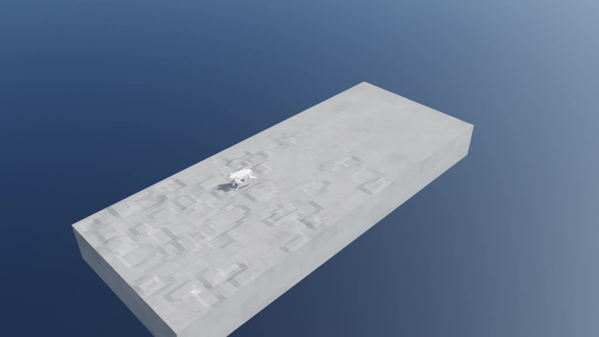

# 田家鑫9.24

- Source: `田家鑫9.24.pptx`
- Total slides: 6

## Slide 1

机器人组 田家鑫组会汇报2026.9.24

## Slide 2

工作目标与总体流程

- 保留基础模型
- 已有平地行走能力

- 教师指导初始化
- 给出动作参考

- 小模块在线学习
- 根据行走结果调整

- 暂停学习复测
- 检查效果与安全

工作目标：让已有平地行走能力的 Lite3，在石块、起伏等陌生地面上，通过有限次数的行走学会调整动作。基础网络保持不变，只训练小模块，并检查回到平地后是否仍能稳定行走。

总体做法：先用能看到地面高度的教师提供动作参考，给小模块一个较好的起点；再边走边学习少量动作修正。新模型暂停学习后复测，通过安全和行走检查才保留。

目前位置：LoRA-PPO、残差 SAC 已做小规模试验；本周新增教师、动作反演和潜变量模块。目前教师尚未通过验收，新路线还没有完整的行走效果结论。

2

### Speaker Notes

总体目标是保留平地控制器的基础能力，让新增的小模块适应陌生路面。早期已经尝试了直接调整网络和直接修正动作，本周进一步加入教师引导，让学习从有参考的动作开始。图中是完整工作顺序，目前停在教师验收和新模块衔接阶段。

## Slide 3

本周新增：FlowDAgger 相关方法

- 教师给动作
- 提供参考

- 反推调整量
- 动作反演

- 小网络预测
- 学习状态与调整关系

- 还原关节修正
- 固定解码器

借鉴的思路：FlowDAgger 把人的纠正动作反推成策略内部的控制量，再让小网络学习预测。本项目改用仿真教师提供参考动作，基础控制器仍是 PPO。

具体怎么做：先从教师与基础策略的动作差中提取少量共同变化；再反推出几个调整量，让解码后的动作尽量接近教师。小网络学习“看到什么状态，就给出什么调整量”。

执行与保护：固定解码器把少量调整量转成 12 个关节的修正；身体倾斜、过低或关节过快时，风险门控缩小修正，再经过动作限幅后执行。

本周做到的部分：已加入反演、解码器拟合、监督初始化工具和独立测试入口。教师数据与整条流程仍待打通；当前是借鉴 FlowDAgger 的反演思路，尚未复现其完整算法。

3

### Speaker Notes

这里的潜变量可以理解为几个需要学习的调整量，它们并不预先对应抬腿高度或步长。教师动作与基础动作的差用于拟合固定解码器，动作反演则求出能够接近参考动作的调整量。随后让小网络根据状态预测这些量，再由风险门控和动作保护决定实际执行多少修正。这些组件已有实现，但目前没有合格教师，所以不能把它们写成已经完成端到端训练的结果。

## Slide 4

本周进展：教师训练与修复

修复前冻结复测 · 地形 101 · 两组均因跌倒结束

| 训练与验收 | 记录 |
| --- | --- |
| 训练总步数 | 60,000 |
| 通过教师验收 | 否 |
| 完整潜变量训练 | 待开展 |

> [Chart] Chart 115 — BAR_CLUSTERED (57)

| Category | 跌倒时控制步数 |
| --- | --- |
| 基础 PPO | 675 |
| 高度扫描教师 | 683 |

实际训练结果：同一个教师依次在 101、103、107 三种训练地形各训练 2 万步。冻结复测在第一种地形第 683 步跌倒；基础 PPO 为 675 步，两者均未完成路段，教师未通过验收。

发现并修复的问题：高度扫描应按“15 行横向 × 23 列前向”读取，旧版把两个方向读反。现已修正并升级数据版本，旧教师权重不能直接续训。

修复后验证：9/24 记录为 1506 项测试通过、7 项跳过；CPU 环境可启动并执行仿真。修复版 GPU 训练尚待补跑，这些检查还不能证明行走性能改善。

4

### Speaker Notes

这页展示的是最新教师试验的真实结果。三种地形是在同一次训练过程中依次使用，不能算成三个独立模型。冻结复测在第一种地形就失败，后续验收因此停止。排查发现高度扫描的前后和左右方向读反，现已修正；图中的结果属于修复前版本，不能据此判断修复后的方法是否有效。

## Slide 5

本周进展：行走视频

9 月 19 日 · 本体历史信息版本 · 地形编号 113 · 暂停学习复测

对应结果：9/19 本体历史信息版本：暂停学习后完成石块路段，1526 个控制步，前进约 8.01 m；记录中没有跌倒或安全违规。

这段视频的作用：展示本周已有的完成样例。它属于此前版本，不是新教师或动作反演方案的结果，也不能单独证明比基础模型更好。

5

### Speaker Notes

这段录像对应本周已有的一个完成样例，播放时可以看机器人在石块路段的连续行走情况。录像与原始结果文件对应，复测时没有继续更新模型。它能说明这个版本在这条路面上完成了任务，但新加入的教师和动作反演方法还没有对应的成功录像。

## Slide 6

遇到的困难与下一周计划

当前困难与思考：教师还没有提供可靠的动作参考，扫描输入又出现过方向错误。因此先确认输入和教师质量，再判断潜变量方法的效果；直接加长训练还无法回答失败原因。

| 时间 | 具体工作 | 完成后留下什么 |
| --- | --- | --- |
| 9/25—26 | 核对扫描方向；跑修复版 GPU 短测试，并补基础模型对照。 | 输入检查图与同条件基线； 明确修复版能否正常训练。 |
| 9/27—28 | 重新训练教师；在 3 种训练 地形分别暂停学习验收。 | 完成率、跌倒位置与安全记录； 明确教师是否可以用。 |
| 9/29—30 | 教师合格后采集动作、拟合 解码器，做短程潜变量试验。 | 动作重建误差及行走对照； 未合格则继续定位教师失败。 |

6

### Speaker Notes

下周按依赖关系推进，先把修复版输入和基础模型的对照确认清楚，再重新训练教师。教师必须在三种训练地形暂停学习后全部通过，才开始采集参考动作和做潜变量初始化。若教师仍然失败，就保留失败证据并继续定位原因，不把后续流程写成已经完成。
